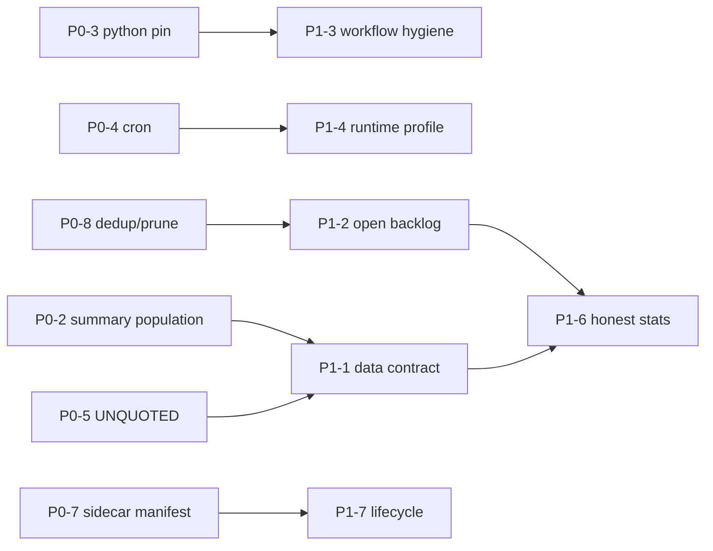

# P1 Structural — cross-cutting remediation

**Scope:** changes that are too broad or too risky for a one-day P0 patch, but are required to stop the failure classes from recurring. P0 fixes the bleeding; P1 changes the architecture that produced it.

All source references were verified on 2026-11-14 with `grep -n` / `nl -ba`. Numbers come from `../MASTER_AUDIT.md` and the `../sub/*` evidence.

---

## P1-1 — One canonical pick/outcome contract enforced at write time

**Problem:** the same concept has incompatible implementations:

| Surface | Rows | `pnl_pct` convention | Status set | Timestamp |
|---|---:|---|---|---|
| `picks.active` | 20 | percent, 19/20 = 0.0 | OPEN/ACTIVE | `timestamp` |
| `picks.active_raw` | 4,148 | percent, 92 % = 0.0 | EXPIRED 3,377 / OPEN 691 | mixed `timestamp`/`created_at`/date-only |
| `picks.recent_closed` | 3,500 | percent | SL_HIT 1,451 · TP_HIT 884 · FORCE_CLOSED 622 · TIME_EXIT 516 · UNKNOWN 22 · EXPIRED 5 | `closed_at` |
| `summary_picks` | 18,839 resolved | wins/losses from overlapping population | terminal set differs (`tools/sync_summary_picks_json.py:15` vs `:63`) | `created_at/updated_at` |
| `pf_registry` | 22,941 clean | net-of-slippage | `CLOSED_STATUSES` at `tools/build_pf_registry.py:196` | trade_date |
| `trading_picks` DB | 143,156 | mixed | 90,523 never resolve (63.2 %) | mixed |

**Structural change:**
1. Define one schema (see `../overall/DATA_CONTRACT.md`) with a `schema_version` and a JSON-Schema file at `audit_dashboard/data/schemas/pick.schema.json`.
2. Generate `summary_picks.json` from `pf_registry` canonical rows, not a second ad-hoc SQL aggregate — or, if DB-direct is required, extract the exact same terminal-status set and PnL-sign rule into a shared constant module (e.g. `shared/pick_contract.py`) imported by `tools/sync_summary_picks_json.py`, `tools/build_pf_registry.py`, and `audit_trail/dashboard_generator.py`.
3. Write-time validation: every producer (`alpha_engine/production_scanner.py`, `audit_trail/universal_pick_resolver.py`, `copy_trader_intel/*`) validates before persisting; invalid rows go to a quarantine file, not silently to `active_raw`.
4. Add `schema_version` to every payload; consumers reject unknown major versions.

**Why structural:** fixes P0-2/P0-5/P0-8 at the source instead of normalizing on read.
**Effort:** L (3–5 days). **Risk:** Medium (touches every writer).
**Expected impact:** fixes P0-2/P0-5/P0-8 at the source; one schema instead of six ad-hoc aggregates; impossible WR/0.00 % become unrepresentable.
**Rollback:** schema validation in warn-only mode for one release; `schema_version` lets consumers stay on 1.x.
**Acceptance:** `acceptance_tests.md#at-p1-1`.

---

## P1-2 — Resolve the 63 % open-pick backlog (the real survivorship bias)

**Problem:** `db_health.open_bloat`: `trading_picks.total_count = 143,156`, `open_count = 90,523` (63.2 %). Only 18,839 (13.4 %) resolve. 2,221 closed rows are >30 d old. The closed ledger is a 37 % survivor sample (`sub/E_statistical.md:§6.3`). Every WR/PF number downstream inherits this.

**Structural change:**
1. Backfill resolution for the 90,523 open rows in bounded batches (the existing `tools/reresolve_intrabar_signal_outcomes.py` path is already wired at `.github/workflows/audit-dashboard.yml:600-602` with `--max 500`). Raise to a dedicated nightly job with `--max 5000`, idempotent, and a per-run time budget.
2. Classify every unresolved row after N days into an explicit outcome: `TIME_EXIT`, `EXPIRED_NO_DATA`, or `VOID` — never leave `OPEN` forever. `audit_trail/universal_pick_resolver.py:609-690` already has conservative SL-first intrabar logic; extend the time-exit path.
3. Publish `survivorship_ratio = resolved / emitted` and `open_age_p50/p95` in `db_health.json` as first-class gates. Hard-fail the dashboard build if `open_count/total_count > 0.40`.
4. Never compute headline WR/PF on the resolved subset without a `population` label (see P1-6).

**Effort:** L (4–6 days + runtime). **Risk:** Medium (resolver semantics).
**Expected impact:** closed-ledger coverage 13.4 % → >60 %; WR/PF stop being computed on a 37 % survivor sample; `hours_since_last_close` stays <6.
**Rollback:** `RESOLVER_ENTRY_ANCHORED=0` and disable the backfill job; historical rows are append-only.
**Acceptance:** `acceptance_tests.md#at-p1-2`.

---

## P1-3 — Workflow hygiene program (197 files)

**Problem:** `update-environment: false` appears in **197** workflow files (verified `rg -l` count). The P0-3 fix covers only the 9 failing cluster workflows. Additional proven failures:
- `.github/workflows/daily-prices-yf.yml` → `ModuleNotFoundError: No module named 'tools'` (`tools/refresh_daily_prices_yf.py` direct-invocation gotcha; AGENTS.md documents the fix pattern).
- `.github/workflows/mirror.yml` → step timeout 30 min.
- `.github/workflows/deploy-rise-of-the-claw*.yml` → missing `github-pages` artifact.
- `.github/workflows/torontoevent-backtest-and-deploy.yml` → curl exit 28.
- `fetch_prices.php` returns HTTP **404** (Daily Price Refresh, 2 fails/24 h).

**Structural change:**
1. Codify a reusable composite action `.github/actions/setup-python-env/action.yml` that always sets `python-version` and never disables environment update, plus the `python -c "assert sys.version_info..."` guard.
2. Reusable `.github/actions/safe-push/` wrapper around `.github/scripts/safe_push.sh` so no workflow hand-rolls a push loop.
3. Repo-wide lint workflow (`tools/lint_workflows.py`):
   - reject `update-environment: false`
   - require `concurrency.group` for any workflow that pushes
   - require `timeout-minutes` on every job
   - reject `git push` outside `safe_push.sh`
   - validate `tools/` direct-invocation imports
4. Fix `fetch_prices.php` 404 by pointing the ingest at the deployed path or the yfinance fallback already used by `tools/refresh_daily_prices_yf.py`.

**Effort:** L (3–4 days, mostly mechanical). **Risk:** Low per file, high aggregate churn. Land in batches by family (alpha, copytrader, deploy).
**Expected impact:** eliminates the Python 3.14 and `No module named 'tools'` failure classes across 197 files; every workflow gets a timeout and a push concurrency group.
**Rollback:** per-batch revert; the composite action is additive.
**Acceptance:** `acceptance_tests.md#at-p1-3`.

---

## P1-4 — Profile and cut the 84.5 min audit-dashboard runtime

**Problem:** median successful job **84.5 min** vs the documented 30–35 min; 5 samples 79.6–104.2 min. P0-4 moves the cron to 2 h, which hides the symptom. The pipeline must fit in an hour to restore hourly freshness.

**Verified slow-step candidates:**
- `.github/workflows/audit-dashboard.yml:129` resolver `timeout-minutes: 40`.
- `.github/workflows/audit-dashboard.yml:493` step `timeout-minutes: 30`.
- `.github/workflows/audit-dashboard.yml:55` whole job `timeout-minutes: 115`.
- The same step re-runs `python -m audit_trail.dashboard_generator` after the commit (see the comment block `:56-69`), doubling the most expensive step.

**Structural change:**
1. Emit per-step wall-clock timings to the job summary (`date +%s` around each step) and a `reports/dashboard_profile.json` artifact for 7 days.
2. Eliminate the post-commit generator re-run: build once, commit the already-built payload, and deploy from the same artifact.
3. Split into two jobs with a shared artifact: `generate` (data + payload) and `deploy` (FTP/HTML). This lets `deploy` start on one site while another site retries, and shrinks the critical path.
4. Cache `pf_registry`/heavy aggregates between runs keyed on the source-file hash; recompute only when inputs change.
5. Target: p95 ≤ 45 min with the hourly cron restored.

**Effort:** L (3–5 days). **Risk:** Medium (deploy ordering).
**Expected impact:** p95 84.5 min → ≤45 min, allowing the hourly cron back; removes the duplicated post-commit generator run.
**Rollback:** keep the 2 h cron from P0-4; revert the job split; profile artifact is read-only.
**Acceptance:** `acceptance_tests.md#at-p1-4`.

---

## P1-5 — Push-contention queue (stop the main-branch commit storm)

**Problem:** Live Spike exhausted **8/8** push attempts (`.github/scripts/safe_push.sh:20` `MAX_RETRIES=8`, loop `:106`); H-002 PEAD exhausted **10/10** (`.github/workflows/pead-shadow-collector.yml:82-103`); mirror timed out at 30 min. 365 workflows, many committing to `main` hourly.

**Structural change:**
1. A single "commit lane": producers upload artifacts; one scheduled job (e.g. every 15 min) collects and commits. This converts N concurrent rebases into one serialized push.
2. If artifacts are too heavy, use a GitHub App token + a shared `concurrency.group: main-push` on the commit step only (not the whole job), with `cancel-in-progress: false`.
3. Standardize on `safe_push.sh`; delete bespoke loops (PEAD `:82-103`).
4. Make push failure non-fatal for pure telemetry jobs (`continue-on-error: true`), with a `data_not_committed` notice and artifact upload so the next cycle self-heals.
5. Keep `-X theirs` rebase but assert no conflict markers afterwards (repo already has `.github/scripts/assert_no_conflict_markers.sh`).

**Effort:** L (2–4 days). **Risk:** Medium (data arrival latency).
**Expected impact:** zero `All N push attempts failed`; Live Spike/PEAD stop failing on ref-lock races; one serialized commit lane.
**Rollback:** keep the current `safe_push.sh` retries; disable the commit lane and let producers push directly.
**Acceptance:** `acceptance_tests.md#at-p1-5`.

---

## P1-6 — Honest-statistics layer: population labels + multiple-testing correction

**Problem (audited):** the fleet policy-clean ledger is n=22,941, WR 42.21 %, PF 0.2657, z=−23.60; 0/9 classes money-ready; 0/8 forward sleeves promotion-ready; 0 golden in MA. The apparent winners are **24 single-source strategies at 90–100 % WR** (`single_source_pct = 1.00`), and 21/658 "survive Bonferroni" only because they are the same correlated cluster. PBO uses a **20×80 unordered matrix** (`tools/anti_overfit_audit_sidecar.py:88-95,210-224`) and DSR uses **n_trials=80** (`:184`) instead of 658. Reality Check never ran (missing `arch`; `alpha_engine/anti_overfit_validator.py:164-193`).

**Structural change:**
1. Every published metric carries a `population` object: `{universe, dedup_key, status_filter, slippage_model, n_emitted, n_resolved, coverage_pct}`. The UI must render this next to every WR/PF.
2. Fix PBO: build a time-indexed T×S matrix (one row per calendar bucket, one column per strategy, NaN where absent) with `T >> n_folds`; if T < 4×n_folds, return `PBO_INSUFFICIENT_T` instead of 0.0.
3. DSR `n_trials` = number of **scored** strategies (658), not the 80 in the audit sample.
4. Add `arch` to `requirements-validation.txt` (already listed at `:13`, but not installed in the audit environment) and make Reality Check a hard gate for any "EDGE" label.
5. Label any strategy with `single_source_pct >= 0.95` as `SINGLE_SOURCE_ARTIFACT` and exclude it from "significant winner" counts.
6. Tier-2 charter already exists (n≥100, WR≥50 %, PF≥1.5); make it the only path to a green "money-ready" badge.

**Effort:** L (4–6 days). **Risk:** Medium (changes published labels).
**Expected impact:** no metric without a population; PBO/DSR/Reality Check become valid; the 24 single-source 90–100 %-WR strategies stop being counted as edges.
**Rollback:** feature flag `HONEST_STATS_V2=0`; raw values remain in the payload.
**Acceptance:** `acceptance_tests.md#at-p1-6`.

---

## P1-7 — Sidecar lifecycle (generation, ownership, retirement)

**Problem:** the P0-7 manifest hides staleness; P1 must fix ownership. `hyrotrader_picks.json` has **no timestamp at all**; `hyrotrader_journal.json` is `{trades: []}`; `strategy_tribunal_latest.json` is HTTP **404**; `pilot_forward_dashboard.json` and `strategy_admissibility.json` are the trust hierarchy's #2 sources but are 161.6 d old.

**Structural change:**
1. Every sidecar declares an owner workflow + `max_age_hours` + `on_stale` policy (hide / warn / delete) in a checked-in registry (`audit_dashboard/data/sidecars.yaml`).
2. A nightly `tools/sidecar_lifecycle.py` job regenerates or retires each entry; removing a dead panel is a valid outcome.
3. Delete or explicitly mark `NOT_BUILT` for mutual funds, `strategy_tribunal_latest`, the AI `top_picks*` cohort (~245 d), and `stock_forex_prices`.
4. Make `hyrotrader_picks.json`/journal either generated from the bridge or removed from the HyroTrader page; do not display a 220.7-day account snapshot as current.

**Effort:** M/L (3 days). **Risk:** Low.
**Expected impact:** 10+ dead sidecars either regenerate or are retired; no 220.7-day account shown as current; no 404 panel.
**Rollback:** restore the yaml registry from git; panels reappear with a stale badge.
**Acceptance:** `acceptance_tests.md#at-p1-7`.

---

## P1-8 — Source authenticity + resolver provenance

**Problem (from `sub/F_sources.md`):**
- Polymarket wallet path is dead: Data API **v1 → HTTP 410** (`copy_trader_intel/polymarket_scraper.py:46,49`; `prediction_market_agents/polymarket_whale_tracker.py:43`); v2 exists but is unused.
- `copy_trader_intel` is dead in the dashboard because `**/data/active_picks.json` is gitignored (`.gitignore:322`) — the system row reads `status=dead`.
- `funding_rate_arb` and `btc_breakout` are real fetchers but ghost-excluded (`audit_trail/dashboard_generator.py:4417-4431`, skip at `:8870`).
- Kalshi is real and live but has **0 resolved outcomes** and is already weighted in `consensus`.

**Structural change:**
1. Migrate Polymarket to Data API v2 (`/v2/leaderboard`, `/v2/positions`) behind a version flag; add a contract test that fails on HTTP 410.
2. Either commit `copy_trader_intel/data/active_picks.json` (remove from `.gitignore:322`) or merge its rows under a live system row; do not publish a `dead` source that actually runs.
3. Un-ghost `funding_rate_arb`/`btc_breakout` or delete the fetchers; the current "runs hourly, never shown" state wastes runner minutes.
4. Gate `consensus` weighting on `resolved_n >= 30`; Kalshi must show `UNVALIDATED` until it has outcomes.

**Effort:** M (3–4 days). **Risk:** Medium (new API contract).
**Expected impact:** Polymarket wallet path recovers via v2; `copy_trader_intel` stops showing `dead`; Kalshi carries `UNVALIDATED` until it has outcomes.
**Rollback:** keep the v1 code path behind `POLYMARKET_API_VERSION=1`; re-add the gitignore entry.
**Acceptance:** `acceptance_tests.md#at-p1-8`.

---

## P1-9 — `audit_surface_truth` / `money_ready` rebuild coupling

**Problem:** `audit_surface_truth.json` is **11.26 h** old while the 14:30 pipeline runs hourly; its banner shows a stale headline. `money_ready_verdict.json` contains **`NaN`** literals (2) and `strategy_ic_analysis.json` contains **`Infinity`** — both make browser `JSON.parse` throw, so those payloads cannot be consumed by the page's own JS path.

**Structural change:**
1. Rebuild `audit_surface_truth` in the same job as the dashboard (it is already invoked at `.github/workflows/audit-dashboard.yml:648-649`, but soft-fails; make it fail-hard or record `stale_reason`).
2. Serialize with `allow_nan=False` in every JSON writer; convert non-finite to `null`. Add a CI scan for bare `NaN`/`Infinity` tokens in `audit_dashboard/data/*.json`.
3. Add `json.loads` strict-parse test over every deployed payload.

**Effort:** S/M (1–2 days). **Risk:** Low.
**Expected impact:** `audit_surface_truth` stops lagging 11.26 h; `NaN`/`Infinity` payloads become parseable; banner and verdict agree.
**Rollback:** revert the `allow_nan=False` writer calls; keep the strict-JSON scan in warn-only mode.
**Acceptance:** `acceptance_tests.md#at-p1-9`.

---

## Structural dependency order

Do P1-1 and P1-2 before P1-6: honest statistics on a survivor-biased population would still be wrong, just more precisely labelled.
