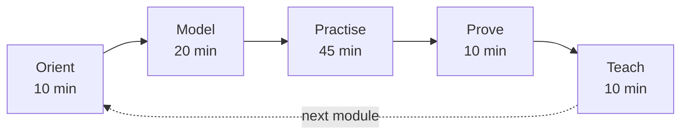

# The ITOM learning loop

**Agent:** Kilo (deepseek-flash) · **Updated:** 2026-11-19 · **Confidence:** high (methodology)

ITOM looks enormous because it is several products pointed at the same two questions:
**what exists?** and **what is wrong with it?** Discovery and Service Mapping answer the first;
Event Management, Health Log Analytics, Metric Intelligence, and the reliability tools answer
the second. Cloud Accelerate adds a third: **what should exist, who owns it, and is it
compliant?**

Learn the machinery once and a new ITOM product costs an hour instead of a week.

---

## 1. The five questions every ITOM product answers

| Question | Where the answer lives | Why it matters |
|---|---|---|
| **What is the record?** | The primary table (`cmdb_ci_*`, `em_event`, `em_alert`, `cmdb_ci_service_discovered`) | Every screen is a view, a flow, or a report on a record |
| **What are the states?** | The choice list on that record (`em_alert.state`, service instance state, discovery status state) | States drive automation, SLAs, dashboards, and closure rules |
| **Who can see it?** | Roles and ACLs (`discovery_admin`, `sm_admin`, `evt_mgmt_*`) | Testing only as admin proves nothing about the operator's view |
| **How does work move?** | Event rules → alerts → alert management rules → incidents; discovery schedules → MID Server → probes | This is the operating model, not the form layout |
| **How is it proven?** | Discovery status, ECC queue, alert history, service maps, SLO dashboards | Evidence is what separates "I read about it" from "I can run it" |

---

## 2. The loop: Orient → Model → Practise → Prove → Teach

| Gate | Target | You do | Artifact | Pass test |
|---|---|---|---|---|
| **Orient** | 10 min | Open the product's three key lists; note the primary table | Three breadcrumbs + table name | You can reach any list without searching the menu |
| **Model** | 20 min | Read only the architecture/process page; draw the record flow | One page: records, states, roles, arrows | You can explain it to a colleague without the screen |
| **Practise** | 45 min | Run the lab; break one dependency on purpose; fix it | Working config + a "what broke" note | It works, and you know why it stopped |
| **Prove** | 10 min | Inspect the actual records, discovery status, or alert history | Observation sheet + gap list | The instance matches your model; mismatches are your gaps |
| **Teach** | 10 min | Explain it in five sentences + one diagram | Teach-back note | A beginner's follow-up gets a real answer |

The timeboxes are targets, not measured benchmarks. They exist so unfinished work becomes
tomorrow's first gate rather than today's excuse.

### Why this order

- **Orient before Model** — official docs assume you know where the product lives. Click
  first or you spend the reading time lost.
- **Model before Practise** — clicking without a record model produces cargo-cult
  configuration that breaks on the first edge case.
- **Practise before Prove** — inspecting an untouched module tells you what exists, not what
  you understand.
- **Prove before Teach** — teaching unverified facts is how wrong configuration spreads.
- **Teach last** — it is the only gate that catches "I recognise this" pretending to be
  "I know this".

---

## 3. Five multipliers

1. **The instance beats the docs.** Docs describe *a* release with *some* plugins. Your
   instance is the truth for your job. Open the record, the related lists, the system
   properties, and the actual error.
2. **Impersonation beats permission guessing.** Use the profile menu to impersonate the
   operator, the discovery admin, or the service owner. This is the highest-yield habit in
   ITOM and it costs two clicks.
3. **Guided Setup is a syllabus.** Where an ITOM app ships guided setup, its step list is the
   official order of operations. Steal the order even if you do not run every step.
4. **Success Packs are scope control.** Now Create's implementation guidance gives the
   Crawl → Walk → Run sequence, prerequisites, and acceptance criteria. Read it before you
   build; it is cheaper than a rebuild.
5. **One diagram per concept, drawn from memory.** A diagram you drew exposes exactly which
   relationship you had wrong. A screenshot does not.

---

## 4. The ITOM-specific traps

| Trap | What it looks like | Better move |
|---|---|---|
| **Treating discovery as an inventory export** | A schedule is created; nobody reads the status, ECC queue, or discovery log | Discovery is a pipeline. Verify each phase, then verify the CMDB result |
| **Confusing event and alert** | A dashboard says "events" but the team works alerts | Events are raw records; alerts are the deduplicated, enriched, CI-bound work item |
| **Mapping services before the CMDB is clean** | Service maps are full of duplicates and orphan CIs | Fix identification and reconciliation first; a map inherits the CMDB's quality |
| **Testing as admin** | Everything works for you; the NOC sees nothing | Impersonate the operator and the team operator; check ACLs and assignment groups |
| **Assuming every ITOM app is included** | A lab assumes Event Management on a PDI with no subscription | Check licensing and plugins before designing the lab; have a design-only path |
| **Trusting AI output without a record** | The summary sounds right; nobody checked the alert or the CI | AI is an assistant. Verify against `em_alert`, the service map, or the log line |

---

## 5. When someone asks you to "just summarise ITOM"

Answer in four quadrants, 30 seconds each:

| Quadrant | Question | Example (Discovery) |
|---|---|---|
| **What it is** | One sentence, no jargon | ServiceNow scans your network and keeps the CMDB up to date |
| **What it touches** | Tables, roles, one dependency | `cmdb_ci_*`, `ecc_queue`, `discovery_admin`, a MID Server |
| **What breaks** | Two or three failure modes | Wrong credentials; MID Server cannot reach the subnet; identification creates duplicates |
| **Where to click** | Three breadcrumbs | `Discovery > Discovery Schedules`; `Discovery > Status`; `Discovery > Output and Artifacts > ECC Queue` |

Then, if the request was "build a lab", turn the quadrants into a runnable path:
prerequisites → build → break → verify. The labs in this repo are exactly that shape.

---

## 6. Three-day ramp

| Day | Block | Output |
|---|---|---|
| 0 (30 min) | Get a PDI, log in, run Lab 00 | A working login and a one-page platform map |
| 1 | ELI5 + family map + Discovery loop | A discovery status you can read and a CMDB record you can explain |
| 2 | Event Management loop + Lab 02 | One event → one alert → one CI binding → one incident |
| 3 | Service Mapping loop + one reliability product | One service instance map, or a documented reason your instance cannot map it |

After that, each additional product is one loop, mostly Practise.

---

## 7. Anti-patterns that look like progress

- **Menu tourism** — clicking through every module without a record model.
- **Doc reading as study** — the docs are reference; read a page *after* a question.
- **Course completion as competence** — a finished video leaves no artifact.
- **Building before reading the prerequisite** — the rebuild costs more than the loop.
- **Custom before out-of-box** — at least half of every ITOM requirement already ships.
- **One giant schedule** — a single discovery range that nobody can debug.
- **Alert tuning by silencing** — muting symptoms without fixing binding or correlation.

---

## 8. How you know it worked

You can do all five without notes:

1. Name the primary record and its states.
2. Draw the flow from source to work item.
3. Explain which role can do what, and why.
4. Reproduce the result on your instance.
5. State one thing that would break it, and how you would detect that.

---

## Official sources

- ServiceNow product documentation — <https://www.servicenow.com/docs/>
- ITOM documentation home (Australia) — <https://www.servicenow.com/docs/r/australia/it-operations-management>
- ITOM overview — <https://www.servicenow.com/docs/r/australia/it-operations-management/r_ITOMApplications.html>
- ServiceNow Developer portal (PDI) — <https://developer.servicenow.com/dev.do>
- ServiceNow University / Now Learning — <https://learning.servicenow.com/lxp>
- Source ladder used by this repo — [08-source-ladder.md](08-source-ladder.md)
