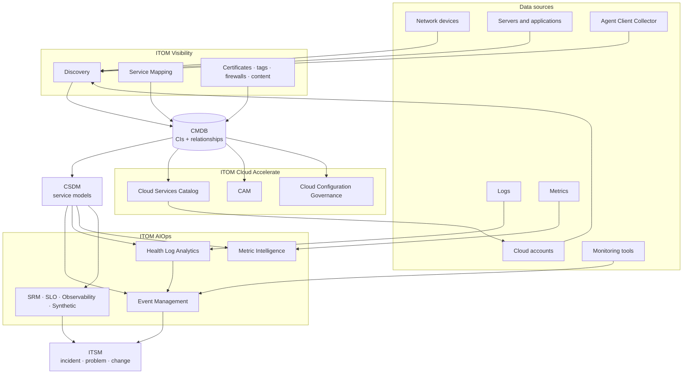

# The ITOM family map

**Agent:** Kilo (deepseek-flash) · **Updated:** 2026-11-19 · **Docs release:** Australia

ServiceNow groups ITOM into product families. The names matter because they appear in
licensing, Store apps, roles, and documentation breadcrumbs. The documentation set used here
(Australia) contains these top-level ITOM sections:

| Documentation section | What it covers | Primary outcome |
|---|---|---|
| **ITOM Visibility** | Discovery, Service Mapping, Certificate Inventory and Management, Firewall Audits and Reporting, Cryptographic Asset Compliance, AI Agent Topology Mapping, ITOM Content Service, Tag Governance, Cloud Discovery Workspace, Cloud License Estimator, LEAP | An accurate, connected CMDB |
| **ITOM AIOps** | Event Management, Health Log Analytics, Service Reliability Management, Service Observability, Synthetic monitoring, SLO Management, AIOps dashboards in the Service Operations Workspace | Detection, triage, and reliability |
| **ITOM Cloud Accelerate** | Cloud Provisioning and Governance, Cloud Account Management, Cloud Services Catalog, Cloud Configuration Governance, Cloud Action Library, Cloud Migration Assessment (retired) | Cloud request, lifecycle, and compliance |
| **Agent Client Collector** | Agent framework, agent monitoring, agent log analytics, air-gapped inventory | Deep host telemetry and isolated inventory |
| **Metric Intelligence** | Metric anomaly detection and metric rules | Earlier detection from metrics |
| **ITOM Optimization** | Optimization reference and cloud cost/visibility capabilities (for example Cloud Insights from the Store) | Cost and infrastructure optimisation |
| **AI in ITOM** | Now Assist for ITOM, ServiceNow Otto for ITOM, ITOM MCP Server Console | Assisted and agentic operations |
| **ITOM/OT SU Licensing and subscriptions** | Subscription usage, resource counts, 2026 packaging | Licence visibility and planning |

> **Naming warning.** Older material calls the detection family **ITOM Health**. The current
> documentation uses **ITOM AIOps** as the section name while product pages and links still
> say "ITOM Health". Treat them as the same neighbourhood, and use the exact product name on
> the page you are reading. Do not assume an old URL or an old licence SKU still applies.

---

## How the pieces connect

**Reading the diagram:**

- Visibility writes the inventory and the relationships.
- AIOps consumes that inventory to turn telemetry into work.
- Cloud Accelerate uses the same inventory to request, own, and audit cloud resources.
- ITSM is where the human work lands. ITOM does not replace ITSM; it feeds it.
- ACC is a data source, not a separate CMDB.

---

## The dependency order that avoids rework

| Step | Why it comes here | Skip it and… |
|---|---|---|
| 1. Foundation data and CMDB classes | Users, groups, locations, CI classes, identification rules | Alerts have no assignment group; CIs duplicate |
| 2. Discovery | Populates CIs and direct relationships | Service maps have nothing trustworthy to draw |
| 3. Service Mapping | Turns CIs into service instances and impact maps | Alerts cannot show business impact |
| 4. Event Management and log/metric analytics | Binds telemetry to CIs and services | You get alert storms with no context |
| 5. Reliability (SLO, SRM, observability, synthetic) | Puts promises and ownership around services | You can detect but not prioritise |
| 6. Cloud governance | Applies the same discipline to cloud accounts | Cloud spend and compliance live in a spreadsheet |

This is the same message as the official ITOM overview: Visibility produces the accurate CMDB
that AIOps, Optimization, and other products consume.

---

## Adjacent products you will meet

| Product | Relationship to ITOM |
|---|---|
| **CMDB / CSDM** | The data model ITOM writes into. CSDM is the recommended service model; ITOM Visibility and AIOps reference it explicitly |
| **Service Graph Connectors** | Third-party data ingestion into the CMDB; complements Discovery rather than replacing it |
| **ITSM** | Incident, problem, and change are where alerts and reliability work become tickets |
| **Service Operations Workspace (SOW)** | The operator workspace used by Event Management, SRM, Service Observability, and AIOps dashboards |
| **Telecom Service Operations Management (TSOM)** | A separate telecom product family that uses ITOM concepts (events, alarms, services) with telecom data models |
| **Digital End-User Experience (DEX)** | Listed in the ITOM licensing application; measures the user's device experience, adjacent to ITOM operations |
| **Cloud Observability** | ServiceNow's observability product; can stream logs and events into AIOps |
| **Software Asset Management** | Consumes discovered software data and ITOM Content Service suggestions |

---

## Cross-cutting guides

Three concerns run through every pillar and are covered as dedicated guides:

| Guide | What it covers |
|---|---|
| [CMDB foundation](modules/cmdb/cmdb-guide.md) | The shared data foundation: tables, CSDM, identification/reconciliation, Service Graph Connectors, impact |
| [Automation & remediation](modules/automation-remediation/automation-remediation-guide.md) | Alert, cloud, and tag automation; CI remediation; LEAP; Ansible; guardrails |
| [Resilience · security · compliance](modules/resilience-security/resilience-security-guide.md) | Backup-resource visibility, change/configuration control, security alignment, audit evidence |

The [coverage map](09-coverage-map.md) maps every pillar and subtopic to the guide that covers it.

---

## Which product should I learn first?

| Your job | First product | Second product | Why |
|---|---|---|---|
| NOC / service desk | Event Management | Health Log Analytics | You need the event → alert → incident path first |
| CMDB / discovery admin | Discovery | Service Mapping | You cannot map what you have not discovered |
| Service owner / SRE | Service Mapping | SLO Management | Impact needs a service model; promises need SLOs |
| Cloud operations | Cloud Account Management or Cloud Services Catalog | Cloud Configuration Governance | Decide whether your pain is request, ownership, or compliance |
| Platform architect | ITOM overview + licensing | Discovery and Event Management | Architecture is a data-flow and entitlement decision |
| AI / automation lead | AI in ITOM | Event Management / HLA | Governance first; the AI sits on top of records you must trust |

---

## Official sources

- ITOM overview — <https://www.servicenow.com/docs/r/australia/it-operations-management/r_ITOMApplications.html>
- ITOM Visibility — <https://www.servicenow.com/docs/r/australia/it-operations-management/itom-visibility/itom-visibility-landing-page.html>
- ITOM AIOps / Event Management — <https://www.servicenow.com/docs/r/australia/it-operations-management/event-management/c_EM.html>
- Health Log Analytics — <https://www.servicenow.com/docs/r/australia/it-operations-management/health-log-analytics/hla-landing-page.html>
- Cloud Provisioning and Governance — <https://www.servicenow.com/docs/r/australia/it-operations-management/cloud-configuration-governance/cloud-management-v2-landing-page.html>
- Agent Client Collector — <https://www.servicenow.com/docs/r/australia/it-operations-management/agent-client-collector/exploring-agent-client-collector.html>
- Metric Intelligence — <https://www.servicenow.com/docs/r/australia/it-operations-management/metric-intelligence/exploring-metric-intelligence.html>
- AI in ITOM — <https://www.servicenow.com/docs/r/australia/it-operations-management/now-assist-for-it-operations-management.html>
- ITOM licensing — <https://www.servicenow.com/docs/r/australia/it-operations-management/explore-itom-licensing.html>
