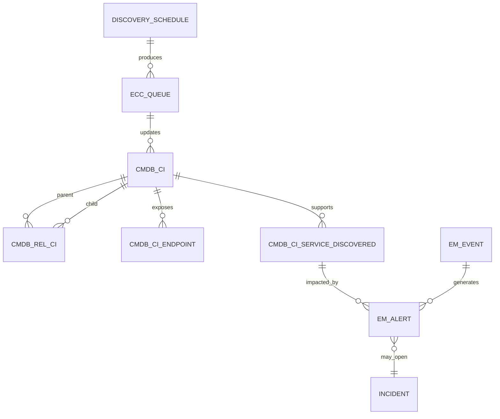

# Roles and tables

**Agent:** Kilo (deepseek-flash) · **Updated:** 2026-11-19 · **Docs release:** Australia

If you remember only one thing: **every ITOM screen is a view over a record**. The roles decide
who can see and change that record; the tables decide what you can query, report, and prove.

Use the table and role names as a map, then confirm them in **System Definition > Tables** and
**User Administration > Roles**. Names and ACLs are instance-specific.

---

## 1. The records that matter

### Visibility and CMDB

| Table | What it is | Why you care |
|---|---|---|
| `cmdb_ci` | Base configuration item table | Every CI class inherits from it |
| `cmdb_rel_ci` | CI-to-CI relationships | The edges in every service map and impact tree |
| `cmdb_ci_service_discovered` | Service instance built by top-down mapping | The main output of Service Mapping |
| `cmdb_ci_service_by_tags` | Service instance built from tags | Used when tags are the source of truth |
| `cmdb_ci_service_manual` | Manually mapped service instance | Useful for services automation cannot reach |
| `cmdb_ci_query_based_service` | Dynamic CI group | A query-defined group used in monitoring and impact |
| `cmdb_ci_endpoint` | Service entry points | Where clients access the service; do not use localhost |
| `cmdb_ci_appl` | Application CI | Common target for service maps |
| `cmdb_ci_server` | Server CI | Host of applications and services |
| `cmdb_ci_vm_instance` | Virtual machine instance | Cloud and virtualisation inventory |
| `cmdb_ci_lb` | Load balancer CI | Frequent service entry point |
| `cmdb_ci_netgear` | Network gear CI | Routers, switches, firewalls |
| `cmdb_ci_ip_network` | IP network | Populated by network discovery |

> Service Graph Connectors, CMDB 360, the CSDM service-instance model, and identification/
> reconciliation are covered in the [CMDB foundation](modules/cmdb/cmdb-guide.md) guide.

### Discovery internals

| Table | What it is | When you use it |
|---|---|---|
| `discovery_schedule` | Discovery schedule definition | Create and audit schedules |
| `discovery_port_probe` | Port probes | Understand what Shazzam can detect |
| `discovery_classy` | Classifiers | Decide which probe or pattern runs |
| `discovery_classy_proc` | Process classifiers | Application discovery |
| `sa_pattern` | Discovery patterns | Pattern-based identification and exploration |
| `ecc_queue` | External Communication Channel messages | Debug probes and sensors |
| `ecc_queue_event` | ECC queue events | Rotation and troubleshooting |
| `ip_service_affinity` | Successful protocol per IP | Explains why later runs use SSH or SNMP first |
| `cmdb_process_groups` | Classified process groups | ITOM Content Service and process fingerprints |
| `discovery_snmp_oid` | SNMP OIDs | ITOM Content Service and network classification |
| `application_service_candidate` | Service candidates | ITOM Content Service / Service Mapping suggestions |

### AIOps

| Table | What it is | Why you care |
|---|---|---|
| `em_event` | Raw events | The immutable-ish record of what was reported |
| `em_alert` | Alerts | The work item: deduplicated, enriched, prioritised, CI-bound |
| `em_mapping_rule` | Event field mapping rule | Maps source fields to alert fields |
| `em_mapping_pair` | Mapping value pairs | Example: `Low → Warning`, `High → Critical` |
| `em_alert_priority_category_order` | Priority category order | Tunes the alert priority score |
| `em_alert_priority_category_mapping` | Priority value mapping | Remaps severity, state, role weights |
| `em_alert_priority_ci_type` | CI type weights | Makes a router alert outrank a workstation alert |

> The documentation sometimes writes the priority tables without underscores
> (`emalertprioritycategoryorder`). Check the dictionary in your instance; the platform may
> expose both the physical and the display name.

---

## 2. How the records connect

Read it as:

- Discovery writes CIs and relationships.
- Service Mapping writes service instances and connects them to CIs and entry points.
- Event Management writes events, then alerts, and binds alerts to CIs or service instances.
- An alert management rule can open an incident.
- The ECC queue is the transport log between the instance and the MID Server; it is not a
  business record, but it is the first place to look when discovery fails.

---

## 3. Roles

| Role | Scope | Notes |
|---|---|---|
| `discovery_admin` | Configure and run Discovery | Create credentials, schedules, and discovery configuration |
| `sm_admin` | Configure and run Service Mapping | Required for top-down mapping; domain must be a leaf domain for some operations |
| `evt_mgmt_admin` | Configure Event Management | Can create/modify global scripts, correlation rules, alert management rules, maintenance rules, field mappings |
| `evt_mgmt_operator` | Operate alerts | Acknowledge, close, and manually run alert management rules |
| `evt_team_operator` | Operate within an assignment group | Must be assigned to the group; otherwise the operator sees no alerts |
| `evt_mgmt_user` | View and acknowledge alerts | Basic alert lifecycle |
| `sn_itom_license.reader` | View ITOM licence usage | Read-only licensing dashboard |
| `admin` | Everything | Bypasses ACLs and UI policies; never use it as the only test |

### Automation and assurance roles

| Role | Scope | Notes |
|---|---|---|
| `evt_mgmt_admin` / `evt_team_operator` | SOW alert automations (ignore/respond) | Also `flow_designer` for alert remediation |
| `sn_itom_ccg.ccg_operator` | Cloud Configuration Governance remediation | Approval-gated remediation creates a change request |
| `sn_itom_tag.tag_governance_admin` | Tag Governance policy and remediation | Manage tag policies, audits, and auto-remediation |
| `sn_change_write` | Analyze potential impact agentic workflow | Also the configured AI access controls |
| `LEAP admin` | LEAP configuration and playbooks | Verify the exact role name in your Store app version |
| `sn_itom_leap.leap_ansible_agent_worker` | LEAP Ansible execution agent | Launches mapped Ansible playbooks |
| `sn_cmp.cloud_admin` | Cloud Admin portal, capacity limits, resource pools | Documented under the CPG-era Cloud Admin portal |
| `sn_cmp_cloud_admin` | Blueprint/resource-pool configuration | Used in the cost-center resource pool example |

Least-privilege also applies here:

1. **Never give auto-remediation to a read-only user.** Remediation can change production
   resources and create change requests.
2. **Separate who writes policies from who can remediate.** Policy authorship is not an operator
   task.
3. **Approve destructive actions.** CCG remediation and some alert remediation paths can be
   approval-gated.

### Least-privilege rules

1. **Do not build with `admin` and call it tested.** Impersonate the operator and the team
   operator. Check the assignment group, the ACL, and the list view.
2. **Separate configuration from operation.** `evt_mgmt_admin` can change global scripts; it
   is not a daily driver role.
3. **Team operators need a group.** A role without a group is a role that sees nothing.
4. **Service Mapping has its own admin role.** `sm_admin` is not a synonym for `admin` in
   every context, and mapping has domain constraints.

---

## 4. States and values you will query

### Event and alert

| Concept | Values seen in the Australia documentation | Where |
|---|---|---|
| Alert severity | Critical, Major, Minor, Warning, OK | `em_alert.severity` and the priority score |
| Alert state | Open, Reopen, Flapping, Closed; operational states include Acknowledged and Maintenance | Alert list / Express List / SOW |
| Alert role | Parent, None, Secondary | Correlation and priority |
| Discovery status | Starting, Active, Completed, Canceled | Discovery status record |
| ECC queue state | Ready, Processing, Processed, Error | ECC queue record |

### Discovery

The official phases are **Scanning → Classification → Identification → Exploration**. The
common mnemonic "PCIE" (Probe, Classifier, Identifier, Explorer) is a teaching shorthand, not
the official phase list. Use the official names when you write documentation or an exam
answer.

---

## 5. Useful breadcrumbs

| Task | Breadcrumb |
|---|---|
| Discovery schedules | `All > Discovery > Discovery Schedules` |
| Discovery status | `All > Discovery > Status` |
| ECC queue | `All > Discovery > Output and Artifacts > ECC Queue` |
| Discovery configuration console | `All > Discovery > Discovery Definition > Configuration Console` |
| Service Mapping | `All > Service Mapping > ...` |
| Event rules | `All > Event Management > Rules > Event Rules` |
| Alert correlation rules | `All > Event Management > Rules > Alert Correlation Rules` |
| Alert management rules | `All > Event Management > Rules > Alert Management Rules` |
| Alerts | `All > Event Management > Alerts > All Alerts` |
| Health Log Analytics | `All > Health Log Analytics > ...` |
| Service Operations Workspace | `All > Service Operations Workspace` |
| MID Servers | `All > MID Server > Servers` |

Menu labels move between releases and depend on installed plugins. If a breadcrumb is wrong
on your instance, trust the table name and search the Application Navigator.

---

## Official sources

- ITOM Visibility and CMDB tables — <https://www.servicenow.com/docs/r/australia/it-operations-management/itom-visibility/itom-visibility-use-case.html>
- CMDB tables used by ITOM AIOps — <https://www.servicenow.com/docs/r/australia/it-operations-management/itom-health-use-case.html>
- Discovery status — <https://www.servicenow.com/docs/r/australia/it-operations-management/discovery/c_DiscoveryStatus.html>
- ECC queue for Discovery — <https://www.servicenow.com/docs/r/australia/it-operations-management/discovery/r_DiscoveryStatusECCQueue.html>
- Event Management roles — <https://www.servicenow.com/docs/r/australia/it-operations-management/event-management/exploring-event-management.html>
- Event field mapping — <https://www.servicenow.com/docs/r/australia/it-operations-management/event-management/c_EMEventFieldMapping.html>
- Alert priority — <https://www.servicenow.com/docs/r/australia/it-operations-management/event-management/alert-priority.html>
- Service Mapping entry points — <https://www.servicenow.com/docs/r/australia/it-operations-management/service-mapping/r_EntryPointsforBizSvcDef.html>
- ITOM licensing role — <https://www.servicenow.com/docs/r/australia/it-operations-management/explore-itom-licensing.html>
