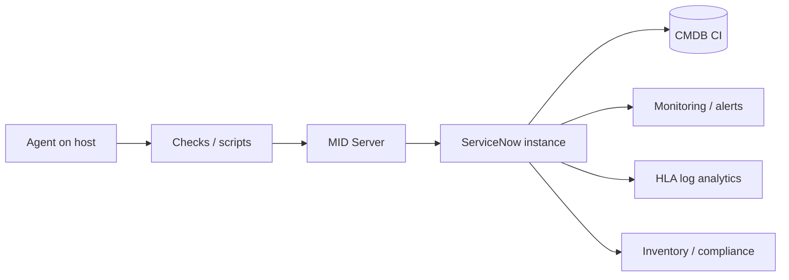

# Agent Client Collector

**Agent:** Kilo (deepseek-flash) · **Updated:** 2026-11-19 · **App:** Agent Client Collector · **Confidence:** high (official docs)

Agent Client Collector (ACC) is ServiceNow's agent-based data collection framework. It installs
agents on servers and devices, runs checks locally, and sends the results through a dedicated
MID Server to the instance.

Use it when agentless Discovery cannot reach far enough, when you need deep host telemetry, or
when the host is in an isolated network.

---

## Contents

- [Purpose](#purpose)
- [Agentless vs agent-based](#agentless-vs-agent-based)
- [How it works](#how-it-works)
- [What ACC collects](#what-acc-collects)
- [The ACC family](#the-acc-family)
- [Prerequisites](#prerequisites)
- [Roles](#roles)
- [Proving it works](#proving-it-works)
- [Common mistakes](#common-mistakes)
- [Quiz](#quiz)
- [Official sources](#official-sources)
- [Related guides](#related-guides)

---

## Purpose

The Agent Client Collector Framework monitors the performance and health of infrastructure
components by deploying agents on servers and devices. The agents execute predefined commands,
collect system data (CPU, memory, disk, network, error logs, system alerts), and send it securely
to the instance via a dedicated MID Server.

The data is stored in the CMDB and associated with the relevant CIs, which supports tracking,
monitoring, and troubleshooting.

---

## Agentless vs agent-based

| | Agentless (Discovery) | Agent-based (ACC) |
|---|---|---|
| Software on target | No | Yes |
| Transport | MID Server runs probes/patterns | Agent sends to MID Server |
| Best for | Broad network inventory | Deep host telemetry, isolated networks |
| Reach | Whatever the MID Server can route to | Whatever the agent can reach and the MID Server can receive |
| Operational cost | MID Server placement and credentials | Agent lifecycle, upgrades, certificates |

Neither is universally better. Many estates use both: Discovery for breadth, ACC for depth.

---

## How it works

Official workflow:

1. **Agent installation** — agents are installed on infrastructure components.
2. **Data collection** — the agent runs predefined scripts or queries (checks) and collects
   performance data, error logs, and alerts.
3. **MID Server communication** — the agent sends data to the instance through a dedicated MID
   Server, which acts as a secure bridge.
4. **Data storage** — events and metrics are stored and associated with the relevant CIs.
5. **Analysis and reporting** — the data is used for monitoring, troubleshooting, and reporting.
6. **Feedback loop** — remediation actions can be triggered, or teams notified, and the loop
   continues.

The MID Server does not replace the agent; it is the secure path back to the platform.

---

## What ACC collects

- CPU usage
- Memory utilisation
- Disk space
- Network activity
- Error logs
- System alerts
- Inventory and software data (with the visibility capability)
- Log data (with ACC Log Analytics)

The exact checks depend on the installed ACC capabilities and the policies you configure.

---

## The ACC family

| Capability | What it does | User |
|---|---|---|
| **ACC Framework** | Agents, checks, MID Server communication, CMDB association | ACC admin |
| **ACC Monitoring** | Health, performance, and availability monitoring | NOC, Event Management admin |
| **ACC for Visibility** | Continuous server inventory and software usage with minimal network impact and non-admin access | CMDB/Discovery admin |
| **ACC Air-Gapped CI Management** | Inventory for devices not connected to the network | CMDB/Discovery admin |
| **ACC Log Analytics** | Streams logs into HLA for anomaly detection | ACC admin |
| **Certificates** | Agent identity and rotation | ACC admin |
| **AI Control Tower** | AI governance context where applicable | AI admin |

The official docs list these as separate capabilities, not one monolithic agent.

---

## Prerequisites

| Prerequisite | Why it matters |
|---|---|
| ACC entitlement and Store apps | ACC is not a base-platform capability |
| A dedicated MID Server | The agent's secure path to the instance |
| Network routes and firewall rules | Agent → MID Server, MID Server → instance |
| Agent installation permissions | Install, upgrade, and certificate management |
| Checks/policies | Decide what the agent collects and how often |
| CMDB CI matching | Data must associate with the right CI |
| Certificate plan | Agents stop checking in when certificates expire |
| Log storage (for ACC-L) | Logs are high-volume |

---

## Roles

Role names vary by capability and Store app version. Expect:

- An ACC administrator who installs agents, configures checks, and manages certificates.
- A NOC/Event Management administrator for monitoring.
- A CMDB/Discovery administrator for inventory and CI association.
- An HLA administrator for log analytics.

Check the ACC reference page for the exact roles in your version.

---

## Proving it works

1. The agent shows as installed and healthy.
2. The MID Server shows the agent connection.
3. The CI has fresh data (metrics, inventory, or logs).
4. A check produces the expected record or metric.
5. A certificate rotation has been tested.
6. An alert or dashboard updates from agent data.

Do not stop at "agent installed". The proof is the record in the CMDB and the signal in the
operation.

---

## Common mistakes

| Mistake | Symptom | Fix |
|---|---|---|
| No MID Server plan | Agents cannot check in | Size and place the MID Server first |
| No certificate rotation | Agents stop after expiry | Monitor and rotate certificates |
| Too many checks | Host and network load | Start with the checks you will use |
| Agent installed but CI not matched | Data is orphaned | Fix CI identification and association |
| Assuming ACC replaces Discovery | Inventory gaps | Use both: breadth and depth |
| No log retention plan | Storage fills | Plan ACC-L retention and filters |

More: [Common mistakes](../../05-common-mistakes.md).

---

## Quiz

1. **When should you use ACC instead of agentless Discovery?**
   

Answer
For deep host telemetry, isolated/air-gapped networks, or data agentless discovery cannot reach.

2. **What does the agent send data through?**
   

Answer
A dedicated MID Server.

3. **Where is collected data associated?**
   

Answer
With the relevant CIs in the CMDB.

4. **What happens when an agent certificate expires?**
   

Answer
The agent can stop checking in; plan certificate rotation.

5. **Name three ACC capabilities.**
   

Answer
Monitoring, Visibility, Air-Gapped CI Management, Log Analytics (any three).

---

## Official sources

- Exploring Agent Client Collector — <https://www.servicenow.com/docs/r/australia/it-operations-management/agent-client-collector/exploring-agent-client-collector.html>
- Configuring Agent Client Collector — <https://www.servicenow.com/docs/r/australia/it-operations-management/agent-client-collector/agent-client-collector-configuring.html>
- ACC Monitoring — <https://www.servicenow.com/docs/r/australia/it-operations-management/agent-client-collector/acc-monitoring-landing-page.html>
- ACC Log Analytics — <https://www.servicenow.com/docs/r/australia/it-operations-management/agent-client-collector/acc-log-analytics.html>
- ACC reference — <https://www.servicenow.com/docs/r/australia/it-operations-management/agent-client-collector/acc-reference.html>
- Health Log Analytics data inputs — <https://www.servicenow.com/docs/r/australia/it-operations-management/health-log-analytics/hla-data-input-supported.html>

---

## Related guides

- [Discovery](../discovery/discovery-guide.md)
- [Health Log Analytics](../health-log-analytics/health-log-analytics-guide.md)
- [Reliability stack](../reliability-stack/reliability-stack-guide.md)
- [Licensing and prerequisites](../../03-licensing-prerequisites.md)
