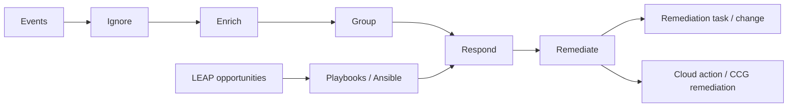

# Automation and remediation

**Agent:** Kilo (deepseek-flash) · **Updated:** 2026-11-19 · **App:** ITOM AIOps / Cloud Accelerate / LEAP · **Confidence:** high (official docs)

Automation is not a fourth pillar. It runs through the three pillars:

- **AIOps** automates alert handling and remediation.
- **Cloud Accelerate** automates provisioning, policy remediation, and day-2 actions.
- **Visibility** automation uses orchestration workflows through the MID Server.

The goal is the same everywhere: reduce manual toil, shorten MTTR, and make the action
auditable. The failure mode is also the same: an automation with no guardrail, no approval, and
no owner.

---

## Contents

- [The automation stack](#the-automation-stack)
- [Alert automation in SOW](#alert-automation-in-sow)
- [Alert and CI remediation](#alert-and-ci-remediation)
- [Cloud remediation](#cloud-remediation)
- [Tag remediation](#tag-remediation)
- [LEAP automation](#leap-automation)
- [Orchestration and execution](#orchestration-and-execution)
- [Guardrails](#guardrails)
- [Quiz](#quiz)
- [Official sources](#official-sources)
- [Related guides](#related-guides)

---

## The automation stack



The stack has four layers:

1. **Noise reduction** — ignore and enrich.
2. **Correlation** — group alerts under a primary/root cause.
3. **Response** — notify, escalate, open an incident, or run remediation.
4. **Execution** — orchestration workflows, cloud actions, Ansible, or scripted actions.

---

## Alert automation in SOW

The Service Operations Workspace provides four alert automation types. They share backend tables
with the classic Event Management experience, so a change in one is visible in the other.

| Automation | What it does | Why it matters |
|---|---|---|
| **Ignore** | Suppresses alerts that are not actionable, are known noise, or are maintenance notifications | Reduces alert fatigue |
| **Enrich** | Adds context and normalises fields so alerts share a common format | Makes grouping and response possible |
| **Group** | Consolidates related alerts into a single primary alert | Reduces noise and helps identify root cause |
| **Respond** | Notifies, escalates, creates cases, or runs remediation actions | Turns detection into action |

Official order: **Ignore → Enrich → Group → Respond**. Each automation has trigger conditions and
runs only on new incoming alerts; past alerts are not retroactively automated.

### Design rules

- Write the ignore rule narrowly; a broad ignore hides real incidents.
- Enrich before group; grouping depends on the enriched fields.
- Group before respond; otherwise every secondary alert triggers its own response.
- Make the response idempotent; retries must not open duplicate incidents.

Roles:

- `evt_mgmt_admin` or `evt_team_operator` for ignore automation.
- Team-scoped automations let SREs manage their own alerts without affecting other teams.
- Some advanced features remain admin-only in the classic experience.

---

## Alert and CI remediation

Event Management has two remediation paths:

| Path | What it does | Trigger |
|---|---|---|
| **Alert remediation** | Associates an alert with a remediation workflow | Alert management rule or manual action |
| **CI remediation** | Applies remediation to a set of CIs | CI remediation rule or manual action |

When a remediation workflow runs, a **remediation task** records the start time, the triggering
alert (if any), and the remediated CI. The workflow can be scripted to request user approval
before executing the next task; it pauses even when triggered automatically.

### Built-in remediation actions

The official action set targets Linux and Windows CIs. Examples:

- Restart Linux service
- Stop/start Windows service
- Kill Linux process / stop Windows process
- Get Linux/Windows services
- Run Linux top (CPU/memory)
- Show disk space used

Prerequisites:

- IntegrationHub Enterprise spokes plugin
- IntegrationHub Action Step - PowerShell
- IntegrationHub Action Step - SSH
- Linux host reachable from the MID Server; `linuxAdmin`
- Windows PowerShell 3.0–5.0, remoting enabled, FQDN reachable; `windowsAdmin`
- Role: `evt_mgmt_admin` or `flow_designer`

The action input is passed in the alert's **Additional information** field:

```json
{"remediation_action_resource":"<mandatory input>"}
```

Examples: a service name for a restart, a process ID for a kill. Results are written to the
alert's **Work Notes**.

### Configure in SOW

`Configuration Summary > Event Management > Reduce MTTR > Remediation actions`. The page lists
the respond automations whose Response subflow is not "Create incident (advanced)". Select
**+Create automation**, follow the Respond automation steps, then **Mark as configured**.

---

## Cloud remediation

Cloud Configuration Governance scans cloud resources against policy sets and offers remediation
actions for violation types.

- Base system remediation actions ship with the app.
- Custom remediation actions and catalog items can be created.
- Remediation runs against the cloud resource.
- Optional approval creates a **change request** to track the approval.
- Role: `sn_itom_ccg.ccg_operator` for remediation.

The remediation request list is visible in **Remediation Requests**. A remediation that changes
production without a change record is an audit finding waiting to happen.

---

## Tag remediation

Tag Governance audits tag policies and can remediate non-compliant CIs.

Policy types:

- **Tag Count** — the CI has the required number of tag keys.
- **Tag Presence** — the required tag keys exist.
- **Tag Key & Value** — the required key-value pairs exist.

Remediation:

- **AutoRemediation** runs when an audit finishes.
- **Update Tags in Cloud** writes the corrected tags back to AWS or Azure for supported CI
  classes.
- AWS auto-remediation uses an Assume Role with `tag:TagResources` permission on the supported
  resource types.
- If Discovery is credential-less, the MID Server with **Tag Management** capability is used.
- Role: `sn_itom_tag.tag_governance_admin` or `admin`.

Tag remediation is the least glamorous automation in ITOM and one of the highest-value, because
tags are the join key for cost, ownership, and service mapping.

---

## LEAP automation

The Learning Enhanced Automation Platform (LEAP) uses AI to find automation opportunities in
incident data.

| Capability | What it does |
|---|---|
| **Automation opportunities** | Groups similar incidents and generates resolution steps, KB articles, problem records, and playbooks |
| **Automation projects** | Scopes analysis by team, region, service tier, or filter; projects run independently |
| **Playbooks** | Generates standard, dynamic, and automated playbooks in Workflow Studio |
| **Ansible execution** | Maps Ansible jobs to resolution steps and runs them from SOW |
| **Value dashboard** | Tracks MTTR, savings, playbook/KB/problem metrics |

Official constraints:

- Analysis is on the incident table in the Australia release.
- Filter queries are limited to 300 characters; a filter returning zero records is invalid.
- Multiple projects can match an incident; playbooks from all matching projects are displayed.
- The Default project is read-only and managed through the AI Admin Workspace.
- Roles include `LEAP admin` and `sn_itom_leap.leap_ansible_agent_worker` for Ansible execution.

LEAP is an AI capability under ITOM Visibility in the documentation. The governance rules in
[AI in ITOM](../itom-ai/itom-ai-guide.md) apply: review generated playbooks before production,
and keep a human approval gate for changes.

---

## Orchestration and execution

Automation needs an execution path. In ITOM that path is usually:

- **MID Server** — the secure route to on-premises systems.
- **IntegrationHub / Flow Designer / Workflow Studio** — the flow and subflow engine.
- **Orchestration workflows** — scripted tasks such as gathering information or rebooting a
  server, used by alert and CI remediation.
- **Cloud actions** — Cloud Action Library actions and workflows for AWS/Azure.
- **Ansible** — LEAP can execute mapped Ansible jobs through the Ansible Execution Agent.

**Orchestration is adjacent to the three pillars, not a synonym for AIOps.** Do not assume an
"orchestration" menu item means Event Management remediation is configured; check the alert
management rule and the workflow.

For cloud orchestration troubleshooting, the **Cloud Orchestration Trail** and **Open cloud
orchestrations** views show the trail of a cloud request/provisioning operation.

---

## Guardrails

| Guardrail | Why |
|---|---|
| Approval gate for destructive actions | Prevents an automation from making an outage worse |
| Change record for cloud remediation | Auditability and rollback |
| Idempotent actions | Retries must not duplicate incidents or resources |
| Narrow scope | Blast radius is a design decision |
| Test in non-production | A working lab action can still fail at scale |
| Owner and review cadence | Automations rot when nobody owns them |
| Audit trail | Remediation tasks, work notes, change requests, orchestration trail |
| Kill switch | Be able to disable an automation without a code change |

The one-question test: **If this automation fires at 2 a.m. and is wrong, who notices, and how do
they stop it?**

---

## Quiz

1. **What is the official order of SOW alert automations?**
   <details><summary>Answer</summary>Ignore → Enrich → Group → Respond.</details>

2. **Why group before respond?**
   <details><summary>Answer</summary>So secondary alerts do not each trigger a response and create duplicate incidents.</details>

3. **What record does a remediation workflow create?**
   <details><summary>Answer</summary>A remediation task with the start time, triggering alert (if any), and remediated CI.</details>

4. **What record does a CCG remediation approval create?**
   <details><summary>Answer</summary>A change request that tracks the approval.</details>

5. **What does Tag Governance auto-remediation require for AWS?**
   <details><summary>Answer</summary>An Assume Role with `tag:TagResources` permission; a MID Server with Tag Management capability when Discovery is credential-less.</details>

6. **What does LEAP analyze in the Australia release?**
   <details><summary>Answer</summary>The incident table, using automation projects scoped by filters/taxonomies.</details>

---

## Official sources

- Alert automation in SOW — <https://www.servicenow.com/docs/r/australia/it-operations-management/event-management/sow-itom-alert-automation.html>
- Create Respond automation — <https://www.servicenow.com/docs/r/australia/it-operations-management/event-management/respond-alert-sow-itom.html>
- Create Group automation — <https://www.servicenow.com/docs/r/australia/it-operations-management/event-management/group-alert-sow-itom.html>
- Alert ignore automations — <https://www.servicenow.com/docs/r/australia/it-operations-management/event-management/ignore-alerts.html>
- Run remediation actions — <https://www.servicenow.com/docs/r/australia/it-operations-management/event-management/run-remediation-actions.html>
- Configure alert remediation actions — <https://www.servicenow.com/docs/r/australia/it-operations-management/event-management/configure-alert-remediation-subflows.html>
- CI remediation — <https://www.servicenow.com/docs/r/australia/it-operations-management/event-management/ci-remediation.html>
- Cloud Configuration Governance remediation — <https://www.servicenow.com/docs/r/australia/it-operations-management/itom-cloud-accelerate/ccg-remediation.html>
- Tag policies and remediation for AWS — <https://www.servicenow.com/docs/r/australia/it-operations-management/tag-governance/tag-governance-policies-remediate.html>
- Configure tag remediation policies — <https://www.servicenow.com/docs/r/australia/it-operations-management/tag-governance/configure-remediation-tag-governance-.html>
- LEAP features — <https://www.servicenow.com/docs/r/australia/it-operations-management/aiops-leap-learning-enhanced-automation-playbooks/aiops-leap-features.html>
- LEAP automation opportunities — <https://www.servicenow.com/docs/r/australia/it-operations-management/aiops-leap-learning-enhanced-automation-playbooks/automation-opportunities.html>
- LEAP automation projects — <https://www.servicenow.com/docs/r/australia/it-operations-management/aiops-leap-learning-enhanced-automation-playbooks/automation-projects-leap.html>
- LEAP playbooks — <https://www.servicenow.com/docs/r/australia/it-operations-management/aiops-leap-learning-enhanced-automation-playbooks/generate-playbooks.html>
- Ansible execution — <https://www.servicenow.com/docs/r/australia/it-operations-management/aiops-leap-learning-enhanced-automation-playbooks/execute-ansible-automations-for-incidents.html>
- Cloud Orchestration Trail — <https://www.servicenow.com/docs/r/australia/it-operations-management/cloud-configuration-governance/cloud-orch-trail.html>

---

## Related guides

- [Event Management](../event-management/event-management-guide.md)
- [Cloud Accelerate](../cloud-accelerate/cloud-accelerate-guide.md)
- [AI in ITOM](../itom-ai/itom-ai-guide.md)
- [Resilience, security, and compliance](../resilience-security/resilience-security-guide.md)
- [Lab 02](../../../labs/LAB-02-EVENT-TO-INCIDENT.md)
