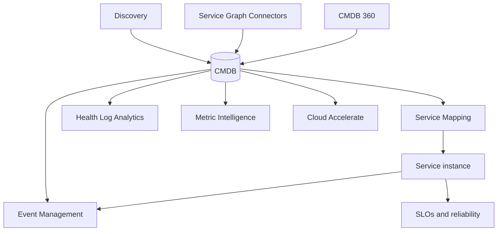

# CMDB foundation

**Agent:** Kilo (deepseek-flash) · **Updated:** 2026-11-19 · **App:** CMDB / ITOM Visibility · **Confidence:** high (official docs)

Every ITOM pillar relies on the same foundation: the Configuration Management Database (CMDB).
Discovery populates it, Service Mapping connects it, Event Management binds alerts to it, and
Cloud Accelerate uses it to account for resources. If the CMDB is wrong, every pillar above it
is confidently wrong.

This guide covers the CMDB from an ITOM perspective. It does not replace the platform CMDB
documentation; it explains which parts ITOM actually reads and writes.

---

## Contents

- [Purpose](#purpose)
- [The CMDB in the ITOM architecture](#the-cmdb-in-the-itom-architecture)
- [The tables ITOM manages and uses](#the-tables-itom-manages-and-uses)
- [CSDM and the service instance](#csdm-and-the-service-instance)
- [Identification and reconciliation](#identification-and-reconciliation)
- [Service Graph Connectors and CMDB 360](#service-graph-connectors-and-cmdb-360)
- [CMDB-based service mapping](#cmdb-based-service-mapping)
- [CMDB-based alert grouping and impact](#cmdb-based-alert-grouping-and-impact)
- [Roles](#roles)
- [Data quality checks](#data-quality-checks)
- [Common mistakes](#common-mistakes)
- [Quiz](#quiz)
- [Official sources](#official-sources)
- [Related guides](#related-guides)

---

## Purpose

The CMDB is the shared data foundation for ITOM. The official ITOM Visibility page is explicit:
ITOM Visibility integrates with the CMDB and Service Graph Connectors to maintain accurate and
complete data, which serves as a strategic foundation for IT operations and service management.

The practical rule:

> **If a CI is not in the CMDB, ITOM cannot map it, alert on it, report on it, or govern it.**

---

## The CMDB in the ITOM architecture

The CMDB is not a passive inventory. It is the join key between:

- infrastructure CIs and the services they support,
- alerts and the CIs they affect,
- logs and the service instance they belong to,
- cloud resources and the accounts/tags that govern them.

---

## The tables ITOM manages and uses

### Service instance tables

The table depends on the mapping method. With CSDM v5, the label "Application Service" changed
to **Service Instance**.

| Method | Table | Notes |
|---|---|---|
| Top-down discovery of CI connections | `cmdb_ci_service_discovered` | Requires Service Mapping, `sm_admin`, and a leaf domain; best accuracy |
| Tag list or tag family | `cmdb_ci_service_by_tags` | Preferred for public/private cloud where tags are used |
| Manual selection of CIs | `cmdb_ci_service_manual` | No automation; you choose the CIs |
| Dynamic CI group | `cmdb_ci_query_based_service` | Query-defined group used by monitoring and impact |

### CI tables ITOM uses

| Table | What it is |
|---|---|
| `cmdb_ci` | Base CI table; every CI class inherits from it |
| `cmdb_rel_ci` | CI-to-CI relationships (the edges in maps and impact) |
| `cmdb_ci_appl` | Application CI |
| `cmdb_ci_server` | Server CI |
| `cmdb_ci_vm_instance` | Virtual machine instance |
| `cmdb_ci_lb` | Load balancer |
| `cmdb_ci_netgear` | Network gear |
| `cmdb_ci_endpoint` | Service entry point (Service Mapping) |

### What ITOM AIOps uses

The official AIOps CSDM page is narrow and useful:

- Mapped Application Service / **Service Instance** `cmdb_ci_service_discovered`
- Configuration Item `ci_*`
- Dynamic CI Group `cmdb_ci_query_based_service`

AIOps does not need every CSDM domain. It needs an accurate service instance, an accurate CI
hierarchy, and a reliable dynamic CI group.

---

## CSDM and the service instance

The Common Service Data Model (CSDM) is ServiceNow's recommended model for representing
services, service instances, and their relationships. The ITOM documentation applies CSDM
explicitly to both Visibility and AIOps.

What matters for ITOM:

- The **service instance** is the anchor for impact and alert context.
- With CSDM v5, `cmdb_ci_service_discovered` is labelled **Service Instance**, not Application
  Service.
- AIOps follows CSDM guidelines because accurate tables improve service mapping and help route
  alerts and incidents correctly.
- Visibility maps service instances from Discovery, Service Mapping, tags, or manual selection;
  the source determines the table.

Do not treat CSDM as a naming exercise. It changes which table holds the service, which changes
which alerts and SLOs can find it.

---

## Identification and reconciliation

The CMDB stays usable only if the same real-world thing maps to one CI.

- **Identification** asks: is this the same CI we already have?
- **Reconciliation** asks: which data source wins for each attribute?

The practical checks:

1. Does each CI class have a sensible identifier (serial, FQDN, MAC, cloud resource ID)?
2. Are there duplicate CIs for the same device?
3. Are Discovery, Service Graph Connectors, and manual data competing for the same attribute?
4. Is the data source precedence configured deliberately?
5. Are retired CIs being cleaned up?

The ITOM Visibility table reference and the Discovery guide cover the mechanics. The CMDB guide
adds the cross-product view: a duplicate CI breaks the service map, the alert binding, the SLO,
and the cloud tag report at the same time.

Further reading: [Discovery](../discovery/discovery-guide.md#identification-reconciliation-and-cmdb-quality).

---

## Service Graph Connectors and CMDB 360

ITOM Visibility does not rely on Discovery alone. The official Visibility page says the **Service
Graph Connectors** and **CMDB 360** applications provide data to ITOM Visibility.

What that means:

- **Service Graph Connectors** are the integration path for third-party data (cloud, asset,
  monitoring, and enterprise sources) into the CMDB. They are Store apps, not a Discovery
  feature.
- **CMDB 360** provides a multi-source view of CI data and change over time.
- Discovery and connectors are complementary. Discovery is agentless scanning; connectors are
  integration pipelines.
- When both sources write the same CI, reconciliation decides which wins.

Governance questions:

1. Which connector owns which CI class?
2. What is the refresh cadence?
3. What is the data source precedence?
4. Who reviews conflicts and duplicates?
5. Is the connector version current?

A connector that is installed but unowned is a future duplicate factory.

---

## CMDB-based service mapping

Service Mapping can map a service from CMDB relationships without running a full top-down
pattern discovery. The official CMDB-based mapping page describes configuring Service Mapping to
work with the CMDB.

Use it when:

- the application cannot be discovered with patterns,
- the relationships are maintained by another authoritative source,
- you need a service map over an existing, well-governed CMDB.

Do not use it to paper over a bad CMDB. A manual map of wrong relationships is still wrong.

---

## CMDB-based alert grouping and impact

Event Management does not only bind alerts to CIs. It can use the CMDB to:

- **group alerts by CMDB relationships** (CMDB-based alert grouping), and
- **calculate impact** using CMDB tables/classes, which you can add or remove from impact
  calculation.

This is why a clean `cmdb_rel_ci` graph matters: the alert list, the impact tree, and the
probable root cause all read it.

---

## Roles

| Role | CMDB relevance |
|---|---|
| `discovery_admin` | Writes CIs and relationships through Discovery |
| `sm_admin` | Builds service instances and maps |
| `evt_mgmt_admin` | Configures impact calculation and alert grouping |
| `admin` | Full access; not a valid test |
| CMDB data steward (business role) | Owns CI quality for a domain; role name varies by organisation |

The platform also has CMDB-specific roles and data certification responsibilities. Check the
CMDB product documentation and your instance's role list; do not invent a role name.

---

## Data quality checks

Run these before blaming ITOM:

| Check | Question |
|---|---|
| Duplicates | Does one server have more than one CI? |
| Orphans | Are there CIs with no owner, no location, or no relationship? |
| Stale | Are CIs still marked installed after the asset was retired? |
| Missing service | Does a business-critical service have a service instance? |
| Bad relationships | Do the arrows match the application team's understanding? |
| Source conflict | Are connectors and Discovery overwriting each other? |
| Tags | Are the tags complete enough for cost/governance? |

CMDB health dashboards and data certification are platform capabilities. Use them where
available; do not assume an ITOM app replaces them.

---

## Common mistakes

| Mistake | Symptom | Fix |
|---|---|---|
| Treating the CMDB as an inventory export | Maps and alerts are wrong | Treat it as a relationship model with owners |
| Adding Discovery before fixing identification | More duplicates, faster | Fix identifiers and reconciliation first |
| Installing a connector without an owner | Conflicting data | Assign ownership and precedence |
| Using the wrong service table | Alerts/SLOs cannot find the service | Match the table to the mapping method |
| Ignoring CSDM | Service instance label/table mismatch | Apply CSDM; use the v5 service instance label |
| Manual relationships without governance | The map decays | Assign a service owner and review cadence |
| Testing only as admin | Data stewards cannot maintain it | Test with the real roles |

---

## Quiz

1. **Which table is the service instance for top-down mapping?**
   

Answer
`cmdb_ci_service_discovered` (labelled Service Instance with CSDM v5).

2. **Which table holds CI relationships?**
   

Answer
`cmdb_rel_ci`.

3. **What do Service Graph Connectors do?**
   

Answer
They bring third-party data into the CMDB as Store-app integrations; they complement Discovery and are subject to reconciliation.

4. **Which two CMDB tables does ITOM AIOps explicitly rely on (besides the CI hierarchy)?**
   

Answer
The service instance `cmdb_ci_service_discovered` and the dynamic CI group `cmdb_ci_query_based_service`.

5. **Why does identification matter more than scanning?**
   

Answer
Scanning finds devices; identification decides whether they update an existing CI or create a duplicate. Duplicates break maps, alerts, and reports.

---

## Official sources

- ITOM Visibility and CMDB tables — <https://www.servicenow.com/docs/r/australia/it-operations-management/itom-visibility/itom-visibility-use-case.html>
- ITOM Visibility and CSDM reference — <https://www.servicenow.com/docs/r/australia/it-operations-management/itom-visibility/itom-visibility-use-case-product-view.html>
- CMDB tables used by ITOM AIOps — <https://www.servicenow.com/docs/r/australia/it-operations-management/itom-health-use-case.html>
- Applying CSDM guidelines to ITOM AIOps — <https://www.servicenow.com/docs/r/australia/it-operations-management/itom-health-use-case-product-view.html>
- ITOM Visibility landing (Service Graph Connectors and CMDB 360) — <https://www.servicenow.com/docs/r/australia/it-operations-management/itom-visibility/itom-visibility-landing-page.html>
- CMDB-based mapping — <https://www.servicenow.com/docs/r/australia/it-operations-management/service-mapping/cmdb-based-mapping.html>
- CMDB-based alert grouping — <https://www.servicenow.com/docs/r/australia/it-operations-management/event-management/cmdb-alert-groups.html>
- Add CMDB tables for impact calculation — <https://www.servicenow.com/docs/r/australia/it-operations-management/event-management/add-cmdb-tables-impact-cal.html>
- CMDB health documentation search — <https://www.servicenow.com/docs/search?q=CMDB+health>

---

## Related guides

- [Discovery](../discovery/discovery-guide.md)
- [Service Mapping](../service-mapping/service-mapping-guide.md)
- [Event Management](../event-management/event-management-guide.md)
- [Reliability stack](../reliability-stack/reliability-stack-guide.md)
- [Roles and tables](../../04-roles-tables.md)
