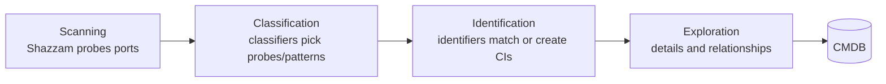

# Discovery

**Agent:** Kilo (deepseek-flash) · **Updated:** 2026-11-19 · **App:** ITOM Visibility · **Confidence:** high (official docs)

Discovery is ServiceNow's horizontal discovery product. It scans networks, classifies devices,
identifies configuration items (CIs), explores their details, and updates the CMDB. It is the
engine that makes the rest of ITOM possible.

---

## Contents

- [Purpose](#purpose)
- [ELI5](#eli5)
- [Where to find it](#where-to-find-it)
- [Prerequisites](#prerequisites)
- [Horizontal vs top-down discovery](#horizontal-vs-top-down-discovery)
- [The four phases](#the-four-phases)
- [Probes, sensors, and patterns](#probes-sensors-and-patterns)
- [MID Server](#mid-server)
- [Types of discovery](#types-of-discovery)
- [Containers and Kubernetes](#containers-and-kubernetes)
- [Credentials](#credentials)
- [Schedules and run options](#schedules-and-run-options)
- [Proving a run: status, ECC queue, logs](#proving-a-run-status-ecc-queue-logs)
- [IP service affinity](#ip-service-affinity)
- [Identification, reconciliation, and CMDB quality](#identification-reconciliation-and-cmdb-quality)
- [Key tables](#key-tables)
- [Roles](#roles)
- [Out-of-box features and integrations](#out-of-box-features-and-integrations)
- [Common mistakes](#common-mistakes)
- [Lab](#lab)
- [Quiz](#quiz)
- [Official sources](#official-sources)
- [Related guides](#related-guides)

---

## Purpose

Discovery answers **what exists** and keeps the answer current. It finds computers, servers,
printers, IP-enabled devices, and the applications running on them, then updates the CIs and
relationships in the CMDB.

The official docs are clear about the boundary: horizontal discovery finds CIs and direct
relationships (for example, an application *runs on* a server). It does **not** understand
business services. Connecting CIs into a service is Service Mapping's job (top-down discovery).

---

## ELI5

Discovery is a census taker with a clipboard and a set of keys.

- It walks the neighbourhood (your IP ranges).
- It knocks on doors (probes ports).
- It checks what kind of building it is (classification).
- It checks whether this building is already in the register (identification).
- It writes down the details and who connects to whom (exploration).
- If it cannot get in, it writes down why (discovery log and ECC queue).

A census that only counts doors is not useful. Discovery is valuable because it reconciles what
it found with what the CMDB already knows.

---

## Where to find it

| Task | Breadcrumb |
|---|---|
| Discovery schedules | `All > Discovery > Discovery Schedules` |
| Discovery status | `All > Discovery > Status` |
| Discovery log / ECC queue | Open a status record → related lists |
| Discovery Configuration Console | `All > Discovery > Discovery Definition > Configuration Console` |
| Credentials | `All > Discovery > Credentials` (or the ITOM Configuration Console) |
| MID Servers | `All > MID Server > Servers` |
| Discovery Admin Workspace | `All > Discovery > Discovery Admin Workspace` (where installed) |

---

## Prerequisites

| Prerequisite | Why it matters |
|---|---|
| ITOM Visibility subscription and `com.snc.discovery` plugin | Discovery is not a base-platform feature |
| MID Server, Up and Validated | Executes probes and patterns inside the network |
| Credentials for each target type | SSH, Windows/WMI, SNMP, cloud API, VMware, etc. |
| IP ranges or cloud accounts | Defines what to scan |
| CMDB classes and identification rules | Decides whether a found device matches an existing CI |
| `discovery_admin` role | Configure and run Discovery |
| A maintenance/change window for first runs | Large scans can be disruptive |

A PDI may not include the plugin or a MID Server. Use the design-only path in the lab if so.

---

## Horizontal vs top-down discovery

| Method | Product | What it finds | What it does not do |
|---|---|---|---|
| **Horizontal** | Discovery | CIs and direct relationships | Does not understand business services |
| **Top-down** | Service Mapping | Service instances and dependencies from an entry point | Does not replace the need for CMDB data |

They are complementary. The usual sequence is horizontal first, then top-down.

---

## The four phases

### 1. Scanning

Discovery sends the **Shazzam** probe to see whether commonly used ports are open and whether
they respond. For example, a device responding on port 135 suggests a Windows server.

### 2. Classification

If devices are found, Discovery sends additional probes to determine the device type and
operating system. **Classifiers** specify the trigger probe or probes for the next phases. With
patterns, the classifier specifies a trigger probe that launches a pattern.

### 3. Identification

Discovery gathers more information and decides whether a CI already exists in the CMDB. It uses
**identifiers** (identification rules) to reconcile the discovered attributes with existing
CIs. If a match is found, the CI is updated; if not, a new CI may be created. With patterns, the
appropriate identification rule for the CI type is used.

### 4. Exploration

The identifier launches additional probes configured in the classifier. These probes gather
details such as applications, memory, network cards, and drivers, and Discovery creates
relationships between applications and devices. With patterns, the pattern operations perform
the exploration.

> **Exam and documentation note:** the official phases are **Scanning, Classification,
> Identification, Exploration**. The popular mnemonic "PCIE" (Probe, Classifier, Identifier,
> Explorer) is a shorthand, not the official phase list. Use the official names.

---

## Probes, sensors, and patterns

| Mechanism | What it is | Language | When it runs |
|---|---|---|---|
| **Probe** | Script that explores or investigates a CI on the network | JavaScript | Early phases and exploration |
| **Sensor** | Script that parses the data returned by a probe | JavaScript | After a probe returns |
| **Pattern** | Sequence of operations that detects CI attributes and outbound connections | Neebula Discovery Language (NDL) | Later stages; also used by Service Mapping |

Probes collect; sensors parse. Patterns are the more modern, reusable mechanism and are the main
method for Service Mapping. You can customise or create patterns with the Pattern Designer.

---

## MID Server

A MID Server is a ServiceNow process inside the enterprise network. It constantly queries the
instance for probes to run, executes the instructions, and returns results to the instance,
where sensors process them. **The MID Server does not retain discovery information.**

Key properties:

- It starts all communication using SOAP over HTTPS, from inside the firewall. No special
  inbound firewall rules or VPNs are normally required.
- Discovery is **agentless**: no permanent software is installed on the target.
- It uses protocols such as SSH (Unix/Linux), WMI/WinRM (Windows), and SNMP (network devices).
- If it cannot reach a subnet, that subnet cannot be discovered, regardless of credentials.

Placement is an architecture decision, not an afterthought. One MID Server per network segment,
or a MID Server cluster for scale and failover, is common.

---

## Types of discovery

| Type | What it finds | Notes |
|---|---|---|
| **Network discovery** | Internal IP networks | Useful when you do not already know the ranges |
| **CI discovery** | Devices, computers, and applications | The most common type |
| **Cloud discovery** | AWS and Azure resources | Uses cloud APIs and credentials |
| **Serverless discovery** | Applications on hosts without discovering the host first | Relies on patterns |
| **Service** | Service instances for Service Mapping | Top-down; see Service Mapping |
| **Certificates** | TLS certificates by URL | Certificate Inventory and Management |
| **IP address scan** | Live IPs without credentials | Creates device history but does not update the CMDB |

---

## Containers and Kubernetes

Containerised estates are not optional in a modern ITOM design. Discovery finds container
management resources, and ServiceNow provides two complementary Kubernetes paths plus a
workspace for exploring the result.

### Pattern-based Kubernetes discovery

The Kubernetes pattern discovers Kubernetes and OpenShift components and creates application
services containing them. Discovery also finds Kubernetes events and updates the CMDB frequently
because the environment is dynamic.

Key points from the official documentation:

- **OpenShift** support is delivered by an extension section of the Kubernetes pattern.
- **Service mesh** discovery uses an Istio/Prometheus extension and can create service-to-service
  relationships.
- **Container registries and images** are found by the container repository extension.
- **Large clusters** can use the `Kubernetes Cluster - Per-Namespace LP` pattern (Discovery and
  Service Mapping Patterns 1.35.1+), which discovers each namespace separately to improve
  reliability.
- **Kubernetes Event** pattern discovers events for Kubernetes components.
- **Service Mapping** can use CI relationships to add Kubernetes components to application
  services during tag-based discovery (Store 1.0.68+).

### Prerequisites in practice

| Requirement | Why it matters |
|---|---|
| Latest Discovery and Service Mapping Patterns app | The Kubernetes patterns and extensions ship in the Store app |
| Kubernetes API server URL | From `kubectl cluster-info`; must be reachable from the MID Server |
| Namespaces | From `kubectl get namespaces` |
| Kubernetes credential | User/password **or** a Bearer token, not both |
| GET permissions on the required API endpoints | Namespaces, services, pods, nodes, deployments, statefulsets, daemonsets, replicasets, cronjobs, jobs, ingresses |
| Serverless discovery schedule | The Kubernetes pattern is run as a serverless schedule |
| RBAC check for per-namespace discovery | A namespace-scoped RoleBinding must exist in each namespace the LP pattern enumerates |

### Kubernetes Visibility Agent

The Kubernetes Visibility Agent is the continuous-discovery option. It detects changes on
resources in a Kubernetes cluster, performs continuous discovery, reports changes back to the
instance, and updates the CMDB with the latest data.

Use it when the cluster changes faster than a scheduled pattern run can keep up with. Use the
pattern when you need the pattern-based inventory and Service Mapping integration.

### Kubernetes Explorer

The Discovery Admin Workspace includes a **Kubernetes Explorer** dashboard (Discovery Admin
Workspace 1.20.0+, `discovery_admin` role). It provides:

- Overview counts and trends for clusters, nodes, namespaces, services, and pods.
- Cluster, service, node, workload, pod, and Docker image tabs.
- Dependency Views and key values for each resource.
- Pod state counts (running, pending, creating, crashloop backoff) and workload replica
  mismatches.

The dashboard is a view over discovered data. If the cluster was never discovered, the dashboard
is empty.

### Container image scanning and SBOM

Discovery also supports container image scanning and software decomposition, including
software bill of materials (SBOM) generation. That data is useful for software asset management
and vulnerability workflows, but it is a separate content area from Kubernetes topology.

### What to verify

- Does the credential use exactly one authentication method?
- Can the MID Server reach the API server?
- Did the schedule run as **Serverless**?
- Are namespaces and workloads appearing in the CMDB?
- Do Service Mapping tag-based maps include the Kubernetes components?
- Is the Kubernetes Explorer showing the same clusters the platform team sees?

If any answer is no, check the pattern version, credentials, RBAC, and MID Server reachability
before changing the schedule.

---

## Credentials

Discovery tries each credential in the order you specify until one works for a device. Order
matters, especially when security policies lock out users after failed login attempts.

Common IP credential types in the Australia documentation:

- Applicative Credentials (applications on a host)
- Basic Auth Credentials
- CIM Credentials
- Kubernetes Credentials
- oVirt Credentials
- SNMP Community Credentials (password only)
- SNMPv3 Credentials
- SSH Credentials
- SSH Private Key Credentials
- SSL Keystore Credentials
- VMware Credentials
- Windows Credentials (WMI or WinRM)

Credential aliases let you define a credential once and reference it across configurations.
Use them; rotating a shared alias is cheaper than editing every schedule.

---

## Schedules and run options

A Discovery schedule defines **what** to scan, **which MID Server** runs it, and **when**.

Key fields from the official schedule reference:

| Field | What it controls |
|---|---|
| **Discover** | Configuration items, IP addresses, Networks, Service, Serverless, Cloud application, Cloud resources, Certificates |
| **MID Server selection method** | Auto-select, specific cluster, specific MID Server, or behaviour |
| **MID Server / cluster / behaviour** | The execution path |
| **Active** | Whether the schedule can run automatically (manual runs still possible) |
| **Location** | Location assigned to discovered CIs |
| **Max run time** | Cancels remaining tasks when the limit is reached |
| **Max idle time** | Cancels stalled runs; may need to be added to the form |
| **Run** | Frequency and time window; uses the system time zone |
| **Shazzam batch size** | How many IPs each Shazzam probe scans (minimum effective batch 256) |
| **Shazzam cluster support** | Distributes Shazzam work across a MID Server cluster |
| **Use SNMP Version** | ALL, v1, v2c, or v3 |
| **Quick ranges** | Comma-delimited IPs, ranges, or subnets |
| **Discover now** | Starts the schedule immediately |

Related lists include **IP Ranges**, **Discovery Range Sets**, **Discovery Status**, **Global IP
Exclusion**, **Discovery Attributes**, and **Certificate URLs**.

Two guardrails:

- Scope ranges tightly. Do not scan the whole corporate estate on day one.
- Set max run time and max idle time so a stuck run does not run forever.

---

## Proving a run: status, ECC queue, logs

A discovery is not "done" because the schedule fired. Open the **Discovery Status** record.

| Area | What it tells you |
|---|---|
| **State** | Starting, Active, Completed, Canceled |
| **Started / Completed** | Probe counts |
| **Discovery log** | Classification failures, CMDB updates, authentication failures |
| **ECC queue** | Probe/sensor messages and XML payloads |
| **Discovery timeline** | Graphical view of probes and sensors |
| **Device history** | Every device scanned and the action taken |

### ECC queue

The External Communication Channel (ECC) queue is the connection point between the instance and
the MID Server.

- **Output records** carry instructions to the MID Server. They move Ready → Processing →
  Processed.
- **Input records** carry results back. They move Ready → Processing → Processed, or **Error**
  when something fails.
- Some input records can remain in Ready if no business rule processes them.
- The queue can grow to gigabytes. By default, records older than seven days are deleted;
  retain at least a month for troubleshooting.
- Enabling **Save ECC queue attachments** preserves attachments that are normally deleted after
  successful sensor processing. Use it for debugging, not permanently.

If a discovery fails, read the ECC error before changing credentials or ranges. The error names
the phase and the payload.

---

## IP service affinity

IP service affinity stores the protocol that successfully found a device and associates it with
the device's IP address in the `ip_service_affinity` table. On later runs, Discovery tries that
protocol first.

Example: a network device has SSH and SNMP open. Discovery tries SSH first because it is
agentless. SSH fails, SNMP succeeds. The affinity record means the next run tries SNMP first.

This is why "it worked on the second run" is a real phenomenon, not luck.

---

## Identification, reconciliation, and CMDB quality

Discovery's value depends on the CMDB's identification and reconciliation rules.

- **Identification** asks: is this the same CI we already have?
- **Reconciliation** asks: which data source wins for each attribute?

If identification is weak, you get duplicate CIs. Duplicates then split relationships, service
maps, alerts, and reports. Fix identification before adding more schedules.

Practical checks:

- Does each CI class have a sensible identifier (serial number, FQDN, MAC, cloud resource ID)?
- Are there duplicate CIs for the same device?
- Are discovery sources competing with Service Graph Connectors or manual data?
- Are CI classes and CSDM aligned with how the business describes services?

---

## Key tables

| Table | What it is |
|---|---|
| `cmdb_ci` and `cmdb_ci_*` | CI records |
| `cmdb_rel_ci` | CI relationships |
| `discovery_schedule` | Schedule definitions |
| `discovery_port_probe` | Port probes |
| `discovery_classy` | Classifiers |
| `discovery_classy_proc` | Process classifiers |
| `sa_pattern` | Discovery patterns |
| `ecc_queue` | ECC messages |
| `ecc_queue_event` | ECC events |
| `ip_service_affinity` | Successful protocol per IP |

More: [Roles and tables](../../04-roles-tables.md).

---

## Roles

| Role | Scope |
|---|---|
| `discovery_admin` | Configure credentials, schedules, and discovery settings; run discovery |
| `admin` | Everything; bypasses ACLs; not a valid test |

Test with the real discovery admin, not only with admin.

---

## Out-of-box features and integrations

- **Discovery patterns** for common operating systems, databases, web servers, network devices,
  cloud resources, and applications.
- **Pattern Designer** for custom patterns.
- **Discovery Admin Workspace** (where installed) for reviewing content and suggestions.
- **ITOM Content Service** for weekly AI-classified process/SNMP suggestions.
- **Service Graph Connectors** for third-party data that Discovery does not collect.
- **Cloud discovery** for AWS, Azure, GCP, VMware, and others.
- **Certificate discovery** for TLS certificates.

---

## Common mistakes

| Mistake | Symptom | Fix |
|---|---|---|
| Huge single range | Run never completes; ECC queue enormous | Split ranges, batch Shazzam, set max run/idle time |
| Wrong credential order | Lockouts; some devices unclassified | Order credentials; use aliases; check lockout policy |
| MID Server outside the subnet | No CIs from a live range | Place a MID Server in the segment; check routes/firewall |
| "Found" treated as "reconciled" | Device history shows a scan, but no CI update | Read identification; fix identifiers |
| Ignoring ECC errors | "Discovery is broken" with no evidence | Read ECC queue, log, timeline, device history |
| No IP exclusions | Scans forbidden or fragile ranges | Use Global IP Exclusion and tight ranges |
| Duplicate CIs | Maps and alerts split | Fix identification/reconciliation before adding schedules |
| Only testing as admin | Works for you, not for the operator | Test with `discovery_admin` and real groups |

More: [Common mistakes](../../05-common-mistakes.md).

---

## Lab

[Lab 01 — Discovery](../../../labs/LAB-01-DISCOVERY.md)

You will create a tightly scoped schedule, verify each phase, break a credential on purpose,
read the ECC evidence, fix it, and write down what the CMDB actually changed.

If your instance has no MID Server or Discovery entitlement, use the lab's design-only path:
draw the phases, the records, and the exact evidence you would collect.

---

## Quiz

1. **Name the four official discovery phases in order.**
   

Answer
Scanning, Classification, Identification, Exploration.

2. **What does Shazzam do?**
   

Answer
Scans for open, responsive ports to identify device types and trigger classification.

3. **What is the difference between a probe and a sensor?**
   

Answer
A probe collects data from a target; a sensor parses the returned data and updates the CMDB.

4. **Where do you look first when a discovery fails?**
   

Answer
The Discovery Status record: discovery log, ECC queue, timeline, and device history.

5. **Why does IP service affinity matter?**
   

Answer
It records which protocol succeeded for an IP so later runs try that protocol first.

6. **What does horizontal discovery not do?**
   

Answer
It does not map business services or build service instances; that is Service Mapping (top-down).

7. **How does Discovery discover Kubernetes?**
   

Answer
With the Kubernetes pattern in a serverless discovery schedule (credentials + API server reachability + GET permissions), or continuously with the Kubernetes Visibility Agent. The Kubernetes Explorer dashboard shows the discovered resources.

---

## Official sources

- Exploring Discovery — <https://www.servicenow.com/docs/r/australia/it-operations-management/discovery/c_GetStartedWithDiscovery.html>
- Discovery schedule reference — <https://www.servicenow.com/docs/r/australia/it-operations-management/discovery/discovery-schedule-form.html>
- Discovery status — <https://www.servicenow.com/docs/r/australia/it-operations-management/discovery/c_DiscoveryStatus.html>
- ECC queue for Discovery — <https://www.servicenow.com/docs/r/australia/it-operations-management/discovery/r_DiscoveryStatusECCQueue.html>
- Create IP credentials — <https://www.servicenow.com/docs/r/australia/it-operations-management/discovery/create-ip-credentials.html>
- Discovery Configuration Console — <https://www.servicenow.com/docs/r/australia/it-operations-management/discovery/c_DiscoveryConfigurationConsole.html>
- Discovery for containerized resources — <https://www.servicenow.com/docs/r/australia/it-operations-management/discovery/container-discovery.html>
- Kubernetes discovery using patterns — <https://www.servicenow.com/docs/r/australia/it-operations-management/discovery/kubernetes-discovery.html>
- Kubernetes Visibility Agent — <https://www.servicenow.com/docs/r/australia/it-operations-management/discovery/acc-kubernetes-visibility-landing-page.html>
- Kubernetes Explorer dashboard — <https://www.servicenow.com/docs/r/australia/it-operations-management/discovery/kubernetes-explorer-dash.html>
- ITOM Visibility and CMDB tables — <https://www.servicenow.com/docs/r/australia/it-operations-management/itom-visibility/itom-visibility-use-case.html>
- ITOM Visibility — <https://www.servicenow.com/docs/r/australia/it-operations-management/itom-visibility/itom-visibility-landing-page.html>

---

## Related guides

- [Service Mapping](../service-mapping/service-mapping-guide.md)
- [Visibility suite](../visibility-suite/visibility-suite-guide.md)
- [Roles and tables](../../04-roles-tables.md)
- [Licensing and prerequisites](../../03-licensing-prerequisites.md)
- [Lab 01](../../../labs/LAB-01-DISCOVERY.md)
