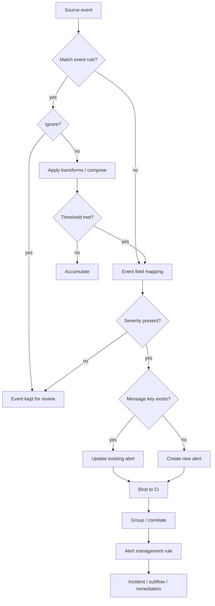

# Event Management

**Agent:** Kilo (deepseek-flash) · **Updated:** 2026-11-19 · **App:** ITOM AIOps · **Confidence:** high (official docs)

Event Management is the detection and triage engine of ITOM AIOps. It collects events from
monitoring tools and infrastructure, turns them into alerts, groups related alerts, binds them
to configuration items, prioritises them, and triggers a response.

It is the product most people mean when they say "ITOM monitoring" — and the one most often
misconfigured into an alert storm.

---

## Contents

- [Purpose](#purpose)
- [ELI5](#eli5)
- [Where to find it](#where-to-find-it)
- [Prerequisites](#prerequisites)
- [Event vs alert vs incident](#event-vs-alert-vs-incident)
- [Event sources and connectors](#event-sources-and-connectors)
- [The process flow](#the-process-flow)
- [Event rules](#event-rules)
- [Event field mapping](#event-field-mapping)
- [Alert generation and message keys](#alert-generation-and-message-keys)
- [CI binding](#ci-binding)
- [Alert correlation and grouping](#alert-correlation-and-grouping)
- [Alert management rules](#alert-management-rules)
- [Alert priority](#alert-priority)
- [Severity and states](#severity-and-states)
- [Roles](#roles)
- [Key tables](#key-tables)
- [Dashboards and workspaces](#dashboards-and-workspaces)
- [Common mistakes](#common-mistakes)
- [Lab](#lab)
- [Quiz](#quiz)
- [Official sources](#official-sources)
- [Related guides](#related-guides)

---

## Purpose

Event Management keeps IT systems healthy by spotting problems quickly and turning them into
work. The official product page describes it as collecting events from different sources,
figuring out what is causing the issues, converting them into alerts, and then analysing,
grouping, and acting on those alerts.

The value is not "more monitoring". The value is **fewer, better alerts, bound to the right CI,
with an owner and an action**.

---

## ELI5

Your house has forty smoke detectors, a burglar alarm, a water-leak sensor, and a power monitor.

- Each reading is an **event**. Most are boring (a door opened, a temperature changed).
- The fire panel is **Event Management**. It turns forty smoking-detector events into one
  "fire on floor 3" **alert**.
- The panel knows which floor plan the alarm belongs to — that is **CI binding**.
- The panel decides whether to call the fire brigade — that is an **alert management rule**
  opening an **incident**.
- If the panel screams for every detector separately, nobody responds. That is an alert storm.

---

## Where to find it

| Task | Breadcrumb |
|---|---|
| Event rules | `All > Event Management > Rules > Event Rules` |
| Alert correlation rules | `All > Event Management > Rules > Alert Correlation Rules` |
| Alert management rules | `All > Event Management > Rules > Alert Management Rules` |
| Event field mappings | `All > Event Management > Rules > Event Field Mappings` |
| Alerts | `All > Event Management > Alerts > All Alerts` |
| Events | `All > Event Management > Events > All Events` |
| Connectors | `All > Event Management > Integrations > Connectors` (label may vary) |
| Service Operations Workspace | `All > Service Operations Workspace` |
| Express List | Service Operations Workspace / Event Management |

---

## Prerequisites

| Prerequisite | Why it matters |
|---|---|
| ITOM AIOps subscription | Event Management is a separate subscription |
| Event Management plugins and Store apps | The connector and alert rule framework |
| A MID Server | For pull connectors and on-premises sources |
| A source of events | Monitoring tool, cloud provider, SNMP trap, email, API, or test payload |
| CMDB CIs | Without CIs, alerts cannot bind or show impact |
| Assignment groups | Without groups, alerts have no owner |
| `evt_mgmt_admin` for configuration | Rules and scripts are privileged |
| `evt_mgmt_operator` / `evt_team_operator` for operation | Test as the real operator |

---

## Event vs alert vs incident

| Record | Table | What it is | Who works it |
|---|---|---|---|
| **Event** | `em_event` | Raw report from a source | Nobody directly; it is evidence |
| **Alert** | `em_alert` | Deduplicated, enriched, prioritised, CI-bound work item | NOC / operator |
| **Incident** | `incident` | ITIL ticket to restore service | Service desk / resolver group |

The flow is:

```
source → em_event → event rule → em_alert → alert management rule → incident
```

An event can exist without an alert (ignored, no severity, no rule). An alert can exist without
an incident (manual triage). An incident can exist without an alert (user call). Do not assume
one-to-one.

---

## Event sources and connectors

Event Management provides many connectors, plus custom connectors. The official connector page
groups them into **pull** and **push** connectors.

Examples of pull connectors include Azure Monitor, HPOM, Hyperic, LogicMonitor, IBM Netcool,
Icinga2, Apache Kafka Consumer, ServiceNow Cloud Observability, Nagios XI, NNMi, OBM/OMi,
Op5, Opsview, PRTG, SAP Solution Manager, SCOM, SolarWinds, vCenter, vRealize, and Zabbix.

Examples of push connectors include AWS, Azure, BMC TrueSight, New Relic, Dynatrace, Datadog,
Catchpoint, GCP, LogicMonitor, Oracle Cloud, Prometheus, Sentry, SNMP traps, ThousandEyes,
Email, Grafana, EIF, Honeycomb, Instana, Scout APM, and Panopta.

There is also a generic JSON endpoint:

```
https://<instance>/api/sn_em_connector/em/inbound_event?source=genericJson
```

It requires an event rule to be configured. This is useful for a lab or a custom source.

**Connector choice is an architecture decision.** A pull connector needs a MID Server route; a
push connector needs the source to reach the instance. Both need credentials, a source name, and
an event rule.

---

## The process flow



The official process flow, step by step:

1. **Match event rule** — the event source matches the rule's source, and optional filters
   match. A rule without a filter is ignored; order decides which rule applies.
2. **Ignore rule** — if Ignore is selected, no alert is generated, but the event remains for
   review.
3. **Apply transforms** — compose fields and apply transformations.
4. **Threshold accumulation** — if threshold is active, accumulate events until the threshold
   is met, then generate one alert.
5. **Event field mapping** — apply mappings even if no event rule matched. If the event has no
   severity after transformation, keep it for reference and do not create an alert.
6. **Alert generation** — search `em_alert` for a matching message key. If found, update the
   alert; if not, create one. Events with the same key are associated under one alert. Bind the
   alert to a CI for root cause.

This flow is the single most useful thing to memorise. When an alert does not appear, walk the
flow backwards from the event.

---

## Event rules

An event rule decides whether an event generates an alert and how that alert looks.

Key fields and behaviours from the official rule documentation:

| Element | What it does |
|---|---|
| **Source** | The event class the rule applies to; empty means all events |
| **Order** | Evaluation order when multiple rules match; ascending |
| **Apply additional matching rules** | Runs subsequent matching rules in order; the last binding wins; disables the threshold tab |
| **Assignment group** | Makes the rule team-based; global rules run first, then the team's rules |
| **Event filter** | Restricts which events the rule applies to |
| **Transform and compose** | Populates and composes alert fields |
| **Threshold** | Creates or closes alerts only when matching events exceed a threshold |
| **Binding** | Binds the alert to a CI using CI identifiers |

Rules that do not perform an action (ignore, threshold, or binding) are skipped. If you want a
rule to do something, specify either the match fields or the composed fields.

Do not change the Classification field on `em_event` manually, by script, or by an event rule.

### Rule order in practice

1. Write a specific rule for the source and a narrow filter.
2. Test it with a real sample payload, including missing fields.
3. Add a broader rule only after the specific one behaves.
4. Use team-based rules when different teams own different sources.
5. Remember: a rule without a filter is ignored.

---

## Event field mapping

Event field mapping maps values from source fields to alert fields. It applies **after event
rule processing and before alert generation**. The original event severity remains unchanged.

Mappings are stored in:

- `em_mapping_rule` — the rule
- `em_mapping_pair` — the value pairs

Example from the official docs:

| Original `org_severity` | Alert `Severity` |
|---|---|
| Low | Warning |
| Medium | Major |
| High | Critical |

Default mappings exist for many common monitoring tools. Check them before writing your own.

If an event has no severity after transformation, no alert is generated. That is a feature, not
a bug — but it is also a common reason "the event arrived and nothing happened".

---

## Alert generation and message keys

The alert is created or updated by **message key**. If two events share the same key, they are
associated under one alert. This is the first layer of deduplication.

Practical implications:

- A message key that is too broad merges unrelated failures.
- A message key that is too narrow creates duplicate alerts.
- The key is derived from event fields and rule configuration; document your convention.
- The alert is then bound to a CI. An unbound alert is still workable but loses impact and
  root-cause context.

---

## CI binding

CI binding links an alert to the configuration item it affects. Event data often lacks an
explicit CI reference, so event rules parse and match hostnames, IPs, tags, or identifiers.

Official binding types:

| Type | How it works |
|---|---|
| **Implicit node binding** (default) | Matches the event `Node` field to CI attributes such as Name, FQDN, IP, or MAC |
| **CI field matching binding** | Uses the CI Identifier field, a JSON structure of column names and values |
| **CI identification binding** | Binds to specific applications on hosts |
| **Process-level binding** | Matches process-related attributes to application CIs |
| **Device-level binding** | Matches event data to device CIs by hostname, IP, or MAC |

If binding fails, the alert remains unlinked. It can still be worked, but impact analysis and
service context are missing.

**Test the binding.** Use a hostname that exists in the CMDB, then use one that does not, and
compare the two alerts.

---

## Alert correlation and grouping

Correlation groups related alerts under a **primary** alert. The primary is treated as the root
cause; the others become **secondary**.

Official methods include:

- **Rule-based alert grouping** — create an alert correlation rule and designate primary and
  secondary alerts. Navigate to `Event Management > Rules > Alert Correlation Rules`.
- **Automated grouping / Group automation** — grouping automation in the Service Operations
  Workspace.
- **Alert grouping and response sync** — ensure the response jobs run after grouping so
  secondary alerts do not each open an incident.

Why it matters:

- One outage should produce one incident, not forty.
- The primary/secondary relationship drives the priority score and the operator's mental model.
- Grouping is not the same as suppression. Grouped alerts still exist; they are organised.

---

## Alert management rules

An alert management rule determines the response to an alert: open an incident, launch a
subflow, run a remediation action, open a task, launch an application or URL, or take another
configured action.

Official behaviours:

- Rules are provided as a Store application (Alert Rules Management, `sn_em_arm`).
- Filters decide which alerts the rule applies to.
- Actions can run a subflow, perform remediation, launch an application, or launch a URL.
- Execution history is recorded on the rule record.
- Rules are evaluated by a scheduled job; the default is every 11 seconds and can be scaled for
  large environments through Support.
- The alert grouping job and the alert response job run independently; coordinate them so
  secondary alerts do not create duplicate incidents.
- Subflows are recommended over legacy workflows for performance.

**Design pattern:** group first, respond second, and make the response idempotent. A rule that
opens an incident every time it runs is a duplicate factory.

---

## Alert priority

Alert priority is a composite score. Official categories and default weights:

| Category | Default weight / effect |
|---|---|
| Number of impacted business services (weighted by business criticality) | × 1,000,000 |
| Severity | × 100,000 |
| CI type | × 100 |
| Alert role (Parent / None / Secondary) | × 10 |
| Number of secondary alerts | Direct count |
| State | × 0.001 |

The score is not calculated for closed alerts or alerts with severity `OK`. It recalculates when
severity, state, role, CI binding, or the number of secondary alerts changes. Severity changes
trigger an immediate partial recalculation.

Tuning tables:

- `em_alert_priority_category_order` — category order
- `em_alert_priority_category_mapping` — value mapping
- `em_alert_priority_ci_type` — CI type weights

The lesson: priority is a model, not a feeling. If a router alert should outrank a workstation
alert, configure the CI type weight instead of asking operators to triage harder.

---

## Severity and states

### Severity

The alert severity values used in the priority model are:

- Critical
- Major
- Minor
- Warning
- OK (no priority score)

Source tools often use different labels (Low/Medium/High, 1–5, or text). Use event field mapping
to translate them.

### States

Alert states seen in the Australia docs include:

- **Open**
- **Reopen**
- **Flapping**
- **Closed**

Operational states include **Acknowledged** and **Maintenance**. The priority model assigns
default weights to Open, Reopen, and Flapping; closed alerts do not get a score.

Discovery status states are separate: Starting, Active, Completed, Canceled.

---

## Roles

| Role | Scope |
|---|---|
| `evt_mgmt_admin` | Configure Event Management; can create/modify global scripts, correlation rules, alert management rules, maintenance rules, field mappings, pre/post-binding scripts. Privileged. |
| `evt_mgmt_operator` | Operate alerts; acknowledge, close, manually run alert management rules |
| `evt_team_operator` | Operate within an assignment group; must be assigned to the group |
| `evt_mgmt_user` | View and acknowledge alerts |
| `admin` | Everything; not a valid test |

The `evt_mgmt_admin` role can be elevated to admin. Treat it as a configuration role, not a
daily driver.

---

## Key tables

| Table | What it is |
|---|---|
| `em_event` | Events |
| `em_alert` | Alerts |
| `em_mapping_rule` | Event field mapping rule |
| `em_mapping_pair` | Mapping value pairs |
| `em_alert_priority_category_order` | Priority category order |
| `em_alert_priority_category_mapping` | Priority value mapping |
| `em_alert_priority_ci_type` | CI type weights |

More: [Roles and tables](../../04-roles-tables.md).

---

## Dashboards and workspaces

- **Service Operations Workspace (SOW)** — the primary operator workspace for alerts, service
  health, and AIOps.
- **Express List** — a compact alert list for triage and state changes.
- **Alert Intelligence** — alert list and investigation views.
- **Service map / impact tree** — shows the service context of an alert.
- **Event Management dashboards** — alert volume, severity, and processing health (availability
  depends on installed content).

A dashboard is not proof. Open the alert, the event, and the CI.

---

## Common mistakes

| Mistake | Symptom | Fix |
|---|---|---|
| No event rule for a connector | Events arrive, no alerts | Create a rule with source and filter; test with simulation |
| Rule without a filter | Every event matches | Add source/additional-information filters |
| No CI binding | Alerts unbound; no impact | Configure implicit or field-matching binding; verify |
| No correlation | Alert storm | Create correlation rules; designate primary/secondary |
| Duplicate incidents | Multiple incidents per outage | Group first; sync response; test secondary alerts |
| No maintenance rules | Change windows create storms | Create maintenance rules; test CI-in-maintenance behaviour |
| Assuming severity | Alerts dropped or mis-prioritised | Check field mapping and the actual choice list |
| Silencing symptoms | Alert count falls; outage remains | Fix binding/correlation/thresholds |
| Testing only with clean data | Works in lab, fails in production | Use a real payload with missing fields |
| Only testing as admin | Operator sees nothing | Impersonate operator/team operator |

More: [Common mistakes](../../05-common-mistakes.md).

---

## Lab

[Lab 02 — Event to incident](../../../labs/LAB-02-EVENT-TO-INCIDENT.md)

You will send a test event, create an event rule, map severity, bind the alert to a CI, group a
secondary alert, and open one incident with an alert management rule. Then you will break the CI
binding and prove what changes.

---

## Quiz

1. **What is the difference between an event and an alert?**
   <details><summary>Answer</summary>An event is a raw report in `em_event`; an alert is the deduplicated, enriched, prioritised, CI-bound work item in `em_alert`.</details>

2. **What happens if an event rule has no filter?**
   <details><summary>Answer</summary>The rule is ignored; a rule needs a source filter and, where used, an additional-information filter.</details>

3. **Where do event field mappings apply?**
   <details><summary>Answer</summary>After event rule processing and before alert generation. The original event severity is unchanged.</details>

4. **What is a message key used for?**
   <details><summary>Answer</summary>Matching an event to an existing alert so events can update one alert instead of creating duplicates.</details>

5. **Name three CI binding types.**
   <details><summary>Answer</summary>Implicit node binding, CI field matching, CI identification, process-level, and device-level (any three).</details>

6. **What does an alert management rule do?**
   <details><summary>Answer</summary>It responds to an alert by opening an incident, running a subflow, launching remediation, opening a task, or launching an app/URL.</details>

7. **Which severity does not get a priority score?**
   <details><summary>Answer</summary>`OK`; closed alerts also do not get a score.</details>

---

## Official sources

- Event Management — <https://www.servicenow.com/docs/r/australia/it-operations-management/event-management/c_EM.html>
- Exploring Event Management — <https://www.servicenow.com/docs/r/australia/it-operations-management/event-management/exploring-event-management.html>
- Event Management process flow — <https://www.servicenow.com/docs/r/australia/it-operations-management/event-management/em-process-flow.html>
- Event Management architecture — <https://www.servicenow.com/docs/r/australia/it-operations-management/event-management/em-architecture.html>
- Configure connectors — <https://www.servicenow.com/docs/r/australia/it-operations-management/event-management/connectors-and-listeners.html>
- Create or edit an event rule — <https://www.servicenow.com/docs/r/australia/it-operations-management/event-management/create-or-edit-event-rule.html>
- Event field mapping — <https://www.servicenow.com/docs/r/australia/it-operations-management/event-management/c_EMEventFieldMapping.html>
- Binding alerts to CIs — <https://www.servicenow.com/docs/r/australia/it-operations-management/event-management/ci-binding-alert.html>
- Create an alert correlation rule — <https://www.servicenow.com/docs/r/australia/it-operations-management/event-management/t_EMConfigureAnEventCorrelationRule.html>
- Alert management rules — <https://www.servicenow.com/docs/r/australia/it-operations-management/event-management/alert-management-rule.html>
- Alert priority — <https://www.servicenow.com/docs/r/australia/it-operations-management/event-management/alert-priority.html>
- Manage alert states — <https://www.servicenow.com/docs/r/australia/it-operations-management/event-management/manage-alert-states-in-express-list.html>

---

## Related guides

- [Health Log Analytics](../health-log-analytics/health-log-analytics-guide.md)
- [Reliability stack](../reliability-stack/reliability-stack-guide.md)
- [Metric Intelligence](../metric-intelligence/metric-intelligence-guide.md)
- [Roles and tables](../../04-roles-tables.md)
- [Lab 02](../../../labs/LAB-02-EVENT-TO-INCIDENT.md)
