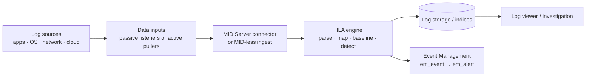

# Health Log Analytics

**Agent:** Kilo (deepseek-flash) · **Updated:** 2026-11-19 · **App:** ITOM AIOps · **Confidence:** high (official docs)

Health Log Analytics (HLA) turns raw logs into structured data, learns what normal looks like,
detects anomalies, and sends events to Event Management. It is the "why did this happen?"
product next to Event Management's "what is wrong?".

HLA is a **separate licence** from Event Management. Do not design a lab that assumes it is
included.

---

## Contents

- [Purpose](#purpose)
- [ELI5](#eli5)
- [Where to find it](#where-to-find-it)
- [Prerequisites](#prerequisites)
- [Architecture](#architecture)
- [Data inputs](#data-inputs)
- [Log mapping](#log-mapping)
- [How alerts are generated](#how-alerts-are-generated)
- [Severity mapping](#severity-mapping)
- [Correlation and filters](#correlation-and-filters)
- [Binding logs to CIs](#binding-logs-to-cis)
- [Roles](#roles)
- [Common mistakes](#common-mistakes)
- [Lab](#lab)
- [Quiz](#quiz)
- [Official sources](#official-sources)
- [Related guides](#related-guides)

---

## Purpose

HLA helps prevent IT issues before users are affected. It:

- collects raw log data streaming into the instance,
- structures textual data into key-value pairs,
- detects meaningful patterns and anomalies,
- sends an event to Event Management when it finds an anomaly.

The official product page frames the value as triaging related logs and analysing the raw data
to find root cause.

---

## ELI5

Your applications write a diary. Most entries are boring: "started", "request served",
"connection closed". One day the diary starts repeating "connection reset" twenty times a
minute.

A human would have to read the diary to notice. HLA reads it for you. It learns the normal
rhythm, notices the change, and taps Event Management on the shoulder: "something is different
here — look at these lines."

HLA is not a search engine for logs. It is a pattern detector that happens to keep the logs.

---

## Where to find it

| Task | Breadcrumb |
|---|---|
| HLA home | `All > Health Log Analytics > ...` |
| Data inputs | `All > Health Log Analytics > Data Inputs` |
| Log viewer | Service Operations Workspace / HLA views |
| Alert rules | `All > Health Log Analytics > Alert Rules` (label may vary) |
| Severity mapping | HLA reference / source type structure |
| Log correlators | HLA analysis views |

Labels vary by Store app version. Use the official docs search if a breadcrumb is wrong.

---

## Prerequisites

| Prerequisite | Why it matters |
|---|---|
| Separate HLA subscription | HLA is licensed separately from Event Management |
| HLA Store app installed | The product is delivered from the Store |
| MID Server | For many data inputs and for clusters/failover |
| A log source | Rsyslog, Beats, Splunk, Kafka, CloudWatch, S3, Azure, Elasticsearch, etc. |
| Storage sizing | Logs are high-volume; plan retention and indexing |
| Time sync | Anomaly detection and correlation depend on correct timestamps |
| Event Management | HLA sends events to Event Management; without it, alerts have nowhere to land |
| Roles | Event Management admin/operator roles are used for many HLA tasks |

---

## Architecture

The official architecture page says HLA collects logs streaming into the instance from endpoints
or data lakes such as Splunk and Elasticsearch. Logs arrive either through a MID Server connector
instance or MID-less ingest, which supports services such as Amazon Data Firehose. HLA identifies
and triages anomalies using unsupervised machine-learning models, groups them, and applies
further algorithms to help identify root cause.

---

## Data inputs

HLA supports passive and active data inputs.

### Passive (listeners)

These wait for data to be pushed and require a network port on the MID Server:

- Rsyslog
- Beats
- Splunk
- TCP
- UDP
- MID Server
- GCP PubSub
- REST API
- Agent Client Collector (with ACC Log Analytics)

### Active (pullers)

These pull from repositories:

- Elasticsearch
- Splunk polling
- Amazon CloudWatch
- Amazon S3
- Microsoft Azure Log Analytics
- Microsoft Azure Event Hubs
- Apache Kafka

For active inputs, HLA supports **MID Server clusters for failover**. The active input runs on a
single MID Server in the cluster; if it fails, tasks move to the next server in the configured
order.

Additional supported streaming tools include Cribl, Edge Delta, and Vector Agent.

**Design decision:** passive vs active is a network and ownership decision. A listener needs an
open port and a sender; a puller needs credentials, connectivity, and a schedule. Neither is
free.

---

## Log mapping

HLA auto-maps every incoming log line to three tags:

1. **Service instance** — based on the service instance specified in the data input setup.
2. **Component** — extracted from fields such as `source`, `path`, `channel`, `namespace_name`,
   `name`, `pod_name`, `source_name`, or `aws_lambda_name`.
3. **Source type** — based on the log structure and format.

You can override the automatic mapping with a JavaScript function. Use **Test mode** to preview
mapping results without creating permanent objects or consuming storage. When you publish and
exit Test mode, temporary indices are deleted.

### AI-assisted mapping

With ServiceNow Otto for ITOM, HLA can suggest optimal log field mappings. This requires the
integration to be activated with the AI option. The AI analyses log patterns and recommends the
best field for mapping; you can override the suggestion.

### Controls

- Stop extracting unneeded data.
- Force extraction of specific terms.
- Limit the number of sources per data input (`log_source.sources_warning_limit` default 500,
  `log_source.sources_critical_limit` default 600 in the docs).
- Bind logs to CIs through a service instance for root-cause correlation.

A log line that is not mapped is still stored, but it is much less useful. Mapping is the
difference between a searchable archive and an operational signal.

---

## How alerts are generated

HLA detects anomalies in several ways:

| Method | What it does |
|---|---|
| **Log anomaly detection** | Tracks baseline behaviour (for example, average events per minute for a pattern) and detects deviations such as a spike |
| **Alert metrics** | Monitors metrics tied to a service instance + component; generates an alert when a metric behaves anomalously |
| **Lexical keywords** | Scans for words such as "crashed" or "failed"; thresholds are based on normal frequency; exceeding the threshold raises an alert |
| **Correlators** | Find related alerts by common keys or values in log data |
| **Advanced alert filters** | Drop alerts that do not indicate a significant issue; can be tested, published, and activated |
| **Custom alert rules** | Define a metric, threshold, and alert properties for a specific case |

Operators can give feedback:

- **Mark significant** — raises the priority of the alert metric.
- **Mute** — removes current and future alerts from that metric until restored.
- **Restore** — returns a metric to normal importance.

HLA sends the resulting event to Event Management. The alert then follows the Event Management
pipeline: field mapping, CI binding, grouping, priority, and response.

---

## Severity mapping

HLA maps raw log severity words to its own severity and then to Event Management alert severity.
Examples from the official mapping table:

| Raw log severity | HLA severity | Event Management alert severity |
|---|---|---|
| TRACE, VERBOSE, FINE, FINER, FINEST | TRACE | Keywords-based |
| DEBUG, DBG, CONFIG | DEBUG | Keywords-based |
| INFO, INFORMATIONAL, INF | INFORMATIONAL | Keywords-based |
| NOTICE, NOTIFICATION | NOTICE | LOW |
| WARNING, WARN | WARNING | MEDIUM |
| ERROR, ERR | ERROR | HIGH |
| CRITICAL, CRIT, FATAL, SEVERE, ALERT, EMERGENCY | CRITICAL / EMERGENCY | CRITICAL |

This table is a common source of confusion. A log line saying `WARN` does not automatically
become a Critical alert; the mapping and the alert rules decide.

---

## Correlation and filters

- **Log correlators** find related alerts by common keys or values. Example: the same network
  device ID appears in warnings across multiple service instances.
- **Advanced alert filters** scan alerts for conditions and drop insignificant ones. Build,
  test, publish, and activate.
- **Custom alert rules** create an alert for a specified metric with a chosen threshold and
  properties.
- **Significance feedback** trains the system about what matters to your team.

The goal is not zero alerts. The goal is a small number of alerts that correspond to real
problems.

---

## Binding logs to CIs

Binding log data to CIs lets HLA search the CMDB for endpoints that match a log. When you
configure a data input, you bind log entries to a service instance that is bound to a CI. This
enables correlation and root-cause analysis.

If logs are not bound, HLA can still detect anomalies, but the resulting alert is less useful:
it has no service context.

---

## Roles

HLA uses Event Management roles for many tasks:

| Role | Scope |
|---|---|
| `evt_mgmt_admin` | Configure HLA data inputs, mappings, rules, and connectors |
| `evt_mgmt_operator` | View alerts, metrics, and logs; provide feedback |
| `evt_mgmt_user` | View alerts and underlying metrics |
| `admin` | Everything; not a valid test |

Check the HLA Store app for any additional roles in your version.

---

## Common mistakes

| Mistake | Symptom | Fix |
|---|---|---|
| Treating HLA as included | Licence surprise | Confirm the separate subscription |
| No mapping | Logs are stored but not tied to services/components | Configure mapping; use Test mode |
| Too many source types | Storage growth and noise | Use limits, filters, extraction controls |
| Ignoring time sync | Baselines and correlators are wrong | Fix NTP on sources and MID Servers |
| Every anomaly becomes an incident | Operator burnout | Use significance, muting, filters, custom rules |
| No CMDB binding | Alerts lack service context | Bind logs to service instances/CIs |
| Sending unstructured logs | Poor parsing and weak detection | Structure the log format or map fields |
| No retention plan | Storage fills | Plan indices and retention before onboarding |

More: [Common mistakes](../../05-common-mistakes.md).

---

## Lab

[Lab 04 — HLA log anomaly](../../../labs/LAB-04-HLA-LOG-ANOMALY.md)

You will design a data input, map a sample log to a service instance and component, define one
anomaly rule, and write the expected event/alert. If HLA is not entitled, the lab becomes a
design-and-evidence exercise using the official severity and mapping tables.

---

## Quiz

1. **What does HLA send to Event Management when it detects an anomaly?**
   

Answer
An event, which Event Management processes into an alert.

2. **Name two passive and two active data inputs.**
   

Answer
Passive: Rsyslog, Beats, Splunk, TCP, UDP, REST API. Active: Elasticsearch, Splunk polling, CloudWatch, S3, Azure, Kafka.

3. **What are the three auto-mapping tags?**
   

Answer
Service instance, component, and source type.

4. **What is Test mode for?**
   

Answer
Previewing mapping results without creating permanent objects or consuming storage.

5. **How does HLA map a `WARNING` log line?**
   

Answer
HLA severity WARNING → Event Management alert severity MEDIUM, per the official mapping table.

6. **Why bind logs to CIs?**
   

Answer
To enable correlation and root-cause analysis against the CMDB and service context.

---

## Official sources

- Health Log Analytics — <https://www.servicenow.com/docs/r/australia/it-operations-management/health-log-analytics/hla-landing-page.html>
- HLA architecture — <https://www.servicenow.com/docs/r/australia/it-operations-management/health-log-analytics/hla-architecture.html>
- Supported data inputs — <https://www.servicenow.com/docs/r/australia/it-operations-management/health-log-analytics/hla-data-input-supported.html>
- Log data auto-mapping — <https://www.servicenow.com/docs/r/australia/it-operations-management/health-log-analytics/hla-data-input-automapping.html>
- How HLA generates alerts — <https://www.servicenow.com/docs/r/australia/it-operations-management/health-log-analytics/hla-op-anomalies-detecting.html>
- HLA severity mapping — <https://www.servicenow.com/docs/r/australia/it-operations-management/health-log-analytics/hla-severity-mapping.html>
- Set up HLA — <https://www.servicenow.com/docs/r/australia/it-operations-management/health-log-analytics/hla-implement.html>
- Event Management process flow — <https://www.servicenow.com/docs/r/australia/it-operations-management/event-management/em-process-flow.html>

---

## Related guides

- [Event Management](../event-management/event-management-guide.md)
- [Reliability stack](../reliability-stack/reliability-stack-guide.md)
- [Metric Intelligence](../metric-intelligence/metric-intelligence-guide.md)
- [Lab 04](../../../labs/LAB-04-HLA-LOG-ANOMALY.md)
