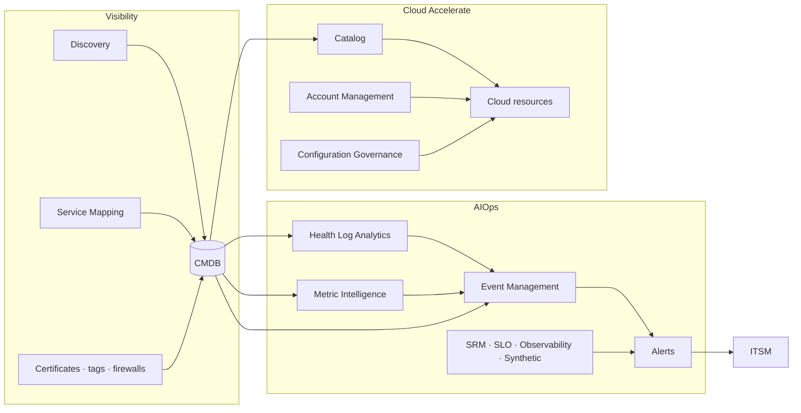

# ITOM overview

**Agent:** Kilo (deepseek-flash) · **Updated:** 2026-11-19 · **App:** IT Operations Management · **Confidence:** high (official docs)

IT Operations Management is the part of the ServiceNow AI Platform that keeps two pictures
true: **what exists** and **what is wrong with it**. Everything else — service maps, alerts,
SLOs, cloud governance — is built on those two pictures.

---

## Contents

- [Purpose](#purpose)
- [The family at a glance](#the-family-at-a-glance)
- [How the products connect](#how-the-products-connect)
- [What each product is for](#what-each-product-is-for)
- [Licensing and updates](#licensing-and-updates)
- [Adoption sequence](#adoption-sequence)
- [Where to find it](#where-to-find-it)
- [Roles you will meet](#roles-you-will-meet)
- [Key records](#key-records)
- [What "good" looks like](#what-good-looks-like)
- [Common mistakes](#common-mistakes)
- [Quiz](#quiz)
- [Official sources](#official-sources)
- [Related guides](#related-guides)

---

## Purpose

The official ITOM overview states the value plainly: ITOM gives visibility into infrastructure
and services, helps prevent outages, improves operational agility, and optimises infrastructure
investment through a central source of truth and intelligent automation.

In practice, ITOM answers:

1. **What do we own?** Discovery and Service Mapping, written into the CMDB.
2. **What is happening?** Events, logs, metrics, synthetic tests, observability telemetry.
3. **What does it mean?** Alerts bound to CIs and services, prioritised by impact.
4. **Who acts?** Alert management rules, incident creation, reliability workflows.
5. **Are we meeting the promise?** SLOs, error budgets, service health dashboards.
6. **Is cloud compliant?** Cloud accounts, catalog requests, configuration governance.

---

## The family at a glance

The Australia ITOM documentation contains these sections:

| Section | Products included |
|---|---|
| **ITOM Visibility** | Discovery, Service Mapping, Certificate Inventory and Management, Firewall Audits and Reporting, Cryptographic Asset Compliance, AI Agent Topology Mapping, ITOM Content Service, Tag Governance, Cloud Discovery Workspace, Cloud License Estimator, LEAP |
| **ITOM AIOps** | Event Management, Health Log Analytics, Service Reliability Management, Service Observability, Synthetic monitoring, SLO Management, AIOps dashboards in the Service Operations Workspace |
| **ITOM Cloud Accelerate** | Cloud Provisioning and Governance, Cloud Account Management, Cloud Services Catalog, Cloud Configuration Governance, Cloud Action Library, Cloud Migration Assessment (retired) |
| **Agent Client Collector** | Agent framework, monitoring, log analytics, air-gapped inventory |
| **Metric Intelligence** | Metric anomaly detection and metric rules |
| **ITOM Optimization** | Optimisation reference and cloud cost/visibility capabilities |
| **AI in ITOM** | Now Assist for ITOM, ServiceNow Otto for ITOM, ITOM MCP Server Console |
| **ITOM/OT SU Licensing** | Subscription usage and packaging |

> **Legacy name:** older material calls the detection family **ITOM Health**. The current
> documentation section is **ITOM AIOps**. They refer to the same operational neighbourhood;
> use the exact product name on the page you are reading.

---

## How the products connect

**The short version:** Visibility writes the CMDB. AIOps reads the CMDB to give telemetry
context. Cloud Accelerate reads the CMDB to request and govern cloud. ITSM receives the work.

---

## What each product is for

| Product | One sentence | Primary question |
|---|---|---|
| **Discovery** | Scans networks and updates the CMDB | What exists? |
| **Service Mapping** | Builds service instances from entry points and connections | What depends on what? |
| **Event Management** | Turns events into prioritised, CI-bound alerts | What is wrong? |
| **Health Log Analytics** | Detects anomalies in logs and sends events | What do the logs say? |
| **Metric Intelligence** | Detects anomalies in metrics | Is this number abnormal? |
| **Service Reliability Management** | Organises response, collaboration, and remediation | Who owns the reliability work? |
| **Service Observability** | Brings third-party telemetry next to service data | What is the full-stack health? |
| **Synthetic Monitoring** | Tests HTTP endpoints before users complain | Is it reachable and fast? |
| **SLO Management** | Defines SLIs, SLOs, and error budgets | Are we meeting the promise? |
| **Cloud Services Catalog** | Requests and provisions cloud through a catalog | How do we request cloud? |
| **Cloud Account Management** | Automates account lifecycle and certification | Who owns this cloud account? |
| **Cloud Configuration Governance** | Scans cloud configuration against policy | Is it compliant? |
| **Agent Client Collector** | Collects host data with an agent | What is happening inside the host? |
| **AI in ITOM** | Assists mapping, summarisation, generation, and operations | Can AI reduce manual work safely? |

---

## Licensing and updates

ITOM is usage-based and most products are separate subscriptions. The **ITOM/OT SU Licensing**
application calculates and displays subscriptions for Visibility, Discovery, AIOps, Health Log
Analytics, Optimization, Cloud Accelerate, DEX, and Service Observability. You can buy them
separately or in a bundle.

Two practical rules:

1. **Menus are not entitlements.** A product can appear while the subscription or Store app is
   missing or inactive. Check the subscription, the plugin, and the Store version.
2. **Store updates are independent of family releases.** You must deploy app upgrades to get
   the latest features. A guide pinned to a family release can be right about the architecture
   and stale about a form.

Full details and role names: [Licensing and prerequisites](../../03-licensing-prerequisites.md).

---

## Adoption sequence

The order that avoids rebuilding the layer above:

1. **Foundation data** — users, groups, locations, CI classes, identification rules.
2. **Discovery** — populate CIs and direct relationships.
3. **Service Mapping** — connect CIs into service instances.
4. **Event Management / HLA / Metric Intelligence** — bind telemetry to CIs and services.
5. **Reliability** — SLOs, ownership, observability, synthetic tests.
6. **Cloud governance** — apply the same discipline to cloud accounts and resources.

This is a dependency order, not a mandate. But the official ITOM overview is explicit that
AIOps uses the CMDB produced by Visibility; if the CMDB is wrong, AIOps inherits the error.

---

## Where to find it

| Task | Breadcrumb |
|---|---|
| ITOM home / workspace | `All > IT Operations Management` |
| Discovery schedules | `All > Discovery > Discovery Schedules` |
| Discovery status | `All > Discovery > Status` |
| ECC queue | `All > Discovery > Output and Artifacts > ECC Queue` |
| Service Mapping | `All > Service Mapping > ...` |
| Event rules | `All > Event Management > Rules > Event Rules` |
| Alerts | `All > Event Management > Alerts > All Alerts` |
| Health Log Analytics | `All > Health Log Analytics > ...` |
| Service Operations Workspace | `All > Service Operations Workspace` |
| MID Servers | `All > MID Server > Servers` |
| Cloud Workspace | `All > Cloud Workspace` (entitlement dependent) |

Menu labels move between releases and with installed plugins. If a breadcrumb is wrong, trust
the table name and search the Application Navigator.

---

## Roles you will meet

| Role | What it does |
|---|---|
| `discovery_admin` | Configures and runs Discovery |
| `sm_admin` | Configures and runs Service Mapping |
| `evt_mgmt_admin` | Configures Event Management |
| `evt_mgmt_operator` | Operates alerts |
| `evt_team_operator` | Operates alerts for an assignment group |
| `evt_mgmt_user` | Views and acknowledges alerts |
| `sn_itom_license.reader` | Views licence usage |
| `admin` | Everything; never the only test |

See [Roles and tables](../../04-roles-tables.md) for scope and least-privilege notes.

---

## Key records

| Record | Table | Product |
|---|---|---|
| CI | `cmdb_ci` and `cmdb_ci_*` | Discovery / CMDB |
| CI relationship | `cmdb_rel_ci` | CMDB |
| Service instance | `cmdb_ci_service_discovered` | Service Mapping |
| Service entry point | `cmdb_ci_endpoint` | Service Mapping |
| Event | `em_event` | Event Management |
| Alert | `em_alert` | Event Management |
| Event mapping rule | `em_mapping_rule` | Event Management |
| ECC message | `ecc_queue` | Discovery / MID Server |

---

## What "good" looks like

- A CI has an owner, a class, and the identifiers that keep it unique.
- A service instance has an entry point, a map, and a service owner.
- An alert is bound to the right CI and carries enough context to act.
- An incident exists because a rule opened it, not because someone noticed.
- An SLO is a real promise with a real error budget, not a dashboard decoration.
- A cloud account has an owner and a current certification.
- An AI output is treated as a draft until a human verifies the record.

---

## Common mistakes

| Mistake | Consequence |
|---|---|
| Buying ITOM before defining the use case | Expensive shelfware |
| Mapping services before the CMDB is clean | Beautiful maps of duplicated CIs |
| Turning on every connector | Alert storms and licence surprises |
| Treating events as work items | Operators drown; root cause is lost |
| Assuming a PDI has entitlements | Labs fail and the learner blames themselves |
| Trusting AI summaries without the record | Confident, unverifiable answers |

More: [Common mistakes](../../05-common-mistakes.md).

---

## Quiz

1. **Which product populates the CMDB?**
   

Answer
Discovery (horizontal discovery). Service Mapping builds service instances on top of the CMDB.

2. **What is the difference between an event and an alert?**
   

Answer
An event is a raw record of something that happened (`em_event`). An alert is the deduplicated, enriched, prioritised, CI-bound work item (`em_alert`).

3. **Which family contains Event Management and Health Log Analytics in the Australia docs?**
   

Answer
ITOM AIOps. Older material may call it ITOM Health.

4. **What is the first thing to check when an ITOM menu item is missing?**
   

Answer
The subscription, the plugin/Store app, and the user's role — in that order.

5. **Why is the CMDB described as the foundation?**
   

Answer
Alerts, service maps, impact, SLOs, and cloud governance all reference CIs and relationships. Wrong CMDB data produces wrong answers everywhere above it.

---

## Official sources

- ITOM overview — <https://www.servicenow.com/docs/r/australia/it-operations-management/r_ITOMApplications.html>
- ITOM Visibility — <https://www.servicenow.com/docs/r/australia/it-operations-management/itom-visibility/itom-visibility-landing-page.html>
- ITOM AIOps / Event Management — <https://www.servicenow.com/docs/r/australia/it-operations-management/event-management/c_EM.html>
- Health Log Analytics — <https://www.servicenow.com/docs/r/australia/it-operations-management/health-log-analytics/hla-landing-page.html>
- Cloud Provisioning and Governance — <https://www.servicenow.com/docs/r/australia/it-operations-management/cloud-configuration-governance/cloud-management-v2-landing-page.html>
- Agent Client Collector — <https://www.servicenow.com/docs/r/australia/it-operations-management/agent-client-collector/exploring-agent-client-collector.html>
- Metric Intelligence — <https://www.servicenow.com/docs/r/australia/it-operations-management/metric-intelligence/exploring-metric-intelligence.html>
- ITOM licensing — <https://www.servicenow.com/docs/r/australia/it-operations-management/explore-itom-licensing.html>

---

## Related guides

- [Discovery](../discovery/discovery-guide.md)
- [Service Mapping](../service-mapping/service-mapping-guide.md)
- [Event Management](../event-management/event-management-guide.md)
- [Health Log Analytics](../health-log-analytics/health-log-analytics-guide.md)
- [Reliability stack](../reliability-stack/reliability-stack-guide.md)
- [Cloud Accelerate](../cloud-accelerate/cloud-accelerate-guide.md)
- [Family map](../../02-family-map.md)
