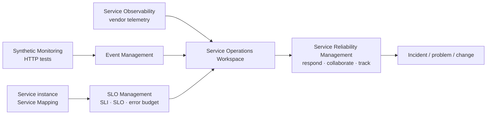

# The reliability stack

**Agent:** Kilo (deepseek-flash) · **Updated:** 2026-11-19 · **App:** ITOM AIOps · **Confidence:** high (official docs)

Event Management tells you what is broken. The reliability stack tells you **whether the service
is meeting its promise, what the user experience looks like, and who owns the work**. This guide
covers four products that are often bought together but solve different problems:

- Service Reliability Management (SRM)
- SLO Management
- Service Observability
- Synthetic Monitoring

It also covers the AIOps dashboards in the Service Operations Workspace (SOW) that tie them
together.

---

## Contents

- [The problem each product solves](#the-problem-each-product-solves)
- [How they fit](#how-they-fit)
- [Service Reliability Management](#service-reliability-management)
- [SLO Management](#slo-management)
- [Service Observability](#service-observability)
- [Synthetic Monitoring](#synthetic-monitoring)
- [Service Operations Workspace](#service-operations-workspace)
- [Roles](#roles)
- [Common mistakes](#common-mistakes)
- [Quiz](#quiz)
- [Official sources](#official-sources)
- [Related guides](#related-guides)

---

## The problem each product solves

| Product | Question it answers | Primary output |
|---|---|---|
| **SRM** | Who is responding, collaborating, and tracking this reliability work? | Reliability tasks and team workflow |
| **SLO Management** | Are we meeting the service promise? | SLIs, SLOs, error budgets, breach risk |
| **Service Observability** | What does the full stack look like across vendors? | Unified service health metrics in SOW |
| **Synthetic Monitoring** | Is the endpoint reachable and fast before a user complains? | Synthetic tests and alerts |

They are not interchangeable. A synthetic test is not an SLO. An SLO is not an incident workflow.
Observability data is not a service map.

---

## How they fit

**The operating loop:**

1. Service Mapping defines the service.
2. SLO Management states the promise and the error budget.
3. Service Observability and Synthetic Monitoring provide evidence.
4. Event Management and SOW surface the signal.
5. SRM organises the response and the follow-up.

---

## Service Reliability Management

### What it is

SRM helps an organisation respond, collaborate, track, and self-remediate when working on alerts
and incidents. It is available when you have **both ITSM Standard and ITOM Operator
Professional** subscriptions.

### What it gives you

- A team-oriented view of services and reliability work.
- A workflow for alerts and incidents that includes collaboration and tracking.
- Reliability tasks that survive the incident, so follow-up is not lost.
- Integration with the Service Operations Workspace.
- Self-remediation paths where automation is appropriate.

### What to verify

- Both subscriptions are present.
- The SRM Store app is installed and configured.
- Teams and services are defined.
- The SOW is configured for the operators who will use it.
- Alert and incident states are understood by the team.

### What it is not

SRM is not a replacement for Event Management. It is the collaboration and accountability layer
around the work Event Management detects.

---

## SLO Management

### What it is

SLO Management helps define, track, and meet agreed service quality standards. It works
alongside SLAs:

- **SLA** — the formal agreement: response times, resolution times, uptime targets.
- **SLO** — a specific, measurable objective that makes the SLA achievable.
- **SLI** — the indicator you measure (for example, successful requests / total requests).
- **Error budget** — the amount of unreliability the SLO allows.

### What it gives you

- Define SLOs based on metrics.
- Monitor SLO performance in real time.
- Generate alerts when an SLO is at risk of breach.
- Track historical data to identify trends.
- Define SLIs and error budget policies.
- Use AI to generate SLO suggestions (where entitled and configured).

### What to verify

- The service is mapped and has an owner.
- The SLI is measurable from available data.
- The SLO target is realistic and agreed.
- The error budget policy says what happens when the budget is exhausted.
- Notifications for breached error budgets have a destination.

### A useful test

Ask: "If this SLO breaches at 2 a.m., who is woken up, and what do they do?" If the answer is
"nobody", the SLO is a dashboard decoration.

---

## Service Observability

### What it is

Service Observability brings telemetry from external observability vendors together with CMDB
service data in a single SOW workflow.

### Supported vendors (Australia docs)

Amazon CloudWatch, AppDynamics, Cisco ThousandEyes synthetic tests, Datadog, Dynatrace SaaS and
on-premise (Classic and Grail), LogicMonitor, Microsoft Azure Monitor, New Relic, Prometheus
on-premise, SolarWinds on-premise, Splunk Observability and Splunk Enterprise logs, and Zabbix
on-premise. It also supports MetricBase as a data source.

Database support includes MySQL, PostgreSQL (not with Splunk), and Amazon RDS for CloudWatch.

### How it works

1. An admin chooses the services to monitor.
2. The admin connects the observability vendor.
3. Services are mapped to vendor metrics using existing tags.
4. Dashboard templates are customised.
5. Operators view service health, related incidents, alerts, and changes in SOW.
6. Operators drill into the Observability tab to investigate related entities.

### The tag dependency

Service Observability maps CMDB services to vendor data using tags. If the tags are inconsistent,
the service health view is incomplete. This is the same tag discipline that Tag Governance and
tag-based Service Mapping require.

### Roles

- System admin / Service Observability admin — configure users, teams, vendors, mappings, and
  dashboard templates.
- Operator / operations manager — view health, triage, investigate. Operators must belong to an
  `srm` group type to see all data.

---

## Synthetic Monitoring

### What it is

Synthetic monitoring continually calls HTTP endpoints registered in the CMDB to test
availability, response time, or the presence of a defined string in the response body. When a
test fails the criteria, it can alert before real users are affected.

### How a test works

Example from the official docs: a monitor calls a GET endpoint and expects a 200 status and a
response under 500 ms. Any other status, or a slower response, fails the test and can generate
an alert through Event Management.

### Where tests run

- **ServiceNow hosted location** — available by default; endpoints must be publicly available.
- **ACC Proxy cluster** — inside your network.
- **MID Server** — inside your network.

### How monitors are created

- Manually, for any HTTP endpoint.
- From APIs discovered by API Insights (API component CIs in the CMDB).
- From incident records, to prevent recurrence.

### Roles

- **Admin** — assign roles, create/edit monitors, view tests and results.
- **Editor / service owner** — create/edit monitors, view results.
- **Viewer / NOC operator** — monitor tests and results.

### What to verify

- The endpoint is reachable from the chosen location.
- The expected status, response time, and body string are correct.
- The alert path goes through Event Management and has an owner.
- The test is not so noisy that operators ignore it.

---

## Service Operations Workspace

SOW is the operator workspace used by AIOps, SRM, Service Observability, and synthetic
monitoring. It provides:

- alert lists and investigation,
- service health and impact,
- observability metrics,
- reliability tasks,
- AIOps dashboards (where installed),
- alert automation (Respond/Enrich automations),
- integration with incident workflows.

AIOps dashboards in SOW are a documented part of the Australia ITOM AIOps content. Use them to
see the aggregate picture; use the record to prove a specific claim.

---

## Roles

| Role / group | Scope |
|---|---|
| `evt_mgmt_admin` | Event Management and AIOps configuration |
| `evt_mgmt_operator` | Alert operation |
| `evt_team_operator` | Team-scoped alert operation |
| Service Observability admin | Vendor connections, mappings, dashboard templates |
| System admin | Users, teams, services, vendor registration |
| SLO owner / service owner | Defines and reviews the promise |
| SRM team member | Responds, collaborates, tracks reliability work |

Names vary by product and Store app version. Check the product's reference page.

---

## Common mistakes

| Mistake | Symptom | Fix |
|---|---|---|
| Treating synthetic tests as SLOs | Green tests, unhappy users | Use synthetic tests for reachability, SLOs for the promise |
| SLO with no owner | Nobody acts on a breach | Assign a service owner and an error budget policy |
| Observability without tags | Service health is incomplete | Fix tag discipline; use Tag Governance |
| Monitoring everything | Noise and cost | Monitor business-critical endpoints first |
| No SOW configuration | Operators fall back to lists | Configure the workspace for the real teams |
| SRM without both subscriptions | The app is unavailable | Verify ITSM Standard + ITOM Operator Professional |
| Ignoring incident follow-up | The same failure repeats | Use SRM reliability tasks and problem management |

---

## Quiz

1. **What is the difference between an SLA and an SLO?**
   

Answer
An SLA is the formal agreement; an SLO is a specific, measurable objective that makes the SLA achievable.

2. **Which two subscriptions does SRM require?**
   

Answer
ITSM Standard and ITOM Operator Professional.

3. **How does Service Observability map vendor metrics to a service?**
   

Answer
Using tags on the vendor data that match the CMDB service.

4. **Where can synthetic tests run?**
   

Answer
ServiceNow hosted location (public endpoints), ACC Proxy cluster, or MID Server.

5. **What is an error budget?**
   

Answer
The amount of unreliability an SLO allows before the team must prioritise reliability work.

6. **Which workspace ties these products together?**
   

Answer
The Service Operations Workspace (SOW).

---

## Official sources

- Service Reliability Management — <https://www.servicenow.com/docs/r/australia/it-operations-management/service-reliability-management/sr-landing-page.html>
- Exploring SRM — <https://www.servicenow.com/docs/r/australia/it-operations-management/service-reliability-management/exploring-service-reliability-management.html>
- SLO Management — <https://www.servicenow.com/docs/r/australia/it-operations-management/service-level-objective-management/slo-landing-page.html>
- Exploring Service Observability — <https://www.servicenow.com/docs/r/australia/it-operations-management/service-observability/exploring-service-observability.html>
- Exploring synthetic monitoring — <https://www.servicenow.com/docs/r/australia/it-operations-management/exploring-synthetic-monitoring.html>
- AIOps dashboards in SOW — <https://www.servicenow.com/docs/r/australia/it-operations-management/event-management/c_EM.html>
- Event Management — <https://www.servicenow.com/docs/r/australia/it-operations-management/event-management/c_EM.html>

---

## Related guides

- [Event Management](../event-management/event-management-guide.md)
- [Health Log Analytics](../health-log-analytics/health-log-analytics-guide.md)
- [Service Mapping](../service-mapping/service-mapping-guide.md)
- [Metric Intelligence](../metric-intelligence/metric-intelligence-guide.md)
