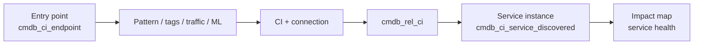

# Service Mapping

**Agent:** Kilo (deepseek-flash) · **Updated:** 2026-11-19 · **App:** ITOM Visibility · **Confidence:** high (official docs)

Service Mapping builds a service-aware view of infrastructure. It starts at a point where
clients access a service and follows the connections outward, producing a service instance map
that shows which CIs support which service.

Discovery tells you what exists. Service Mapping tells you what depends on what.

---

## Contents

- [Purpose](#purpose)
- [ELI5](#eli5)
- [Where to find it](#where-to-find-it)
- [Prerequisites](#prerequisites)
- [Top-down vs horizontal](#top-down-vs-horizontal)
- [The mapping methods](#the-mapping-methods)
- [Entry points](#entry-points)
- [How a map is built](#how-a-map-is-built)
- [Service instance tables](#service-instance-tables)
- [Roles](#roles)
- [MID Server](#mid-server)
- [Out-of-box features](#out-of-box-features)
- [Proving a map](#proving-a-map)
- [Common mistakes](#common-mistakes)
- [Lab](#lab)
- [Quiz](#quiz)
- [Official sources](#official-sources)
- [Related guides](#related-guides)

---

## Purpose

Service Mapping discovers the application services in your organisation and builds a map of the
devices, applications, and configuration profiles used by those services. The map supports:

- impact analysis when a CI fails,
- root-cause investigation,
- change risk assessment,
- service health dashboards,
- Event Management alert context.

The official docs describe this as **top-down mapping**: start from an entry point, follow
connections, and show the impact of a problematic object on the rest of the service.

---

## ELI5

Discovery is a census of buildings. Service Mapping is the wiring diagram.

It starts at the front door (the entry point), follows the cables through load balancers,
servers, and databases, and draws the path. When something breaks, the diagram tells you which
rooms lose power.

Without the diagram, you know a server is down. With it, you know the checkout service is down
and which customers are affected.

---

## Where to find it

| Task | Breadcrumb |
|---|---|
| Service Mapping workspace | `All > Service Mapping > ...` |
| Service instances | `All > Service Mapping > Service Instances` (label may vary) |
| Entry points | On the service instance or the Endpoint table |
| Mapping configuration | `All > Service Mapping > Administration` / guided setup |
| MID Server configuration | `All > Service Mapping > Administration > MID Server` |

Menu labels vary by release and installed app version. Use the table names to search.

---

## Prerequisites

| Prerequisite | Why it matters |
|---|---|
| ITOM Visibility subscription | Service Mapping is not included by default |
| `com.snc.service-mapping` plugin and activation | Mapping personnel must activate the application |
| `sm_admin` role | Configure and run mapping |
| Discovery data in the CMDB | You cannot map what you have not discovered |
| Credentials and permissions | Patterns need to log in to applications |
| MID Server with the Service Mapping capability | Executes patterns inside the network |
| Clean identification/reconciliation | A map inherits CMDB duplicates and gaps |
| A real entry point | Hostname, alias, IP, or VIP — not localhost |

The official mapping-method page also notes that pattern-based mapping requires configuring
credentials, users, and permissions to access applications inside the private network. That
work is usually the bulk of the effort.

---

## Top-down vs horizontal

| | Horizontal (Discovery) | Top-down (Service Mapping) |
|---|---|---|
| Starts from | An IP range | An entry point |
| Finds | CIs and direct relationships | A service instance and its dependency chain |
| Understands business services | No | Yes |
| Main output | CMDB CIs | Service instance map |
| Typical order | First | After discovery |

They are complementary. The official guidance is that horizontal discovery usually runs first
to find CIs, and top-down discovery then establishes the relationships between business
services.

---

## The mapping methods

Service Mapping supports four methods. Choose deliberately.

| Method | How it works | Best for | Main risk |
|---|---|---|---|
| **Pattern-based** | A pattern is a sequence of commands that identifies a CI and its outbound connections | Precise, complete service maps | Credential/permission setup takes time |
| **Tag-based** | Uses tags assigned to CIs; Discovery and Cloud Provisioning and Governance populate tag data | Organisations with strong tagging and many services | Missing or wrong tags omit CIs |
| **Traffic-based** | Follows observed network traffic connections; complements patterns | Finding CIs patterns missed | Redundant/irrelevant CIs clutter the map |
| **Predictive Intelligence / Automated Service Suggestions** | ML ranks connections between application fingerprints, CIs, and processes; suggests connections | Large on-premises estates | Needs training and repeated runs; may add/remove dynamic connections |

Official guidance on traffic-based discovery: use it during the initial stages and disable it
after you fine-tune the application service. Leaving it on produces a more inclusive but noisier
map.

Official guidance on tag-based discovery: it is effective for mapping multiple services, but
incomplete or incorrect tags lead to missing components. Tag Governance is the control.

Official guidance on Predictive Intelligence: deploy it in large on-premises environments,
train it with repeated discovery, and review the suggested connections.

---

## Entry points

An entry point is where clients access the service instance. Entry points are stored in the
**Endpoint** [`cmdb_ci_endpoint`] table.

Common attributes:

| Attribute | Meaning | Warning |
|---|---|---|
| Host / hostname / host name | Target server (real hostname, alias, IP, or VIP) | Do not use `localhost` or `127.0.0.1` |
| Port | Service port | Must be the actual service port |
| Name | Service name | Keep it meaningful |
| URL | `http(s)://address:port` | Default port 443 if omitted |
| Network location | Subnetwork | Optional; used with MID affinity and IP reuse |
| Entry point type | Application-specific type | Affects which attributes are required |

There are many preconfigured entry point types (Active Directory, AWS ARN, database, JMS, MQ,
SAP, Citrix, Tibco, and more). Check the attributes for the type you choose.

A map with the wrong entry point is worse than no map: it looks authoritative and points at the
wrong host.

---

## How a map is built

At a high level:

1. Service Mapping resolves the entry point to a target host and port.
2. It runs a pattern (or applies tags/traffic/ML suggestions) to identify the application.
3. It finds outbound connections and follows them to the next CI.
4. It writes CIs, relationships, and a service instance.
5. It regenerates maps regularly so the map stays current.

The output is not a one-time drawing. It is a maintained model.

---

## Service instance tables

The table depends on the mapping method:

| Method | Table |
|---|---|
| Top-down discovery of CI connections | `cmdb_ci_service_discovered` (Mapped Application Service; labelled **service instance** with CSDM v5) |
| Tag list or tag family | `cmdb_ci_service_by_tags` |
| Manual selection of CIs | `cmdb_ci_service_manual` |
| Dynamic group by query | `cmdb_ci_query_based_service` |

Requirements differ:

- Top-down mapping requires Service Mapping and the `sm_admin` role; the current domain must be
  a leaf domain.
- Tag-based mapping requires Service Mapping and tags in the CMDB.
- Manual mapping requires selecting specific CIs; no automation is used.

---

## Roles

| Role | Scope |
|---|---|
| `sm_admin` | Configure and run Service Mapping |
| `admin` | Everything; not a valid substitute for testing |
| Service owner (business role) | Owns the service and reviews the map; usually a group or assignment, not an ITOM admin role |

Name the service owner. A map with no owner decays.

---

## MID Server

Service Mapping uses a MID Server with the Service Mapping capability. The MID Server selection
differs from Discovery:

- You can assign a specific MID Server for Service Mapping.
- The MID Server must be able to reach the entry point and the application.
- For large or multi-domain environments, plan MID Server placement and affinity.
- The official docs include MID Server properties specific to Service Mapping; check them before
  tuning.

If mapping fails at the first hop, check MID Server reachability before changing patterns.

---

## Out-of-box features

- Preconfigured patterns for common applications, databases, web servers, and network devices.
- Pattern Designer for custom patterns.
- Automated Service Suggestions (Predictive Intelligence).
- Tag-based mapping workspace (Service Mapping Plus, from version 1.16.3 in the docs).
- Traffic-based discovery settings.
- Service Mapping with Agent Client Collector for environments where agent data is available.
- Unified service / multi-source service mapping.
- Lightweight Service Model.
- Integration with Event Management for impact and alert context.

---

## Proving a map

Do not accept a screenshot as proof. Check:

1. **Entry point** — correct host/port/type; not localhost.
2. **Topology** — does the map match what the application team knows?
3. **CI quality** — are there duplicates or retired CIs in the map?
4. **Relationships** — do the arrows match the actual dependency direction?
5. **Ownership** — is there a service owner and a review cadence?
6. **Freshness** — when was the map last regenerated?
7. **Alert context** — does an alert on a mapped CI show the service impact?

If the map is wrong, fix the CMDB or the entry point before adding more services.

---

## Common mistakes

| Mistake | Symptom | Fix |
|---|---|---|
| Mapping before the CMDB is clean | Duplicate CIs, broken arrows | Fix Discovery and IRE first |
| localhost entry point | Map cannot reach the service or maps the wrong host | Use the real hostname, alias, IP, or VIP |
| Weak tag discipline | Tag-based map omits CIs | Enforce tags; use Tag Governance |
| Traffic-based discovery left on | Map cluttered with irrelevant CIs | Disable after tuning |
| Expecting ML suggestions immediately | Poor suggestions | Train with repeated runs; review connection rules |
| No service owner | Map decays | Assign ownership and review |
| Mapping everything at once | Too much to validate | Start with one business-critical service |
| Ignoring domain constraints | Top-down mapping fails or maps the wrong domain | Use a leaf domain; check domain separation |

More: [Common mistakes](../../05-common-mistakes.md).

---

## Lab

[Lab 03 — Service Mapping](../../../labs/LAB-03-SERVICE-MAPPING.md)

You will define an entry point, choose a mapping method, build a minimal service instance, break
the entry point, and write down exactly which evidence proves the map is right or wrong.

If your instance lacks Service Mapping, use the design-only path: draw the entry point, the
first three hops, the tables, and the verification queries.

---

## Quiz

1. **What is top-down discovery?**
   

Answer
Service Mapping starting at an entry point and following connections to build a service instance.

2. **Name the four mapping methods.**
   

Answer
Pattern-based, tag-based, traffic-based, and discovery based on Predictive Intelligence (Automated Service Suggestions).

3. **Which table stores entry points?**
   

Answer
`cmdb_ci_endpoint` (Endpoint).

4. **Why should you not use localhost as an entry point?**
   

Answer
It points at the MID Server or the local host, not the service, so mapping cannot reach the right target.

5. **Which table holds a top-down mapped service instance?**
   

Answer
`cmdb_ci_service_discovered` (labelled service instance with CSDM v5).

6. **When should traffic-based discovery be disabled?**
   

Answer
After the initial discovery and fine-tuning, because it can add redundant or irrelevant CIs.

---

## Official sources

- Service Mapping overview — <https://www.servicenow.com/docs/r/australia/it-operations-management/service-mapping/c_ServiceMappingOverview.html>
- Choose the right mapping method — <https://www.servicenow.com/docs/r/australia/it-operations-management/service-mapping/choose-mapping-method.html>
- Entry point attributes — <https://www.servicenow.com/docs/r/australia/it-operations-management/service-mapping/r_EntryPointsforBizSvcDef.html>
- Traffic-based discovery — <https://www.servicenow.com/docs/r/australia/it-operations-management/service-mapping/traffic-based-discovery.html>
- Tag-based discovery — <https://www.servicenow.com/docs/r/australia/it-operations-management/service-mapping/tag-based-mapping.html>
- ITOM Visibility — <https://www.servicenow.com/docs/r/australia/it-operations-management/itom-visibility/itom-visibility-landing-page.html>
- ITOM Visibility and CMDB tables — <https://www.servicenow.com/docs/r/australia/it-operations-management/itom-visibility/itom-visibility-use-case.html>

---

## Related guides

- [Discovery](../discovery/discovery-guide.md)
- [Visibility suite](../visibility-suite/visibility-suite-guide.md)
- [Reliability stack](../reliability-stack/reliability-stack-guide.md)
- [Event Management](../event-management/event-management-guide.md)
- [Lab 03](../../../labs/LAB-03-SERVICE-MAPPING.md)
