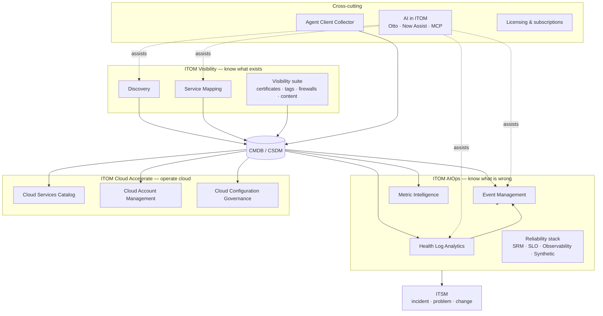

# ServiceNow ITOM, without the fog

A source-backed field guide to **IT Operations Management** on the ServiceNow AI Platform:
what each product actually does, which records it writes, how the pieces connect, and how to
prove you understand it on a real instance.

This repository is **not** a documentation mirror. Every guide is a paraphrase of official
ServiceNow sources, links to the exact page it came from, and separates *what the docs say*
from *what you can verify in your own instance*. The current content is pinned to the
**Australia** release documentation and was read on **2026-11-19**.

> **Status:** first edition. Core ITOM Visibility, ITOM AIOps, ITOM Cloud Accelerate,
> Agent Client Collector, Metric Intelligence, and AI-in-ITOM guides are complete. The
> content is designed to merge into the existing ServiceNow Learning site as a new ITOM
> section without rewriting the other modules.

## Pick a track

  

    <h3>New to ITOM</h3>
    
Start with the plain-English model, then run one 95-minute loop on Discovery. You will finish able to explain what a CI, a service instance, an event, and an alert are — and where each one lives.

    
<a href="./docs/01-ELI5.md">ELI5</a> · <a href="./docs/00-methodology.md">Methodology</a> · <a href="./labs/LAB-00-ORIENTATION.md">Lab 00</a>

  

  

    <h3>NOC / AIOps operator</h3>
    
Learn how events become alerts, how alerts bind to CIs, how correlation finds the parent, and how an alert management rule opens the right incident without opening forty.

    
<a href="./docs/modules/event-management/event-management-guide.md">Event Management</a> · <a href="./docs/modules/health-log-analytics/health-log-analytics-guide.md">Health Log Analytics</a> · <a href="./labs/LAB-02-EVENT-TO-INCIDENT.md">Lab 02</a>

  

  

    <h3>Discovery / CMDB admin</h3>
    
Configure credentials and schedules, read the ECC queue, explain the four discovery phases, and recognise the difference between a device being found and a CI being reconciled.

    
<a href="./docs/modules/discovery/discovery-guide.md">Discovery</a> · <a href="./docs/modules/service-mapping/service-mapping-guide.md">Service Mapping</a> · <a href="./labs/LAB-01-DISCOVERY.md">Lab 01</a>

  

  

    <h3>Service owner / SRE</h3>
    
Move from infrastructure health to service health: service instances, SLOs and error budgets, observability telemetry, synthetic tests, and reliability workflows in the Service Operations Workspace.

    
<a href="./docs/modules/reliability-stack/reliability-stack-guide.md">Reliability stack</a> · <a href="./docs/modules/service-mapping/service-mapping-guide.md">Service Mapping</a>

  

  

    <h3>Cloud operations</h3>
    
Separate the three cloud problems — request/provision, account lifecycle and governance, and configuration compliance — and learn which Cloud Accelerate app solves which.

    
<a href="./docs/modules/cloud-accelerate/cloud-accelerate-guide.md">Cloud Accelerate</a> · <a href="./docs/getting-started/cloud-accelerate.md">Cloud start</a>

  

  

    <h3>AI in ITOM</h3>
    
Understand the Australia-era shift: Now Assist for ITOM preparing for deprecation, ServiceNow Otto for ITOM, MCP Server Console, AI-assisted mapping, and the governance you need before trusting any of it.

    
<a href="./docs/modules/itom-ai/itom-ai-guide.md">AI in ITOM</a> · <a href="./docs/getting-started/itom-ai.md">AI start</a>

  

  

    <h3>CMDB foundation</h3>
    
The shared data foundation all three pillars trust: the tables ITOM reads and writes, CSDM and the service instance, identification/reconciliation, and Service Graph Connectors.

    
<a href="./docs/modules/cmdb/cmdb-guide.md">CMDB foundation</a> · <a href="./docs/04-roles-tables.md">Roles &amp; tables</a>

  

  

    <h3>Automation &amp; remediation</h3>
    
How ITOM turns detection into action: SOW alert automation, alert/CI remediation, cloud and tag remediation, LEAP playbooks, and Ansible execution — with guardrails.

    
<a href="./docs/modules/automation-remediation/automation-remediation-guide.md">Automation &amp; remediation</a>

  

  

    <h3>Resilience · security · compliance</h3>
    
The assurance layer: backup-resource visibility, change/configuration control, certificate and firewall audits, cryptographic asset compliance, and audit evidence.

    
<a href="./docs/modules/resilience-security/resilience-security-guide.md">Resilience &amp; compliance</a>

  

## The family, in one picture

**Read it left to right:** Visibility populates the CMDB; AIOps turns telemetry into
actionable alerts against that CMDB; Cloud Accelerate uses the same inventory to request,
govern, and account for cloud resources. The Agent Client Collector is one more data source;
AI is an assistant layer, not a fourth product family.

## The loop this repo teaches

| Gate | Target | Artifact | Pass test |
|---|---|---|---|
| **Orient** | 10 min | Three breadcrumbs + the primary table | You can reach the list without searching menus |
| **Model** | 20 min | One page: records, states, roles, arrows | You can explain it without the screen |
| **Practise** | 45 min | Working configuration + a "what broke" note | It works, and you know why it stopped |
| **Prove** | 10 min | Probe/observations → a gap list | The instance matches your model; gaps are your gaps |
| **Teach** | 10 min | Five sentences + one diagram | A beginner's follow-up gets a real answer |

Full rationale, timeboxes, and anti-patterns: [methodology](./docs/00-methodology.md).

## Module guides

| Guide | What it answers | Primary records |
|---|---|---|
| [ITOM overview](./docs/modules/itom-overview/itom-overview-guide.md) | What is in the family, and how does it fit together? | product map, licensing |
| [CMDB foundation](./docs/modules/cmdb/cmdb-guide.md) | What is the shared data foundation, and how does ITOM use it? | `cmdb_ci`, `cmdb_rel_ci`, service tables |
| [Discovery](./docs/modules/discovery/discovery-guide.md) | How does ServiceNow find infrastructure and populate the CMDB? | `cmdb_ci_*`, `ecc_queue` |
| [Service Mapping](./docs/modules/service-mapping/service-mapping-guide.md) | How do CIs become service instances and impact maps? | `cmdb_ci_service_*`, `cmdb_ci_endpoint` |
| [Event Management](./docs/modules/event-management/event-management-guide.md) | How does an event become a prioritised, CI-bound alert? | `em_event`, `em_alert` |
| [Health Log Analytics](./docs/modules/health-log-analytics/health-log-analytics-guide.md) | How do logs become anomaly alerts? | log data inputs, alerts |
| [Reliability stack](./docs/modules/reliability-stack/reliability-stack-guide.md) | How do SRM, SLOs, observability, and synthetic tests fit? | SLOs, service health, tests |
| [Cloud Accelerate](./docs/modules/cloud-accelerate/cloud-accelerate-guide.md) | How do I request, account for, and govern cloud? | cloud accounts, catalog items |
| [Agent Client Collector](./docs/modules/agent-client-collector/acc-guide.md) | When do I need an agent instead of agentless discovery? | agents, checks, CIs |
| [Metric Intelligence](./docs/modules/metric-intelligence/metric-intelligence-guide.md) | How do metric anomalies become alerts? | metric definitions, alerts |
| [AI in ITOM](./docs/modules/itom-ai/itom-ai-guide.md) | What is actually available, and what must I govern? | AI skills, MCP, models |
| [Visibility suite](./docs/modules/visibility-suite/visibility-suite-guide.md) | What are the specialist Visibility apps? | certificates, tags, firewalls, AI topology |
| [Automation &amp; remediation](./docs/modules/automation-remediation/automation-remediation-guide.md) | How does ITOM turn detection into action safely? | alert automations, remediation tasks, change requests |
| [Resilience · security · compliance](./docs/modules/resilience-security/resilience-security-guide.md) | How does ITOM supply resilience, security, and audit evidence? | backup CIs, certificate/firewall records, policy scans |

## What this guide will not do

- It will not give you production credentials, customer data, or a hidden API.
- It will not claim a feature works on your instance because it works in a vendor demo.
- It will not quote documentation at length. Read the linked page; this guide gives you the
  map, the questions to ask, and the artifact to produce.
- It will not treat every ITOM app as licensed by default. Most are separate subscriptions.

## Official sources

- ServiceNow product documentation — <https://www.servicenow.com/docs/>
- ITOM documentation home (Australia) — <https://www.servicenow.com/docs/r/australia/it-operations-management>
- ServiceNow University / Now Learning — <https://learning.servicenow.com/lxp>
- ServiceNow Developer portal (free PDI) — <https://developer.servicenow.com/dev.do>
- ServiceNow Store — <https://store.servicenow.com/store>
- ServiceNow Community — <https://community.servicenow.com/>

**Agent:** Kilo (deepseek-flash) · **Updated:** 2026-11-19 · **Docs release:** Australia
