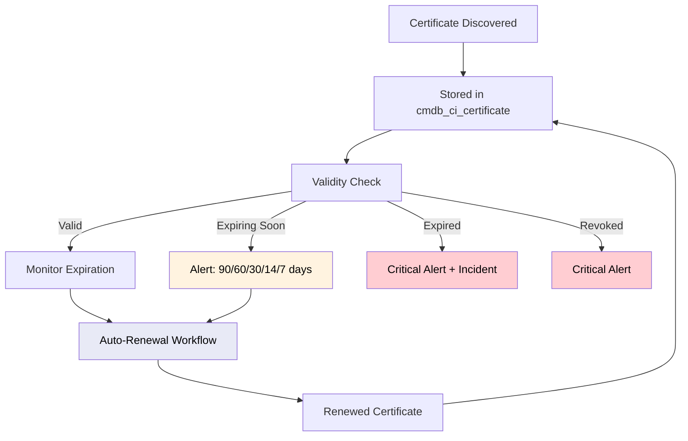
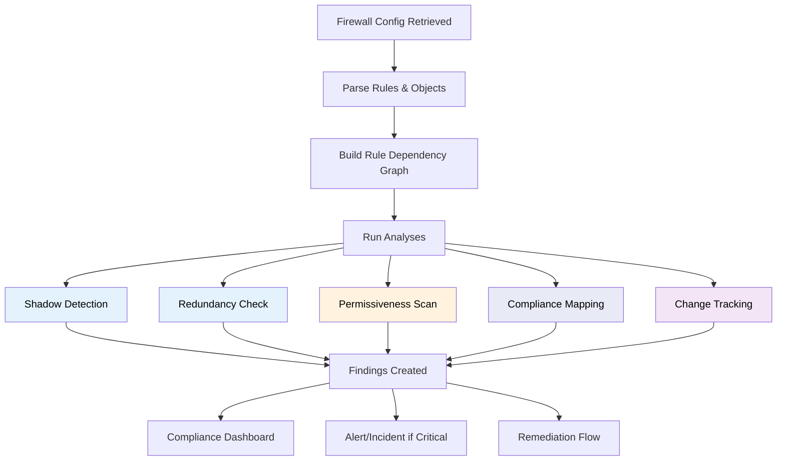
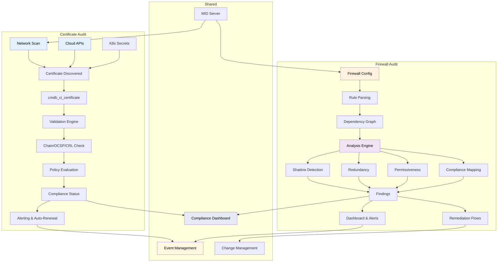

# Certificate & Firewall Audits — ITOM Visibility Pillar

**Agent:** Kilo  
**Date:** 2026-11-19  
**Module:** Certificate & Firewall Audits  
**App:** IT Operations Management — ITOM Visibility Pillar  
**Confidence:** high  

---

## Contents

- [Purpose](#purpose)
- [Where to Find It](#where-to-find-it)
- [Certificate Audit](#certificate-audit)
- [Firewall Audit](#firewall-audit)
- [Key Plugins & Licensing](#key-plugins--licensing)
- [Scoped Application](#scoped-application)
- [Out-of-Box Values & Dropdowns](#out-of-box-values--dropdowns)
- [Re-usable Code / Metadata](#re-usable-code--metadata)
- [Out-of-Box Features](#out-of-box-features)
- [Key Table Hierarchy](#key-table-hierarchy)
- [Integrations](#integrations)
- [Key Fields](#key-fields)
- [Common Mistakes](#common-mistakes)
- [Lab: Certificate & Firewall Audit Setup](#lab-certificate--firewall-audit-setup)
- [Goals, Benefits & Key Metrics](#goals-benefits--key-metrics)
- [Core Concept Diagrams](#core-concept-diagrams)
- [Quiz](#quiz)
- [Memory Aids & Mnemonics](#memory-aids--mnemonics)
- [Related Guides](#related-guides)
- [Official Learning Resources](#official-learning-resources)

---

## Purpose

**Certificate & Firewall Audits** are part of the **ITOM Visibility** pillar. They provide continuous monitoring and compliance tracking for:

1. **Certificate Audit** — Tracks TLS/SSL certificates across the infrastructure to prevent unexpected expirations, validates certificate chains, and ensures compliance with security policies.
2. **Firewall Audit** — Analyzes firewall rules for security compliance, identifies shadowed/redundant rules, validates rule changes, and supports regulatory audit requirements.

**Key value:** Eliminates certificate-related outages (expired certs are a top cause of unplanned downtime) and ensures firewall configurations meet security/compliance standards.

---

## Where to Find It

| Breadcrumb | Path |
|------------|------|
| Certificate Audit | All > IT Operations Management > Certificate Audit |
| Certificate List | All > Certificate Audit > Certificates |
| Firewall Audit | All > IT Operations Management > Firewall Audit |
| Firewall Devices | All > Firewall Audit > Firewall Devices |
| Compliance Dashboard | All > IT Operations Management > Compliance Dashboard |

**Tip:** Certificate Audit requires the `com.snc.certificate_audit` plugin. Firewall Audit requires `com.snc.firewall_audit`. Both are included with ITOM License.

---

## Certificate Audit

### Purpose

Certificate Audit automatically discovers, tracks, and monitors SSL/TLS certificates across:
- Public-facing web servers
- Internal application servers
- Load balancers and API gateways
- Cloud services (AWS ACM, Azure Key Vault, GCP Certificate Manager)
- Kubernetes clusters

### Certificate Discovery Methods

| Method | Description | Frequency |
|--------|-------------|-----------|
| **Network Scan** | MID Server scans IP ranges for SSL ports (443, 8443, etc.) | Scheduled |
| **Cloud Provider APIs** | AWS ACM, Azure Key Vault, GCP Cert Manager | Daily |
| **Kubernetes Secrets** | Discovers certs stored as K8s secrets | Scheduled |
| **Manual Import** | CSV upload for offline/air-gapped systems | On-demand |

### Certificate Lifecycle Management



### Certificate Attributes Tracked

| Attribute | Description | Source |
|-----------|-------------|--------|
| **Subject DN** | Certificate subject distinguished name | Discovery |
| **Issuer DN** | CA that issued the certificate | Discovery |
| **Serial Number** | Unique certificate serial | Discovery |
| **Valid From / To** | Validity period | Discovery |
| **Signature Algorithm** | e.g., SHA256withRSA | Discovery |
| **Key Algorithm / Size** | RSA 2048, ECDSA P-256, etc. | Discovery |
| **SANs** | Subject Alternative Names (DNS, IP) | Discovery |
| **Chain Status** | Complete / Incomplete / Untrusted | Validation |
| **OCSP/CRL Status** | Revocation check result | Validation |
| **Compliance** | Meets policy (key size, algorithm, validity) | Policy Engine |

### Certificate Policies

| Policy | Default Threshold | Action |
|--------|-------------------|--------|
| **Expiration Warning** | 90, 60, 30, 14, 7 days | Alert → Notification → Auto-Renewal Flow |
| **Minimum Key Size** | RSA 2048 / ECDSA P-256 | Non-compliant flag |
| **Approved Algorithms** | SHA256+, no SHA1/MD5 | Non-compliant flag |
| **Maximum Validity** | 398 days (public), 10 years (private) | Non-compliant flag |
| **Trusted CA Only** | Public CA / Enterprise CA list | Untrusted CA alert |
| **Wildcard Restrictions** | Limited wildcard usage | Policy violation alert |

---

## Firewall Audit

### Purpose

Firewall Audit continuously analyzes firewall rule sets across vendors to:
- Identify **shadowed rules** (rules never matched due to earlier rules)
- Detect **redundant rules** (duplicate functionality)
- Find **overly permissive rules** (any/any, wide port ranges)
- Validate **compliance** with standards (PCI-DSS, NIST, ISO 27001)
- Track **rule changes** with approval workflows

### Supported Firewall Vendors

| Vendor | Integration Method | Capabilities |
|--------|-------------------|--------------|
| **Palo Alto Networks** | XML API / Panorama | Full rule analysis, device groups |
| **Cisco ASA / FTD** | REST API / CLI via MID Server | Rule analysis, object groups |
| **Fortinet FortiGate** | REST API | Policy analysis, VDOM support |
| **Check Point** | Management API / SmartConsole | Layer analysis, global policy |
| **AWS Security Groups** | AWS API | Ingress/egress rules, VPC context |
| **Azure NSG** | Azure API | Rules, application security groups |
| **GCP Firewall** | GCP API | Rules, network tags, service accounts |

### Firewall Rule Analysis Types

| Analysis | Description | Output |
|----------|-------------|--------|
| **Shadow Detection** | Rules completely covered by earlier rules | List of shadowed rules with covering rule |
| **Redundancy Detection** | Duplicate or functionally identical rules | Rule pairs with similarity score |
| **Permissiveness Check** | Rules allowing broad access (0.0.0.0/0, ::/0) | High-risk rules with justification needed |
| **Unused Rule Detection** | Rules with zero hits in time window | Candidates for removal |
| **Compliance Mapping** | Rules mapped to compliance controls | Compliance report (PCI 1.2.1, NIST AC-4, etc.) |
| **Change Impact** | New/modified rule impact on traffic flows | Affected applications, risk score |

### Firewall Audit Workflow



---

## Key Plugins & Licensing

| Plugin | Name | Purpose |
|--------|------|---------|
| `com.snc.certificate_audit` | Certificate Audit | Certificate discovery, tracking, alerting |
| `com.snc.firewall_audit` | Firewall Audit | Firewall rule analysis, compliance |
| `com.snc.mid_server` | MID Server | On-prem firewall/certificate scanning |

**License:** Included with **ITOM License**. No separate add-on required.

---

## Scoped Application

| Scope Aspect | Detail |
|--------------|--------|
| Certificate Audit Scope | `com.snc.certificate_audit` |
| Firewall Audit Scope | `com.snc.firewall_audit` |
| Key Tables | `cmdb_ci_certificate`, `cmdb_ci_firewall_device`, `firewall_rule`, `firewall_analysis_result` |
| Roles | `certificate_audit_admin`, `firewall_audit_admin`, `itil`, `admin` |

---

## Out-of-Box Values & Dropdowns

### Certificate Status (cmdb_ci_certificate.status)

| Value | Label | Meaning |
|-------|-------|---------|
| `valid` | Valid | Certificate is currently valid |
| `expiring_soon` | Expiring Soon | Within warning threshold (default 30 days) |
| `expired` | Expired | Certificate has expired |
| `revoked` | Revoked | Certificate revoked (OCSP/CRL) |
| `untrusted` | Untrusted | Chain validation failed |
| `pending` | Pending Validation | Discovery complete, validation pending |

### Certificate Type

| Value | Label |
|-------|-------|
| `server` | Server Certificate |
| `client` | Client Certificate |
| `ca` | Certificate Authority |
| `intermediate` | Intermediate CA |
| `self_signed` | Self-Signed |
| `wildcard` | Wildcard Certificate |

### Firewall Analysis Result Severity

| Value | Label |
|-------|-------|
| `critical` | Critical — Immediate action required |
| `high` | High — Address within 7 days |
| `medium` | Medium — Address within 30 days |
| `low` | Low — Informational |
| `info` | Info — Best practice recommendation |

### Firewall Rule Action

| Value | Label |
|-------|-------|
| `allow` | Allow / Permit |
| `deny` | Deny / Block |
| `drop` | Drop (silent) |
| `reject` | Reject (with response) |

---

## Re-usable Code / Metadata

### Re-usable Metadata Inventory

| Piece | Location | Purpose |
|-------|----------|---------|
| **Certificate Schedules** | All > Certificate Audit > Schedules | Discovery scan schedules |
| **Certificate Policies** | All > Certificate Audit > Policies | Compliance policies |
| **Firewall Devices** | All > Firewall Audit > Firewall Devices | Managed firewall inventory |
| **Firewall Policies** | All > Firewall Audit > Policies | Analysis policies |
| **Compliance Frameworks** | All > Firewall Audit > Compliance | PCI-DSS, NIST, ISO mappings |

### Re-usable Code Snippets

#### Script: Certificate Expiration Alert

```javascript
// Business Rule on cmdb_ci_certificate - After Update
(function rule(current, previous) {
    if (current.valid_to.changes() || current.status.changes()) {
        var daysUntilExpiry = gs.dateDiff(gs.nowDateTime(), current.valid_to, true);
        
        var thresholds = [90, 60, 30, 14, 7, 1];
        thresholds.forEach(function(threshold) {
            if (daysUntilExpiry <= threshold && daysUntilExpiry > (threshold - 1)) {
                // Create alert
                var event = new GlideRecord('em_event');
                event.initialize();
                event.node = current.name;
                event.resource = 'SSL Certificate';
                event.type = 'certificate_expiry';
                event.message = 'Certificate ' + current.name + ' expires in ' + daysUntilExpiry + ' days';
                event.severity = daysUntilExpiry <= 7 ? 1 : (daysUntilExpiry <= 30 ? 2 : 3);
                event.source = 'Certificate Audit';
                event.insert();
            }
        });
    }
})(current, previous);
```

#### Script: Firewall Shadow Rule Detection

```javascript
// Firewall Analysis - Shadow Detection Logic
(function analyzeShadows(rules) {
    // rules: array of {id, source, destination, service, action, position}
    var shadows = [];
    
    for (var i = 0; i < rules.length; i++) {
        var rule = rules[i];
        
        // Check if any earlier rule completely covers this rule
        for (var j = 0; j < i; j++) {
            var earlier = rules[j];
            
            if (covers(earlier, rule)) {
                shadows.push({
                    shadowed_rule: rule.id,
                    shadowed_position: rule.position,
                    covering_rule: earlier.id,
                    covering_position: earlier.position,
                    severity: 'high',
                    message: 'Rule ' + rule.position + ' is shadowed by rule ' + earlier.position
                });
                break; // Only need first covering rule
            }
        }
    }
    
    return shadows;
    
    function covers(earlier, later) {
        // Simplified: earlier covers later if:
        // 1. Same action (both allow or both deny)
        // 2. Earlier source includes later source
        // 3. Earlier destination includes later destination
        // 4. Earlier service includes later service
        return earlier.action === later.action &&
               cidrIncludes(earlier.source, later.source) &&
               cidrIncludes(earlier.destination, later.destination) &&
               serviceIncludes(earlier.service, later.service);
    }
})(rules);
```

#### Flow Designer: Auto-Remediate Expired Certificate

```javascript
// Flow Designer Action - Trigger certificate renewal
var cert = trigger.current; // cmdb_ci_certificate record

if (cert.status === 'expired' || cert.status === 'expiring_soon') {
    // Check if auto-renewal is enabled for this cert
    if (cert.u_auto_renewal === true) {
        // Determine certificate source
        var source = cert.discovery_source; // e.g., 'AWS ACM', 'Let\'s Encrypt', 'Internal CA'
        
        // Call appropriate renewal flow
        var flowName = 'Certificate Renewal - ' + source;
        var flow = new GlideRecord('sys_hub_flow');
        flow.addQuery('name', flowName);
        flow.addQuery('active', true);
        flow.query();
        
        if (flow.next()) {
            var fr = new FlowAPI();
            fr.startFlow(flow.sys_id, {
                certificate_sys_id: cert.sys_id,
                common_name: cert.subject_dn,
                sans: cert.subject_alt_names
            });
            
            cert.work_notes = 'Auto-renewal triggered via Flow: ' + flowName;
            cert.update();
        }
    }
}
```

---

## Key Table Hierarchy

| Table | Purpose | Key Fields |
|-------|---------|------------|
| `cmdb_ci_certificate` | SSL/TLS Certificates | `name`, `subject_dn`, `issuer_dn`, `serial_number`, `valid_from`, `valid_to`, `status`, `key_algorithm`, `key_size`, `signature_algorithm`, `subject_alt_names`, `chain_status` |
| `cmdb_ci_firewall_device` | Firewall Devices | `name`, `vendor`, `model`, `version`, `management_ip`, `status`, `last_sync` |
| `firewall_rule` | Firewall Rules | `firewall_device`, `position`, `name`, `source`, `destination`, `service`, `action`, `enabled`, `hit_count`, `last_hit` |
| `firewall_analysis_result` | Analysis Findings | `firewall_device`, `analysis_type`, `rule_position`, `severity`, `message`, `recommendation`, `status` |
| `firewall_policy` | Analysis Policies | `name`, `vendor`, `checks_enabled`, `compliance_frameworks` |
| `certificate_policy` | Certificate Policies | `name`, `min_key_size`, `approved_algorithms`, `max_validity_days`, `trusted_cas` |

### Table Relationships

```
cmdb_ci_certificate
    │
    ├──► cmdb_ci (related server/load balancer)
    │
    └──► certificate_policy (compliance evaluation)

cmdb_ci_firewall_device
    │
    ├──► firewall_rule (device → rules)
    │       └──► firewall_analysis_result (rule → findings)
    │
    ├──► firewall_policy (device → policy)
    │
    └──► cmdb_ci (firewall as CI)
```

---

## Integrations

| Integration | Direction | Purpose | Protocol |
|-------------|-----------|---------|----------|
| **MID Server** | Outbound | Scan on-prem networks for certs/firewalls | SSH/WinRM/SNMP/REST |
| **AWS ACM / Secrets Manager** | Inbound | Discover cloud certificates | AWS API |
| **Azure Key Vault** | Inbound | Discover cloud certificates | Azure API |
| **GCP Certificate Manager** | Inbound | Discover cloud certificates | GCP API |
| **Kubernetes** | Inbound | Discover certs in secrets | K8s API |
| **Palo Alto Panorama** | Bidirectional | Firewall rule retrieval, push changes | XML API / REST |
| **Cisco ASA/FTD** | Inbound | Firewall config retrieval | REST / CLI via MID |
| **Fortinet FortiGate** | Inbound | Firewall policy retrieval | REST API |
| **Check Point** | Inbound | Rule base retrieval | Management API |
| **Cloud Security Groups** | Inbound | AWS SG, Azure NSG, GCP Firewall | Cloud Provider APIs |
| **SIEM / Splunk** | Outbound | Send findings for correlation | REST / Syslog |

---

## Key Fields

| Table | Field | Type | Why It Matters |
|-------|-------|------|----------------|
| `cmdb_ci_certificate` | `valid_to` | Date/Time | Expiration tracking |
| `cmdb_ci_certificate` | `status` | Choice | Valid/Expiring/Expired/Revoked |
| `cmdb_ci_certificate` | `key_size` | Integer | Policy compliance (RSA 2048+) |
| `cmdb_ci_certificate` | `signature_algorithm` | String | Policy compliance (SHA256+) |
| `cmdb_ci_certificate` | `chain_status` | Choice | Complete/Incomplete/Untrusted |
| `firewall_rule` | `position` | Integer | Rule evaluation order |
| `firewall_rule` | `hit_count` | Integer | Unused rule detection |
| `firewall_rule` | `source` / `destination` | String | CIDR notation for analysis |
| `firewall_analysis_result` | `analysis_type` | Choice | Shadow/Redundancy/Permissive/Compliance |
| `firewall_analysis_result` | `severity` | Choice | Critical/High/Medium/Low/Info |

---

## Common Mistakes

| Mistake | Symptom | Fix |
|---------|---------|-----|
| No MID Server for internal scans | Internal certs/firewalls not discovered | Deploy MID Server in each network zone |
| Certificate validation disabled | Untrusted/expired certs not detected | Enable chain validation, OCSP/CRL checks |
| Firewall analysis not scheduled | Shadow rules accumulate | Schedule daily/weekly analysis runs |
| No compliance frameworks mapped | Audit reports incomplete | Map PCI-DSS, NIST, ISO controls to analyses |
| Auto-renewal not configured | Expired certs cause outages | Configure renewal flows per CA/source |
| Wildcard certs not tracked | Security blind spots | Explicitly track wildcard certificate usage |
| Firewall object groups not expanded | Inaccurate shadow analysis | Enable object group expansion in policy |
| Change management not integrated | Unauthorized rule changes | Require Change Request for firewall modifications |
| No alerting on critical findings | Issues go unnoticed | Configure Event Management alerts for findings |

---

## Lab: Certificate & Firewall Audit Setup

**Prerequisites:** ITOM License, Certificate Audit plugin, Firewall Audit plugin, MID Server deployed.

### Part 1: Certificate Audit Setup

1. **Enable Plugin**
   - Navigate to **System Definition > Plugins**
   - Search `certificate_audit` → Activate `com.snc.certificate_audit`

2. **Configure MID Server Capabilities**
   - Navigate to **All > MID Server > MID Servers**
   - Open your MID Server → **Capabilities** related list
   - Verify **SSL** capability is active (for certificate scanning)

3. **Create Certificate Discovery Schedule**
   - Navigate to **All > Certificate Audit > Schedules**
   - Click **New**
   - **Name:** `Daily Certificate Scan - Production`
   - **IP Ranges:** `10.0.0.0/8, 172.16.0.0/12, 192.168.0.0/16`
   - **Ports:** `443, 8443, 9443, 6443` (common SSL ports)
   - **Frequency:** Daily at 02:00
   - **MID Server:** Select your MID Server
   - **Save** and **Run Now** for initial scan

4. **Configure Certificate Policies**
   - Navigate to **All > Certificate Audit > Policies**
   - Click **New** → **Default Policy**
   - **Min Key Size:** RSA 2048, ECDSA P-256
   - **Approved Algorithms:** SHA256, SHA384, SHA512
   - **Max Validity:** 398 days (public), 10 years (private)
   - **Trusted CAs:** Add your enterprise CAs + public CAs
   - **Alert Thresholds:** 90, 60, 30, 14, 7, 1 days
   - **Save** and **Activate**

5. **Configure Cloud Certificate Discovery (Optional)**
   - **AWS:** All > Certificate Audit > Cloud Accounts > New > AWS
     - Regions, IAM Role with `acm:ListCertificates`, `secretsmanager:GetSecretValue`
   - **Azure:** New > Azure > Key Vault permissions
   - **GCP:** New > GCP > Certificate Manager permissions

6. **Verify Discovery Results**
   - Navigate to **All > Certificate Audit > Certificates**
   - Filter by **Status ≠ Valid** to see issues
   - Open a certificate → Verify **Chain Status**, **SANs**, **Compliance**

### Part 2: Firewall Audit Setup

1. **Enable Plugin**
   - System Definition > Plugins → Activate `com.snc.firewall_audit`

2. **Add Firewall Device**
   - Navigate to **All > Firewall Audit > Firewall Devices**
   - Click **New**
   - **Vendor:** Palo Alto Networks (example)
   - **Name:** `PAN-PROD-PANORAMA`
   - **Management IP:** Panorama IP
   - **Authentication:** API Key or Username/Password
   - **Device Groups:** Select device groups to audit
   - **Test Connection** → **Save**

3. **Configure Firewall Analysis Policy**
   - Navigate to **All > Firewall Audit > Policies**
   - Click **New**
   - **Name:** `Production Firewall Policy`
   - **Vendor:** Palo Alto Networks
   - **Enable Checks:**
     - [x] Shadow Detection
     - [x] Redundancy Detection
     - [x] Permissiveness Check (0.0.0.0/0)
     - [x] Unused Rule Detection (90 days)
     - [x] Compliance Mapping
   - **Compliance Frameworks:** PCI-DSS 4.0, NIST 800-53
   - **Save** and **Activate**

4. **Run Initial Analysis**
   - Open Firewall Device record → Click **Run Analysis**
   - Monitor **Analysis Results** related list
   - Review findings by **Severity**

5. **Configure Compliance Dashboard**
   - Navigate to **All > IT Operations Management > Compliance Dashboard**
   - Verify Certificate and Firewall compliance widgets appear

6. **Set Up Alerting**
   - Create Event Rules for:
     - Certificate: `source=Certificate Audit AND severity<=2` → Alert
     - Firewall: `source=Firewall Audit AND severity IN (critical,high)` → Alert
   - Create Alert Management Rules to auto-create Incidents for Critical findings

### Part 3: Integration Testing

1. **Test Certificate Expiration Alert**
   - Create test certificate with `valid_to` = tomorrow
   - Run Certificate Audit schedule
   - Verify Event → Alert → Incident flow

2. **Test Firewall Shadow Detection**
   - Add test rule in firewall that is shadowed
   - Run Firewall Analysis
   - Verify finding created with `severity=high`

3. **Verify Compliance Reporting**
   - Run both audits
   - Check **Compliance Dashboard** for scores
   - Export PCI-DSS report

---

## Goals, Benefits & Key Metrics

| Goal | Benefit | Key Metric | Example Target |
|------|---------|------------|----------------|
| Zero certificate-related outages | Proactive expiration tracking | Certificate outage count | 0 per year |
| Automate certificate lifecycle | Eliminate manual renewals | Auto-renewal success rate | > 95% |
| Firewall compliance posture | Audit-ready evidence | Compliance score | > 95% |
| Reduce firewall attack surface | Remove shadow/redundant rules | Rule count reduction | -20% annually |
| Detect overly permissive rules | Reduce breach risk | High-risk rule count | < 5% of total |
| Change control integration | Authorized changes only | Unauthorized change rate | 0 |

---

## Core Concept Diagrams



---

## Quiz

1. What are the two components of the ITOM Visibility pillar's Certificate & Firewall Audits?
   <details><summary>Answer</summary>Certificate Audit and Firewall Audit</details>

2. What plugin enables Certificate Audit?
   <details><summary>Answer</summary>`com.snc.certificate_audit`</details>

3. What plugin enables Firewall Audit?
   <details><summary>Answer</summary>`com.snc.firewall_audit`</details>

4. What are the default certificate expiration alert thresholds?
   <details><summary>Answer</summary>90, 60, 30, 14, 7, 1 days</details>

5. What is a "shadowed" firewall rule?
   <details><summary>Answer</summary>A rule that is completely covered by an earlier rule in the rule base, so it never matches traffic</details>

6. What compliance frameworks are supported out-of-the-box for Firewall Audit?
   <details><summary>Answer</summary>PCI-DSS, NIST 800-53, ISO 27001</details>

7. How does Certificate Audit discover certificates in Kubernetes?
   <details><summary>Answer</summary>Scans Kubernetes Secrets via K8s API</details>

8. What MID Server capability is needed for Certificate Audit network scanning?
   <details><summary>Answer</strong>SSL</details>

9. What table stores firewall analysis findings?
   <details><summary>Answer</strong>`firewall_analysis_result`</details>

10. What is the maximum validity period for public SSL certificates per policy?
    <details><summary>Answer</strong>398 days (per CA/Browser Forum)</details>

---

## Memory Aids & Mnemonics

<details>
<summary>💡 Click to reveal mnemonics & memory aids</summary>

### Certificate Audit — CANVAS
**C**ertificate
**A**udit
**N**etwork Scan
**V**alidation (Chain/OCSP/CRL)
**A**lerting (Expiry)
**S**ource (Cloud, K8s, MID)

---

### Certificate Policies — MAKTA
**M**in Key Size (2048)
**A**pproved Algorithms (SHA256+)
**K**ey Usage (Server/Client/CA)
**T**rusted CAs Only
**A**lert Thresholds (90/60/30/14/7/1)

---

### Firewall Audit — FROUC
**F**irewall Config Retrieval
**R**ule Parsing & Graph
**O**bject Group Expansion
**U**sed Analysis (Shadow/Redundant/Permissive)
**C**ompliance Mapping

---

### Firewall Analysis Types — SRUCC
**S**hadow Detection
**R**edundancy Detection
**U**nused Rule Detection
**C**ompliance Mapping
**C**hange Impact

---

### Shadow Rule — COVERS
**C**ompares earlier rules
**O**verlaps source/dest/service
**V**erifies same action
**E**arlier position wins
**R**ule never hits
**S**hadowed = remove or justify

---

### Certificate Status — VEURP
**V**alid
**E**xpiring Soon
**U**ntrusted
**R**evoked
**E**xpired (wait, that's E twice... **P**ending)
**P**ending Validation

---

</details>

---

## Related Guides

- [ITOM Overview](../itom-guide.md)
- [Discovery Guide](../discovery/discovery-guide.md)
- [MID Server Guide](../midserver/midserver-guide.md)
- [Event Management Guide](../eventmanagement/eventmanagement-guide.md)
- [Cloud Management Guide](../cloudmanagement/cloudmanagement-guide.md)
- [CMDB Guide](../cmdb/cmdb-guide.md)

---

## Official Learning Resources

### Now Learning (Structured Training)
- [Certificate Audit Fundamentals](https://nowlearning.servicenow.com/) — Search "Certificate Audit" on Now Learning Portal
- [Firewall Audit Fundamentals](https://nowlearning.servicenow.com/) — Search "Firewall Audit" on Now Learning Portal

### Product Documentation (Technical Reference)
- [ServiceNow Product Documentation — Certificate Audit](https://docs.servicenow.com/) → Search "Certificate Audit", "Certificate Discovery", "Certificate Compliance"
- [ServiceNow Product Documentation — Firewall Audit](https://docs.servicenow.com/) → Search "Firewall Audit", "Firewall Rule Analysis", "Firewall Compliance"

### Official Videos & Playlists
- [ServiceNow YouTube Channel](https://www.youtube.com/c/ServiceNow) — Search "ServiceNow Certificate Audit", "ServiceNow Firewall Audit"

---

*Generated by Kilo on 2026-11-19. Based on official ServiceNow documentation and product guides.*