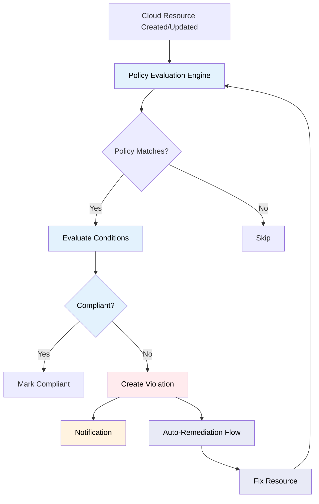
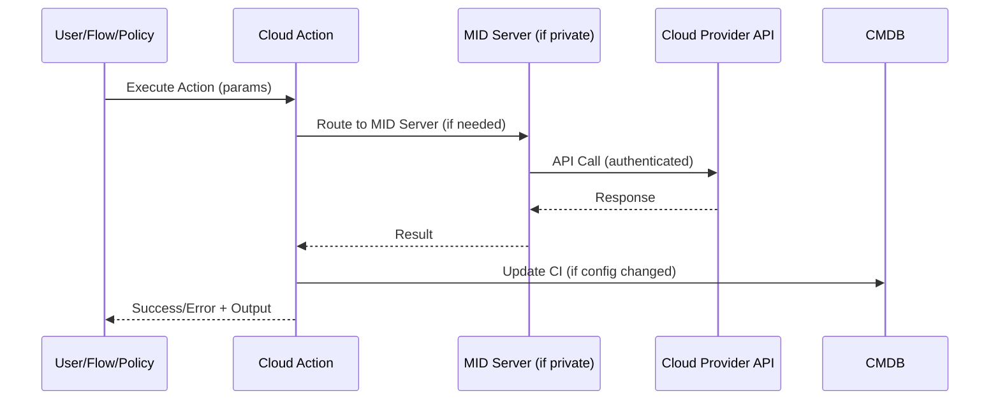

# Cloud Management — ServiceNow Cloud Management

**Agent:** Kilo  
**Date:** 2026-11-19  
**Module:** Cloud Management  
**App:** IT Operations Management — ITOM Cloud Accelerate Pillar  
**Confidence:** high  

---

## Contents

- [Purpose](#purpose)
- [Official Exam Alignment — CIS-Cloud Management (KB0011547)](#official-exam-alignment--cis-cloud-management-kb0011547)
- [Where to Find It](#where-to-find-it)
- [Cloud Management Architecture](#cloud-management-architecture)
- [Key Plugins & Licensing](#key-plugins--licensing)
- [Scoped Application](#scoped-application)
- [Cloud Account Onboarding](#cloud-account-onboarding)
- [Cloud Resource Discovery](#cloud-resource-discovery)
- [Cloud Patterns](#cloud-patterns)
- [Cloud Governance & Compliance](#cloud-governance--compliance)
- [Cloud Cost Management](#cloud-cost-management)
- [Cloud Actions & Orchestration](#cloud-actions--orchestration)
- [Multi-Cloud Management](#multi-cloud-management)
- [Out-of-Box Values & Dropdowns](#out-of-box-values--dropdowns)
- [Re-usable Code / Metadata](#re-usable-code--metadata)
- [Key Table Hierarchy](#key-table-hierarchy)
- [Integrations](#integrations)
- [Key Fields](#key-fields)
- [Common Mistakes](#common-mistakes)
- [Lab: End-to-End Cloud Management](#lab-end-to-end-cloud-management)
- [Quiz](#quiz)
- [Memory Aids & Mnemonics](#memory-aids--mnemonics)
- [Related Guides](#related-guides)
- [Official Learning Resources](#official-learning-resources)

---

## Purpose

ServiceNow Cloud Management provides **unified discovery, governance, and operations** across AWS, Azure, and Google Cloud Platform (GCP). It extends the CMDB to include cloud resources, enables policy-driven governance, and supports cost optimization across multi-cloud environments.

**Key value:** Single pane of glass for multi-cloud inventory, automated compliance, cost visibility, and self-service provisioning.

---

## Official Exam Alignment — CIS-Cloud Management (KB0011547)

This guide maps directly to the **Certified Implementation Specialist - Cloud Management (CIS-CM)** exam blueprint.

| Domain | Weight | Guide Sections | Key Topics |
|--------|--------|----------------|------------|
| **Domain 1: Cloud Account Setup** | 25% | [Cloud Account Onboarding](#cloud-account-onboarding) | AWS/Azure/GCP account onboarding, IAM roles, MID Server for cloud |
| **Domain 2: Cloud Resource Discovery** | 35% | [Cloud Resource Discovery](#cloud-resource-discovery), [Cloud Patterns](#cloud-patterns) | Cloud resource patterns, tagging, scheduling, discovery schedules |
| **Domain 3: Cloud Operations** | 25% | [Cloud Governance](#cloud-governance--compliance), [Cloud Cost Management](#cloud-cost-management), [Cloud Actions](#cloud-actions--orchestration) | Cloud actions, governance policies, cost management, optimization |
| **Domain 4: Cloud Provisioning** | 15% | [Cloud Provisioning](#cloud-provisioning) | Service Catalog, blueprints, Terraform, CloudFormation |

**Official preparation courses:**
- ServiceNow Fundamentals
- ServiceNow Get Started with Now Create
- ServiceNow Platform Implementation
- CMDB Fundamentals
- Cloud Management Fundamentals
- CIS-Cloud Management: Certification Test Prep

---

## Where to Find It

| Breadcrumb | Path |
|------------|------|
| Module entry | All > Cloud Management > ... |
| Cloud Accounts | All > Cloud Management > Cloud Accounts |
| Cloud Resources | All > Cloud Management > Cloud Resources |
| Cloud Discovery | All > Cloud Management > Discovery Schedules |
| Cloud Policies | All > Cloud Management > Governance > Policies |
| Cloud Costs | All > Cloud Management > Cost Management |
| Cloud Actions | All > Cloud Management > Actions |
| Blueprints | All > Cloud Management > Blueprints |

---

## Cloud Management Architecture

```mermaid
graph TD
    subgraph "ServiceNow Cloud"
        A[Cloud Management App]
        B[Cloud Accounts]
        C[Discovery Schedules]
        D[Patterns]
        E[Governance Engine]
        F[Cost Engine]
        G[Action Framework]
        H[CMDB]
    end
    subgraph "AWS"
        I[AWS Account]
        J[CloudTrail]
        K[Config]
        L[Cost Explorer]
        M[APIs]
    end
    subgraph "Azure"
        N[Azure Subscription]
        O[Activity Log]
        P[Policy]
        Q[Cost Management]
        R[APIs]
    end
    subgraph "GCP"
        S[GCP Project]
        T[Cloud Audit Logs]
        U[Cloud Asset Inventory]
        V[Billing Export]
        W[APIs]
    end
    subgraph "MID Server (Optional)"
        X[MID Server for Private Cloud]
    end

    B --> I
    B --> N
    B --> S
    C --> M
    C --> R
    C --> W
    D --> M
    D --> R
    D --> W
    M --> H
    R --> H
    W --> H
    E --> I
    E --> N
    E --> S
    F --> L
    F --> Q
    F --> V
    G --> M
    G --> R
    G --> W

    style A fill:#e8eaf6,color:#000
    style B fill:#e3f2fd,color:#000
    style C fill:#e3f2fd,color:#000
    style D fill:#e3f2fd,color:#000
    style E fill:#fff3e0,color:#000
    style F fill:#fff3e0,color:#000
    style G fill:#fff3e0,color:#000
    style H fill:#f5f5f5,color:#000
    style I fill:#fff8e1,color:#000
    style N fill:#e3f2fd,color:#000
    style S fill:#e1f5e1,color:#000
```



---

## Key Plugins & Licensing

| Plugin | Name | Purpose |
|--------|------|---------|
| `com.snc.cloud_management` | Cloud Management Core | Base cloud management |
| `com.snc.cloud_management.aws` | AWS Provider | AWS-specific discovery/actions |
| `com.snc.cloud_management.azure` | Azure Provider | Azure-specific discovery/actions |
| `com.snc.cloud_management.gcp` | GCP Provider | GCP-specific discovery/actions |
| `com.snc.cloud_management.cost` | Cloud Cost Management | Cost ingestion, optimization |
| `com.snc.cloud_management.governance` | Cloud Governance | Policy engine, compliance |
| `com.snc.cloud_management.provisioning` | Cloud Provisioning | Blueprints, Service Catalog |
| `com.snc.mid_server` | MID Server | For private cloud/on-prem hybrid |

**License:** Cloud Management Add-on (separate from ITOM License).

---

## Scoped Application

| Scope Aspect | Detail |
|--------------|--------|
| Scope name | `com.snc.cloud_management` |
| Key tables | `cloud_account`, `cloud_resource`, `cloud_discovery_schedule`, `cloud_policy`, `cloud_cost` |
| Roles | `cloud_admin`, `cloud_user`, `cloud_operator`, `admin` |

---

## Cloud Account Onboarding

### AWS Account Setup

**Prerequisites:**
- AWS IAM user/role with required permissions
- External ID for cross-account access (recommended)

**Required IAM Permissions:**
```json
{
    "Version": "2012-10-17",
    "Statement": [
        {
            "Effect": "Allow",
            "Action": [
                "ec2:Describe*",
                "rds:Describe*",
                "s3:List*",
                "lambda:List*",
                "elasticloadbalancing:Describe*",
                "autoscaling:Describe*",
                "cloudformation:Describe*",
                "cloudwatch:Describe*",
                "cloudwatch:Get*",
                "cloudwatch:List*",
                "tag:GetResources",
                "tag:GetTagKeys",
                "tag:GetTagValues",
                "organizations:Describe*",
                "organizations:List*",
                "ce:Get*",
                "ce:List*"
            ],
            "Resource": "*"
        }
    ]
}
```

**Onboarding Steps:**
1. Navigate to **All > Cloud Management > Cloud Accounts**
2. Click **New** → **AWS**
3. Fill:
   - **Name:** `PROD-AWS-US-EAST-1`
   - **Account ID:** 12-digit AWS Account ID
   - **Authentication:** Access Key + Secret Key OR Role ARN
   - **Regions:** Select regions to discover
   - **MID Server:** (Optional) For private subnets
4. **Test Connection** → Verify success
5. **Activate** account

### Azure Account Setup

**Prerequisites:**
- Azure AD App Registration
- Subscription Owner or Contributor role

**Required Permissions:**
- `Microsoft.Resources/subscriptions/read`
- `Microsoft.Compute/virtualMachines/read`
- `Microsoft.Storage/storageAccounts/read`
- `Microsoft.Network/*/read`
- `Microsoft.Web/sites/read`
- `Microsoft.ContainerService/managedClusters/read`
- `Microsoft.CostManagement/*/read`
- `Microsoft.Authorization/policyAssignments/read`

**Onboarding Steps:**
1. Navigate to **All > Cloud Management > Cloud Accounts**
2. Click **New** → **Azure**
3. Fill:
   - **Name:** `PROD-AZURE-EASTUS`
   - **Subscription ID:** Azure Subscription ID
   - **Tenant ID:** Azure AD Tenant ID
   - **Client ID:** App Registration Client ID
   - **Client Secret:** App Registration Secret
   - **Regions:** Select regions
4. **Test Connection** → Verify success
5. **Activate** account

### GCP Account Setup

**Prerequisites:**
- GCP Service Account
- Project Owner or Viewer + specific roles

**Required Roles:**
- `roles/compute.viewer`
- `roles/storage.objectViewer`
- `roles/cloudsql.viewer`
- `roles/container.viewer`
- `roles/monitoring.viewer`
- `roles/billing.projectViewer`
- `roles/recommender.viewer`

**Onboarding Steps:**
1. Navigate to **All > Cloud Management > Cloud Accounts**
2. Click **New** → **Google Cloud**
3. Fill:
   - **Name:** `PROD-GCP-US-CENTRAL1`
   - **Project ID:** GCP Project ID
   - **Service Account Key:** JSON key file
   - **Regions:** Select regions
4. **Test Connection** → Verify success
5. **Activate** account

---

## Cloud Resource Discovery

### Discovery Methods

| Method | Description | Frequency |
|--------|-------------|-----------|
| **API-Based Discovery** | Direct cloud provider API calls | Scheduled (default: daily) |
| **Configuration-Based** | AWS Config, Azure Policy, GCP Cloud Asset Inventory | Near real-time |
| **Event-Driven** | CloudTrail, Activity Log, Audit Logs | Real-time |
| **Tag-Based** | Discover resources by tags | On-demand |

### Discovery Schedule Configuration

1. Navigate to **All > Cloud Management > Discovery Schedules**
2. Click **New**
3. Fill:
   - **Name:** `Daily Cloud Discovery - PROD`
   - **Cloud Account:** Select account
   - **Resource Types:** Select types (VM, Storage, Network, Database, etc.)
   - **Frequency:** Daily / Weekly / Monthly
   - **Time:** Off-peak (02:00)
   - **MID Server:** Auto (for public) or specific (for private)
4. **Save** and **Run Now** for initial discovery

### Discovered Resource Types (Key Examples)

| Provider | Compute | Storage | Network | Database | Serverless | Containers |
|----------|---------|---------|---------|----------|------------|------------|
| **AWS** | EC2, Lambda | S3, EBS, EFS | VPC, ELB, ALB | RDS, DynamoDB, ElastiCache | Lambda, Fargate | ECS, EKS |
| **Azure** | VM, Functions | Blob, Disk, Files | VNet, LB, App Gateway | SQL DB, Cosmos DB, Cache | Functions, Container Instances | AKS, ACI |
| **GCP** | Compute Engine, Cloud Functions | Cloud Storage, Persistent Disk | VPC, Load Balancing | Cloud SQL, Firestore, Memorystore | Cloud Functions, Cloud Run | GKE, Cloud Run |

### Resource Tagging Strategy

**Recommended Tags:**
```yaml
# Standard tags for all cloud resources
Environment: prod|staging|dev|test
Application: customer-portal|order-service|payment-gateway
Owner: team-platform|team-payments|team-frontend
CostCenter: CC-1001|CC-1002
DataClassification: public|internal|confidential|restricted
BackupRequired: true|false
PatchGroup: weekly|monthly|manual
```

**Tag Policy Enforcement:**
- Create Cloud Policy: "Required Tags"
- Non-compliant resources → Alert + Auto-remediation

---

## Cloud Patterns

**Cloud Patterns** define how to discover and map cloud resources to CMDB CIs.

### Pattern Structure

```
Cloud Pattern
├── Connection Section
│   ├── Cloud Account Reference
│   ├── Region Selection
│   └── API Parameters
├── Identification Section
│   ├── Resource Type Filter
│   ├── Tag Filters
│   └── Unique Identifiers (ARN, Resource ID, Self Link)
├── Exploration Section
│   ├── API Calls (Describe*, List*, Get*)
│   ├── Parse Operations (JSON → CI Fields)
│   ├── Create/Update CI Operations
│   └── Relationship Creation
└── Tag Mapping Section
    ├── Standard Tags → CI Fields
    └── Custom Tags → CI Attributes
```

### Key Cloud Patterns (Out-of-Box)

| Pattern | Resource Type | CI Class |
|---------|---------------|----------|
| **AWS EC2 Instance** | `AWS::EC2::Instance` | `cmdb_ci_aws_ec2_instance` |
| **AWS RDS Instance** | `AWS::RDS::DBInstance` | `cmdb_ci_aws_rds_instance` |
| **AWS S3 Bucket** | `AWS::S3::Bucket` | `cmdb_ci_aws_s3_bucket` |
| **AWS Lambda** | `AWS::Lambda::Function` | `cmdb_ci_aws_lambda_function` |
| **Azure VM** | `Microsoft.Compute/virtualMachines` | `cmdb_ci_azure_vm` |
| **Azure SQL Database** | `Microsoft.Sql/servers/databases` | `cmdb_ci_azure_sql_database` |
| **GCP Compute Instance** | `compute.v1.instance` | `cmdb_ci_gcp_compute_instance` |
| **GCP Cloud SQL** | `sqladmin.v1beta4.instance` | `cmdb_ci_gcp_cloudsql_instance` |

### Custom Pattern Development

1. Navigate to **All > Cloud Management > Patterns**
2. Click **New** → Select Provider (AWS/Azure/GCP)
3. Define **Resource Type** (CloudFormation type, ARM type, GCP type)
4. Build **Connection** → **Identification** → **Exploration**
5. **Test** with sample resource
6. **Activate** pattern

---

## Cloud Governance & Compliance

### Policy Types

| Policy Type | Description | Enforcement |
|-------------|-------------|-------------|
| **Configuration Policy** | Desired state for resource config | Audit / Auto-remediate |
| **Tag Policy** | Required tags, allowed values | Audit / Block creation |
| **Security Policy** | Encryption, public access, IAM | Audit / Auto-remediate |
| **Cost Policy** | Budget alerts, rightsizing | Notify / Optimize |
| **Custom Policy** | Scripted conditions | Flexible |

### Policy Engine



### Common Governance Policies

| Policy | Condition | Remediation |
|--------|-----------|-------------|
| **S3 Bucket Public Access** | Bucket ACL allows public read/write | Block public access |
| **EBS Encryption** | Volume not encrypted | Enable encryption (requires snapshot) |
| **Security Group Open to World** | 0.0.0.0/0 on port 22/3389 | Restrict to bastion CIDR |
| **Required Tags Missing** | Missing Environment, Application, Owner | Tag or terminate |
| **Unused Resources** | Idle > 30 days (CPU < 5%) | Stop/Terminate with approval |
| **Public IP on Private Resource** | Public IP on non-web resource | Remove public IP |

### Compliance Dashboard

- **All > Cloud Management > Governance > Compliance Dashboard**
- Shows: Compliance %, Violations by severity, Trends, Top non-compliant accounts

---

## Cloud Cost Management

### Cost Ingestion

| Provider | Method | Frequency |
|----------|--------|-----------|
| **AWS** | Cost Explorer API / CUR (S3) | Daily |
| **Azure** | Cost Management API / Export | Daily |
| **GCP** | Billing Export to BigQuery | Daily |

### Cost Data Model

```
cloud_cost (table)
├── cloud_account (ref)
├── resource_id (string)
├── service_name (string)  # EC2, RDS, S3, etc.
├── usage_type (string)    # BoxUsage, EBS-Volume, etc.
├── usage_amount (decimal)
├── unit (string)          # Hrs, GB-Mo, etc.
├── blended_cost (decimal)
├── unblended_cost (decimal)
├── amortized_cost (decimal)
├── currency (string)
├── start_date (date)
├── end_date (date)
├── tags (JSON)
└── billing_period (string)
```

### Cost Optimization Features

| Feature | Description |
|---------|-------------|
| **Rightsizing Recommendations** | Identify over-provisioned resources |
| **Reserved Instance Planning** | Analyze RI coverage, recommend purchases |
| **Savings Plans (AWS)** | Compute Savings Plan optimization |
| **Idle Resource Detection** | Find stopped, unattached, low-utilization |
| **Budget Alerts** | Threshold-based notifications |
| **Cost Allocation** | Chargeback/showback by tag, account, service |

### Cost Dashboard

- **All > Cloud Management > Cost Management > Cost Dashboard**
- Views: Total spend, Month-over-month, By account/service/tag, Forecast, Optimization opportunities

---

## Cloud Actions & Orchestration

### Action Framework

**Cloud Actions** are executable operations on cloud resources, invoked via:
- **Manual** (UI button)
- **Flow Designer** (automated)
- **Policy Remediation** (auto-fix)
- **Runbook** (documented procedure)

### Common Cloud Actions

| Category | Actions |
|----------|---------|
| **Compute** | Start, Stop, Reboot, Terminate, Resize, Change Type |
| **Storage** | Create Snapshot, Delete Snapshot, Encrypt, Change Tier |
| **Network** | Associate/Disassociate IP, Modify SG Rules, Create VPC Peering |
| **Database** | Start, Stop, Reboot, Scale, Backup, Restore |
| **Serverless** | Deploy, Update, Delete, Configure |
| **Containers** | Scale Deployment, Update Image, Rollback |
| **IAM** | Attach/Detach Policy, Create/Delete Role |

### Action Execution Flow



### Custom Action Development

1. Navigate to **All > Cloud Management > Actions**
2. Click **New**
3. Define:
   - **Name:** `Encrypt EBS Volume`
   - **Provider:** AWS
   - **Resource Type:** `AWS::EC2::Volume`
   - **Input Parameters:** Volume ID, KMS Key ID
   - **Script:** API call logic (Groovy/JavaScript)
4. **Test** on non-prod resource
5. **Publish** for use in Flows/Policies

---

## Multi-Cloud Management

### Unified Resource View

**All > Cloud Management > Cloud Resources** — Single list across AWS, Azure, GCP.

| Column | Description |
|--------|-------------|
| **Name** | Resource name |
| **Provider** | AWS / Azure / GCP |
| **Account** | Cloud Account name |
| **Region** | Deployment region |
| **Type** | Resource type |
| **Status** | Running, Stopped, Terminated, etc. |
| **Tags** | Key tags (Environment, Application, Owner) |
| **Compliance** | Compliant / Non-Compliant / Unknown |
| **Monthly Cost** | Estimated monthly cost |

### Cross-Cloud Operations

| Operation | Description |
|-----------|-------------|
| **Unified Tagging** | Apply tags across providers via single action |
| **Compliance Reporting** | Single report for all clouds |
| **Cost Aggregation** | Total spend across providers |
| **Resource Migration** | Track lift-and-shift migrations |
| **Disaster Recovery** | Cross-cloud DR validation |

### Multi-Cloud Patterns

| Pattern | Use Case |
|---------|----------|
| **Active-Passive DR** | Primary in AWS, DR in Azure/GCP |
| **Multi-Cloud Kubernetes** | EKS + AKS + GKE managed centrally |
| **Data Residency** | EU data in Azure EU, US data in AWS US |
| **Best-of-Breed** | AI/ML on GCP, Enterprise apps on Azure, General compute on AWS |

---

## Out-of-Box Values & Dropdowns

### Cloud Account Status (cloud_account.status)

| Value | Label |
|-------|-------|
| `active` | Active |
| `inactive` | Inactive |
| `error` | Connection Error |
| `pending` | Pending Validation |

### Cloud Resource State (cloud_resource.state)

| Value | Label |
|-------|-------|
| `running` | Running |
| `stopped` | Stopped |
| `terminated` | Terminated |
| `pending` | Pending |
| `error` | Error |
| `unknown` | Unknown |

### Cloud Policy Status

| Value | Label |
|-------|-------|
| `compliant` | Compliant |
| `non_compliant` | Non-Compliant |
| `not_applicable` | Not Applicable |
| `unknown` | Unknown |

### Cloud Action Status

| Value | Label |
|-------|-------|
| `pending` | Pending |
| `running` | Running |
| `success` | Success |
| `failed` | Failed |
| `cancelled` | Cancelled |

---

## Re-usable Code / Metadata

### Re-usable Metadata Inventory

| Piece | Location | Purpose |
|-------|----------|---------|
| **Cloud Accounts** | All > Cloud Management > Cloud Accounts | Provider connections |
| **Discovery Schedules** | All > Cloud Management > Discovery Schedules | Recurring discovery |
| **Patterns** | All > Cloud Management > Patterns | Resource discovery logic |
| **Policies** | All > Cloud Management > Governance > Policies | Compliance rules |
| **Actions** | All > Cloud Management > Actions | Executable operations |
| **Blueprints** | All > Cloud Management > Blueprints | Provisioning templates |

### Re-usable Code Snippets

#### Script Include: Cloud Resource Helper

```javascript
var CloudResourceHelper = Class.create();
CloudResourceHelper.prototype = Object.extendsObject(AbstractAjaxProcessor, {
    // Get resources by tag across all clouds
    getResourcesByTag: function() {
        var tagKey = this.getParameter('tag_key');
        var tagValue = this.getParameter('tag_value');
        
        var gr = new GlideRecord('cloud_resource');
        gr.addEncodedQuery('tags.' + tagKey + '=' + tagValue);
        gr.query();
        
        var results = [];
        while (gr.next()) {
            results.push({
                sys_id: gr.sys_id,
                name: gr.name,
                provider: gr.provider,
                account: gr.cloud_account.getDisplayValue(),
                region: gr.region,
                type: gr.resource_type,
                state: gr.state,
                monthly_cost: gr.monthly_estimated_cost
            });
        }
        return JSON.stringify(results);
    },
    
    // Get cost summary by account
    getCostSummary: function() {
        var accountId = this.getParameter('account_id');
        var days = parseInt(this.getParameter('days') || '30');
        
        var ga = new GlideAggregate('cloud_cost');
        if (accountId) ga.addQuery('cloud_account', accountId);
        ga.addQuery('start_date', '>=', gs.daysAgo(days));
        ga.groupBy('cloud_account');
        ga.groupBy('service_name');
        ga.sum('blended_cost');
        ga.query();
        
        var results = [];
        while (ga.next()) {
            results.push({
                account: ga.cloud_account.getDisplayValue(),
                service: ga.getValue('service_name'),
                cost: ga.getAggregate('SUM', 'blended_cost')
            });
        }
        return JSON.stringify(results);
    },
    
    // Trigger cloud action
    triggerAction: function() {
        var actionId = this.getParameter('action_id');
        var resourceId = this.getParameter('resource_id');
        var params = JSON.parse(this.getParameter('params') || '{}');
        
        var action = new GlideRecord('cloud_action');
        action.addQuery('sys_id', actionId);
        action.query();
        if (action.next()) {
            var exec = new CloudActionAPI();
            var result = exec.execute(actionId, resourceId, params);
            return JSON.stringify(result);
        }
        return 'Action not found';
    },
    
    type: 'CloudResourceHelper'
});
```

#### Flow Designer: Auto-Remediate Non-Compliant Resource

```javascript
// Flow Designer Action Script
var violation = trigger.current; // cloud_policy_violation record

// Get remediation action for this policy
var policy = violation.policy.getRefRecord();
var remediationAction = policy.remediation_action; // Reference to cloud_action

if (remediationAction) {
    var cloudActionAPI = new CloudActionAPI();
    var result = cloudActionAPI.execute(
        remediationAction.sys_id,
        violation.resource.sys_id,
        {}
    );
    
    if (result.success) {
        violation.state = 'remediated';
        violation.remediation_notes = 'Auto-remediated via Flow: ' + result.output;
        violation.update();
        
        // Re-evaluate policy
        var evaluator = new CloudPolicyEvaluator();
        evaluator.evaluateResource(violation.resource.sys_id);
    } else {
        violation.state = 'remediation_failed';
        violation.remediation_notes = 'Auto-remediation failed: ' + result.error;
        violation.update();
        
        // Notify team
        var notif = new GlideRecord('sys_notification_email');
        notif.send('cloud_admin_group', 'Remediation Failed', violation);
    }
}
```

#### Business Rule: Auto-Tag Resources on Discovery

```javascript
(function rule(current, previous) {
    // When new cloud resource discovered, apply default tags from account
    if (current.operation() == 'insert') {
        var account = current.cloud_account.getRefRecord();
        if (account.default_tags) {
            var defaultTags = JSON.parse(account.default_tags);
            var currentTags = JSON.parse(current.tags || '{}');
            
            // Merge default tags (don't overwrite existing)
            Object.keys(defaultTags).forEach(function(key) {
                if (!currentTags[key]) {
                    currentTags[key] = defaultTags[key];
                }
            });
            
            current.tags = JSON.stringify(currentTags);
        }
    }
})(current, previous);
```

---

## Key Table Hierarchy

| Table | Purpose | Key Fields |
|-------|---------|------------|
| `cloud_account` | Cloud provider accounts | `name`, `provider`, `account_id`, `status`, `regions` |
| `cloud_resource` | Discovered cloud resources | `name`, `provider`, `resource_id`, `resource_type`, `region`, `state`, `tags`, `monthly_estimated_cost` |
| `cloud_discovery_schedule` | Discovery schedules | `name`, `cloud_account`, `resource_types`, `frequency`, `state` |
| `cloud_pattern` | Discovery patterns | `name`, `provider`, `resource_type`, `active` |
| `cloud_policy` | Governance policies | `name`, `provider`, `resource_type`, `conditions`, `remediation_action` |
| `cloud_policy_violation` | Policy violations | `policy`, `resource`, `state`, `severity`, `remediation_status` |
| `cloud_cost` | Cost data | `cloud_account`, `resource_id`, `service_name`, `blended_cost`, `start_date`, `tags` |
| `cloud_action` | Executable actions | `name`, `provider`, `resource_type`, `script`, `input_parameters` |
| `cloud_blueprint` | Provisioning templates | `name`, `provider`, `template_type`, `parameters` |

### Table Relationships

```
cloud_account
    │
    ├──► cloud_resource (account → resources)
    │       ├──► cloud_policy_violation (resource → violations)
    │       ├──► cloud_cost (resource → cost data)
    │       └──► cmdb_ci (resource → CI via identification)
    │
    ├──► cloud_discovery_schedule (account → schedules)
    │
    └──► cloud_action (account → actions via provider)
    
cloud_policy
    │
    ├──► cloud_policy_violation (policy → violations)
    │
    └──► cloud_action (policy → remediation action)
```

---

## Integrations

| Integration | Direction | Purpose | Protocol |
|-------------|-----------|---------|----------|
| **AWS APIs** | Bidirectional | Discovery, Actions, Cost, Governance | REST (AWS SDK) |
| **Azure APIs** | Bidirectional | Discovery, Actions, Cost, Governance | REST (Azure SDK) |
| **GCP APIs** | Bidirectional | Discovery, Actions, Cost, Governance | REST (GCP SDK) |
| **MID Server** | Outbound | Private cloud/hybrid connectivity | Proprietary |
| **CMDB** | Bidirectional | CI synchronization | Internal |
| **Service Catalog** | Inbound | Self-service provisioning | Internal |
| **Flow Designer** | Inbound | Automated cloud operations | Internal |
| **Event Management** | Inbound | Cloud resource alerts | Internal |
| **Terraform Cloud** | Outbound | IaC provisioning | REST |
| **Ansible Tower** | Outbound | Configuration management | REST |

---

## Key Fields

| Table | Field | Type | Why It Matters |
|-------|-------|------|----------------|
| `cloud_account` | `provider` | Choice | AWS / Azure / GCP |
| `cloud_account` | `account_id` | String | Provider account identifier |
| `cloud_resource` | `resource_id` | String | Provider-native resource ID (ARN, Resource ID, Self Link) |
| `cloud_resource` | `resource_type` | String | Provider resource type |
| `cloud_resource` | `tags` | JSON | Key-value tags for governance/cost |
| `cloud_resource` | `monthly_estimated_cost` | Decimal | Cost visibility |
| `cloud_policy` | `conditions` | Script/JSON | Compliance logic |
| `cloud_policy` | `remediation_action` | Reference | Auto-fix action |
| `cloud_cost` | `service_name` | String | Cloud service (EC2, RDS, etc.) |
| `cloud_cost` | `blended_cost` | Decimal | Actual cost with discounts |
| `cloud_action` | `input_parameters` | JSON | Action parameters schema |

---

## Common Mistakes

| Mistake | Symptom | Fix |
|---------|---------|-----|
| Over-permissioned IAM roles | Security risk, audit findings | Least privilege; use ServiceNow-provided policies |
| No MID Server for private resources | Discovery misses private subnet resources | Deploy MID Server in each VPC/VNet |
| Discovery schedule too frequent | API throttling, cost | Daily max; use config-based for real-time |
| Missing required tags | Governance gaps, cost allocation fails | Enforce tag policies at creation |
| No cost data ingestion | Cost dashboard empty | Configure CUR (AWS), Export (Azure), BigQuery (GCP) |
| Policies without remediation | Manual cleanup burden | Add remediation actions to all policies |
| Not testing patterns | Discovery fails/creates wrong CIs | Test in Pattern Designer first |
| Single cloud account for all envs | Prod/test mixing, security | Separate accounts per environment |
| Ignoring rightsizing | Overspend on compute | Schedule weekly rightsizing review |
| No budget alerts | Surprise bills | Set budgets per account/service/tag |

---

## Lab: End-to-End Cloud Management

**Prerequisites:** Cloud Management plugin active, Cloud Management license, at least one cloud provider account.

### Step 1: Onboard AWS Account
1. Create IAM role in AWS with `CloudManagementReadOnly` permissions
2. Navigate to **All > Cloud Management > Cloud Accounts**
3. Click **New** → **AWS**
4. Fill details, use Role ARN authentication
5. **Test Connection** → **Activate**

### Step 2: Run Initial Discovery
1. Navigate to **All > Cloud Management > Discovery Schedules**
2. Click **New** → Select AWS account
3. **Resource Types:** Select all (or start with EC2, RDS, S3)
4. **Frequency:** Once (for test)
5. **Run Now** → Monitor progress

### Step 3: Verify Discovered Resources
1. Navigate to **All > Cloud Management > Cloud Resources**
2. Filter by Account = your AWS account
3. Verify: EC2 instances, RDS databases, S3 buckets appear
4. Open a resource → Check **Tags**, **Cost**, **Compliance** tabs

### Step 4: Create Tag Policy
1. Navigate to **All > Cloud Management > Governance > Policies**
2. Click **New** → **Tag Policy**
3. **Name:** `Required Tags - Environment, Application, Owner`
4. **Provider:** AWS
5. **Resource Types:** All (or specific)
6. **Required Tags:** Environment, Application, Owner
7. **Remediation Action:** (Optional) Create action to auto-tag
8. **Save** and **Activate**

### Step 5: Configure Cost Ingestion
1. **AWS:** Enable Cost and Usage Report (CUR) to S3 bucket
2. Navigate to **All > Cloud Management > Cost Management > Settings**
3. Configure CUR bucket for your account
4. **Run Cost Ingestion** → Verify cost data appears

### Step 6: Create Auto-Remediation Flow
1. Navigate to **All > Flow Designer**
2. **New Flow:** `Auto-Tag Non-Compliant Resources`
3. **Trigger:** Record Created → Table: `cloud_policy_violation`
4. **Condition:** `Policy = Required Tags`
5. **Action:** Look up Resource → Cloud Action: `Tag Resource`
6. **Parameters:** Apply missing tags from policy
7. **Save** and **Test** (create violation manually)

### Step 7: View Dashboards
1. **Compliance:** All > Cloud Management > Governance > Compliance Dashboard
2. **Cost:** All > Cloud Management > Cost Management > Cost Dashboard
3. **Resources:** All > Cloud Management > Cloud Resources (unified view)

---

## Quiz

1. What are the three cloud providers supported by ServiceNow Cloud Management?
   <details><summary>Answer</summary>AWS, Azure, Google Cloud Platform (GCP)</details>

2. What plugin enables Cloud Management?
   <details><summary>Answer</summary>`com.snc.cloud_management`</details>

3. What is the primary method for discovering AWS resources?
   <details><summary>Answer</summary>API-Based Discovery (direct AWS API calls)</details>

4. What table stores cloud cost data?
   <details><summary>Answer</summary>`cloud_cost`</details>

5. What are the two main authentication methods for AWS accounts?
   <details><summary>Answer</summary>Access Key + Secret Key OR IAM Role ARN (cross-account)</details>

6. What is a Cloud Pattern?
   <details><summary>Answer</summary>Defines how to discover and map a specific cloud resource type to CMDB CI</details>

7. How does Cloud Governance enforce policies?
   <details><summary>Answer</summary>Policy Engine evaluates resources on create/update/schedule → Creates violations → Triggers remediation</details>

8. What is the difference between blended and unblended cost?
   <details><summary>Answer</summary>Blended = includes RI/Savings Plan discounts; Unblended = on-demand rate</details>

9. What MID Server capability is needed for private cloud discovery?
   <details><summary>Answer</strong>Deploy MID Server in the private VPC/VNet with outbound HTTPS to ServiceNow</details>

10. What is a Cloud Blueprint?
    <details><summary>Answer</strong>Provisioning template (CloudFormation, ARM, Terraform) for self-service deployment via Service Catalog</details>

---

## Memory Aids & Mnemonics

<details>
<summary>💡 Click to reveal mnemonics & memory aids</summary>

### Cloud Providers — AAG
**A**WS, **A**zure, **G**CP

---

### Cloud Account Setup — AIR
**A**uthentication (Keys/Role)
**I**AM Permissions
**R**egions Selection

---

### Discovery Methods — ACE
**A**PI-Based
**C**onfiguration-Based
**E**vent-Driven

---

### Policy Types — CTSCC
**C**onfiguration, **T**ag, **S**ecurity, **C**ost, **C**ustom

---

### Cloud Actions — CSNDI
**C**ompute, **S**torage, **N**etwork, **D**atabase, **I**AM

---

### Cost Optimization — RISE
**R**ightsizing, **I**dle Detection, **S**avings Plans/RIs, **E**xport/Ingestion

---

### Multi-Cloud Patterns — ADMB
**A**ctive-Passive DR, **D**ata Residency, **M**ulti-Cloud K8s, **B**est-of-Breed

---

</details>

---

## Related Guides

- [ITOM Overview](../itom-guide.md)
- [Discovery Guide](../discovery/discovery-guide.md)
- [Service Mapping Guide](../servicemapping/servicemapping-guide.md)
- [Orchestration Guide](../orchestration/orchestration-guide.md)
- [MID Server Guide](../midserver/midserver-guide.md)
- [Cloud Management Getting Started](../../getting-started/cloudmanagement.md)

---

## Official Learning Resources

### Now Learning (Structured Training)
- [Cloud Management Fundamentals](https://nowlearning.servicenow.com/) — Search "Cloud Management" on Now Learning Portal
- [CIS-Cloud Management: Certification Test Prep](https://nowlearning.servicenow.com/)

### Product Documentation (Technical Reference)
- [ServiceNow Product Documentation — Cloud Management](https://docs.servicenow.com/) → Search "Cloud Management", "Cloud Discovery", "Cloud Governance", "Cloud Cost Management", "Cloud Provisioning"
- [ServiceNow Product Documentation — Cloud Patterns](https://docs.servicenow.com/) → Search "Cloud Patterns", "Cloud Actions"

### Official Videos & Playlists
- [ServiceNow YouTube Channel](https://www.youtube.com/c/ServiceNow) — Search "ServiceNow Cloud Management", "ServiceNow Multi-Cloud", "ServiceNow Cloud Cost"

### Certification Blueprint
- [CIS-Cloud Management Blueprint (KB0011547)](https://www.servicenow.com/training-certification/certifications/cis-cloud-management.html)

---

*Generated by Kilo on 2026-11-19. Based on official ServiceNow documentation, CIS-Cloud Management certification blueprint (KB0011547), and product guides.*