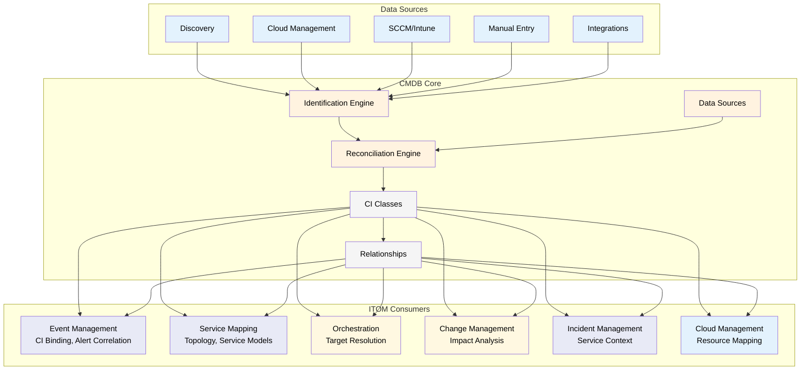
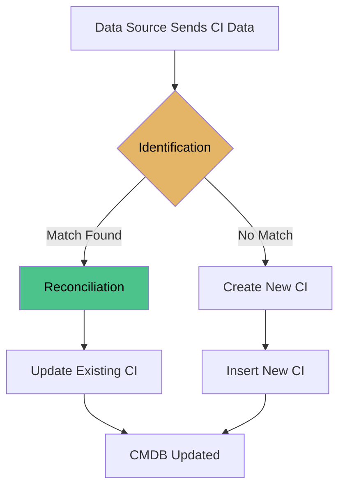

# CMDB — Configuration Management Database (ITOM Perspective)

**Agent:** Kilo  
**Date:** 2026-11-19  
**Module:** CMDB (ITOM Perspective)  
**App:** IT Operations Management — Foundation for all ITOM modules  
**Confidence:** high  

---

## Contents

- [Purpose](#purpose)
- [The Blueprint vs. The Actual: Model vs. CI Instance](#the-blueprint-vs-the-actual-model-vs-ci-instance)
- [CMDB in ITOM Architecture](#cmdb-in-itom-architecture)
- [Key Plugins & Licensing](#key-plugins--licensing)
- [CI Class Hierarchy](#ci-class-hierarchy)
- [ITOM-Relevant CI Classes](#itom-relevant-ci-classes)
- [Identification & Reconciliation (IRE)](#identification--reconciliation-ire)
- [Data Source Precedence](#data-source-precedence)
- [CMDB Relationships](#cmdb-relationships)
- [Service Mapping Relationships](#service-mapping-relationships)
- [CSDM Alignment](#csdm-alignment)
- [CMDB Health & Quality](#cmdb-health--quality)
- [ITOM Integration Points](#itom-integration-points)
- [Out-of-Box Values & Dropdowns](#out-of-box-values--dropdowns)
- [Re-usable Code / Metadata](#re-usable-code--metadata)
- [Key Table Hierarchy](#key-table-hierarchy)
- [Integrations](#integrations)
- [Key Fields](#key-fields)
- [Common Mistakes](#common-mistakes)
- [Lab: CMDB for ITOM](#lab-cmdb-for-itom)
- [Quiz](#quiz)
- [Memory Aids & Mnemonics](#memory-aids--mnemonics)
- [Related Guides](#related-guides)
- [Official Learning Resources](#official-learning-resources)

---

## Purpose

The **Configuration Management Database (CMDB)** is the **single source of truth** for all ITOM modules. Discovery populates it, Event Management correlates alerts to it, Service Mapping builds service topologies from it, Orchestration targets it, and Cloud Management extends it to cloud resources.

**Key value:** Without an accurate CMDB, ITOM cannot provide service-aware operations, change impact analysis, or automated remediation.

---

## The Blueprint vs. The Actual: Model vs. CI Instance

In a CMDB, the "base" configuration and its maximum capacity are separated across two different layers: the **Model / Catalog Level** and the **CI Instance Level**. This prevents "template" data from being confused with "live" asset data.

### 1. Model / Product Catalog Level (The Blueprint)
*   **What it stores:** The theoretical capabilities and maximum limits of the hardware or software.
*   **ELI5 Example:** Think of a LEGO set instruction manual. It tells you that the set *can* build a castle with 10 towers. It doesn't matter if you've only built 2 towers so far; the manual says 10 are possible.
*   **CMDB Example:** The "Server Model X" record specifies that the chassis has **6 total physical slots** available.
*   **Purpose:** Used for purchasing and capacity planning. It tells you the maximum expansion potential.

### 2. CI Instance Level (The Actual "Base" Setup)
*   **What it stores:** The real-world, live state of the specific asset currently in your environment.
*   **ELI5 Example:** This is the actual LEGO castle sitting on your table. Right now, it only has **4 towers** built. This is its "current baseline."
*   **CMDB Example:** The specific server CI (`SRV-001`) shows **4 slots currently populated** as its active baseline.
*   **Purpose:** Used for incident management and daily operations. It tracks what is actually deployed *now*.

### 3. Component / Child CI Level (The Granular Parts)
*   **What it stores:** Individual CIs for the items occupying those slots, linked to the parent via relationships (e.g., `Contains :: Contained by`).
*   **ELI5 Example:** These are the individual LEGO bricks used to build those 4 towers. Each brick is its own piece you can track.
*   **CMDB Example:** 4 separate child CIs (e.g., RAM sticks) exist and are linked to `SRV-001`, leaving 2 slots empty.
*   **Purpose:** Granular tracking for replacement and failure analysis.

### Summary Comparison

| CMDB Layer | Represents | Your Example (Slots) | ELI5 Analogy |
| :--- | :--- | :--- | :--- |
| **Product Model** | Maximum potential / Specs | 6 slots (Max capacity) | The Instruction Manual |
| **Parent CI** | Actual active configuration | 4 slots (Current baseline) | The Built Model |
| **Child CIs** | Individual installed parts | 4 individual component records | The Individual Bricks |

> **Note on Baselines:** In ITIL, a "Configuration Baseline" is a snapshot of a CI at a specific point in time. When you expand from 4 to 6 slots, you update the Parent CI, add 2 Child CIs, and capture a new Baseline.

---

## CMDB in ITOM Architecture



---

## Key Plugins & Licensing

| Plugin | Name | Purpose |
|--------|------|---------|
| `com.snc.cmdb` | CMDB Core | Base CMDB functionality |
| `com.snc.cmdb.model` | CI Class Manager | CI class definitions, relationships |
| `com.snc.identification_reconciliation` | Identification & Reconciliation | IRE engine |
| `com.snc.cmdb.health` | CMDB Health | Health dashboard, metrics |
| `com.snc.cmdb.csdm` | CSDM | Common Services Data Model |
| `com.snc.cmdb.ci_class_models` | CI Class Models | Hardware, Application, Network models |

**License:** Included with base platform. ITOM License enhances with Discovery, Service Mapping, etc.

---

## CI Class Hierarchy

### Base Classes (cmdb_ci)

```
cmdb_ci (Abstract)
├── cmdb_ci_hardware
│   ├── cmdb_ci_computer
│   │   ├── cmdb_ci_server
│   │   │   ├── cmdb_ci_linux_server
│   │   │   ├── cmdb_ci_win_server
│   │   │   ├── cmdb_ci_unix_server
│   │   │   └── cmdb_ci_vmware_vm
│   │   ├── cmdb_ci_workstation
│   │   └── cmdb_ci_laptop
│   ├── cmdb_ci_network_gear
│   │   ├── cmdb_ci_router
│   │   ├── cmdb_ci_switch
│   │   ├── cmdb_ci_firewall
│   │   └── cmdb_ci_load_balancer
│   └── cmdb_ci_storage
├── cmdb_ci_application
│   ├── cmdb_ci_web_server
│   ├── cmdb_ci_database
│   ├── cmdb_ci_middleware
│   └── cmdb_ci_business_application
├── cmdb_ci_service (Logical services)
└── cmdb_ci_cloud_resource (Cloud-specific)
```

### Key ITOM CI Classes

| CI Class | Table | Discovered By | Key Identifiers |
|----------|-------|---------------|-----------------|
| **Linux Server** | `cmdb_ci_linux_server` | Discovery (SSH) | `serial_number`, `mac_address`, `fqdn` |
| **Windows Server** | `cmdb_ci_win_server` | Discovery (WinRM/WMI) | `serial_number`, `mac_address`, `fqdn` |
| **Network Device** | `cmdb_ci_network_gear` | Discovery (SNMP/SSH) | `serial_number`, `mac_address`, `ip_address` |
| **Database** | `cmdb_ci_database` | Discovery (JDBC/SSH) | `name` + `host` |
| **Web Server** | `cmdb_ci_web_server` | Discovery (SSH/WinRM) | `name` + `host` |
| **Load Balancer** | `cmdb_ci_load_balancer` | Discovery (SNMP/REST) | `serial_number`, `ip_address` |
| **Cloud VM (AWS)** | `cmdb_ci_aws_ec2_instance` | Cloud Management | `instance_id` (ARN) |
| **Cloud VM (Azure)** | `cmdb_ci_azure_vm` | Cloud Management | `resource_id` |
| **Cloud VM (GCP)** | `cmdb_ci_gcp_compute_instance` | Cloud Management | `self_link` |
| **Kubernetes Cluster** | `cmdb_ci_kubernetes_cluster` | Discovery/Cloud | `cluster_id` |
| **Business Service** | `sa_service` | Service Mapping | `name` |

---

## ITOM-Relevant CI Classes

### Hardware Classes (Discovery Targets)

| Class | Key Attributes | Discovery Method |
|-------|----------------|------------------|
| `cmdb_ci_linux_server` | cpu_count, cpu_core_count, ram, disk_space, os_version | SSH |
| `cmdb_ci_win_server` | cpu_count, ram, disk_space, os_version, domain | WinRM/PowerShell |
| `cmdb_ci_router` | model, ios_version, interfaces | SNMP/SSH |
| `cmdb_ci_switch` | model, ports, vlans | SNMP/SSH |
| `cmdb_ci_firewall` | model, firmware, rules | SNMP/SSH/REST |
| `cmdb_ci_load_balancer` | model, vips, pools | SNMP/REST |
| `cmdb_ci_storage` | capacity, raid_level, array_type | SNMP/REST |

### Application Classes (Horizontal Discovery)

| Class | Key Attributes | Discovery Method |
|-------|----------------|------------------|
| `cmdb_ci_apache` | version, config_path, ports, modules | SSH |
| `cmdb_ci_nginx` | version, config_path, upstream_servers | SSH |
| `cmdb_ci_tomcat` | version, jvm_args, deployed_apps | SSH/JMX |
| `cmdb_ci_weblogic` | version, domain, clusters | SSH/JMX |
| `cmdb_ci_websphere` | version, cell, nodes | SOAP/REST |
| `cmdb_ci_mysql` | version, databases, replication | SSH/JDBC |
| `cmdb_ci_postgresql` | version, databases, replication | SSH/JDBC |
| `cmdb_ci_oracle` | version, instance_name, tablespaces | JDBC |
| `cmdb_ci_sql_server` | version, instances, databases | WinRM/JDBC |
| `cmdb_ci_redis` | version, memory, keyspace | SSH |
| `cmdb_ci_kafka` | version, brokers, topics | SSH/JMX |
| `cmdb_ci_docker` | version, containers, images | SSH |
| `cmdb_ci_kubernetes_node` | version, kubelet, pods | SSH/kubectl |

### Cloud Classes (Cloud Management)

| Class | Provider | Key Identifiers |
|-------|----------|-----------------|
| `cmdb_ci_aws_ec2_instance` | AWS | `instance_id` (i-xxxxx) |
| `cmdb_ci_aws_rds_instance` | AWS | `db_instance_identifier` |
| `cmdb_ci_aws_s3_bucket` | AWS | `bucket_name` |
| `cmdb_ci_aws_lambda_function` | AWS | `function_name` + `region` |
| `cmdb_ci_azure_vm` | Azure | `resource_id` (/subscriptions/.../virtualMachines/...) |
| `cmdb_ci_azure_sql_database` | Azure | `resource_id` |
| `cmdb_ci_gcp_compute_instance` | GCP | `self_link` |
| `cmdb_ci_gcp_cloudsql_instance` | GCP | `project` + `instance` |

---

## Identification & Reconciliation (IRE)

### IRE = Identification Before Reconciliation



### Identification Rules

**Purpose:** Determine if an incoming CI already exists in CMDB.

| Component | Description |
|-----------|-------------|
| **CI Class** | Target class (e.g., `cmdb_ci_linux_server`) |
| **Criteria** | Fields to match (serial_number, mac_address, fqdn) |
| **Priority** | Lower number = evaluated first |
| **Active** | Only active rules run |

### Default Identification Rules (Key Examples)

| CI Class | Primary Criteria | Fallback Criteria |
|----------|------------------|-------------------|
| `cmdb_ci_linux_server` | `serial_number` | `mac_address` + `fqdn` |
| `cmdb_ci_win_server` | `serial_number` | `mac_address` + `fqdn` |
| `cmdb_ci_network_gear` | `serial_number` | `mac_address` + `ip_address` |
| `cmdb_ci_database` | `name` + `host` | — |
| `cmdb_ci_aws_ec2_instance` | `instance_id` | — |
| `cmdb_ci_azure_vm` | `resource_id` | — |

### Reconciliation Rules

**Purpose:** Determine which data source wins for each field when multiple sources provide data for the same CI.

### Data Source Precedence (Default)

| Data Source | Precedence | Description |
|-------------|------------|-------------|
| **ServiceNow Discovery** | 100 | Highest - trusted automated discovery |
| **SCCM/MECM** | 90 | Microsoft endpoint management |
| **Intune** | 90 | Microsoft cloud endpoint management |
| **Jamf** | 85 | Apple device management |
| **Manual Entry** | 80 | Human-entered data |
| **Cloud Discovery** | 70 | AWS/Azure/GCP automated discovery |
| **Ansible/Terraform** | 65 | IaC tools |
| **Other Integrations** | 50 | Custom integrations |
| **Spreadsheet Import** | 10 | Lowest - bulk imports |

### Reconciliation Definition

Links: **Identification Rule** + **Data Sources** + **Field Rules**

| Field Rule | Description |
|------------|-------------|
| **Precedence** | Which data source wins for this field |
| **Update Empty** | Only update if target field is empty |
| **Never Update** | Never overwrite (e.g., `sys_created_on`) |
| **Always Update** | Always use latest (e.g., `last_discovered`) |

---

## Data Source Precedence

### Viewing/Configuring Precedence

1. Navigate to **All > CMDB > Reconciliation > Reconciliation Definitions**
2. Open definition for target class (e.g., `cmdb_ci_linux_server`)
3. **Data Sources** related list shows precedence order
4. **Field Rules** related list shows per-field behavior

### Common Field-Level Rules

| Field | Typical Rule | Reason |
|-------|--------------|--------|
| `name` | Discovery wins | Automated naming consistent |
| `serial_number` | Discovery wins | Hardware fact |
| `ip_address` | Discovery wins | Changes frequently |
| `os_version` | Discovery wins | Automated detection |
| `install_status` | Manual wins | Human decision (retire vs active) |
| `owner` | Manual wins | Business assignment |
| `location` | Manual wins | Physical placement |
| `cost_center` | Manual wins | Financial data |
| `last_discovered` | Always update | Timestamp freshness |

---

## CMDB Relationships

### Relationship Types (cmdb_rel_ci)

| Type | Parent → Child | Description |
|------|---------------|-------------|
| **Runs on::Runs** | App → Host | Application runs on server |
| **Hosted on::Hosts** | Host → App | Server hosts application |
| **Depends on::Used by** | App → App/DB | Application depends on another |
| **Connected to::Connected to** | Network → Network | Network adjacency |
| **Contains::Contained by** | Cluster → Node | Cluster contains nodes |
| **Virtualized on::Virtualizes** | VM → Hypervisor | VM runs on hypervisor |
| **Member of::Has member** | Group → Member | Logical grouping |
| **Attached to::Attaches** | Storage → Server | Storage attached to server |

### Relationship Rules

| Rule | Description |
|------|-------------|
| **Directionality** | Parent → Child (not always bidirectional) |
| **Cardinality** | One-to-many, many-to-many |
| **Cascading Delete** | Delete parent → delete relationship (not child CI) |
| **Impact Analysis** | Used by Service Mapping, Change Management |

### Discovery-Created Relationships

Discovery automatically creates relationships:
- **Server → Network Interface** (Contains::Contained by)
- **Application → Server** (Runs on::Runs)
- **Database → Server** (Runs on::Runs)
- **VM → Hypervisor** (Virtualized on::Virtualizes)
- **Network Device → Interface** (Contains::Contained by)

---

## Service Mapping Relationships

### sa_ci_relationship (Service-Aware)

Extends `cmdb_rel_ci` with service context:

| Field | Description |
|-------|-------------|
| `service` | Reference to `sa_service` (business service) |
| `ci` | Reference to `cmdb_ci` |
| `relationship_type` | `direct`, `indirect`, `entry_point` |
| `tier` | Service tier (1, 2, 3) |
| `criticality` | Inherited from service |
| `is_entry_point` | User-facing access point |

### Service Topology

```
Customer Portal (sa_service, Tier 1)
├── Web Tier (Tier 2)
│   ├── LB (cmdb_ci_load_balancer) - entry_point
│   ├── Web01 (cmdb_ci_linux_server) - direct
│   └── Web02 (cmdb_ci_linux_server) - direct
├── App Tier (Tier 2)
│   ├── App01 (cmdb_ci_linux_server) - direct
│   └── App02 (cmdb_ci_linux_server) - direct
└── Data Tier (Tier 2)
    ├── DB01 (cmdb_ci_database) - direct
    └── Cache (cmdb_ci_redis) - direct
```

---

## CSDM Alignment

**Common Services Data Model (CSDM)** provides a standardized framework for CMDB.

### CSDM Layers

| Layer | Purpose | Key Tables |
|-------|---------|------------|
| **1. Foundation** | Core CI classes, relationships | `cmdb_ci`, `cmdb_rel_ci` |
| **2. Service Management** | Business services, offerings | `sa_service`, `service_offering` |
| **3. Technical Services** | Application, infrastructure services | `cmdb_ci_service`, `sa_ci_relationship` |
| **4. Business Services** | Customer-facing services | `business_service`, `service_offering` |

### CSDM Compliance

- **CMDB Health Dashboard** → CSDM Compliance Score
- **Target:** > 90% compliance for ITOM effectiveness
- **Key Metrics:** Model completeness, Relationship completeness, Data quality

---

## CMDB Health & Quality

### CMDB Health Dashboard

**All > CMDB > Health > CMDB Health Dashboard**

| Metric | Target | Description |
|--------|--------|-------------|
| **Completeness** | > 95% | Required fields populated |
| **Compliance** | > 90% | CSDM model compliance |
| **Correctness** | > 98% | Data accuracy (sample audit) |
| **Duplication** | < 1% | Duplicate CI rate |
| **Staleness** | < 30 days | Last discovery/update |
| **Relationship Coverage** | > 80% | CIs with relationships |

### Health Checks (Automated)

| Check | Frequency | Action on Failure |
|-------|-----------|-------------------|
| **Duplicate CIs** | Daily | Alert, auto-merge candidates |
| **Orphan CIs** | Weekly | Alert, review for retirement |
| **Stale CIs** | Daily | Alert, schedule rediscovery |
| **Missing Relationships** | Weekly | Alert, enrich via Discovery |
| **Identification Failures** | Real-time | Alert, review IRE rules |

---

## ITOM Integration Points

### Discovery → CMDB

| Integration | Mechanism |
|-------------|-----------|
| **CI Creation/Update** | Identification & Reconciliation |
| **Relationship Creation** | Discovery sensors create `cmdb_rel_ci` |
| **Data Source** | `discovery_source` field on CI |

### Event Management → CMDB

| Integration | Mechanism |
|-------------|-----------|
| **CI Binding** | Event/Alert `ci` field references `cmdb_ci` |
| **Service Impact** | Alert `ci` → `sa_ci_relationship` → `sa_service` |
| **Correlation** | Correlation rules use CI relationships |

### Service Mapping → CMDB

| Integration | Mechanism |
|-------------|-----------|
| **Topology Source** | Reads `cmdb_ci` + `cmdb_rel_ci` |
| **Service Model** | Creates `sa_service` + `sa_ci_relationship` |
| **Pattern Discovery** | Patterns create/update CIs and relationships |

### Orchestration → CMDB

| Integration | Mechanism |
|-------------|-----------|
| **Target Resolution** | Workflow uses CI `ip_address`, `fqdn` for targeting |
| **Credential Lookup** | CI may have credential references |
| **Change Tracking** | Orchestration updates `last_modified` |

### Cloud Management → CMDB

| Integration | Mechanism |
|-------------|-----------|
| **Cloud CI Classes** | Extends `cmdb_ci` with provider-specific classes |
| **Resource Mapping** | Cloud resources → CMDB CIs via Identification |
| **Tag Synchronization** | Cloud tags → CI `tags` field (JSON) |

---

## Out-of-Box Values & Dropdowns

### CI Install Status (cmdb_ci.install_status)

| Value | Label |
|-------|-------|
| `1` | Installed |
| `2` | In Storage |
| `3` | Retired |
| `4` | Disposed |
| `5` | Pending |
| `6` | In Transit |
| `7` | In Maintenance |

### CI Operational Status (cmdb_ci.operational_status)

| Value | Label |
|-------|-------|
| `1` | Operational |
| `2` | Non-Operational |
| `3` | Offline |
| `4` | Degraded |

### Relationship Types (cmdb_rel_ci.type)

| Value | Label |
|-------|-------|
| `1` | Runs on::Runs |
| `2` | Depends on::Used by |
| `3` | Contains::Contained by |
| `4` | Virtualized on::Virtualizes |
| `5` | Connected to::Connected to |
| `6` | Hosted on::Hosts |
| `7` | Member of::Has member |

### Data Source Precedence (Typical)

| Source | Precedence |
|--------|------------|
| Discovery | 100 |
| SCCM | 90 |
| Manual | 80 |
| Cloud | 70 |
| Other | 50 |

---

## Re-usable Code / Metadata

### Re-usable Metadata Inventory

| Piece | Location | Purpose |
|-------|----------|---------|
| **CI Classes** | All > CMDB > CI Class Manager | Class definitions |
| **Relationship Types** | All > CMDB > Relationship Types | Relationship definitions |
| **Identification Rules** | All > CMDB > Identification Rules | IRE matching logic |
| **Reconciliation Definitions** | All > CMDB > Reconciliation Definitions | Data precedence |
| **CMDB Health** | All > CMDB > Health > Dashboard | Quality metrics |
| **CSDM Model** | All > CMDB > CSDM > Model | Compliance view |

### Re-usable Code Snippets

#### Script Include: CI Impact Helper

```javascript
var CIImpactHelper = Class.create();
CIImpactHelper.prototype = Object.extendsObject(AbstractAjaxProcessor, {
    // Get all downstream CIs (what this CI supports)
    getDownstreamCIs: function() {
        var ciSysId = this.getParameter('ci_sys_id');
        var depth = parseInt(this.getParameter('depth') || '3');
        
        var results = [];
        var visited = new Set();
        var queue = [{sys_id: ciSysId, level: 0}];
        
        while (queue.length > 0) {
            var current = queue.shift();
            if (visited.has(current.sys_id) || current.level >= depth) continue;
            visited.add(current.sys_id);
            
            var rel = new GlideRecord('cmdb_rel_ci');
            rel.addQuery('parent', current.sys_id);
            rel.addQuery('type', 'IN', '1,3,4,6'); // Runs on, Contains, Virtualizes, Hosts
            rel.query();
            
            while (rel.next()) {
                results.push({
                    ci: rel.child.sys_id,
                    name: rel.child.name,
                    class: rel.child.sys_class_name,
                    relationship: rel.type.getDisplayValue(),
                    level: current.level + 1
                });
                queue.push({sys_id: rel.child.sys_id, level: current.level + 1});
            }
        }
        return JSON.stringify(results);
    },
    
    // Get all upstream CIs (what this CI depends on)
    getUpstreamCIs: function() {
        var ciSysId = this.getParameter('ci_sys_id');
        var depth = parseInt(this.getParameter('depth') || '3');
        
        var results = [];
        var visited = new Set();
        var queue = [{sys_id: ciSysId, level: 0}];
        
        while (queue.length > 0) {
            var current = queue.shift();
            if (visited.has(current.sys_id) || current.level >= depth) continue;
            visited.add(current.sys_id);
            
            var rel = new GlideRecord('cmdb_rel_ci');
            rel.addQuery('child', current.sys_id);
            rel.addQuery('type', 'IN', '1,2,3,4,5,6'); // All relationship types
            rel.query();
            
            while (rel.next()) {
                results.push({
                    ci: rel.parent.sys_id,
                    name: rel.parent.name,
                    class: rel.parent.sys_class_name,
                    relationship: rel.type.getDisplayValue(),
                    level: current.level + 1
                });
                queue.push({sys_id: rel.parent.sys_id, level: current.level + 1});
            }
        }
        return JSON.stringify(results);
    },
    
    // Get services this CI supports
    getSupportedServices: function() {
        var ciSysId = this.getParameter('ci_sys_id');
        var rel = new GlideRecord('sa_ci_relationship');
        rel.addQuery('ci', ciSysId);
        rel.query();
        
        var services = [];
        while (rel.next()) {
            services.push({
                service: rel.service.sys_id,
                name: rel.service.name,
                criticality: rel.service.criticality,
                relationship_type: rel.relationship_type,
                tier: rel.tier
            });
        }
        return JSON.stringify(services);
    },
    
    type: 'CIImpactHelper'
});
```

#### Business Rule: Auto-Create Relationships on CI Update

```javascript
(function rule(current, previous) {
    // When server CI gets new IP, create network relationship
    if (current.operation() == 'update' && current.ip_address.changes()) {
        // Find network device for this subnet
        var net = new GlideRecord('cmdb_ci_network_gear');
        net.addQuery('ip_address', 'STARTSWITH', current.ip_address.substring(0, current.ip_address.lastIndexOf('.') + 1));
        net.query();
        if (net.next()) {
            // Create Connected to relationship
            var rel = new GlideRecord('cmdb_rel_ci');
            rel.parent = net.sys_id;
            rel.child = current.sys_id;
            rel.type = 5; // Connected to::Connected to
            rel.insert();
        }
    }
    
    // When database CI gets host, create Runs on relationship
    if (current.operation() == 'update' && current.host.changes()) {
        var rel = new GlideRecord('cmdb_rel_ci');
        rel.parent = current.sys_id; // Database
        rel.child = current.host;    // Server
        rel.type = 1; // Runs on::Runs
        rel.insert();
    }
})(current, previous);
```

#### Fix Script: Merge Duplicate CIs

```javascript
// Run in Background Script (Fix Script) - Review carefully before running!
var mergeDuplicates = function(className, identifierField) {
    var gr = new GlideRecord(className);
    gr.addQuery(identifierField, '!=', '');
    gr.query();
    
    var seen = {};
    var duplicates = [];
    
    while (gr.next()) {
        var key = gr.getValue(identifierField);
        if (seen[key]) {
            duplicates.push({
                keep: seen[key],
                merge: gr.sys_id,
                identifier: key
            });
        } else {
            seen[key] = gr.sys_id;
        }
    }
    
    gs.log('Found ' + duplicates.length + ' duplicate ' + className + ' CIs by ' + identifierField);
    
    duplicates.forEach(function(dup) {
        gs.log('Would merge ' + dup.merge + ' into ' + dup.keep + ' (' + dup.identifier + ')');
        // Uncomment to actually merge:
        // mergeCIs(dup.keep, dup.merge);
    });
};

// Usage: mergeDuplicates('cmdb_ci_linux_server', 'serial_number');
```

---

## Key Table Hierarchy

| Table | Purpose | Key Fields |
|-------|---------|------------|
| `cmdb_ci` | Configuration Items | `name`, `sys_class_name`, `ip_address`, `serial_number`, `install_status`, `operational_status`, `discovery_source` |
| `cmdb_rel_ci` | CI Relationships | `parent`, `child`, `type` |
| `cmdb_model` | Hardware/Software Models | `name`, `vendor`, `category` |
| `cmdb_ci_service` | Logical Services | `name`, `business_criticality` |
| `sa_service` | Business Services (Service Mapping) | `name`, `criticality`, `status` |
| `sa_ci_relationship` | Service-CI Links | `service`, `ci`, `relationship_type`, `tier` |
| `cmdb_identification_rule` | Identification Rules | `cmdb_ci_class`, `criteria`, `priority` |
| `cmdb_reconciliation_def` | Reconciliation Definitions | `cmdb_ci_class`, `data_sources` |
| `cmdb_data_source` | Data Sources | `name`, `precedence` |

### Table Relationships

```
cmdb_ci
    │
    ├──► cmdb_rel_ci (parent) → cmdb_ci (downstream)
    │
    ├──► cmdb_rel_ci (child) → cmdb_ci (upstream)
    │
    ├──► sa_ci_relationship → sa_service
    │
    ├──► cmdb_model (model reference)
    │
    └──► cmdb_identification_rule (class → rules)
            │
            └──► cmdb_reconciliation_def (class → precedence)
                    │
                    └──► cmdb_data_source (precedence order)
```

---

## Integrations

| Integration | Direction | Purpose | Protocol |
|-------------|-----------|---------|----------|
| **Discovery** | Inbound | Primary CI population | Internal (IRE) |
| **Cloud Management** | Inbound | Cloud resource CIs | Internal (IRE) |
| **SCCM/Intune/Jamf** | Inbound | Endpoint CIs | REST/ODBC |
| **Service Mapping** | Bidirectional | Service topology | Internal |
| **Event Management** | Inbound | CI binding for alerts | Internal |
| **Orchestration** | Outbound | Target resolution | Internal |
| **Change Management** | Bidirectional | Impact analysis | Internal |
| **Asset Management** | Bidirectional | Hardware lifecycle | Internal |
| **External CMDBs** | Bidirectional | Federation/sync | REST/API |

---

## Key Fields

| Table | Field | Type | Why It Matters |
|-------|-------|------|----------------|
| `cmdb_ci` | `sys_class_name` | Class | Determines CI type, attributes |
| `cmdb_ci` | `serial_number` | String | Primary hardware identifier |
| `cmdb_ci` | `discovery_source` | String | Which source created/updated |
| `cmdb_ci` | `install_status` | Choice | Lifecycle state |
| `cmdb_rel_ci` | `type` | Reference | Relationship semantics |
| `sa_ci_relationship` | `relationship_type` | Choice | direct/indirect/entry_point |
| `sa_ci_relationship` | `tier` | Integer | Service tier |
| `cmdb_identification_rule` | `criteria` | JSON | Matching fields |
| `cmdb_reconciliation_def` | `data_sources` | List | Precedence order |

---

## Common Mistakes

| Mistake | Symptom | Fix |
|---------|---------|-----|
| No Identification Rules | Duplicate CIs | Define rules per class with unique criteria |
| Wrong Precedence | Good data overwritten | Set Discovery=100, Manual=80, Cloud=70 |
| Missing Relationships | Incomplete topology | Ensure Discovery creates relationships |
| Stale CIs | Incorrect impact analysis | Schedule regular discovery, retire old CIs |
| No CSDM Alignment | Health score low | Model CIs per CSDM layers |
| Manual CI edits lost | Reconciliation overwrites | Use "Update Empty" or "Never Update" rules |
| Orphan CIs | Wasted licenses, confusion | Regular orphan cleanup, auto-retire |
| Duplicate Serial Numbers | Identification conflicts | Fix data quality at source |
| No CI Class Manager | Inconsistent attributes | Use CI Class Manager for standardization |
| Ignoring Health Dashboard | Quality degrades silently | Weekly health review, alert on metrics |

---

## Lab: CMDB for ITOM

**Prerequisites:** CMDB plugin active, Discovery working, Service Mapping active.

### Step 1: Review CI Class Hierarchy
1. Navigate to **All > CMDB > CI Class Manager**
2. Explore hierarchy: `cmdb_ci` → `cmdb_ci_computer` → `cmdb_ci_server` → `cmdb_ci_linux_server`
3. Note key attributes for each class

### Step 2: Check Identification Rules
1. Navigate to **All > CMDB > Identification Rules**
2. Filter by `cmdb_ci_linux_server`
3. Verify criteria: `serial_number` (primary), `mac_address` + `fqdn` (fallback)
4. Check **Priority** (lower = first)

### Step 3: Check Reconciliation Definition
1. Navigate to **All > CMDB > Reconciliation Definitions**
2. Open `cmdb_ci_linux_server` definition
3. Review **Data Sources** related list → Verify precedence
4. Review **Field Rules** → Check critical fields

### Step 4: Run Discovery & Verify CI Creation
1. Run Discovery schedule for test subnet
2. Navigate to **All > CMDB > Configuration Items**
3. Filter by `sys_class_name = cmdb_ci_linux_server`
4. Open a CI → Verify:
   - `serial_number` populated
   - `discovery_source` = Discovery
   - Relationships to network interfaces, applications

### Step 5: Check CMDB Health
1. Navigate to **All > CMDB > Health > CMDB Health Dashboard**
2. Review: Completeness, Compliance, Duplication, Staleness
3. Click **Duplication** → Review any duplicate candidates

### Step 6: Service Mapping Integration
1. Navigate to **All > Service Mapping > Application Services**
2. Create service: `Test Service`
3. Run Service Mapping discovery
4. Verify `sa_ci_relationship` created linking CIs to service

### Step 7: Event Management CI Binding
1. Send test event with `node` = discovered CI name
2. Process through Event Rules
3. Verify Alert `ci` field populated correctly
4. Check Service Impact on Alert

### Step 8: Change Impact Test
1. Create Change Request
2. **Configuration Item:** Select discovered server CI
3. Submit → Check **Impacted Services** related list
4. Verify service appears with risk score

---

## Quiz

1. What is the primary identifier for Linux servers in Identification Rules?
   <details><summary>Answer</summary>`serial_number`</details>

2. What is the default precedence for ServiceNow Discovery?
   <details><summary>Answer</summary>100 (highest)</details>

3. What relationship type means "Application runs on Server"?
   <details><summary>Answer</summary>`Runs on::Runs`</details>

4. What table stores service-to-CI relationships?
   <details><summary>Answer</summary>`sa_ci_relationship`</details>

5. What does IRE stand for?
   <details><summary>Answer</summary>Identification Before Reconciliation</details>

6. What is the CMDB Health target for Duplication?
   <details><summary>Answer</summary>< 1%</details>

7. What field on CI indicates which source created it?
   <details><summary>Answer</summary>`discovery_source`</details>

8. What relationship type is used for VM → Hypervisor?
   <details><summary>Answer</summary>`Virtualized on::Virtualizes`</details>

9. What are the four CSDM layers?
   <details><summary>Answer</summary>Foundation, Service Management, Technical Services, Business Services</details>

10. What happens during Reconciliation when two sources have different values?
    <details><summary>Answer</summary>Higher precedence source wins (per field rules)</details>

---

## Memory Aids & Mnemonics

<details>
<summary>💡 Click to reveal mnemonics & memory aids</summary>

### IRE — Identification Before Reconciliation
**I**dentification = "Does this CI exist?" (match or create)
**R**econciliation = "Whose data wins?" (update attributes)

**Remember:** **I before R** — Can't reconcile what you haven't identified.

---

### Data Source Precedence — DSICMO
**D**iscovery (100)
**S**CCM/Intune (90)
**I**ntune/Jamf (85-90)
**C**loud (70)
**M**anual (80) — *Wait, Manual is 80, Cloud is 70*
**O**ther (50)

**Better:** **D-SIM-CO** → Discovery (100), SCCM/Intune/Jamf (90/85), Manual (80), Cloud (70), Other (50)

---

### Relationship Types — RDCVHM
**R**uns on::Runs
**D**epends on::Used by
**C**ontains::Contained by
**V**irtualized on::Virtualizes
**H**osted on::Hosts
**M**ember of::Has member

**Remember:** **RDCVHM** — Red Cars Very Heavy Sometimes

---

### CI Install Status — 1234567
**1** Installed
**2** In Storage
**3** Retired
**4** Disposed
**5** Pending
**6** In Transit
**7** In Maintenance

**Remember:** **R**etire = 3, **D**ispose = 4 — **R before D**

---

### CMDB Health Metrics — CCDS
**C**ompleteness > 95%
**C**ompliance > 90%
**D**uplication < 1%
**S**taleness < 30 days

---

### Service Mapping Tiers — 123
**1** Mission Critical (Tier 1)
**2** Business Critical (Tier 2)
**3** Operational (Tier 3)

**Remember:** **1-2-3** = Critical to Operational

---

</details>

---

## Related Guides

- [ITOM Overview](../itom-guide.md)
- [Discovery Guide](../discovery/discovery-guide.md)
- [Service Mapping Guide](../servicemapping/servicemapping-guide.md)
- [Event Management Guide](../eventmanagement/eventmanagement-guide.md)
- [Cloud Management Guide](../cloudmanagement/cloudmanagement-guide.md)
- [CMDB Getting Started](../../getting-started/cmdb.md)

---

## Official Learning Resources

### Now Learning (Structured Training)
- [CMDB Fundamentals](https://nowlearning.servicenow.com/) — Search "CMDB" on Now Learning Portal
- [CMDB Advanced](https://nowlearning.servicenow.com/) — Search "CMDB Advanced" on Now Learning Portal
- [CSDM Fundamentals](https://nowlearning.servicenow.com/) — Search "CSDM" on Now Learning Portal

### Product Documentation (Technical Reference)
- [ServiceNow Product Documentation — CMDB](https://docs.servicenow.com/) → Search "CMDB", "Identification and Reconciliation", "CI Class Manager", "CMDB Health", "CSDM"
- [ServiceNow Product Documentation — CMDB Relationships](https://docs.servicenow.com/) → Search "CMDB Relationships", "cmdb_rel_ci"

### Official Videos & Playlists
- [ServiceNow YouTube Channel](https://www.youtube.com/c/ServiceNow) — Search "ServiceNow CMDB", "ServiceNow Identification Reconciliation", "ServiceNow CSDM"

---

*Generated by Kilo on 2026-11-19. Based on official ServiceNow documentation and product guides.*