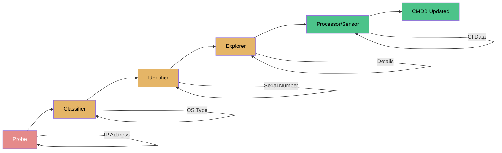
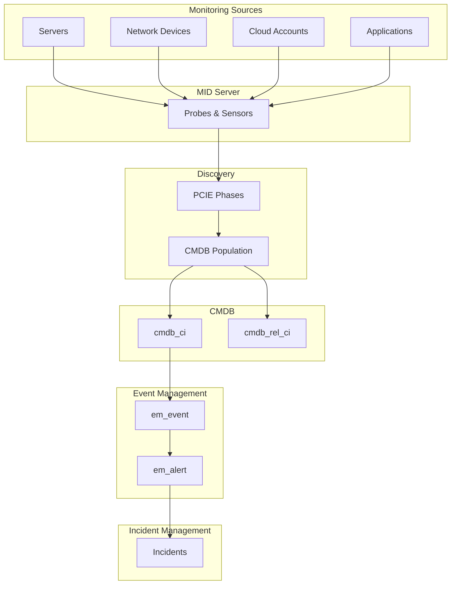

# ITOM Discovery — Automated CI Discovery

**Agent:** Kilo
**Date:** 2026-11-19
**Module:** Discovery
**App:** Discovery
**Confidence:** high

---

## Contents

- [Purpose](#purpose)
- [Where to Find It](#where-to-find-it)
- [Official Exam Alignment — CIS-Discovery (KB0011545)](#official-exam-alignment--cis-discovery-kb0011545)
- [Discovery PCIE Phases](#discovery-pcie-phases)
- [Out-of-Box Values & Dropdowns](#out-of-box-values--dropdowns)
- [Re-usable Code / Metadata](#re-usable-code--metadata)
- [Out-of-Box Features](#out-of-box-features)
- [Key Table Hierarchy](#key-table-hierarchy)
- [Integrations](#integrations)
- [Key Fields](#key-fields)
- [Common Mistakes](#common-mistakes)
- [Goals, Benefits & Key Metrics](#goals-benefits--key-metrics)
- [Core Concept Diagrams](#core-concept-diagrams)
- [Quiz](#quiz)
- [Related Guides](#related-guides)

---

## Purpose

**Discovery** is the ServiceNow ITOM module that automatically discovers IT infrastructure — servers, network devices, applications, and cloud resources — and populates the **Configuration Management Database (CMDB)** with accurate, up-to-date Configuration Items (CIs).

Discovery solves the problem of **CMDB decay**: manually maintained CMDBs drift out of sync within weeks. Discovery keeps the CMDB current by running scheduled scans of IP ranges, identifying device types, gathering detailed attributes, and reconciling against existing CIs using Identification & Reconciliation (IRE) rules.

Discovery is the **foundation of ITOM**: Event Management depends on accurate CIs for impact analysis, Service Mapping depends on CI relationships for topology maps, and Orchestration depends on CI locations for automated remediation.

---

## Where to Find It

| Breadcrumb | Path |
|------------|------|
| Module entry | All > IT Operations Management > Discovery |
| Discovery Schedules | All > Discovery > Discovery Schedules |
| Discovery Definition | All > Discovery > Discovery Definition |
| Discovery Patterns | All > Discovery > Discovery Definition > Patterns |
| MID Server | All > MID Server > MID Servers |
| ECC Queue | All > ECC > Queue |
| CMDB CI List | All > CMDB > CI List |

**Tip:** Discovery requires the `com.snc.discovery.core` plugin to be active. Verify before building Discovery workflows.

---

## Official Exam Alignment — CIS-Discovery (KB0011545)

| Guide Section | CIS-DISCO Domain | Exam Weight | What's Covered |
|---------------|-----------------|-------------|----------------|
| **Discovery Configuration** | Domain 2: Discovery Configuration — Discovery Setup, Process Flow, Troubleshooting | 35% | Behaviors, clusters, IP services, schedules, PCIE phases, ECC Queue, credentials |
| **CMDB** | Domain 3: Configuration Management Database — CI Class Manager, Identification & Reconciliation | 15% | CI identifiers, reconciliation definitions, data source precedence, de-duplication |
| **Discovery Pattern Design** | Domain 1: Discovery Pattern Design | 35% | Pattern Designer, operations, application identification and connection sections |

**Official preparation courses (CIS-Discovery):**
- ServiceNow Fundamentals
- ServiceNow Get Started with Now Create
- ServiceNow Platform Implementation
- CMDB Fundamentals
- Discovery Fundamentals
- CIS-Discovery: Certification Test Prep

**Exam guidance:** Questions are based on official ServiceNow training materials, the ServiceNow Product documentation site, and the ServiceNow developer site.

---

## Discovery PCIE Phases

Discovery follows a 5-phase pipeline:



### PCIE Phase Details

| Phase | Purpose | Key Action | Key Question |
|-------|---------|-----------|--------------|
| **Probe** | Sends request to target | HTTP, SSH, SNMP, WMI, JDBC | Is the target reachable? |
| **Classifier** | Determines CI type | Matches probe results to CI classes | What type of device is this? |
| **Identifier** | Checks if CI exists | Queries CMDB using identification rules | Is this CI already in the CMDB? |
| **Explorer** | Gathers detailed data | SSH commands, SNMP queries, API calls | What are the CI's attributes? |
| **Processor/Sensor** | Parses and maps to CMDB | Parses raw data, maps to CI fields | What data goes where? |

**Exam focus (CIS-Discovery 35%):** PCIE phases, ECC Queue, Discovery errors, credentials, CI identifiers.

---

## ECC Queue

The **ECC Queue** (`ecc_queue`) is the execution engine for Discovery. Every probe and sensor creates a record in the ECC Queue with a status.

| State | Meaning | What to Do |
|-------|---------|-----------|
| `ready` | Waiting to be processed | Check MID Server is Up |
| `processing` | MID Server is executing | Wait |
| `processed` | Completed successfully | Check output in `output` field |
| `error` | Processing failed | Check `error_message` field |
| `skip` | Skipped by Discovery | Check skip reason |

**Debugging tip:** Open `ecc_queue.list` and filter by `agent` (MID Server name) and `name` (probe name). The `output` field contains the raw response data.

---

## Out-of-Box Values & Dropdowns

### Discovery Status (discovery_schedule.status)
| Status | Meaning |
|--------|---------|
| `ready` | Schedule is active and will run |
| `running` | Discovery is currently running |
| `complete` | Discovery completed successfully |
| `error` | Discovery failed |
| `inactive` | Schedule is disabled |

### CI Install Status (cmdb_ci.install_status)
| Value | Label |
|-------|-------|
| `1` | Installed |
| `2` | Shipped |
| `3` | In stock |
| `4` | In maintenance |
| `5` | Retired |
| `6` | Stolen |
| `7` | Missing |

### CI Operational Status (cmdb_ci.operational_status)
| Value | Label |
|-------|-------|
| `1` | Operational |
| `2` | Non-operational |
| `3` | Repair in progress |
| `4` | Drifting |
| `5` | Not ready |

---

## Re-usable Code / Metadata

### Re-usable Metadata Inventory

| Re-usable piece | What it is | Where it lives (breadcrumb) |
|-----------------|------------|------------------------------|
| **Discovery Schedules** | Recurring or one-time scans of IP ranges | All > Discovery > Discovery Schedules |
| **Discovery Patterns** | Identification logic for devices and applications | All > Discovery > Discovery Definition > Patterns |
| **Discovery Behaviors** | Pre-configured probe/sensor sequences for common device types | All > Discovery > Discovery Definition > Behaviors |
| **Discovery Credentials** | SSH, SNMP, WMI, JDBC credentials | All > Discovery > Credentials |
| **Discovery IP Ranges** | IP ranges to scan | All > Discovery > Discovery Schedules > IP Ranges |
| **MID Server** | Agent that runs discovery inside your network | All > MID Server > MID Servers |
| **ECC Queue** | Execution queue for probes and sensors | All > ECC > Queue |

### Re-usable Code Snippets

#### Script: Custom CI Identification

```javascript
// In a Discovery Identifier script
(function identify(current) {
    // Custom identification logic for web servers
    if (current.class_name === 'cmdb_ci_web_server') {
        current.name = current.fqdn;
        current.ip_address = current.ip_address;
        current.serial_number = current.serial_number;
    }
})(current);
```

#### Script: Post-Discovery CI Enrichment

```javascript
// In a Discovery Sensor script
(function sensor(current) {
    // Add custom attributes after discovery
    if (current.class_name === 'cmdb_ci_server') {
        // Set environment based on hostname pattern
        if (current.name.startsWith('prod-')) {
            current.u_environment = 'production';
        } else if (current.name.startsWith('dev-')) {
            current.u_environment = 'development';
        }
    }
})(current);
```

#### Flow Designer: Post-Discovery Approval Flow

```javascript
// Trigger: After CI created or updated
// Action: Send approval request if CI is Tier 1
var service = current.getValue('u_business_service');
if (service === 'Tier 1') {
    // Create approval record
    var approval = new GlideRecord('sysapproval_approver');
    approval.initialize();
    approval.short_description = 'Tier 1 CI discovered: ' + current.name;
    approval.approver = 'assignment_group';
    approval.insert();
}
```

---

## Out-of-Box Features

| Feature | Description | Where |
|---------|-------------|-------|
| Discovery | Auto-discover servers, network devices, applications | All > Discovery > Discovery Schedules |
| Discovery Patterns | Identification logic for devices and applications | All > Discovery > Discovery Definition > Patterns |
| Discovery Behaviors | Pre-configured probe/sensor sequences | All > Discovery > Discovery Definition > Behaviors |
| CMDB Integration | Populate and update CIs automatically | All > CMDB > CI List |
| MID Server | Execute probes and sensors inside the network | All > MID Server > MID Servers |
| ECC Queue | Track and debug probe/sensor execution | All > ECC > Queue |
| Discovery Scheduling | Recurring and one-time scans | All > Discovery > Discovery Schedules |
| Credential Management | SSH, SNMP, WMI, JDBC credentials | All > Discovery > Credentials |

---

## Key Table Hierarchy

| Table | Purpose | Key Fields |
|-------|---------|------------|
| `cmdb_ci` | Configuration Items | `name`, `ip_address`, `serial_number`, `class_name`, `install_status` |
| `discovery_schedule` | Discovery scan schedules | `name`, `ip_address`, `frequency`, `state`, `active` |
| `ecc_queue` | Execution queue for probes/sensors | `name`, `agent`, `state`, `output`, `error_message` |
| `sys_mid_server` | MID Server records | `name`, `ip_address`, `status`, `version` |
| `discovery_result` | Discovery run results | `schedule`, `status`, `ci_count`, `errors` |
| `cmdb_rel_ci` | CI relationships | `parent`, `child`, `type` |

### Table Relationships

```
discovery_schedule
    │
    ├──► discovery_result (one schedule, many runs)
    │
    ├──► ecc_queue (one run, many probes/sensors)
    │
    └──► cmdb_ci (discovered CIs)

cmdb_ci
    │
    ├──► cmdb_rel_ci (CI relationships)
    │
    └──► sys_mid_server (MID Server that discovered this CI)
```

---

## Integrations

| Integration | Direction | Purpose | Protocol |
|-------------|-----------|---------|----------|
| MID Server | Bidirectional | Execute probes and sensors inside the network | Proprietary (HTTPS) |
| SSH | Outbound | Discover Linux/Unix servers | SSH |
| SNMP | Outbound | Discover network devices | SNMP v1/v2c/v3 |
| WMI | Outbound | Discover Windows servers | WMI/DCOM |
| JDBC | Outbound | Discover databases | JDBC |
| REST API | Outbound | Discover cloud resources | REST |
| ECC Queue | Bidirectional | Track probe/sensor execution | Internal |

---

## Key Fields

| Table | Field | Type | Why It Matters |
|-------|-------|------|----------------|
| `discovery_schedule` | `name` | String | Schedule name |
| `discovery_schedule` | `ip_address` | String | IP range to scan |
| `discovery_schedule` | `frequency` | Choice | How often the scan runs |
| `discovery_schedule` | `state` | Choice | ready, running, complete, error |
| `ecc_queue` | `name` | String | Probe or sensor name |
| `ecc_queue` | `agent` | String | MID Server name |
| `ecc_queue` | `state` | Choice | ready, processing, processed, error |
| `ecc_queue` | `output` | String | Probe/sensor output data |
| `cmdb_ci` | `name` | String | CI name |
| `cmdb_ci` | `class_name` | String | CI class |
| `cmdb_ci` | `serial_number` | String | Manufacturer serial |
| `cmdb_ci` | `install_status` | Choice | Installed, retired, etc. |

---

## Common Mistakes

| Mistake | Symptom | Fix |
|---------|---------|-----|
| MID Server can't reach network | Discovery returns no CIs | Place MID Server in each network segment |
| Missing credentials | Incomplete CI data | Configure Discovery credentials per OS/application |
| No identification rules | Duplicate CIs in CMDB | Define identification rules per CI class |
| Discovery without patterns | Incomplete CI attributes | Create Discovery Patterns for device types |
| Discovery running on production | Performance impact | Schedule discovery during maintenance windows |
| Not de-duplicating CIs | CMDB cluttered with duplicates | Enable de-duplication in Identification & Reconciliation |
| Ignoring ECC Queue errors | Discovery failures not noticed | Monitor ECC Queue daily |

---

## Goals, Benefits & Key Metrics

| Goal | Benefit | Key Metric | Example Target |
|------|---------|------------|----------------|
| Accurate CMDB | All CIs discovered and current | CMDB coverage % | > 95% |
| Reduce manual effort | Automated discovery replaces manual entry | Discovery success rate | > 95% |
| Faster issue resolution | Accurate CI data for incident impact | Mean time to resolve (MTTR) | < 30 minutes |
| Better change management | Accurate CI relationships for impact analysis | Change success rate | > 95% |
| Proactive monitoring | Discovery feeds Event Management with accurate CIs | Event correlation accuracy | > 90% |

---

## Core Concept Diagrams



**Reading the diagram:** Monitoring sources feed data through MID Servers → Discovery uses PCIE phases to populate CMDB → Accurate CIs feed Event Management → Alerts become incidents.

---

## Quiz

1. What is the difference between an event and an alert?
   <details><summary>Answer</summary>Event = raw data from a monitoring tool; Alert = processed, de-duplicated event ready for human action</details>

2. What table stores raw events?
   <details><summary>Answer</summary>`em_event`</details>

3. What does a MID Server do in Discovery?
   <details><summary>Answer</summary>Runs probes and sensors inside the customer's network, bridging cloud ServiceNow to on-prem systems</details>

4. Name the five PCIE phases in Discovery.
   <details><summary>Answer</summary>Probe, Classifier, Identifier, Explorer, Processor/Sensor</details>

5. What is the purpose of Identification & Reconciliation in Discovery?
   <details><summary>Answer</summary>Identification = "Does this CI already exist?" (match or create); Reconciliation = "Whose data wins for each field?" (update attributes on matched CI)</details>

6. What table stores the execution queue for probes and sensors?
   <details><summary>Answer</summary>`ecc_queue`</details>

7. What is the default SNMP port for SNMP discovery?
   <details><summary>Answer</summary>161</details>

8. What is the default SSH port for SSH discovery?
   <details><summary>Answer</summary>22</details>

9. What is the default WMI port for WMI discovery?
   <details><summary>Answer</summary>135 (RPC) + dynamic ports</details>

10. What is the default JDBC port for MySQL?
    <details><summary>Answer</summary>3306</details>

---

## Related Guides

- [ITOM Overview](../itom/itom-guide.md)
- [Event Management Guide](../eventmanagement/eventmanagement-guide.md)
- [CMDB Guide](../cmdb/cmdb-guide.md)
- [MID Server Guide](../midserver/midserver-guide.md)
- [Service Mapping Guide](../servicemapping/servicemapping-guide.md)
- [Orchestration Guide](../orchestration/orchestration-guide.md)
- [Cloud Management Guide](../cloudmanagement/cloudmanagement-guide.md)
- [Now Assist for ITOM Guide](../nowassist-itom/nowassist-guide.md)
- [Discovery Getting Started](../../getting-started/discovery.md)

---

## Official Learning Resources

### Now Learning (Structured Training)
- [Discovery Fundamentals](https://nowlearning.servicenow.com/) — Search "Discovery Fundamentals"
- [CMDB Fundamentals](https://nowlearning.servicenow.com/) — Search "CMDB Fundamentals"
- [CIS-Discovery: Certification Test Prep](https://nowlearning.servicenow.com/) — Search "CIS-Discovery"

### Product Documentation (Technical Reference)
- [ServiceNow Product Documentation — Discovery](https://docs.servicenow.com/) → Search "Discovery"
- [ServiceNow Product Documentation — MID Server](https://docs.servicenow.com/) → Search "MID Server"

### Official Videos & Playlists
- [ServiceNow YouTube Channel](https://www.youtube.com/c/ServiceNow) — Search "ServiceNow Discovery", "ServiceNow MID Server"
- [Discovery demo](https://www.youtube.com/results?search_query=servicenow+discovery+demo)