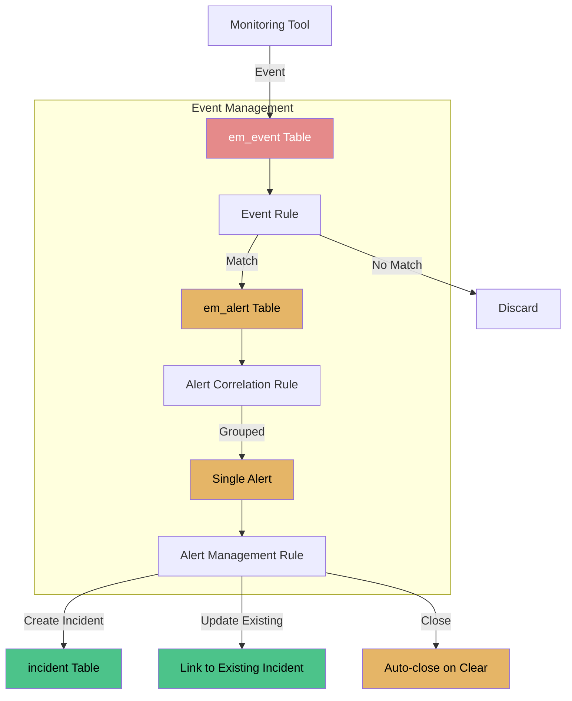
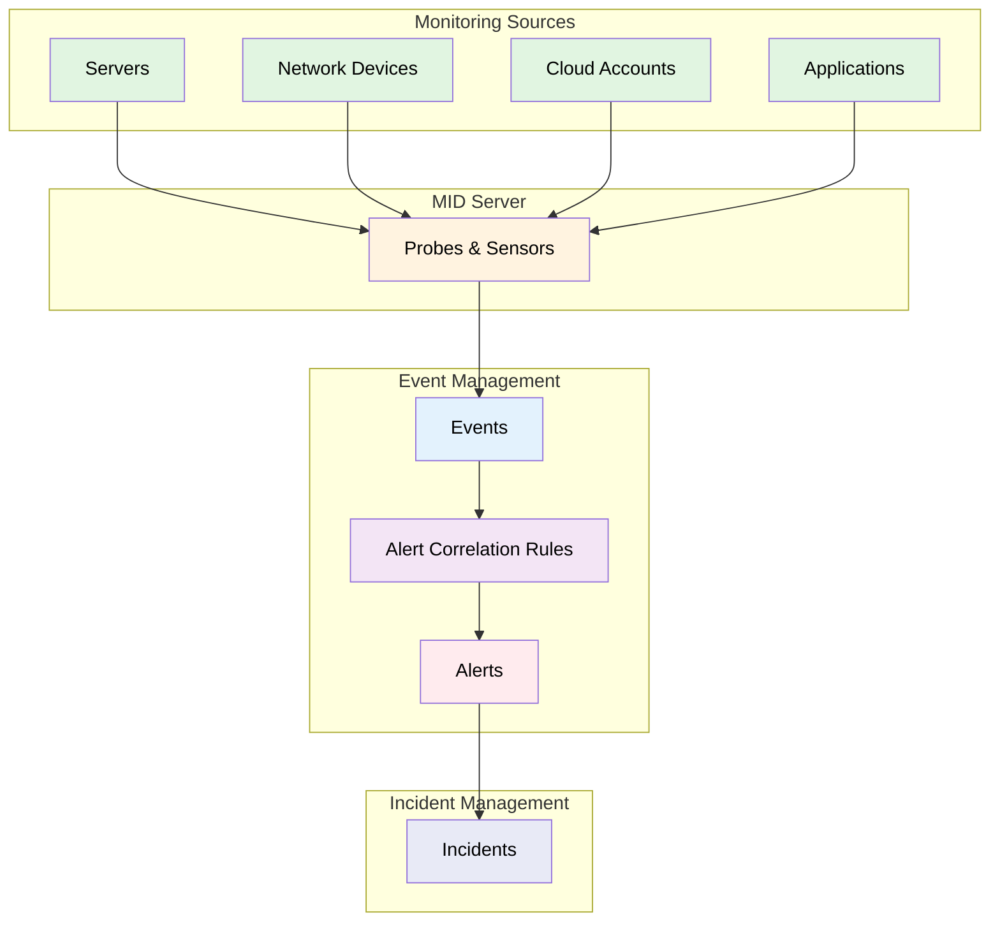
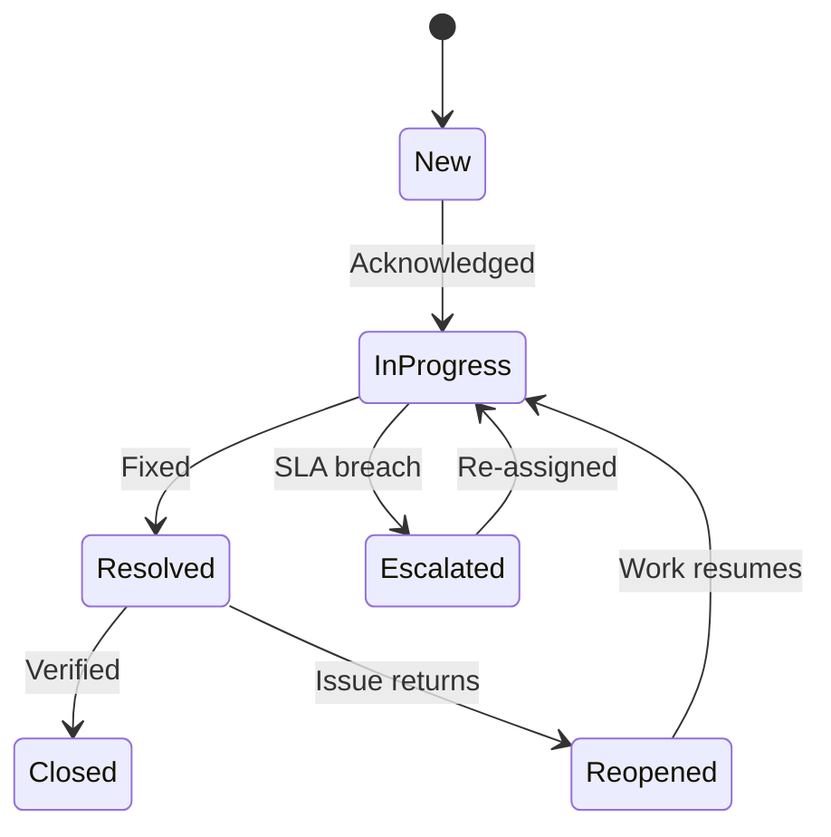

# ITOM Event Management — Event Ingestion, Alert Correlation, Incident Generation

**Agent:** Kilo
**Date:** 2026-11-19
**Module:** Event Management
**App:** Event Management
**Confidence:** high

---

## Contents

- [Purpose](#purpose)
- [Where to Find It](#where-to-find-it)
- [Official Exam Alignment — CIS-Event Management (KB0011604)](#official-exam-alignment--cis-event-management-kb0011604)
- [Event Management Flow Diagram](#event-management-flow-diagram)
- [Out-of-Box Values & Dropdowns](#out-of-box-values--dropdowns)
- [Re-usable Code / Metadata](#re-usable-code--metadata)
- [Out-of-Box Features](#out-of-box-features)
- [Key Table Hierarchy](#key-table-hierarchy)
- [Integrations](#integrations)
- [Key Fields](#key-fields)
- [Common Mistakes](#common-mistakes)
- [Deep Dive: Event Management → Incident](#deep-dive-event-management--incident)
- [Lab: Create an Event and Watch It Become an Incident](#lab-create-an-event-and-watch-it-become-an-incident)
- [Goals, Benefits & Key Metrics](#goals-benefits--key-metrics)
- [Core Concept Diagrams](#core-concept-diagrams)
- [Quiz](#quiz)
- [Related Guides](#related-guides)
- [Official Learning Resources](#official-learning-resources)

---

## Purpose

**Event Management** ingests raw events from monitoring tools (SolarWinds, Datadog, Nagios, SNMP traps, REST APIs, email), processes them into actionable alerts, correlates related alerts to reduce noise, and automatically creates incidents or tasks for critical issues.

Event Management is the **nervous system of ITOM**: it bridges the gap between infrastructure monitoring and IT service management. Without Event Management, NOC teams drown in raw alerts; with it, events become correlated alerts that drive incident response with full CMDB context.

Key capabilities:
- **Event ingestion** from multiple sources (SNMP, REST, email, MID Server connectors)
- **Event rules** for filtering, transformation, CI binding, and de-duplication
- **Alert correlation** to group related alerts into actionable parent alerts
- **Alert management rules** to auto-create incidents, close alerts, or trigger workflows
- **SLA support** on alerts and auto-created incidents

---

## Where to Find It

| Breadcrumb | Path |
|------------|------|
| Module entry | All > Event Management |
| Events | All > Event Management > Events > All |
| Alerts | All > Event Management > Alerts > All |
| Event Rules | All > Event Management > Event Rules |
| Alert Correlation | All > Event Management > Alert Correlation Rules |
| Alert Management Rules | All > Event Management > Alert Management Rules |
| Metrics | All > Event Management > Metrics |
| Dashboards | All > Event Management > Dashboards |

**Tip:** Event Management requires the `com.snc.em` plugin to be active. Verify before building Event Management workflows.

---

## Official Exam Alignment — CIS-Event Management (KB0011604)

| Guide Section | CIS-EM Domain | Exam Weight | What's Covered |
|---------------|-----------------|-------------|----------------|
| **Event Management → Incident** | Domain 3: Event Configuration and Use — Event setup, process flow, CI binding | 27% | Event rules, thresholds, CI binding, alert management rules |
| **Alerts and Tasks** | Domain 4: Alerts and Tasks — Alert process flow, correlation rules, alert intelligence | 30% | Alert grouping, correlation, priority scores, incident creation |

**Official preparation courses:**
- Welcome to ServiceNow
- ServiceNow Administration Fundamentals
- Event Management Fundamentals
- ITOM Overview

**Exam guidance:** Questions are based on official ServiceNow training materials, the ServiceNow Product documentation site, and the ServiceNow developer site.

---

## Event Management Flow Diagram



**Exam focus:** Event rules, CI binding, alert correlation, alert management rules, incident creation (27% + 30% = 57% of CIS-EM exam).

---

## Out-of-Box Values & Dropdowns

### Event Severity (em_event.severity / em_alert.severity)

| Value | Label | Incident Priority |
|-------|-------|-------------------|
| `1` | Critical | P1 |
| `2` | Major | P2 |
| `3` | Minor | P3 |
| `4` | Warning | P4 |
| `5` | Clear | Auto-close |

### Alert State (em_alert.state)

| State | When to Use |
|-------|-------------|
| `New` | Alert created, not yet processed |
| `In Progress` | Agent working the alert |
| `Resolved` | Issue resolved |
| `Closed` | Alert closed |

---

## Re-usable Code / Metadata

### Re-usable Metadata Inventory

| Re-usable piece | What it is | Where it lives (breadcrumb) |
|-----------------|------------|------------------------------|
| **Event Rules** | Rules that turn raw events into alerts | All > Event Management > Event Rules |
| **Alert Correlation Rules** | Rules that group related alerts into one | All > Event Management > Alert Correlation |
| **Alert Management Rules** | Rules that create/update incidents from alerts | All > Event Management > Alert Management Rules |
| **Metrics** | Metric data for Event Management | All > Event Management > Metrics |
| **Notification Templates** | Email/event templates for alert notifications | All > Event Management > Notification Templates |

### Re-usable Code Snippets

#### Business Rule: Create Incident from High Severity Alert

```javascript
(function rule(current, previous) {
    if (current.operation() == 'insert' && current.severity == '1') { // Critical
        var gr = new GlideRecord('incident');
        gr.short_description = 'Critical alert: ' + current.node;
        gr.description = current.message;
        gr.priority = '1';
        gr.assignment_group = 'NOC';
        gr.cmdb_ci = current.ci;
        gr.insert();
    }
})(current, previous);
```

#### Script Include: Event Severity Helper

```javascript
var EventSeverityHelper = Class.create();
EventSeverityHelper.prototype = Object.extendsObject(AbstractAjaxProcessor, {
    getSeverityLabel: function() {
        var sev = this.getParameter('severity');
        var map = {'1': 'Critical', '2': 'Major', '3': 'Minor', '4': 'Warning', '5': 'Clear'};
        return map[sev] || 'Unknown';
    },
    type: 'EventSeverityHelper'
});
```

#### Flow Designer: Alert-to-Incident Flow

```javascript
// Trigger: em_alert record inserted
// Condition: severity == 1 (Critical)
// Action: Create incident with CI binding
var incident = new GlideRecord('incident');
incident.initialize();
incident.short_description = 'Auto-created from alert: ' + current.short_description;
incident.description = current.description;
incident.priority = '1'; // Critical maps to P1
incident.assignment_group = current.assignment_group || 'NOC';
incident.cmdb_ci = current.ci;
incident.category = 'infrastructure';
incident.subcategory = 'server';
incident.insert();

// Link alert to incident
current.incident = incident.sys_id;
current.state = 'In Progress';
current.update();
```

---

## Out-of-Box Features

| Feature | Description | Where |
|---------|-------------|-------|
| Event Ingestion | Receive events from monitoring tools | All > Event Management > Events |
| Event Rules | Filter, transform, bind CI, de-duplicate | All > Event Management > Event Rules |
| Alert Creation | Events become alerts via rules | All > Event Management > Alerts |
| Alert Correlation | Group related alerts | All > Event Management > Alert Correlation |
| Alert Management | Auto-create incidents, close alerts | All > Event Management > Alert Management Rules |
| SLA on Alerts | Track acknowledgment and resolution times | All > Event Management > Dashboards |
| Auto Incident Creation | Critical alerts create incidents automatically | All > Event Management > Alert Management Rules |

---

## Key Table Hierarchy

| Table | Purpose | Key Fields |
|-------|---------|------------|
| `em_event` | Raw events from monitoring tools | `node`, `resource`, `message`, `severity`, `source`, `time_of_event` |
| `em_alert` | Processed alerts (de-duplicated, correlated) | `node`, `resource`, `message`, `severity`, `state`, `ci` |
| `em_metric` | Metric data for Event Management | `name`, `value`, `threshold`, `state` |
| `incident` | Incidents created from alerts | `short_description`, `priority`, `assignment_group`, `cmdb_ci` |
| `cmdb_ci` | Configuration items for CI binding | `name`, `ip_address`, `os`, `serial_number` |

### Table Relationships

```
em_event
    │
    ├──► em_alert (event → alert via event rules)
    │       (one alert can group many events via correlation)
    │
    ├──► cmdb_ci (event's related CI)
    │
    └──► incident (alert → incident via business rule or correlation)

cmdb_ci
    │
    ├──► cmdb_rel_ci (CI relationships for service mapping)
    │
    └──► em_alert (alerts related to this CI)
```

---

## Integrations

| Integration | Direction | Purpose | Protocol |
|-------------|-----------|---------|----------|
| Monitoring Tools (SolarWinds, Datadog, Nagios) | Inbound | Send events/alerts to Event Management | REST/SNMP/Email |
| SNMP Traps | Inbound | Network device traps | SNMP via MID Server |
| REST API | Inbound | Generic event ingestion | REST |
| Email | Inbound | Inbound event email actions | Email |
| CMDB | Bidirectional | Store discovered CIs and relationships | Internal |
| Orchestration Targets | Outbound | Run commands on discovered hosts | SSH/PowerShell/SNMP |
| ServiceNow REST API | Outbound | Call other ServiceNow instances or external APIs | REST |
| Integration Hub | Outbound | Slack, Teams, PagerDuty, etc. | Various |

---

## Key Fields

| Table | Field | Type | Why It Matters |
|-------|-------|------|----------------|
| `em_event` | `node` | String | The device/resource that generated the event |
| `em_event` | `resource` | String | Specific resource (CPU, Memory, Disk, etc.) |
| `em_event` | `type` | String | Event classification (threshold, availability, etc.) |
| `em_event` | `message` | String | Human-readable event description |
| `em_event` | `severity` | Choice | 1=Critical, 2=Major, 3=Minor, 4=Warning, 5=Clear |
| `em_event` | `source` | String | The monitoring tool that sent the event |
| `em_event` | `time_of_event` | Date/Time | When the event occurred |
| `em_event` | `ci_identifier` | String | Fields used to identify the CI |
| `em_alert` | `state` | Choice | New → In Progress → Resolved → Closed |
| `em_alert` | `ci` | Reference | Related CMDB CI for impact analysis |
| `em_alert` | `correlation_id` | String | Groups correlated alerts |
| `em_alert` | `severity` | Choice | 1=Critical, 2=Major, 3=Minor, 4=Warning, 5=Clear |
| `em_alert` | `alert_count` | Integer | Number of events in this alert |
| `incident` | `priority` | Choice | P1/P2/P3/P4 (derived from alert severity) |
| `incident` | `cmdb_ci` | Reference | Affected CI from alert |

---

## Common Mistakes

| Mistake | Symptom | Fix |
|---------|---------|-----|
| No event rules configured | Events arrive but never become alerts | Create event rules for each monitoring tool |
| No correlation rules | Hundreds of alerts for one outage | Configure alert correlation by node or CI |
| Not de-duplicating events | Alert storm during outage | Use event rules with de-duplication (node + resource + type) |
| No CI binding | No impact analysis for alerts | Configure CI binding in event rules |
| Alerts never become incidents | NOC never sees the alert | Business rule or correlation rule creates incident from critical alerts |
| Wrong severity mapping | Incidents with wrong priority | Map monitoring tool severity to ServiceNow 1-5 scale |
| Wrong alert state transitions | Alerts stuck in New or auto-closed too early | Configure alert management rules correctly |

---

## Deep Dive: Event Management → Incident

### The flow

1. **Monitoring tool** detects an issue (server down, disk full, service stopped)
2. **Event sent to ServiceNow** via REST, SNMP, or email → `em_event`
3. **Event Rule** evaluates the event → creates `em_alert`
4. **Alert Correlation** groups related alerts → one alert represents one issue
5. **Business Rule** or auto-closure → creates `incident`
6. **NOC agent** works the incident → resolves → closes alert

### Severity mapping

| Event Severity | Alert Severity | Incident Priority |
|----------------|----------------|-------------------|
| 1 (Critical) | Critical | P1 |
| 2 (Major) | Major | P2 |
| 3 (Minor) | Minor | P3 |
| 4 (Warning) | Warning | P4 |
| 5 (Clear) | Clear | Auto-close |

---

## Lab: Create an Event and Watch It Become an Incident

**Instance requirement:** Event Management plugin active.

1. **Navigate** to All > Event Management > Events > All
2. **Click New** and fill:
   - Node: `WEB01`
   - Resource: `CPU`
   - Type: `threshold`
   - Message: `CPU usage at 98%`
   - Severity: `1 - Critical`
   - Source: `Test Monitor`
3. **Submit** — the event appears in the list
4. **Verify** an Event Rule processes it → creates an Alert in `em_alert`
5. **Navigate** to All > Event Management > Alerts > All
6. **Verify** the alert exists with severity Critical
7. **Check** if a Business Rule auto-creates an Incident from critical alerts
8. **If not**, manually create an Incident related to the alert's CI

---

## Goals, Benefits & Key Metrics

| Goal | Benefit | Key Metric | Example Target |
|------|---------|------------|----------------|
| Reduce unplanned downtime | Faster detection of infrastructure issues | Mean Time to Detect (MTTD) | < 5 minutes |
| Faster incident resolution | Events auto-create incidents with full context | Mean Time to Resolve (MTTR) | < 30 minutes |
| Proactive problem prevention | Pattern detection before users notice | Incident volume trend | -10% quarter-over-quarter |
| Better infrastructure visibility | All CIs and their health in one view | CMDB coverage % | > 95% |
| Reduce alert noise | Correlation rules suppress duplicate events | Alert volume | -50% after tuning |
| Faster change impact assessment | Know which services a CI supports | Change success rate | > 95% |

---

## Core Concept Diagrams



**Reading the diagram:** Monitoring sources feed events through the MID Server → Event Management creates alerts → Correlation rules reduce noise → Alerts become incidents for resolution teams.



**Event/alert lifecycle states** — tracking an event from detection through resolution and closure.

---

## Quiz

1. What is the difference between an event and an alert?
   <details><summary>Answer</summary>Event = raw data from a monitoring tool; Alert = processed, de-duplicated event ready for human action</details>

2. What table stores raw events?
   <details><summary>Answer</summary>`em_event`</details>

3. What does a MID Server do in Event Management?
   <details><summary>Answer</summary>Runs Discovery and Orchestration inside the customer's network, bridging cloud ServiceNow to on-prem systems; also receives SNMP traps</details>

4. Name three monitoring tools that can send events to ServiceNow.
   <details><summary>Answer</summary>SolarWinds, Datadog, Nagios (also SNMP traps, email, REST)</details>

5. What severity value means Critical in Event Management?
   <details><summary>Answer</summary>`1`</details>

6. What are the four alert states?
   <details><summary>Answer</summary>New, In Progress, Resolved, Closed</details>

7. What does an event rule do?
   <details><summary>Answer</summary>Evaluates raw events and creates alerts; handles filtering, transformation, CI binding, and de-duplication</details>

8. What does an alert correlation rule do?
   <details><summary>Answer</summary>Groups related alerts into a single parent alert to reduce alert noise</details>

9. What does an alert management rule do?
   <details><summary>Answer</summary>Defines actions when an alert matches conditions: create incident, create task, close alert, send notification, run flow</details>

10. What is the severity-to-priority mapping?
    <details><summary>Answer</summary>1=Critical→P1, 2=Major→P2, 3=Minor→P3, 4=Warning→P4, 5=Clear→Auto-close</details>

---

## Related Guides

- [ITOM Overview](../itom/itom-guide.md)
- [Discovery Guide](../discovery/discovery-guide.md)
- [Service Mapping Guide](../servicemapping/servicemapping-guide.md)
- [Orchestration Guide](../orchestration/orchestration-guide.md)
- [CMDB Guide](../cmdb/cmdb-guide.md)
- [MID Server Guide](../midserver/midserver-guide.md)
- [Now Assist for ITOM Guide](../nowassist-itom/nowassist-guide.md)
- [Event Management Getting Started](../../getting-started/eventmanagement.md)

---

## Official Learning Resources

### Now Learning (Structured Training)
- [Event Management Fundamentals](https://nowlearning.servicenow.com/) — Search "Event Management" on Now Learning Portal
- [ITOM Overview](https://nowlearning.servicenow.com/) — Search "ITOM Overview" on Now Learning Portal
- [CIS-Event Management: Certification Test Prep](https://nowlearning.servicenow.com/) — Search "CIS-Event Management" on Now Learning Portal

### Product Documentation (Technical Reference)
- [ServiceNow Product Documentation — Event Management](https://docs.servicenow.com/) → Search "Event Management", "Event Rules", "Alert Correlation", "Alert Management Rules"
- [ServiceNow Product Documentation — MID Server](https://docs.servicenow.com/) → Search "MID Server"

### Official Videos & Playlists
- [ServiceNow YouTube Channel](https://www.youtube.com/c/ServiceNow) — Search "ServiceNow Event Management", "ServiceNow Event Management Demo"
- [Event Management demo](https://www.youtube.com/results?search_query=servicenow+event+management+demo)

### Certification Blueprint
- [CIS-Event Management Blueprint (KB0011604)](https://www.servicenow.com/training-certification/certifications/cis-event-management.html)

---