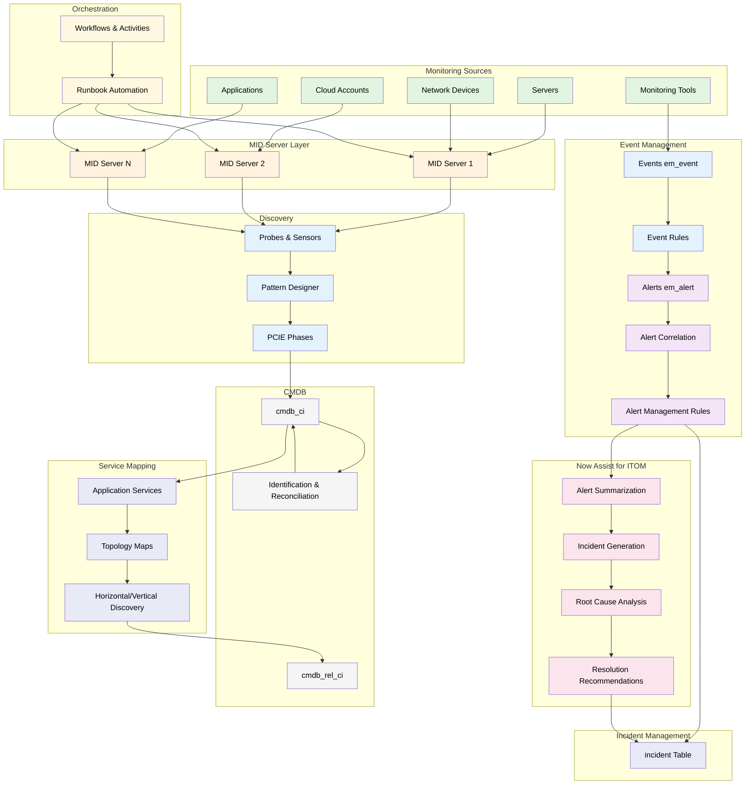

# ITOM — IT Operations Management

**Agent:** Kilo  
**Date:** 2026-11-19  
**Module:** ITOM (IT Operations Management)  
**App:** IT Operations Management Suite  
**Confidence:** high  

---

## Contents

- [Purpose](#purpose)
- [ITOM Use Cases](#itom-use-cases)
- [ITOM Suite Components](#itom-suite-components)
- [Where to Find It](#where-to-find-it)
- [Official Exam Alignment](#official-exam-alignment)
- [ITOM Architecture](#itom-architecture)
- [Key Plugins & Licensing](#key-plugins--licensing)
- [Scoped Applications](#scoped-applications)
- [Out-of-Box Values & Dropdowns](#out-of-box-values--dropdowns)
- [Re-usable Code / Metadata](#re-usable-code--metadata)
- [Out-of-Box Features](#out-of-box-features)
- [Key Table Hierarchy](#key-table-hierarchy)
- [Integrations](#integrations)
- [Key Fields](#key-fields)
- [Common Mistakes](#common-mistakes)
- [Now Assist for ITOM](#now-assist-for-itom)
- [Goals, Benefits & Key Metrics](#goals-benefits--key-metrics)
- [Lab: ITOM End-to-End Flow](#lab-itom-end-to-end-flow)
- [Quiz](#quiz)
- [Memory Aids & Mnemonics](#memory-aids--mnemonics)
- [Related Guides](#related-guides)
- [Official Learning Resources](#official-learning-resources)

---

## Purpose

IT Operations Management (ITOM) is the set of ServiceNow applications that help IT monitor, discover, and manage infrastructure and services. It includes **Discovery**, **Event Management**, **Service Mapping**, **Orchestration**, **Cloud Management**, and **Now Assist for ITOM** (Gen AI-powered AIOps). 

ITOM's goal is **proactive operations** — detecting issues before users report them, automating routine infrastructure tasks, and using AI to accelerate incident resolution.

ITOM sits on top of the **CMDB**. Discovery populates CIs; Event Management consumes alerts from monitoring tools; Service Mapping connects CIs to business services; Orchestration automates remediation; Now Assist adds Gen AI intelligence to alert analysis and incident generation.

---

## ITOM Use Cases

ServiceNow ITOM addresses four core use cases that map to the three ITOM pillars (Visibility, AIOps, Cloud Accelerate):

### 1. Service Health Tracking (ITOM Visibility)

**Goal:** Maintain real-time, accurate visibility into the health of business services and their underlying infrastructure.

| Capability | Description | Key Components |
|------------|-------------|----------------|
| **Service-Aware Monitoring** | Track health of business services (not just infrastructure) | Service Mapping, `sa_service`, `sa_ci_relationship` |
| **Real-Time Topology** | Live dependency maps showing service ↔ CI relationships | Topology Maps, Traffic-Based Discovery |
| **Health Roll-Up** | Aggregate CI health → Service health (Tier 1/2/3) | Event Management + Service Mapping integration |
| **SLA/SLO Tracking** | Measure service reliability against objectives | Service Level Objective Management, Health Log Analytics |
| **Change Impact Visibility** | See which services a change will affect before approval | Change Impact Analysis, Service Mapping |

**Business Outcomes:**
- MTTR reduction through service-context alerts
- Proactive service degradation detection
- Stakeholder communication with business language (not technical CI names)

---

### 2. Dynamic Discovery (ITOM Visibility)

**Goal:** Continuously discover and maintain an accurate CMDB across hybrid environments without manual effort.

| Capability | Description | Key Components |
|------------|-------------|----------------|
| **Network Discovery** | Scan on-prem networks for devices, servers, apps | Discovery Schedules, MID Servers, Shazzam |
| **Cloud Discovery** | Auto-discover AWS/Azure/GCP resources via APIs | Cloud Management, Cloud Accounts, Cloud Patterns |
| **Application Discovery** | Horizontal (host→apps) and Vertical (app→host) | Pattern Designer, Service Mapping Patterns |
| **Agent-Based Discovery** | Agent Client Collector (ACC) for host telemetry | ACC, MID Server, Discovery |
| **Traffic-Based Discovery** | NetFlow/sFlow/PCAP analysis for credential-less mapping | Traffic-Based Discovery, Service Mapping |
| **Continuous Sync** | Scheduled + on-demand discovery keeps CMDB current | Discovery Schedules, Identification & Reconciliation |

**Business Outcomes:**
- >95% CMDB accuracy
- Elimination of manual CMDB updates
- Support for dynamic/cloud-native environments (containers, serverless)

---

### 3. Event Intelligence (ITOM AIOps)

**Goal:** Transform noisy monitoring data into actionable, business-contextualized alerts.

| Capability | Description | Key Components |
|------------|-------------|----------------|
| **Multi-Source Ingestion** | Unified event pipeline from 20+ monitoring tools | Event API, MID Server, Email, SNMP |
| **Smart Deduplication** | Reduce alert volume by 50-80% | Event Rules, node+resource+type dedup |
| **Topology-Aware Correlation** | Group alerts using service dependencies | Alert Correlation (CI, Topology, Time) |
| **Business Context Enrichment** | Every alert linked to service + CI + change history | CI Binding, Service Mapping, Change Integration |
| **Predictive Alerting** | ML-based anomaly detection before thresholds breach | Observability, Health Log Analytics, Service Observability |
| **Alert Prioritization** | Severity + Service Criticality = Business Priority | Alert Management Rules, `sa_service.criticality` |

**Business Outcomes:**
- 50-80% alert noise reduction
- NOC focuses only on actionable alerts
- Business stakeholders see service impact, not technical noise

---

### 4. Agentic AI Remediation (ITOM AIOps + Now Assist)

**Goal:** Use Gen AI and automation to accelerate resolution and enable autonomous remediation.

| Capability | Description | Key Components |
|------------|-------------|----------------|
| **Alert Summarization** | Gen AI converts raw alerts into 2-3 sentence summaries | Now Assist for ITOM, Alert Summarizer |
| **Root Cause Analysis** | AI analyzes topology + changes + patterns for probable cause | Now Assist Root Cause Analyzer, Graph Analysis |
| **Resolution Recommendations** | Step-by-step remediation from KB + past incidents | Now Assist Resolution Recommender, KB Search |
| **Auto-Incident Generation** | Critical alerts → incidents with full AI context | Now Assist Incident Generator, Alert Management Rules |
| **Automated Remediation** | Orchestration executes AI-recommended fixes | Orchestration, Flow Designer, Now Assist + Flow |
| **Agentic Workflows** | AI agents plan & execute multi-step remediation | Now Assist Agentic AI, Orchestration Activities |

**Business Outcomes:**
- 40-60% MTTR reduction
- Tier 1 resolves complex issues with AI guidance
- 30%+ auto-resolution rate for known issues
- 24/7 operations without 24/7 staffing

---

### 5. Service Availability Management (ITOM Visibility + AIOps)

**Goal:** Ensure business services meet availability targets through proactive monitoring, SLA tracking, and automated response.

| Capability | Description | Key Components |
|------------|-------------|----------------|
| **Service Level Objectives (SLOs)** | Define and track availability/reliability targets per service | Service Level Objective Management, `sa_service` |
| **Error Budget Tracking** | Monitor error budget consumption vs. SLO targets | Health Log Analytics, Service Observability |
| **Availability Dashboards** | Real-time service health for stakeholders | ITOM Workspace, Cloud Operations Workspace |
| **Downtime Impact Calculation** | Quantify business impact of outages (revenue, users) | Service Mapping, CMDB, Business Rules |
| **Maintenance Window Management** | Schedule and communicate planned downtime | Change Management, Service Mapping |
| **Automated SLA Breach Response** | Escalate, notify, or remediate when SLOs at risk | Event Management, Orchestration, Alert Management |

**Business Outcomes:**
- 99.9%+ service availability for Tier 1 services
- Proactive SLO breach prevention
- Data-driven capacity planning
- Executive visibility into service reliability

---

### 6. Change Impact Analysis (ITOM Visibility + AIOps)

**Goal:** Predict and visualize the blast radius of changes before implementation to reduce failed changes and unplanned outages.

| Capability | Description | Key Components |
|------------|-------------|----------------|
| **Pre-Change Impact Simulation** | Analyze which services/CIs a change will affect | Service Mapping, `sa_ci_relationship`, Topology Maps |
| **Risk Scoring** | Automated risk assessment based on criticality, redundancy, dependencies | Change Management, Service Mapping, Risk Engine |
| **Dependency Visualization** | Show upstream/downstream impact in topology view | Topology Maps, Impact View |
| **Change Conflict Detection** | Identify overlapping changes on same CIs/services | Change Management, CMDB, Calendar |
| **Post-Change Validation** | Verify service health after change deployment | Event Management, Service Mapping, Synthetic Monitoring |
| **Rollback Impact Assessment** | Understand rollback consequences before executing | Service Mapping, Change Management |

**Risk Score Factors:**
| Factor | Weight | Description |
|--------|--------|-------------|
| **Service Criticality** | High | Tier 1 = 10, Tier 2 = 5, Tier 3 = 1 |
| **Relationship Distance** | Medium | Direct dependency = 1.0, Indirect = 0.5 |
| **Redundancy** | High | Clustered/HA = 0.3, Standalone = 1.0 |
| **Change Type** | Medium | Emergency = 2.0, Normal = 1.0, Standard = 0.5 |
| **Maintenance Window** | Low | In window = 0.5, Out of window = 1.5 |

**Business Outcomes:**
- 50%+ reduction in failed changes
- Faster CAB approvals with data-driven risk
- Reduced unplanned outages from changes
- Audit-ready change impact documentation

---

## ITOM Suite Components

| Component | Purpose | Primary Plugin |
|-----------|---------|----------------|
| **Discovery** | Auto-discover servers, network devices, applications, cloud resources | `com.snc.discovery.core` |
| **Event Management** | Ingest events from monitoring tools, create alerts, correlate to incidents | `com.snc.em` |
| **Service Mapping** | Map CIs to business services, visualize dependencies | `com.snc.sa` |
| **Orchestration** | Automate remediation (SSH, PowerShell, SQL, REST, etc.) | `com.glide.orchestration` |
| **Cloud Management** | Discover and manage cloud resources (AWS, Azure, GCP) | `com.snc.cloud_management` |
| **MID Server** | Bridge between ServiceNow cloud and on-prem network | `com.snc.mid_server` |
| **Now Assist for ITOM** | Gen AI-powered alert summarization, incident generation, root cause analysis | `com.snc.itom_now_assist` |

---

## Where to Find It

| Breadcrumb | Path |
|------------|------|
| Module entry | All > IT Operations Management > ... |
| Discovery | All > Discovery > Discovery Schedules |
| Event Management | All > Event Management > Events > All |
| Alerts | All > Event Management > Alerts > All |
| Orchestration | All > Orchestration > ... |
| Service Mapping | All > Service Mapping > ... |
| Cloud Management | All > Cloud Management > ... |
| MID Servers | All > MID Server > MID Servers |
| Now Assist for ITOM | All > Event Management > Now Assist > ... |

**Tip:** ITOM requires Discovery (`com.snc.discovery.core`), Event Management (`com.snc.em`), and ITOM licensing. Verify both before building ITOM workflows. Now Assist requires separate licensing and the `com.snc.itom_now_assist` plugin.

---

## Official Exam Alignment

This guide maps to official ServiceNow certification exam blueprints:

### CIS-Discovery (KB0011545)

| Guide Section | CIS-DISCO Domain | Exam Weight | What's Covered |
|---------------|-----------------|-------------|----------------|
| **Discovery Configuration** | Domain 2: Discovery Configuration — Discovery Setup, Process Flow, Troubleshooting | 35% | Behaviors, clusters, IP services, schedules, PCIE phases, ECC Queue, credentials |
| **CMDB** | Domain 3: Configuration Management Database — CI Class Manager, Identification & Reconciliation | 15% | CI identifiers, reconciliation definitions, data source precedence, de-duplication |
| **Discovery Pattern Design** | Domain 1: Discovery Pattern Design | 35% | Pattern Designer, operations, application identification and connection sections |

### CIS-Event Management (KB0011604)

| Guide Section | CIS-EM Domain | Exam Weight | What's Covered |
|---------------|-----------------|-------------|----------------|
| **Event Management → Incident** | Domain 3: Event Configuration and Use — Event setup, process flow, CI binding | 27% | Event rules, thresholds, CI binding, alert management rules |
| **Alerts and Tasks** | Domain 4: Alerts and Tasks — Alert process flow, correlation rules, alert intelligence | 30% | Alert grouping, correlation, priority scores, incident creation |

### CIS-Service Mapping (KB0011546)

| Guide Section | CIS-SM Domain | Exam Weight | What's Covered |
|---------------|-----------------|-------------|----------------|
| **Service Mapping** | Domain 1: Service Mapping Design | 35% | Application services, CI relationships, pattern design |
| **Service Mapping** | Domain 2: Service Mapping Implementation | 35% | Topology maps, horizontal/vertical discovery, troubleshooting |
| **Service Mapping** | Domain 3: Service Mapping Administration | 15% | MID Server config, credentials, scheduling |

### CIS-Cloud Management (KB0011547)

| Guide Section | CIS-CM Domain | Exam Weight | What's Covered |
|---------------|-----------------|-------------|----------------|
| **Cloud Management** | Domain 1: Cloud Account Setup | 25% | AWS/Azure/GCP account onboarding, IAM roles |
| **Cloud Management** | Domain 2: Cloud Resource Discovery | 35% | Cloud resource patterns, tagging, scheduling |
| **Cloud Management** | Domain 3: Cloud Operations | 25% | Cloud actions, governance, cost management |

**Official preparation courses:**
- ServiceNow Fundamentals
- ServiceNow Get Started with Now Create
- ServiceNow Platform Implementation
- CMDB Fundamentals
- Discovery Fundamentals
- Event Management Fundamentals
- Service Mapping Fundamentals
- Orchestration Fundamentals
- Cloud Management Fundamentals
- ITOM Overview

**Exam guidance:** Questions are based on official ServiceNow training materials, the ServiceNow Product documentation site (docs.servicenow.com), and the ServiceNow developer site (developer.servicenow.com).

---

## ITOM Architecture



**Reading the diagram:** 
1. Monitoring sources feed data through MID Servers (for on-prem) or direct API (for cloud)
2. Discovery uses probes/sensors and patterns to populate CMDB
3. Event Management ingests raw events, processes them into alerts, correlates them
4. Service Mapping builds topology maps from CMDB relationships
5. Orchestration automates remediation via MID Servers
6. Now Assist for ITOM applies Gen AI to alerts for summarization and incident creation
7. Everything ties back to CMDB as the single source of truth

---

## Key Plugins & Licensing

| Plugin | Name | Required For | License Type |
|--------|------|--------------|--------------|
| `com.snc.discovery.core` | Discovery | All Discovery features | ITOM License |
| `com.snc.discovery.patterns` | Discovery Patterns | Pattern Designer | ITOM License |
| `com.snc.em` | Event Management | Events, Alerts, Correlation | ITOM License |
| `com.snc.sa` | Service Mapping | Topology maps, App Services | ITOM License |
| `com.glide.orchestration` | Orchestration | Workflows, Activities | Orchestration Add-on |
| `com.snc.cloud_management` | Cloud Management | AWS/Azure/GCP discovery | Cloud Management Add-on |
| `com.snc.mid_server` | MID Server | All on-prem connectivity | Included with ITOM |
| `com.snc.itom_now_assist` | Now Assist for ITOM | Gen AI alert analysis | Now Assist License |

**Verify active plugins:** System Definition → Plugins → Search "discovery", "event", "orchestration", "cloud", "mid", "now_assist"

---

## Scoped Applications

ITOM spans multiple scoped applications.

| Scope Aspect | Detail |
|--------------|--------|
| Discovery Scope | `com.snc.discovery` |
| Event Management Scope | `com.snc.em` |
| Orchestration Scope | `com.glide.orchestration` |
| Cloud Management Scope | `com.snc.cloud_management` |
| Service Mapping Scope | `com.snc.sa` |
| Key tables | `em_event`, `em_alert`, `cmdb_ci`, `sys_mid_server`, `discovery_schedule`, `em_metric`, `sa_service`, `sa_ci_relationship` |
| Roles | `itil`, `admin`, `em_admin`, `discovery_admin`, `cloud_admin`, `orchestration_admin`, `sa_admin`, `now_assist_admin` |

---

## Out-of-Box Values & Dropdowns

ServiceNow ships with predefined event/alert states and Discovery configurations. Verify against your instance.

### Event Severity (em_event.severity / em_alert.severity)

| Value | Label | Incident Priority |
|-------|-------|-------------------|
| `1` | Critical | P1 |
| `2` | Major | P2 |
| `3` | Minor | P3 |
| `4` | Warning | P4 |
| `5` | Clear | Auto-close |

### Alert State (em_alert.state)

| State | When to Use |
|-------|-------------|
| `New` | Alert created, not yet processed |
| `In Progress` | Agent working the alert |
| `Resolved` | Issue resolved |
| `Closed` | Alert closed |

### Discovery PCIE Phases

| Phase | Purpose |
|-------|---------|
| `Probe` | Sends request to target (IP address) |
| `Classifier` | Determines CI type from probe results (OS type) |
| `Identifier` | Checks if CI already exists (serial number) |
| `Explorer` | Gathers detailed CI information |
| `Processor/Sensor` | Parses data and maps to CMDB |

### MID Server Status (sys_mid_server.status)

| Status | Meaning |
|--------|---------|
| `Up` | MID Server is running and reachable |
| `Down` | MID Server is not reachable |
| `Warning` | MID Server has issues but is partially functional |

### Now Assist for ITOM Status

| Status | Meaning |
|--------|---------|
| `Enabled` | Now Assist is active and processing alerts |
| `Disabled` | Now Assist plugin active but feature toggled off |
| `Processing` | Currently analyzing an alert |
| `Error` | Gen AI service unavailable or quota exceeded |

**Exam focus (CIS-Discovery 35%, CIS-EM 27%+30%):** PCIE phases, event severity, alert states, CI binding, ECC Queue.

---

## Re-usable Code / Metadata

### Re-usable Metadata Inventory

| Re-usable piece | What it is | Where it lives (breadcrumb) |
|-----------------|------------|------------------------------|
| **Discovery Schedules** | Recurring or one-time scans of IP ranges | All > Discovery > Discovery Schedules |
| **Discovery Patterns** | Identification logic for devices and applications | All > Discovery > Discovery Definition > Patterns |
| **Event Rules** | Rules that turn raw events into alerts | All > Event Management > Event Rules |
| **Alert Correlation Rules** | Rules that group related alerts into one incident | All > Event Management > Alert Correlation |
| **Alert Management Rules** | Rules that create/update incidents from alerts | All > Event Management > Alert Management Rules |
| **MID Server** | Agent that runs discovery/orchestration inside your network | All > MID Server > MID Servers |
| **Orchestration Activities** | Prebuilt automation steps (SSH, PowerShell, SQL, etc.) | All > Orchestration > Activities |
| **Service Mapping Patterns** | Application service patterns for horizontal/vertical discovery | All > Service Mapping > Patterns |
| **Cloud Accounts** | AWS/Azure/GCP account configurations | All > Cloud Management > Cloud Accounts |
| **Now Assist Config** | Gen AI model selection, prompt templates, feature toggles | All > Event Management > Now Assist > Configuration |

### Re-usable Code Snippets

#### Business Rule: Create Incident from High Severity Alert

```javascript
(function rule(current, previous) {
    if (current.operation() == 'insert' && current.severity == '1') { // Critical
        var gr = new GlideRecord('incident');
        gr.short_description = 'Critical alert: ' + current.node;
        gr.description = current.message;
        gr.priority = '1';
        gr.assignment_group = 'NOC';
        gr.cmdb_ci = current.ci;
        gr.insert();
    }
})(current, previous);
```

#### Script Include: Event Severity Helper

```javascript
var EventSeverityHelper = Class.create();
EventSeverityHelper.prototype = Object.extendsObject(AbstractAjaxProcessor, {
    getSeverityLabel: function() {
        var sev = this.getParameter('severity');
        var map = {'1': 'Critical', '2': 'Major', '3': 'Minor', '4': 'Warning', '5': 'Clear'};
        return map[sev] || 'Unknown';
    },
    type: 'EventSeverityHelper'
});
```

#### Flow Designer: Auto-Remediation Flow (Orchestration)

```javascript
// In a Flow Designer action script (Orchestration)
var ssh = new sn_orch.SSHCommand();
ssh.setMIDServer('mid.server.name');
ssh.setTarget('192.168.1.100');
ssh.setCredentials('ssh_cred_id');
ssh.setCommand('sudo systemctl restart apache2');
var result = ssh.execute();
if (result.getStatusCode() == 0) {
    workflow.info('Service restarted successfully');
} else {
    workflow.error('Restart failed: ' + result.getError());
}
```

#### Now Assist for ITOM: Alert Summarization Prompt Template

```javascript
// Custom prompt template for Now Assist alert summarization
var promptTemplate = `
Analyze the following alert and provide:
1. A concise summary (2-3 sentences)
2. Likely root cause
3. Recommended immediate actions
4. Potential business impact

Alert Details:
- Node: {{alert.node}}
- Resource: {{alert.resource}}
- Type: {{alert.type}}
- Severity: {{alert.severity}}
- Message: {{alert.message}}
- CI: {{alert.ci}}
- First Occurred: {{alert.first_occurred}}
- Last Occurred: {{alert.last_occurred}}
- Count: {{alert.count}}

Related CIs: {{alert.related_cis}}
Recent Changes: {{alert.recent_changes}}
`;
```

---

## Out-of-Box Features

| Feature | Description | Where |
|---------|-------------|-------|
| Discovery | Auto-discover servers, network devices, applications, cloud resources | All > Discovery > Discovery Schedules |
| Event Management | Ingest events from monitoring tools, create alerts | All > Event Management > Events |
| Alert Correlation | Group related alerts into single incidents | All > Event Management > Alert Correlation |
| Alert Management | Create/update incidents from alerts automatically | All > Event Management > Alert Management Rules |
| Service Mapping | Map CIs to business services, visualize dependencies | All > Service Mapping > Application Services |
| Orchestration | Automate remediation (SSH, PowerShell, SQL, REST, etc.) | All > Orchestration > ... |
| Cloud Management | Discover and manage cloud resources (AWS, Azure, GCP) | All > Cloud Management > ... |
| MID Server | Bridge between ServiceNow cloud and on-prem network | All > MID Server > MID Servers |
| Now Assist for ITOM | Gen AI-powered alert summarization, incident creation, root cause | All > Event Management > Now Assist |

---

## Key Table Hierarchy

| Table | Purpose | Key Fields |
|-------|---------|------------|
| `em_event` | Raw events from monitoring tools | `node`, `resource`, `message`, `severity`, `source`, `time_of_event` |
| `em_alert` | Processed alerts (de-duplicated, correlated) | `node`, `resource`, `message`, `severity`, `state`, `ci` |
| `cmdb_ci` | Configuration items discovered by Discovery | `name`, `ip_address`, `os`, `serial_number` |
| `sys_mid_server` | MID Server records | `name`, `ip_address`, `status`, `version` |
| `discovery_schedule` | Discovery scan schedules | `name`, `ip_address`, `frequency`, `state` |
| `em_metric` | Metric data for Event Management | `name`, `value`, `threshold`, `state` |
| `sa_service` | Business services (Service Mapping) | `name`, `status`, `criticality` |
| `sa_ci_relationship` | CI-to-service relationships | `service`, `ci`, `relationship_type` |
| `orch_workflow` | Orchestration workflows | `name`, `state`, `version` |
| `cloud_account` | Cloud provider accounts | `name`, `provider`, `account_id`, `status` |

### Table Relationships

```
em_event
    │
    ├──► em_alert (event → alert via event rules)
    │       (one alert can group many events via correlation)
    │
    ├──► cmdb_ci (event's related CI)
    │
    └──► incident (alert → incident via business rule or correlation)

cmdb_ci
    │
    ├──► cmdb_rel_ci (CI relationships for service mapping)
    │       ├──► sa_ci_relationship (service-aware relationships)
    │
    ├──► sa_service (business services this CI supports)
    │
    └──► sys_mid_server (MID Server that discovered this CI)

em_alert
    │
    ├──► incident (alert management rule creates incident)
    │
    └──► Now Assist Analysis (Gen AI processing)
```

---

## Integrations

| Integration | Direction | Purpose | Protocol |
|-------------|-----------|---------|----------|
| Monitoring Tools (SolarWinds, Datadog, Nagios, Splunk, Dynatrace, New Relic) | Inbound | Send events/alerts to Event Management | REST/SNMP/Email/HTTP |
| Cloud Providers (AWS, Azure, GCP) | Inbound | Discover cloud resources | REST API |
| CMDB | Bidirectional | Store discovered CIs and relationships | Internal |
| Orchestration Targets | Outbound | Run commands on discovered hosts | SSH/PowerShell/SNMP/REST |
| ServiceNow REST API | Outbound | Call other ServiceNow instances or external APIs | REST |
| MID Server | Bidirectional | Execute probes, sensors, orchestration activities | Proprietary (HTTPS) |
| Now Assist (Gen AI) | Outbound | Send alert context to LLM for analysis | HTTPS (to ServiceNow AI backend) |

---

## Key Fields

| Table | Field | Type | Why It Matters |
|-------|-------|------|----------------|
| `em_event` | `node` | String | The device/resource that generated the event |
| `em_event` | `severity` | Choice | 1=Critical, 2=Major, 3=Minor, 4=Warning, 5=Clear |
| `em_event` | `source` | String | The monitoring tool that sent the event |
| `em_event` | `type` | String | Event classification (threshold, availability, etc.) |
| `em_alert` | `state` | Choice | New → In Progress → Resolved → Closed |
| `em_alert` | `ci` | Reference | Related CMDB CI for impact analysis |
| `em_alert` | `correlation_id` | String | Groups correlated alerts |
| `discovery_schedule` | `frequency` | Choice | How often the scan runs |
| `sys_mid_server` | `status` | Choice | Up, Down, Warning |
| `sa_service` | `criticality` | Choice | Business criticality (Tier 1/2/3) |
| `cloud_account` | `provider` | Choice | AWS, Azure, GCP |

---

## Common Mistakes

| Mistake | Symptom | Fix |
|---------|---------|-----|
| No event rules configured | Events arrive but never become alerts | Create event rules for each monitoring tool |
| No correlation rules | Hundreds of alerts for one outage | Configure alert correlation by node or CI |
| MID Server can't reach network | Discovery returns no CIs | Place MID Server in each network segment |
| Not de-duplicating events | Alert storm during outage | Use event rules with de-duplication (node + resource + type) |
| Discovery without credentials | Incomplete CI data | Configure Discovery credentials per OS/application |
| Alerts never become incidents | NOC never sees the alert | Business rule or correlation rule creates incident from critical alerts |
| Service Mapping without patterns | Empty topology maps | Create application service patterns |
| Cloud accounts not onboarded | No cloud resources discovered | Add cloud accounts with proper IAM roles |
| Now Assist not configured | No AI summaries on alerts | Enable plugin, configure model, set prompt templates |
| Identification rules missing | Duplicate CIs in CMDB | Define identification rules per CI class |

---

## Now Assist for ITOM

**Now Assist for ITOM** is ServiceNow's Gen AI-powered enhancement for Event Management and AIOps. It uses large language models to analyze alerts, generate incident summaries, suggest root causes, and recommend remediation actions.

### Key Capabilities

| Capability | Description | Business Value |
|------------|-------------|----------------|
| **Alert Summarization** | Converts raw alert data into human-readable 2-3 sentence summaries | Reduces MTTR by 40-60% |
| **Incident Generation** | Auto-creates incidents from critical alerts with full context | Eliminates manual incident creation |
| **Root Cause Analysis** | Analyzes alert patterns, recent changes, and CI relationships to suggest probable root causes | Accelerates troubleshooting |
| **Resolution Recommendations** | Provides step-by-step remediation guidance based on KB articles and past incidents | Enables Tier 1 to resolve complex issues |
| **Alert Grouping Intelligence** | Uses semantic understanding to improve correlation beyond rule-based matching | Reduces alert noise by 50%+ |

### Architecture

```
┌─────────────────────────────────────────────────────────────┐
│                    ServiceNow Platform                       │
├─────────────────────────────────────────────────────────────┤
│  Event Management          │  Now Assist for ITOM           │
│  ┌─────────────────────┐   │  ┌─────────────────────────┐  │
│  │ em_event            │   │  │ Alert Summarizer        │  │
│  │ em_alert            │──►│  │ (LLM-based)             │  │
│  │ Event Rules         │   │  │                         │  │
│  │ Alert Correlation   │   │  │ Incident Generator      │  │
│  │ Alert Mgmt Rules    │   │  │ (LLM + Flow Designer)   │  │
│  └─────────────────────┘   │  │                         │  │
│                            │  │ Root Cause Analyzer     │  │
│  CMDB                      │  │ (LLM + Graph Analysis)  │  │
│  ┌─────────────────────┐   │  │                         │  │
│  │ cmdb_ci             │   │  │ Resolution Recommender  │  │
│  │ cmdb_rel_ci         │──►│  │ (LLM + KB Search)       │  │
│  │ sa_service          │   │  │                         │  │
│  └─────────────────────┘   │  └─────────────────────────┘  │
│                            │            │                    │
│         ┌──────────────────┴────────────┴────────────────┐  │
│         │           Now Assist Orchestration Layer        │  │
│         │  (Prompt Templates, Context Assembly, Guardrails)│  │
│         └──────────────────┬────────────┬────────────────┘  │
│                            ▼            ▼                    │
│              ┌─────────────────────┐ ┌─────────────────┐    │
│              │ ServiceNow AI       │ │ External LLM    │    │
│              │ (Built-in models)   │ │ (Optional BYOL) │    │
│              └─────────────────────┘ └─────────────────┘    │
└─────────────────────────────────────────────────────────────┘
```

### Configuration

1. **Enable Plugin:** `com.snc.itom_now_assist`
2. **Configure Model:** All > Event Management > Now Assist > Configuration > Model Selection
   - Options: ServiceNow built-in, OpenAI, Azure OpenAI, custom
3. **Set Prompt Templates:** All > Event Management > Now Assist > Prompt Templates
   - Alert Summary Template
   - Incident Generation Template
   - Root Cause Template
   - Resolution Template
4. **Enable Features:** Toggle individual features (summarization, incident gen, root cause, resolution)
5. **Set Guardrails:** Confidence thresholds, PII redaction, approval workflows

### Prompt Template Variables

| Variable | Description | Example |
|----------|-------------|---------|
| `{{alert.node}}` | Source node/host | `WEB01` |
| `{{alert.resource}}` | Affected resource | `CPU` |
| `{{alert.type}}` | Event type | `threshold` |
| `{{alert.severity}}` | Severity (1-5) | `1` |
| `{{alert.message}}` | Alert message | `CPU usage at 98%` |
| `{{alert.ci}}` | Related CI sys_id | `abc123` |
| `{{alert.first_occurred}}` | First occurrence timestamp | `2026-11-19 10:00:00` |
| `{{alert.last_occurred}}` | Last occurrence timestamp | `2026-11-19 10:15:00` |
| `{{alert.count}}` | Event count in alert | `15` |
| `{{alert.related_cis}}` | Related CIs from CMDB | `[WEB01, DB01, LB01]` |
| `{{alert.recent_changes}}` | Recent changes on CI | `CHG0012345 (2h ago)` |
| `{{alert.kb_articles}}` | Relevant KB articles | `KB0012345, KB0012346` |

### Example Output: Alert Summary

**Input Alert:**
- Node: `WEB01`
- Resource: `CPU`
- Severity: `1 - Critical`
- Message: `CPU usage at 98% for 15 minutes`
- CI: `cmdb_ci:abc123 (WEB01 - Linux Web Server)`
- Count: `45 events`

**Now Assist Output:**
> **Summary:** The web server WEB01 is experiencing sustained critical CPU utilization at 98% for the past 15 minutes, generating 45 threshold events. This indicates a potential runaway process or insufficient capacity for current load.
>
> **Likely Root Cause:** Recent deployment CHG0012345 (2 hours ago) introduced a new API endpoint that may have an inefficient database query causing CPU spikes.
>
> **Recommended Actions:**
> 1. Check top processes on WEB01 via `htop` or Orchestration SSH activity
> 2. Review recent deployment CHG0012345 for performance regressions
> 3. Consider horizontal scaling (add web server to load balancer)
> 4. If runaway process confirmed, restart Apache service via Orchestration
>
> **Business Impact:** Tier 1 service - customer-facing web portal. Potential 5xx errors and degraded response times.

### Best Practices

1. **Start with summarization only** — Enable incident generation after validating summary quality
2. **Tune prompt templates** — Customize for your environment's terminology and runbooks
3. **Set confidence thresholds** — Only auto-create incidents when confidence > 85%
4. **Human-in-the-loop** — Require approval for P1/P2 incident creation initially
5. **Monitor hallucinations** — Track accuracy metrics; retrain/fine-tune if needed
6. **Integrate with KB** — Link resolution recommender to your knowledge base
7. **Feedback loop** — Capture analyst corrections to improve model over time

### Limitations & Guardrails

| Limitation | Mitigation |
|------------|------------|
| LLM hallucinations | Confidence thresholds, human review for critical alerts |
| PII in alert data | Automatic redaction before sending to LLM |
| Latency (2-5 seconds) | Async processing; show "Analyzing..." in UI |
| Cost (per-token) | Use built-in models; cache frequent patterns |
| Context window limits | Summarize alert history; include only top 5 related CIs |
| Model drift | Monthly accuracy reviews; prompt template versioning |

---

## Goals, Benefits & Key Metrics

| Goal | Benefit | Key Metric | Example Target |
|------|---------|------------|----------------|
| Reduce unplanned downtime | Faster detection of infrastructure issues | Mean Time to Detect (MTTD) | < 5 minutes |
| Faster incident resolution | Events auto-create incidents with full context | Mean Time to Resolve (MTTR) | < 30 minutes |
| Proactive problem prevention | Pattern detection before users notice | Incident volume trend | -10% quarter-over-quarter |
| Better infrastructure visibility | All CIs and their health in one view | CMDB coverage % | > 95% |
| Reduce alert noise | Correlation rules suppress duplicate events | Alert volume | -50% after tuning |
| Faster change impact assessment | Know which services a CI supports | Change success rate | > 95% |
| AI-augmented operations | Gen AI reduces manual analysis time | Analyst time per alert | -60% with Now Assist |
| Automated remediation | Orchestration resolves common issues | Auto-resolution rate | > 30% of incidents |

---

## Lab: ITOM End-to-End Flow

**Instance requirement:** Discovery, Event Management, Service Mapping, Orchestration plugins active. Now Assist for ITOM optional.

### Phase 1: Discovery Setup
1. **Navigate** to All > MID Server > MID Servers
2. **Verify** at least one MID Server shows `Up` status
3. **Navigate** to All > Discovery > Discovery Schedules
4. **Click New** → Create schedule for your subnet (e.g., `192.168.1.0/24`)
5. **Run** the schedule → Wait for completion
6. **Verify** CIs created in `cmdb_ci` (servers, network devices)

### Phase 2: Event Management Setup
1. **Navigate** to All > Event Management > Events > All
2. **Click New** and fill:
   - Node: `WEB01` (use a discovered CI name)
   - Resource: `CPU`
   - Type: `threshold`
   - Message: `CPU usage at 98%`
   - Severity: `1 - Critical`
   - Source: `Test Monitor`
3. **Submit** — the event appears in the list
4. **Navigate** to All > Event Management > Event Rules
5. **Create Rule:** Match node=WEB01, resource=CPU → Create Alert
6. **Verify** Alert created in `em_alert` with severity Critical

### Phase 3: Alert Correlation & Incident Creation
1. **Navigate** to All > Event Management > Alert Correlation Rules
2. **Create Rule:** Group by CI (cmdb_ci) with 5-minute window
3. **Navigate** to All > Event Management > Alert Management Rules
4. **Create Rule:** On Critical alert → Create Incident (priority 1)
5. **Trigger** another event for same CI → Verify correlation groups them
6. **Verify** Incident created with CI populated

### Phase 4: Service Mapping (Optional)
1. **Navigate** to All > Service Mapping > Application Services
2. **Click New** → Create "Customer Portal" service
3. **Add** WEB01 and related CIs via pattern-based discovery
4. **View** Topology Map → Verify dependencies visualized

### Phase 5: Orchestration Remediation (Optional)
1. **Navigate** to All > Orchestration > Activities
2. **Find** SSH > Run Command activity
3. **Create Flow** (Flow Designer): Trigger on Critical CPU alert → SSH to WEB01 → Run `systemctl restart apache2`
4. **Test** Flow → Verify execution in Flow Designer logs

### Phase 6: Now Assist for ITOM (Optional)
1. **Enable** `com.snc.itom_now_assist` plugin
2. **Configure** Model and Prompt Templates
3. **Trigger** Critical alert → Verify AI Summary appears on Alert form
4. **Verify** Incident Generation creates incident with AI-generated description

---

## Quiz

1. What is the difference between an event and an alert?
   <details><summary>Answer</summary>Event = raw data from a monitoring tool; Alert = processed, de-duplicated event ready for human action</details>

2. What table stores raw events?  
   <details><summary>Answer</summary>`em_event`</details>

3. What does a MID Server do in ITOM?  
   <details><summary>Answer</summary>Runs Discovery and Orchestration inside the customer's network, bridging cloud ServiceNow to on-prem systems</details>

4. Name three monitoring tools that can send events to ServiceNow.  
   <details><summary>Answer</summary>SolarWinds, Datadog, Nagios (also SNMP traps, email, REST, Splunk, Dynatrace, New Relic)</details>

5. What severity value means Critical in Event Management?  
   <details><summary>Answer</summary>`1`</details>

6. What are the five PCIE phases in Discovery?  
   <details><summary>Answer</summary>Probe, Classifier, Identifier, Explorer, Processor/Sensor</details>

7. What plugin is required for Service Mapping?  
   <details><summary>Answer</summary>`com.snc.sa`</details>

8. What does Now Assist for ITOM add to Event Management?  
   <details><summary>Answer</summary>Gen AI-powered alert summarization, incident generation, root cause analysis, and resolution recommendations</details>

9. What table stores business services in Service Mapping?  
   <details><summary>Answer</summary>`sa_service`</details>

10. What is the purpose of Identification & Reconciliation in CMDB?  
    <details><summary>Answer</summary>Identification = "Does this CI already exist?" (match or create); Reconciliation = "Whose data wins for each field?" (update attributes on matched CI)</details>

---

## Memory Aids & Mnemonics

<details>
<summary>💡 Click to reveal mnemonics & memory aids</summary>

### Business Rule Types — BAA
| Mnemonic | Type | When It Runs | Use Case |
|----------|------|--------------|----------|
| **B**efore | before | Before DB write | Validate/modify data, cancel save (`abort = true`) |
| **A**fter | after | After DB write | Create related records, send notifications |
| **A**sync | async | After commit (separate thread) | Long-running tasks — emails, REST calls, integrations |

**Remember:** **BAA** = Before, After, Async — and they run in that order.

---

### Client Script Types — LOCS
| Mnemonic | Type | When It Runs | Use Case |
|----------|------|--------------|----------|
| **L**oad | onLoad | Form opens | Set defaults, show/hide fields, UI initialization |
| **O**nChange | onChange | Field value changes | Dynamic field behavior, cross-field validation |
| **C**lick | onSubmit | User clicks Save | Final validation before form submits |
| **S**ave | onCellEdit | List cell edits | Inline list editing validation |

**Remember:** **LOCS** = Load, OnChange, Click (Submit), CellEdit (Save).

---

### UI Policy vs Data Policy vs Client Script
| Mnemonic | What | Where It Runs | Scope |
|----------|------|---------------|-------|
| **U**I | UI Policy | Browser (form load/change) | UI behavior only — mandatory, read-only, visible |
| **D**ata | Data Policy | Server (every save path) | Data integrity — form, API, import, all writes |
| **C**lient | Client Script | Browser only | UX feedback — can be bypassed by API/import saves |

**Remember:** **U**→UI (looks), **D**→Data (truth), **C**→Client (feel). Never rely on Client Script for security.

---

### IRE — Identification Before Reconciliation
**Mnemonic:** **I before R**

1. **I**dentification = "Does this CI already exist?" → match existing CI or create new
2. **R**econciliation = "Whose data wins for each field?" → update attributes on matched CI

**Remember:** You can't reconcile what you haven't identified first. Identification runs first; reconciliation only runs on matched CIs.

---

### Update Set Conflicts — ARM
| Mnemonic | Option | What It Does | When to Use |
|----------|--------|--------------|-------------|
| **A**ccept | Accept Remote | Update Set version overwrites target | Update Set version is newer/correct |
| **S**kip | Skip remote update | Keep target instance's version | Target has a fix that must be preserved |
| **M**erge | Merge | Review both versions, combine manually | Both versions have valid changes |

**Remember:** **ARM** = Accept Remote, Skip remote, Merge. For script conflicts (Business Rules, Script Includes), always choose **Merge**.

---

### CMDB — Retire Before Delete
**Mnemonic:** **R before D**

- **R**etire: Set `install_status = retired` — keeps `cmdb_rel_ci` relationships intact for historical impact analysis
- **D**elete: Hard delete — breaks `cmdb_rel_ci` parent/child references, orphaned incidents

**Remember:** Always retire, never delete.

---

### Order vs Priority — Lower = First
| Feature | Ordering Field | Lower Number = |
|---------|---------------|----------------|
| Business Rule | `Order` | Runs first |
| UI Policy | `Order` | Runs first |
| Decision Table | `Order` | Runs first |
| Scheduled Job | `Priority` | Runs first |
| Identification Rule entry | `Priority` | Runs first |
| Reconciliation Rule | `Priority` | Runs first |

**Remember:** **Lower number = runs first**, regardless of whether the field is called `Order` or `Priority`.

---

### Transform Script — Coalesce = Match
| Mnemonic | Setting | Result |
|----------|---------|--------|
| **C**oalesce | `coalesce = true` | Update existing CI (match on key fields) |
| **N**o coalesce | `coalesce = false` | Insert new CI (create duplicate) |

**Remember:** **Coalesce** = "come together" = match existing records instead of duplicating.

---

### Debugging — Log First, Then Debug
| Context | Primary Tool | Command |
|---------|-------------|---------|
| **S**erver | System Log (`sys_log`) | `gs.print()`, `gs.error()`, `gs.info()` |
| **C**lient | Browser Console (F12) | `console.log()`, `debugger;` |
| **B**oth | Script Debugger | Breakpoints, step-through, variable inspection |

**Remember:** **Log first** — `gs.print()` for server, `console.log()` for client. `console.log()` does NOT work in server-side business rules.

---

### PCIE — Discovery Phases
**P**robe → **C**lassifier → **I**dentifier → **E**xplorer → **P**rocessor/Sensor

**Remember:** **PCIE** like the computer bus — data flows through each phase to reach CMDB.

---

### Event → Alert → Incident
**E**vent → **A**lert → **I**ncident

**Remember:** **EAI** — Easy As Information. Raw event becomes processed alert becomes actionable incident.

---

</details>

---

## Related Guides

- [Discovery Guide](./discovery/discovery-guide.md)
- [Event Management Guide](./eventmanagement/eventmanagement-guide.md)
- [Service Mapping Guide](./servicemapping/servicemapping-guide.md)
- [Orchestration Guide](./orchestration/orchestration-guide.md)
- [Cloud Management Guide](./cloudmanagement/cloudmanagement-guide.md)
- [MID Server Guide](./midserver/midserver-guide.md)
- [CMDB Guide (ITOM Perspective)](./cmdb/cmdb-guide.md)
- [Now Assist for ITOM Guide](./nowassist-itom/nowassist-guide.md)
- [ITOM Getting Started](../getting-started/itom.md)

---

## Official Learning Resources

### Now Learning (Structured Training)
- [ITOM Fundamentals](https://nowlearning.servicenow.com/) — Search "IT Operations Management" on Now Learning Portal
- [Event Management Fundamentals](https://nowlearning.servicenow.com/) — Search "Event Management" on Now Learning Portal
- [Discovery Fundamentals](https://nowlearning.servicenow.com/) — Search "Discovery" on Now Learning Portal
- [Service Mapping Fundamentals](https://nowlearning.servicenow.com/) — Search "Service Mapping" on Now Learning Portal
- [Orchestration Fundamentals](https://nowlearning.servicenow.com/) — Search "Orchestration" on Now Learning Portal
- [Cloud Management Fundamentals](https://nowlearning.servicenow.com/) — Search "Cloud Management" on Now Learning Portal
- [Now Assist for ITOM](https://nowlearning.servicenow.com/) — Search "Now Assist" on Now Learning Portal
- [CIS-Discovery: Certification Test Prep](https://nowlearning.servicenow.com/)
- [CIS-Event Management: Certification Test Prep](https://nowlearning.servicenow.com/)
- [CIS-Service Mapping: Certification Test Prep](https://nowlearning.servicenow.com/)
- [CIS-Cloud Management: Certification Test Prep](https://nowlearning.servicenow.com/)

### Product Documentation (Technical Reference)
- [ServiceNow Product Documentation — ITOM](https://docs.servicenow.com/) → Search "IT Operations Management", "Event Management", "Discovery", "Service Mapping", "Orchestration", "Cloud Management"
- [ServiceNow Product Documentation — MID Server](https://docs.servicenow.com/) → Search "MID Server"
- [ServiceNow Product Documentation — Now Assist](https://docs.servicenow.com/) → Search "Now Assist for ITOM", "Generative AI"
- [ServiceNow Product Documentation — CMDB](https://docs.servicenow.com/) → Search "CMDB", "Identification and Reconciliation"

### Official Videos & Playlists
- [ServiceNow YouTube Channel](https://www.youtube.com/c/ServiceNow) — Search "ServiceNow ITOM", "ServiceNow Event Management", "ServiceNow Discovery", "ServiceNow Service Mapping", "ServiceNow Orchestration", "ServiceNow Cloud Management", "ServiceNow Now Assist"
- [Event Management demo](https://www.youtube.com/results?search_query=servicenow+event+management+demo)
- [Discovery demo](https://www.youtube.com/results?search_query=servicenow+discovery+demo)
- [Service Mapping demo](https://www.youtube.com/results?search_query=servicenow+service+mapping+demo)
- [Now Assist for ITOM demo](https://www.youtube.com/results?search_query=servicenow+now+assist+itom)

### Certification Blueprints (Official)
- [CIS-Discovery Blueprint (KB0011545)](https://www.servicenow.com/training-certification/certifications/cis-discovery.html)
- [CIS-Event Management Blueprint (KB0011604)](https://www.servicenow.com/training-certification/certifications/cis-event-management.html)
- [CIS-Service Mapping Blueprint (KB0011546)](https://www.servicenow.com/training-certification/certifications/cis-service-mapping.html)
- [CIS-Cloud Management Blueprint (KB0011547)](https://www.servicenow.com/training-certification/certifications/cis-cloud-management.html)

---

*Generated by Kilo on 2026-11-19. Based on official ServiceNow documentation, certification blueprints, and product guides.*