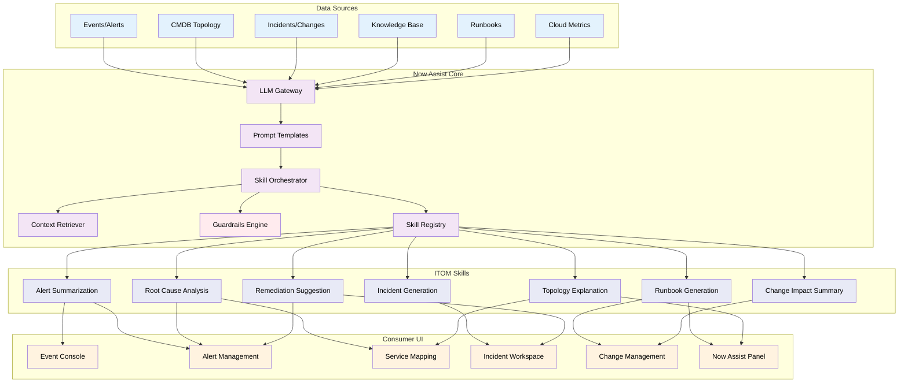

# Now Assist for ITOM — Gen AI for IT Operations

**Agent:** Kilo  
**Date:** 2026-11-19  
**Module:** Now Assist for ITOM  
**App:** IT Operations Management — Gen AI Acceleration Layer  
**Confidence:** high  

---

## Contents

- [Purpose](#purpose)
- [Now Assist in ITOM Architecture](#now-assist-in-itom-architecture)
- [Key Plugins & Licensing](#key-plugins--licensing)
- [Core Capabilities](#core-capabilities)
- [Now Assist for Event Management](#now-assist-for-event-management)
- [Now Assist for Service Mapping](#now-assist-for-service-mapping)
- [Now Assist for Discovery](#now-assist-for-discovery)
- [Now Assist for Cloud Management](#now-assist-for-cloud-management)
- [Now Assist for Orchestration](#now-assist-for-orchestration)
- [Guardrails & Governance](#guardrails--governance)
- [Prompt Engineering for ITOM](#prompt-engineering-for-itom)
- [Key Table Hierarchy](#key-table-hierarchy)
- [Integrations](#integrations)
- [Key Fields](#key-fields)
- [Common Mistakes](#common-mistakes)
- [Lab: Now Assist for ITOM](#lab-now-assist-for-itom)
- [Quiz](#quiz)
- [Memory Aids & Mnemonics](#memory-aids--mnemonics)
- [Related Guides](#related-guides)
- [Official Learning Resources](#official-learning-resources)

---

## Purpose

**Now Assist for ITOM** brings **generative AI** directly into IT Operations workflows — summarizing alerts, suggesting root causes, generating incident descriptions, creating runbook steps, and explaining service topologies. It acts as an **AI copilot** for operators, reducing MTTR and cognitive load.

**Key value:** Transform reactive firefighting into proactive, AI-assisted resolution with human-in-the-loop governance.

---

## Now Assist in ITOM Architecture



---

## Key Plugins & Licensing

| Plugin | Name | Purpose |
|--------|------|---------|
| `com.snc.now_assist` | Now Assist Core | Base Gen AI platform |
| `com.snc.now_assist_itom` | Now Assist for ITOM | ITOM-specific skills |
| `com.snc.now_assist_em` | Now Assist for Event Mgmt | Alert summarization, RCA |
| `com.snc.now_assist_sm` | Now Assist for Service Mapping | Topology explanation |
| `com.snc.now_assist_discovery` | Now Assist for Discovery | Pattern generation |
| `com.snc.now_assist_cm` | Now Assist for Cloud Mgmt | Cloud resource insights |
| `com.snc.now_assist_orch` | Now Assist for Orchestration | Runbook/workflow generation |

**License:** **Now Assist for ITOM** — separate SKU, requires ITOM license + Now Assist license. Includes LLM token allocation.

---

## Core Capabilities

### Now Assist Skills for ITOM

| Skill | Description | Input | Output |
|-------|-------------|-------|--------|
| **Alert Summarization** | Condense noisy alert streams | Alert group, related alerts | Human-readable summary |
| **Root Cause Analysis** | Identify probable cause from topology | Alert + service topology | Ranked root cause hypotheses |
| **Incident Generation** | Create incident from alert context | Alert + CI + history | Incident record with description |
| **Runbook Generation** | Create remediation steps | Incident type, CI, KB articles | Structured runbook |
| **Topology Explanation** | Natural language service map | Service model | Plain-English topology walkthrough |
| **Remediation Suggestion** | Recommend fix actions | Incident, CI, past resolutions | Actionable steps with confidence |
| **Change Impact Summary** | Summarize change risk | Change request, affected CIs | Business impact narrative |

### Skill Invocation Flow

```
User Action (Alert click, Incident open, Service map view)
        │
        ▼
Context Retriever → Gathers: Alert details, CI info, Topology, KB, History
        │
        ▼
Prompt Template → Injects context into skill-specific prompt
        │
        ▼
Guardrails Engine → Validates: PII, scope, hallucination risk, policy
        │
        ▼
LLM Gateway → Calls configured LLM (ServiceNow LLM, Azure OpenAI, etc.)
        │
        ▼
Response Parser → Structures output (summary, steps, confidence)
        │
        ▼
UI Rendering → Now Assist Panel, Inline, Toast, Modal
```

---

## Now Assist for Event Management

### Alert Summarization

**Trigger:** Operator opens Alert Console or groups alerts.

```mermaid
flowchart LR
    A[Raw Alerts<br/>50+ critical alerts] --> B[Now Assist Skill]
    B --> C[Group by:<br/>- Service<br/>- CI<br/>- Time window<br/>- Correlation]
    C --> D[Summary:<br/>"50 alerts collapsed to 3 service impacts:<br/>1. Customer Portal (12 alerts, DB01 root)<br/>2. Payment API (8 alerts, LB02 root)<br/>3. Auth Service (5 alerts, Cache01 root)"]
    
    style A fill:#ffcdd2,color:#000
    style D fill:#c8e6c9,color:#000
```

**Output Fields:**
- `summary` — Natural language narrative
- `affected_services` — Service names with alert counts
- `probable_root_causes` — Top 3 CIs with confidence
- `recommended_actions` — Immediate next steps

### Root Cause Analysis (RCA)

**Trigger:** Operator clicks "Analyze" on alert group or service impact.

**Context Injected:**
- Alert payload (source, severity, message, tags)
- CI details (class, attributes, relationships)
- Service topology (upstream/downstream dependencies)
- Recent changes on affected CIs
- Historical incidents for same CI/service
- Knowledge base articles matching symptoms

**Output:**
```json
{
  "root_cause_hypotheses": [
    {
      "ci": "DB01 (cmdb_ci_database)",
      "confidence": 0.87,
      "evidence": ["CPU 98% for 15min", "Connection pool exhausted", "Recent deploy v2.3 changed pool size"],
      "type": "resource_exhaustion"
    },
    {
      "ci": "App01 (cmdb_ci_linux_server)",
      "confidence": 0.62,
      "evidence": ["Thread count spike", "GC pauses increased"],
      "type": "performance_degradation"
    }
  ],
  "recommended_investigation": [
    "Check DB01 slow query log",
    "Review App01 JVM heap dump",
    "Validate deploy v2.3 rollback"
  ]
}
```

### Incident Generation

**Trigger:** Operator clicks "Create Incident" from Alert Console with Now Assist.

**Auto-populates:**
- `short_description` — "Service degradation: Customer Portal — DB01 CPU saturation"
- `description` — Full narrative with alert context, topology, RCA summary
- `cmdb_ci` — Probable root cause CI
- `business_service` — Affected service from topology
- `category` / `subcategory` — Inferred from CI class
- `priority` — Calculated from service criticality + alert severity

---

## Now Assist for Service Mapping

### Topology Explanation

**Trigger:** Operator views service map, clicks "Explain Service".

**Input:** Service model (`sa_service`) + `sa_ci_relationship` graph.

**Output:**
> **"Customer Portal** is a **Tier 1** business service with **criticality: 1 (Mission Critical)**. It has **3 tiers**:
> 
> **Tier 1 (Entry Points):** Load Balancer (LB01) — receives all user traffic.
> 
> **Tier 2 (Web Tier):** 3 web servers (Web01, Web02, Web03) behind LB01. All running Apache 2.4.54.
> 
> **Tier 3 (App Tier):** 2 app servers (App01, App02) running Tomcat 9.0.75. Both depend on **Database Cluster (DB01, DB02)** running PostgreSQL 14.
> 
> **Current Health:** 🟢 All CIs operational. **Last Incident:** 3 days ago on DB01 (CPU)."

### Change Impact Summary

**Trigger:** Operator views Change Request affecting CIs in service map.

**Output:**
> **"Change CHG0012345** (Deploy v2.4 to App Tier) **impacts Customer Portal (Tier 1)**.
> 
> **Direct Impact:** App01, App02 (2/2 app servers) — **100% of app capacity** affected during deploy.
> 
> **Downstream Risk:** Web tier will queue requests. Database unaffected.
> 
> **Mitigation:** Blue-green deploy recommended. Rollback window: 15 min. **Risk Score: HIGH**."

---

## Now Assist for Discovery

### Pattern Generation Assistant

**Trigger:** Discovery admin creates new pattern, clicks "Generate with AI".

**Input:** 
- Target application name/version
- Sample connection details (SSH, WinRM, SNMP, JDBC)
- Desired CI class
- Existing similar patterns (optional)

**Output:** Complete Discovery Pattern (XML/JSON) with:
- Identification section (matches target class)
- Connection section (protocols, credentials)
- Exploration steps (commands, queries, parsing)
- CI creation/update steps (attributes, relationships)
- Error handling

### Credential Mapping Suggestion

**Trigger:** Discovery schedule fails with credential errors.

**Output:** "Based on target IP range and CI classes, try: **Linux SSH Key** (cred set: `linux_prod_keys`) for servers, **SNMP v3** (cred set: `network_snmp_v3`) for switches."

---

## Now Assist for Cloud Management

### Cloud Resource Insights

**Trigger:** Operator views Cloud Management dashboard, clicks "Explain Cost Spike".

**Input:** Cloud billing data, resource utilization, CMDB cloud CIs.

**Output:**
> **Cost Increase: +$2,400/month (18%)** on AWS account `prod-east`.
> 
> **Top Drivers:**
> 1. **EC2: r6g.2xlarge** — 12 new instances launched 2026-11-01 (Auto Scaling Group `web-tier-asg`). **+$1,800**
> 2. **RDS: db.r6g.xlarge** — Upgraded from large 2026-11-10. **+$450**
> 3. **S3: Intelligent Tiering** — 2.3TB new data from log aggregation. **+$150**
> 
> **Recommendation:** Review ASG scaling policy. Consider reserved instances for steady-state workloads.

### Cloud Remediation Suggestion

**Trigger:** Cloud Management alert (e.g., "Unencrypted S3 bucket").

**Output:**
> **Issue:** Bucket `prod-logs-raw` has no default encryption.
> 
> **Remediation:** Enable SSE-S3 encryption.
> 
> **Steps:**
> 1. Navigate to S3 Console → `prod-logs-raw` → Properties → Default encryption
> 2. Select **SSE-S3** (AES-256)
> 3. Save — applies to new objects only
> 4. For existing objects: Run `aws s3 cp s3://prod-logs-raw s3://prod-logs-raw --recursive --storage-class STANDARD`
> 
> **Impact:** Zero downtime. Compliance: **SOC2, PCI-DSS**.

---

## Now Assist for Orchestration

### Runbook Generation

**Trigger:** Operator creates Flow Designer action, clicks "Generate Steps".

**Input:** Task description, target CI type, available activities.

**Output:** Flow Designer flow with:
- **Steps:** Sequential activities (SSH, PowerShell, REST, Script)
- **Inputs:** Mapped from trigger (CI IP, credentials, parameters)
- **Error Handling:** Try/catch branches, retry logic
- **Outputs:** Structured results for downstream steps

**Example:** "Restart Apache on Linux web servers"
```yaml
Flow: Restart Apache
Trigger: Manual (CI: cmdb_ci_linux_server)
Steps:
  1. SSH Activity: sudo systemctl status apache2
  2. Decision: If active → SSH: sudo systemctl restart apache2
  3. SSH Activity: sudo systemctl status apache2 (verify)
  4. Script: Parse output → success/failure
Outputs: {restarted: true, duration_ms: 1250}
```

### Workflow Explanation

**Trigger:** Operator views complex Flow, clicks "Explain".

**Output:** "This flow **onboards a new AWS EC2 instance** into CMDB:
1. **Trigger:** Cloud Management discovers new instance
2. **Step 1:** Create/Update `cmdb_ci_aws_ec2_instance` via Identification
3. **Step 2:** Tag with `Environment=prod`, `Owner=platform-team`
4. **Step 3:** Launch Discovery pattern `Linux Server` against private IP
5. **Step 4:** Create `Runs on` relationships to VPC, Subnet, Security Group
6. **Step 5:** Notify `#cloud-ops` Slack channel with CI link"

---

## Guardrails & Governance

### Guardrails Layers

| Layer | Purpose | Configuration |
|-------|---------|---------------|
| **Data Privacy** | Prevent PII in prompts/responses | Field-level redaction (email, SSN, keys) |
| **Scope Control** | Limit AI to authorized domains | Skill allowlist, table access controls |
| **Hallucination Detection** | Flag low-confidence outputs | Confidence threshold (default 0.7), citation requirement |
| **Policy Enforcement** | Org policies (no prod changes, no secrets) | Custom guardrail rules, approval gates |
| **Audit Trail** | Full traceability | All prompts/responses logged to `sys_now_assist_audit` |

### Guardrails Configuration

**All > Now Assist > Administration > Guardrails**

| Setting | Recommended Value | Description |
|---------|-------------------|-------------|
| **Confidence Threshold** | 0.75 | Minimum confidence to show output |
| **Require Citations** | true | LLM must reference source data |
| **Max Tokens per Request** | 4000 | Prevent runaway costs |
| **PII Redaction** | enabled | Auto-redact sensitive fields |
| **Human Approval Required** | true for prod | Changes to prod CIs need approval |
| **Allowed Tables** | `cmdb_ci`, `em_alert`, `incident`, `change_request` | Scope restriction |

### Audit Table: `sys_now_assist_audit`

| Field | Description |
|-------|-------------|
| `skill` | Skill invoked (e.g., `alert_summarization`) |
| `user` | Operator who triggered |
| `context_hash` | Hash of input context (for privacy) |
| `prompt_tokens` | Input token count |
| `completion_tokens` | Output token count |
| `confidence` | Model confidence score |
| `accepted` | User accepted/rejected/modified |
| `feedback` | Thumbs up/down + comment |

---

## Prompt Engineering for ITOM

### Prompt Template Structure

```xml
<prompt_template>
  <system>
    You are a ServiceNow ITOM expert assistant. 
    Provide accurate, actionable guidance for IT operations.
    Always cite sources from the provided context.
    Never hallucinate CIs, relationships, or configurations.
    If uncertain, say "I need more information" rather than guessing.
  </system>
  <context>
    <!-- Injected at runtime -->
    <alerts>{alert_data}</alerts>
    <topology>{service_topology}</topology>
    <ci_details>{ci_attributes}</ci_details>
    <history>{incident_history}</history>
    <kb_articles>{matching_kb}</kb_articles>
  </context>
  <task>
    Analyze the alert group and provide:
    1. Executive summary (2-3 sentences)
    2. Top 3 probable root causes with confidence
    3. Recommended immediate actions
    4. Escalation path if unresolved in 15 min
  </task>
  <output_format>
    JSON with fields: summary, root_causes[], actions[], escalation
  </output_format>
  <guardrails>
    <require_citations>true</require_citations>
    <min_confidence>0.75</min_confidence>
    <pii_redaction>true</pii_redaction>
  </guardrails>
</prompt_template>
```

### Few-Shot Examples (Injected in Context)

```json
{
  "examples": [
    {
      "input": "50 alerts on Web01-Web05, LB01, all HTTP 500",
      "output": {
        "summary": "Web tier returning 500 errors. LB01 healthy. All 5 web servers affected simultaneously — suggests shared dependency.",
        "root_causes": [
          {"ci": "DB01", "confidence": 0.91, "evidence": ["DB01 CPU 99%", "Connection pool exhausted", "All web servers connect to DB01"]}
        ],
        "actions": ["Check DB01 slow queries", "Increase connection pool", "Consider read replica"]
      }
    }
  ]
}
```

---

## Key Table Hierarchy

| Table | Purpose | Key Fields |
|-------|---------|------------|
| `sys_now_assist_skill` | Skill Definitions | `name`, `prompt_template`, `context_schema`, `active` |
| `sys_now_assist_prompt` | Prompt Templates | `name`, `template`, `variables`, `version` |
| `sys_now_assist_audit` | Audit Log | `skill`, `user`, `prompt_tokens`, `confidence`, `accepted` |
| `sys_now_assist_guardrail` | Guardrail Rules | `name`, `type`, `condition`, `action` |
| `sys_now_assist_llm_config` | LLM Configuration | `provider`, `model`, `endpoint`, `token_limit` |
| `sys_now_assist_context` | Context Retrievers | `name`, `table`, `query`, `fields` |

---

## Integrations

| Integration | Direction | Purpose |
|-------------|-----------|---------|
| **ServiceNow LLM** | Outbound | Default LLM (hosted, data residency) |
| **Azure OpenAI** | Outbound | Enterprise OpenAI with private networking |
| **AWS Bedrock** | Outbound | Claude, Titan, Jurassic models |
| **Google Vertex AI** | Outbound | Gemini, PaLM models |
| **Now Assist Panel** | UI | Embedded AI assistant in all workspaces |
| **Event Console** | UI | Alert summarization, RCA buttons |
| **Service Mapping** | UI | Topology explanation, impact summary |
| **Incident Workspace** | UI | Incident generation, runbook suggestion |
| **Change Management** | UI | Impact summary, risk narrative |
| **Flow Designer** | UI | Runbook generation, workflow explanation |

---

## Key Fields

| Table | Field | Type | Purpose |
|-------|-------|------|---------|
| `sys_now_assist_skill` | `prompt_template` | HTML/XML | Jinja2-style template with variables |
| `sys_now_assist_skill` | `context_schema` | JSON | Defines required context fields |
| `sys_now_assist_audit` | `confidence` | Float | Model confidence (0-1) |
| `sys_now_assist_audit` | `accepted` | Boolean | User accepted output |
| `sys_now_assist_guardrail` | `action` | Choice | `block`, `warn`, `log`, `redact` |

---

## Common Mistakes

| Mistake | Symptom | Fix |
|---------|---------|-----|
| No guardrails configured | Hallucinated CI names, leaked PII | Enable all guardrails, set confidence > 0.75 |
| Overly broad context | Slow responses, token limit errors | Narrow context retrievers to relevant CIs/alerts |
| No few-shot examples | Inconsistent output format | Add 3-5 curated examples per skill |
| Ignoring audit log | No visibility into AI quality | Weekly audit review, track acceptance rate |
| No human approval for prod | AI suggests prod changes | Require approval for `change_request`, `cmdb_ci` updates |
| Single LLM provider | Vendor lock-in, outage risk | Configure fallback providers |
| No feedback loop | Model doesn't improve | Enable thumbs up/down, review rejected outputs |
| Prompt injection risk | Malicious alert payloads | Sanitize all injected context, use allowlist |
| Cost overruns | Token budget exceeded | Set per-request and daily token limits |
| Skills not versioned | Breaking changes in prod | Version prompt templates, test in sub-prod |

---

## Lab: Now Assist for ITOM

**Prerequisites:** Now Assist for ITOM plugin active, LLM configured, ITOM modules (Discovery, EM, SM) populated.

### Step 1: Verify Now Assist Setup
1. Navigate to **All > Now Assist > Administration > Skills**
2. Filter by **Category: ITOM**
3. Verify skills active: `Alert Summarization`, `Root Cause Analysis`, `Incident Generation`, `Topology Explanation`, `Runbook Generation`
4. Check **LLM Configuration** — verify provider, model, token limits

### Step 2: Configure Guardrails
1. Navigate to **All > Now Assist > Administration > Guardrails**
2. Enable: PII Redaction, Confidence Threshold (0.75), Citation Required
3. Set **Human Approval Required** for: `change_request`, `cmdb_ci` updates
4. Configure **Allowed Tables**: `em_alert`, `incident`, `cmdb_ci`, `sa_service`, `change_request`, `kb_knowledge`

### Step 3: Test Alert Summarization
1. Go to **All > Event Management > Alert Console**
2. Create test alert group: 10+ alerts on same service (simulate via Event Rules)
3. Select alerts → Click **Now Assist** panel → **Summarize**
4. Verify output: Service-level summary, root cause hypotheses, recommended actions

### Step 4: Test Root Cause Analysis
1. In Alert Console, select alert group affecting a mapped service
2. Click **Now Assist** → **Analyze Root Cause**
3. Review hypotheses with confidence scores and evidence
4. Click **Create Incident** → Verify incident auto-populated with context

### Step 5: Test Service Mapping Explanation
1. Go to **All > Service Mapping > Application Services**
2. Open a service with full topology (3+ tiers)
3. Click **Now Assist** panel → **Explain Service**
4. Verify: Tier breakdown, entry points, current health, recent incidents

### Step 6: Test Change Impact Summary
1. Create **Change Request** affecting CIs in a mapped service
2. Open Change Request → Click **Now Assist** → **Summarize Impact**
3. Verify: Affected services, risk score, mitigation suggestions

### Step 7: Test Runbook Generation
1. Go to **All > Flow Designer**
2. Create new Flow → **Action: Runbook**
3. Description: "Restart Tomcat on Linux app servers after deploy"
4. Click **Now Assist** → **Generate Steps**
5. Review generated flow: SSH activities, decision logic, verification steps

### Step 8: Review Audit Log
1. Navigate to **All > Now Assist > Administration > Audit Log**
2. Filter by today's tests
3. Review: Confidence scores, acceptance rate, token usage
4. Check any **blocked/warned** entries from guardrails

---

## Quiz

1. What is the primary purpose of Now Assist for Event Management?
   <details><summary>Answer</summary>Alert summarization and root cause analysis to reduce MTTR</details>

2. What table stores the audit trail for all Now Assist interactions?
   <details><summary>Answer</summary>`sys_now_assist_audit`</details>

3. What guardrail prevents PII from being sent to the LLM?
   <details><summary>Answer</summary>PII Redaction</details>

4. What confidence threshold is recommended for production?
   <details><summary>Answer</summary>0.75</details>

5. Which skill generates Flow Designer flows from natural language?
   <details><summary>Answer</summary>Runbook Generation</details>

6. What context does RCA skill use from Service Mapping?
   <details><summary>Answer</sup>Service topology (upstream/downstream dependencies)</details>

7. What happens when guardrail action is "block"?
   <details><summary>Answer</sup>Response is not shown to user; logged in audit</details>

8. Which table defines Now Assist skills?
   <details><summary>Answer</sup>`sys_now_assist_skill`</details>

9. What is the purpose of few-shot examples in prompt templates?
   <details><summary>Answer</sup>Guide output format and quality</details>

10. What should you do if Now Assist suggests a production change?
    <details><summary>Answer</sup>Require human approval (guardrail config)</details>

---

## Memory Aids & Mnemonics

<details>
<summary>💡 Click to reveal mnemonics & memory aids</summary>

### Now Assist ITOM Skills — ARIRTRC
**A**lert Summarization
**R**oot Cause Analysis
**I**ncident Generation
**R**unbook Generation
**T**opology Explanation
**R**emediation Suggestion
**C**hange Impact Summary

**Remember:** **A R I R T R C** — A Robot I Ran To Repair Cars

---

### Guardrails Layers — DSHPA
**D**ata Privacy (PII redaction)
**S**cope Control (table allowlist)
**H**allucination Detection (confidence threshold)
**P**olicy Enforcement (approval gates)
**A**udit Trail (full logging)

**Remember:** **D S H P A** — Don't Skip Health & Policy Audits

---

### Prompt Template Sections — SCTOG
**S**ystem (role, rules)
**C**ontext (injected data)
**T**ask (what to do)
**O**utput Format (JSON, markdown)
**G**uardrails (constraints)

**Remember:** **S C T O G** — System Context Task Output Guardrails

---

### Audit Fields — PCATF
**P**rompt tokens
**C**ompletion tokens
**A**ccepted (user action)
**T**confidence
**F**eedback

**Remember:** **P C A T F** — People Can Accept True Feedback

---

</details>

---

## Related Guides

- [ITOM Overview](../itom-guide.md)
- [Event Management Guide](../eventmanagement/eventmanagement-guide.md)
- [Service Mapping Guide](../servicemapping/servicemapping-guide.md)
- [Discovery Guide](../discovery/discovery-guide.md)
- [Orchestration Guide](../orchestration/orchestration-guide.md)
- [Cloud Management Guide](../cloudmanagement/cloudmanagement-guide.md)
- [Now Assist Getting Started](../../getting-started/nowassist.md)

---

## Official Learning Resources

### Now Learning (Structured Training)
- [Now Assist Fundamentals](https://nowlearning.servicenow.com/) — Search "Now Assist" on Now Learning Portal
- [Now Assist for ITOM](https://nowlearning.servicenow.com/) — Search "Now Assist ITOM" on Now Learning Portal
- [Generative AI on ServiceNow](https://nowlearning.servicenow.com/) — Search "Gen AI" on Now Learning Portal

### Product Documentation (Technical Reference)
- [ServiceNow Product Documentation — Now Assist](https://docs.servicenow.com/) → Search "Now Assist", "Now Assist for ITOM", "Now Assist Guardrails", "Now Assist Skills"
- [ServiceNow Product Documentation — Now Assist Administration](https://docs.servicenow.com/) → Search "Now Assist Administration", "Prompt Templates", "LLM Configuration"

### Official Videos & Playlists
- [ServiceNow YouTube Channel](https://www.youtube.com/c/ServiceNow) — Search "ServiceNow Now Assist", "ServiceNow Generative AI ITOM", "Now Assist Event Management"

---

*Generated by Kilo on 2026-11-19. Based on official ServiceNow documentation and product guides.*