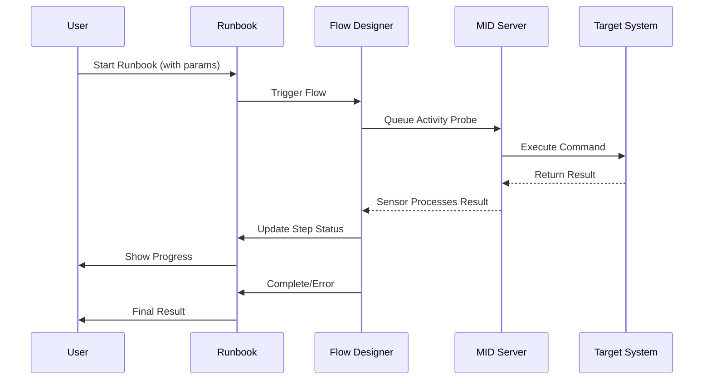

# Orchestration — ServiceNow Orchestration

**Agent:** Kilo  
**Date:** 2026-11-19  
**Module:** Orchestration  
**App:** IT Operations Management  
**Confidence:** high  

---

## Contents

- [Purpose](#purpose)
- [Where to Find It](#where-to-find-it)
- [Orchestration Architecture](#orchestration-architecture)
- [Key Plugins & Licensing](#key-plugins--licensing)
- [Scoped Application](#scoped-application)
- [Core Concepts](#core-concepts)
- [Orchestration Activities](#orchestration-activities)
- [Workflow Types](#workflow-types)
- [Flow Designer vs Workflow Editor](#flow-designer-vs-workflow-editor)
- [MID Server in Orchestration](#mid-server-in-orchestration)
- [Credentials in Orchestration](#credentials-in-orchestration)
- [Runbook Automation](#runbook-automation)
- [Event Management Integration](#event-management-integration)
- [Out-of-Box Values & Dropdowns](#out-of-box-values--dropdowns)
- [Re-usable Code / Metadata](#re-usable-code--metadata)
- [Key Table Hierarchy](#key-table-hierarchy)
- [Integrations](#integrations)
- [Key Fields](#key-fields)
- [Common Mistakes](#common-mistakes)
- [Lab: End-to-End Orchestration](#lab-end-to-end-orchestration)
- [Quiz](#quiz)
- [Memory Aids & Mnemonics](#memory-aids--mnemonics)
- [Related Guides](#related-guides)
- [Official Learning Resources](#official-learning-resources)

---

## Purpose

ServiceNow Orchestration automates **routine IT tasks** and **remediation workflows** by executing commands on remote systems (servers, network devices, cloud APIs, databases). It extends workflow capabilities beyond the ServiceNow platform to on-premises and cloud infrastructure via the **MID Server**.

**Key value:** Eliminates manual runbooks, reduces MTTR through auto-remediation, standardizes operational procedures.

---

## Where to Find It

| Breadcrumb | Path |
|------------|------|
| Module entry | All > Orchestration > ... |
| Activities | All > Orchestration > Activities |
| Workflows | All > Orchestration > Workflows |
| Runbook Automation | All > Orchestration > Runbook Automation |
| Flow Designer | All > Flow Designer |

---

## Orchestration Architecture

```mermaid
graph TD
    subgraph "ServiceNow Cloud"
        A[Flow Designer / Workflow Editor]
        B[Orchestration Engine]
        C[Activity Packs]
        D[MID Server Management]
    end
    subgraph "Customer Network"
        E[MID Server 1]
        F[MID Server 2]
        G[Target Systems]
    end
    subgraph "Target Systems"
        H[Linux/Unix (SSH)]
        I[Windows (WinRM/PowerShell/WMI)]
        J[Network Devices (SNMP/SSH)]
        K[Cloud APIs (REST)]
        L[Databases (JDBC)]
        M[Kubernetes (kubectl/Helm)]
    end

    A --> B
    B --> C
    C --> D
    D --> E
    D --> F
    E --> H
    E --> I
    E --> J
    F --> K
    F --> L
    F --> M

    style A fill:#e8eaf6,color:#000
    style B fill:#e3f2fd,color:#000
    style C fill:#e3f2fd,color:#000
    style D fill:#fff3e0,color:#000
    style E fill:#fff3e0,color:#000
    style F fill:#fff3e0,color:#000
    style H fill:#e1f5e1,color:#000
    style I fill:#e1f5e1,color:#000
    style J fill:#e1f5e1,color:#000
    style K fill:#e1f5e1,color:#000
    style L fill:#e1f5e1,color:#000
    style M fill:#e1f5e1,color:#000
```

---

## Key Plugins & Licensing

| Plugin | Name | Purpose |
|--------|------|---------|
| `com.glide.orchestration` | Orchestration Core | Base workflow/activity engine |
| `com.glide.orchestration.activitypack` | Activity Packs | Prebuilt activities (SSH, PowerShell, etc.) |
| `com.snc.mid_server` | MID Server | Required for remote execution |
| `com.glide.orchestration.rbac` | Runbook Automation | Advanced runbook features |

**License:** Orchestration Add-on (separate from ITOM License).

---

## Scoped Application

| Scope Aspect | Detail |
|--------------|--------|
| Scope name | `com.glide.orchestration` |
| Key tables | `orch_workflow`, `orch_activity`, `orch_workflow_log`, `orch_activity_log` |
| Roles | `orchestration_admin`, `orchestration_user`, `admin` |

---

## Core Concepts

### Workflow vs Activity

| Concept | Description |
|---------|-------------|
| **Workflow** | End-to-end automation process (can include multiple activities) |
| **Activity** | Single atomic action (SSH command, REST call, PowerShell script) |
| **Activity Pack** | Collection of related activities (e.g., "Linux Activity Pack") |

### Execution Model

```
Workflow Started
       │
       ▼
┌──────────────────┐
│ Orchestration    │  ← Evaluates workflow, queues activities
│ Engine           │
└────────┬─────────┘
         │
         ▼
┌──────────────────┐
│ Activity         │  ← Each activity creates a probe record
│ Dispatcher       │
└────────┬─────────┘
         │
         ▼
┌──────────────────┐
│ MID Server       │  ← Polls for probe, executes on target
│ Executes Probe   │
└────────┬─────────┘
         │
         ▼
┌──────────────────┐
│ Sensor Processes │  ← Parses output, updates workflow vars
│ Result           │
└────────┬─────────┘
         │
         ▼
    Next Activity / Workflow Complete
```

---

## Orchestration Activities

### Core Activity Packs (Out-of-Box)

| Pack | Activities | Target |
|------|------------|--------|
| **SSH** | Run Command, File Transfer, Script | Linux/Unix |
| **PowerShell** | Run Script, Run Command, DSC | Windows |
| **WinRM** | Run Command, Run Script | Windows (modern) |
| **WMI** | Query, Method Invoke | Windows (legacy) |
| **SNMP** | Get, Set, Walk | Network Devices |
| **REST** | GET, POST, PUT, DELETE, Generic | APIs |
| **SOAP** | Call Web Service | Legacy APIs |
| **JDBC** | Query, Update, Stored Procedure | Databases |
| **Kubernetes** | Apply, Delete, Get, Helm | K8s Clusters |
| **Cloud** | AWS/Azure/GCP specific actions | Cloud Providers |
| **Ansible** | Playbook, Module | Ansible Tower/AWX |
| **Terraform** | Plan, Apply, Destroy | Terraform Cloud/Enterprise |

### Activity Structure

```
Activity Definition
├── Input Variables (Parameters)
│   ├── Required/Optional
│   ├── Data Types (String, Integer, Reference, etc.)
│   └── Default Values
├── Execution Logic
│   ├── Probe Script (runs on MID Server)
│   └── Sensor Script (runs in ServiceNow)
├── Output Variables (Results)
│   ├── Success/Failure
│   ├── Output Data
│   └── Error Information
└── Post-Processing
    ├── Variable Mapping
    └── Error Handling
```

---

## Workflow Types

### 1. Orchestration Workflows (Legacy)
- Built in **Workflow Editor** (`orch_workflow` table)
- Graphical designer with transitions
- Being deprecated in favor of Flow Designer

### 2. Flow Designer Flows (Modern)
- Built in **Flow Designer** (no-code/low-code)
- Trigger-based (Record, Schedule, Event, Webhook)
- Actions = Orchestration Activities + Core Actions
- Data pills for variable passing
- Subflows for reusability

### 3. Runbook Automation
- **Runbook** = Documented procedure + executable workflow
- **Runbook Template** = Parameterized runbook for reuse
- **Runbook Instance** = Execution of a runbook with specific parameters
- Integration with **Incident/Change/Problem** for context

### Flow Designer vs Workflow Editor

| Feature | Flow Designer | Workflow Editor |
|---------|---------------|-----------------|
| **UI** | Modern, no-code | Legacy, graphical |
| **Triggers** | Rich (Record, Schedule, Event, Webhook, Manual) | Limited |
| **Variables** | Data pills, auto-mapping | Manual mapping |
| **Subflows** | Native support | Sub-workflows |
| **Error Handling** | Try/Catch/Retry built-in | Manual |
| **Versioning** | Automatic | Manual |
| **Future** | Strategic direction | Deprecated |

---

## MID Server in Orchestration

### MID Server Role

The MID Server is the **execution agent** for Orchestration activities.

| Responsibility | Detail |
|----------------|--------|
| **Probe Execution** | Runs SSH, PowerShell, WinRM, SNMP, REST commands |
| **Credential Handling** | Securely retrieves and uses credentials |
| **Output Processing** | Returns stdout/stderr/exit code to ServiceNow |
| **Long-Running Ops** | Supports async activities with polling |

### MID Server Capabilities for Orchestration

| Capability | Activities Enabled |
|------------|-------------------|
| **SSH** | Linux commands, file transfer, scripts |
| **PowerShell** | Windows scripts, DSC, remote commands |
| **WinRM** | Modern Windows management |
| **SNMP** | Network device config, monitoring |
| **REST** | API calls to any REST endpoint |
| **JDBC** | Database queries, updates |
| **Kubernetes** | kubectl, Helm operations |
| **Docker** | Container management |
| **Ansible** | Playbook execution via Ansible Tower |
| **Terraform** | Infrastructure as Code |

### MID Server Configuration for Orchestration

**config.xml** additions:
```xml
<parameter name="mid.orchestration.enabled" value="true"/>
<parameter name="mid.orchestration.max_concurrent" value="10"/>
<parameter name="mid.orchestration.timeout" value="3600"/>
<parameter name="mid.powershell.version" value="5.1"/>
<parameter name="mid.ssh.key_exchange_algorithms" value="curve25519-sha256,diffie-hellman-group16-sha512"/>
```

---

## Credentials in Orchestration

### Credential Types

| Type | Used By | Storage |
|------|---------|---------|
| **SSH Credentials** | SSH activities | `discovery_credentials` (type: SSH Key) |
| **Windows Credentials** | PowerShell, WinRM, WMI | `discovery_credentials` (type: Username/Password) |
| **REST Credentials** | REST activities | `discovery_credentials` (type: Bearer Token, Basic Auth) |
| **Database Credentials** | JDBC activities | `discovery_credentials` (type: JDBC) |
| **Kubernetes Credentials** | K8s activities | `discovery_credentials` (type: Kubeconfig) |
| **Ansible Credentials** | Ansible activities | `discovery_credentials` (type: Ansible Tower) |

### Credential Best Practices

1. **Use Credential References** — Never hardcode in workflows
2. **Least Privilege** — Service accounts with minimal required permissions
3. **Rotation** — Integrate with vault solutions (CyberArk, HashiCorp, AWS Secrets Manager)
4. **Tagging** — Tag by environment, system, team
5. **Test Before Use** — Credential Test UI validates connectivity

---

## Runbook Automation

**Runbook Automation** bridges documentation and execution.

### Runbook Components

| Component | Description |
|-----------|-------------|
| **Runbook Definition** | Template with parameters, steps, approvals |
| **Runbook Instance** | Actual execution with specific parameters |
| **Runbook Step** | Individual action (manual or automated) |
| **Runbook Variable** | Input/output parameters |

### Runbook Flow



### Runbook Integration Points

| Integration | Use Case |
|-------------|----------|
| **Incident** | Run remediation runbook from incident |
| **Change** | Pre/post-change validation runbooks |
| **Problem** | Root cause investigation runbooks |
| **Event Management** | Auto-remediation runbooks for alerts |
| **Service Catalog** | Self-service runbooks for end users |

---

## Event Management Integration

Orchestration is the **action arm** of Event Management.

### Auto-Remediation Pattern

```
Critical Alert
      │
      ▼
┌──────────────────┐
│ Alert Management │  ← Matches alert condition
│ Rule             │
└────────┬─────────┘
         │ Action: Run Orchestration
         ▼
┌──────────────────┐
│ Flow Designer    │  ← Triggered by Alert Management Rule
│ Flow             │
└────────┬─────────┘
         │
         ▼
┌──────────────────┐
│ Orchestration    │  ← SSH/PowerShell/REST Activity
│ Activity         │
└────────┬─────────┘
         │
         ▼
┌──────────────────┐
│ Target System    │  ← Executes remediation
│ (Server/App)     │
└────────┬─────────┘
         │
         ▼
    Alert Auto-Closes / Incident Updated
```

### Common Auto-Remediation Scenarios

| Scenario | Activity | Example |
|----------|----------|---------|
| **High CPU** | SSH/PowerShell | Restart service, kill runaway process |
| **Disk Full** | SSH/PowerShell | Clean temp files, rotate logs |
| **Service Down** | SSH/PowerShell/REST | Restart service, failover |
| **Certificate Expiry** | REST/SSH | Renew cert, update load balancer |
| **Cloud Resource Limit** | Cloud API | Scale up, request quota increase |
| **Security Alert** | REST/SSH | Block IP, isolate host, revoke token |

---

## Out-of-Box Values & Dropdowns

### Workflow State (orch_workflow.state)

| Value | Label |
|-------|-------|
| `pending` | Pending |
| `running` | Running |
| `success` | Success |
| `failed` | Failed |
| `cancelled` | Cancelled |

### Activity State (orch_activity_log.state)

| Value | Label |
|-------|-------|
| `pending` | Pending |
| `running` | Running |
| `success` | Success |
| `failed` | Failed |
| `cancelled` | Cancelled |
| `skipped` | Skipped |

### Runbook State

| Value | Label |
|-------|-------|
| `draft` | Draft |
| `published` | Published |
| `running` | Running |
| `completed` | Completed |
| `failed` | Failed |

---

## Re-usable Code / Metadata

### Re-usable Metadata Inventory

| Piece | Location | Purpose |
|-------|----------|---------|
| **Activities** | All > Orchestration > Activities | Atomic automation steps |
| **Workflows** | All > Orchestration > Workflows | Legacy workflows |
| **Flows** | All > Flow Designer | Modern flows |
| **Runbooks** | All > Orchestration > Runbook Automation | Documented procedures |
| **Activity Packs** | All > Orchestration > Activity Packs | Bundled activities |

### Re-usable Code Snippets

#### Flow Designer: REST Activity with Error Handling

```javascript
// Flow Designer Action Script (REST Activity wrapper)
var rest = new sn_ws.RESTMessageV2();
rest.setHttpMethod('POST');
rest.setEndpoint('https://api.example.com/v1/action');
rest.setRequestHeader('Content-Type', 'application/json');
rest.setRequestHeader('Authorization', 'Bearer ' + inputs.api_token);

var payload = {
    target: inputs.target_host,
    action: inputs.remediation_action,
    parameters: inputs.action_params
};
rest.setRequestBody(JSON.stringify(payload));

var response = rest.execute();
var statusCode = response.getStatusCode();
var body = response.getBody();

if (statusCode >= 200 && statusCode < 300) {
    var result = JSON.parse(body);
    outputs.success = true;
    outputs.result = result;
} else {
    outputs.success = false;
    outputs.error = 'HTTP ' + statusCode + ': ' + body;
    workflow.error('Remediation API failed: ' + outputs.error);
}
```

#### Script Include: Orchestration Helper

```javascript
var OrchestrationHelper = Class.create();
OrchestrationHelper.prototype = Object.extendsObject(AbstractAjaxProcessor, {
    // Trigger a flow from client script
    triggerFlow: function() {
        var flowSysId = this.getParameter('flow_sys_id');
        var inputs = JSON.parse(this.getParameter('inputs') || '{}');
        
        var flow = new GlideRecord('sys_hub_flow');
        flow.addQuery('sys_id', flowSysId);
        flow.query();
        if (flow.next()) {
            var fr = new FlowAPI();
            var executionId = fr.startFlow(flowSysId, inputs);
            return executionId;
        }
        return 'Flow not found';
    },
    
    // Get flow execution status
    getFlowStatus: function() {
        var execId = this.getParameter('execution_id');
        var exec = new GlideRecord('sys_hub_flow_execution');
        exec.addQuery('sys_id', execId);
        exec.query();
        if (exec.next()) {
            return exec.getValue('state'); // running, completed, failed
        }
        return 'not_found';
    },
    
    // Run ad-hoc SSH command via Orchestration
    runAdHocSSH: function() {
        var midServer = this.getParameter('mid_server');
        var target = this.getParameter('target');
        var credential = this.getParameter('credential');
        var command = this.getParameter('command');
        
        var ssh = new sn_orch.SSHCommand();
        ssh.setMIDServer(midServer);
        ssh.setTarget(target);
        ssh.setCredentials(credential);
        ssh.setCommand(command);
        
        var result = ssh.execute();
        return JSON.stringify({
            status: result.getStatusCode(),
            output: result.getOutput(),
            error: result.getError()
        });
    },
    
    type: 'OrchestrationHelper'
});
```

#### Business Rule: Auto-Run Runbook on Critical Incident

```javascript
(function rule(current, previous) {
    if (current.operation() == 'insert' && 
        current.priority == '1' && 
        current.category == 'Infrastructure') {
        
        // Find matching runbook
        var rb = new GlideRecord('orch_runbook');
        rb.addQuery('active', true);
        rb.addQuery('category', current.category);
        rb.addQuery('priority', '1');
        rb.query();
        
        if (rb.next()) {
            // Create runbook instance
            var instance = new GlideRecord('orch_runbook_instance');
            instance.runbook = rb.sys_id;
            instance.triggered_by = 'incident';
            instance.trigger_record = current.sys_id;
            instance.state = 'running';
            instance.insert();
            
            // Trigger the associated flow
            if (rb.flow) {
                var fr = new FlowAPI();
                fr.startFlow(rb.flow, {
                    incident_sys_id: current.sys_id,
                    runbook_instance_sys_id: instance.sys_id
                });
            }
            
            current.work_notes = 'Auto-triggered runbook: ' + rb.name + ' (' + instance.number + ')';
        }
    }
})(current, previous);
```

---

## Key Table Hierarchy

| Table | Purpose | Key Fields |
|-------|---------|------------|
| `orch_workflow` | Legacy workflows | `name`, `state`, `version` |
| `orch_activity` | Activity definitions | `name`, `type`, `topic`, `probe_script`, `sensor_script` |
| `orch_workflow_log` | Workflow execution history | `workflow`, `state`, `started`, `ended` |
| `orch_activity_log` | Activity execution history | `workflow_log`, `activity`, `state`, `output` |
| `sys_hub_flow` | Flow Designer flows | `name`, `state`, `trigger`, `version` |
| `sys_hub_flow_execution` | Flow execution instances | `flow`, `state`, `inputs`, `outputs` |
| `orch_runbook` | Runbook definitions | `name`, `flow`, `category`, `active` |
| `orch_runbook_instance` | Runbook executions | `runbook`, `state`, `triggered_by`, `trigger_record` |

### Table Relationships

```
sys_hub_flow (Flow)
    │
    ├──► sys_hub_flow_execution (Executions)
    │       ├──► Inputs/Outputs (JSON)
    │       └──► Action Executions (Activities)
    │
    └──► orch_runbook (Linked Runbook)
            │
            └──► orch_runbook_instance (Runbook Runs)
                    │
                    └──► Triggered by (Incident/Change/Alert)
```

---

## Integrations

| Integration | Direction | Purpose | Protocol |
|-------------|-----------|---------|----------|
| **MID Server** | Bidirectional | Execute activities on targets | Proprietary (HTTPS) |
| **Event Management** | Inbound | Trigger auto-remediation | Internal |
| **Incident/Change/Problem** | Bidirectional | Contextual runbooks | Internal |
| **Service Catalog** | Inbound | Self-service automation | Internal |
| **Ansible Tower/AWX** | Outbound | Run playbooks | REST |
| **Terraform Cloud** | Outbound | IaC operations | REST |
| **Kubernetes** | Outbound | Cluster management | kubectl/Helm/REST |
| **Cloud Providers** | Outbound | Resource management | REST APIs |
| **External APIs** | Outbound | Any REST/SOAP endpoint | REST/SOAP |

---

## Key Fields

| Table | Field | Type | Why It Matters |
|-------|-------|------|----------------|
| `orch_activity` | `topic` | Choice | SSH, PowerShell, REST, SNMP, etc. |
| `orch_activity` | `probe_script` | Script | MID Server execution logic |
| `orch_activity` | `sensor_script` | Script | Result processing logic |
| `sys_hub_flow` | `trigger` | Choice | Record, Schedule, Event, Webhook |
| `sys_hub_flow_execution` | `state` | Choice | running, completed, failed |
| `orch_runbook_instance` | `triggered_by` | String | incident, change, alert, catalog |
| `orch_runbook_instance` | `trigger_record` | Reference | Source record sys_id |

---

## Common Mistakes

| Mistake | Symptom | Fix |
|---------|---------|-----|
| No MID Server for target | Activities fail with "No MID Server" | Deploy MID Server in target network zone |
| Wrong credentials | Authentication failures | Test credentials; use credential aliases |
| Hardcoded values in flows | Not reusable across environments | Use flow variables, environment configs |
| No error handling | Silent failures | Add Try/Catch, retry logic, notifications |
| Long-running without async | Workflow times out | Use async activities, polling patterns |
| No idempotency | Duplicate executions cause issues | Design activities to be idempotent |
| Missing rollback | Failed changes can't be undone | Add compensating actions |
| Not testing in sub-prod | Production failures | Test all flows in dev/test first |
| Over-complex flows | Hard to maintain/debug | Break into subflows, use runbooks |
| Ignoring MID Server logs | Can't debug failures | Check `/var/log/mid/` or `C:\mid\logs\` |

---

## Lab: End-to-End Orchestration

**Prerequisites:** Orchestration plugin active, MID Server deployed and `Up`, target system accessible.

### Step 1: Create SSH Credential
1. Navigate to **All > Discovery > Credentials**
2. Click **New** → Type: **SSH Key**
3. Fill: Name, Username, Private Key (or use password)
4. **Test Credential** → Verify success
5. Save

### Step 2: Create Simple Flow (Restart Service)
1. Navigate to **All > Flow Designer**
2. Click **New** → **Flow**
3. **Name:** `Restart Web Service`
4. **Trigger:** Manual (for testing) or **Alert - Created** (for production)
5. **Add Action:** Search "SSH" → **SSH - Run Command**
6. **Configure Action:**
   - **MID Server:** Select your MID Server
   - **Target:** `{{trigger.target}}` (or static IP for test)
   - **Credentials:** Select SSH credential
   - **Command:** `sudo systemctl restart apache2`
7. **Add Action:** **Core - Look up Record** (to update incident/alert)
8. **Save** and **Test** (Run Flow manually with test inputs)

### Step 3: Create Runbook
1. Navigate to **All > Orchestration > Runbook Automation > Runbooks**
2. Click **New**
3. **Name:** `Web Service Restart Runbook`
4. **Flow:** Select your `Restart Web Service` flow
5. **Category:** `Infrastructure`
6. **Parameters:** Define `target_host`, `service_name`
7. **Save** and **Publish**

### Step 4: Connect to Event Management
1. Navigate to **All > Event Management > Alert Management Rules**
2. Click **New**
3. **Name:** `High CPU → Restart Web Service`
4. **Condition:** `Severity = 1 AND Resource = CPU`
5. **Action:** `Run Orchestration`
6. **Flow:** Select your flow
7. **Inputs:** Map `target` → `{{alert.node}}`
8. **Save**

### Step 5: Test End-to-End
1. Send test event: Node=`WEB01`, Resource=`CPU`, Severity=`1`
2. Verify:
   - Alert created
   - Alert Management Rule triggers
   - Flow executes
   - SSH command runs on target
   - Flow completes successfully
   - Alert/Incident updated

### Step 6: Test Runbook from Incident
1. Create Incident: Priority=1, Category=Infrastructure, CI=WEB01
2. Open Incident → **Runbook** related list
3. Click **Run** on `Web Service Restart Runbook`
4. Fill parameters → Submit
5. Verify runbook executes and updates incident

---

## Quiz

1. What is the execution agent for Orchestration activities?
   <details><summary>Answer</summary>MID Server</details>

2. What is the modern workflow builder in ServiceNow?
   <details><summary>Answer</summary>Flow Designer</details>

3. What activity pack would you use to run a PowerShell script on Windows?
   <details><summary>Answer</summary>PowerShell Activity Pack</details>

4. What table stores Flow Designer flows?
   <details><summary>Answer</summary>`sys_hub_flow`</details>

5. What is a Runbook?
   <details><summary>Answer</summary>Documented procedure + executable workflow for repeatable operations</details>

6. How does Event Management trigger Orchestration?
   <details><summary>Answer</summary>Alert Management Rule with Action = Run Orchestration</details>

7. What credential type is used for SSH activities?
   <details><summary>Answer</summary>SSH Key credentials (stored in discovery_credentials)</details>

8. What is the difference between a Workflow and an Activity?
   <details><summary>Answer</summary>Workflow = end-to-end process; Activity = single atomic action</details>

9. What is idempotency in Orchestration?
   <details><summary>Answer</summary>Running the same activity multiple times produces the same result without side effects</details>

10. Where do you check MID Server logs for Orchestration failures?
    <details><summary>Answer</summary>`/var/log/mid/` (Linux) or `C:\mid\logs\` (Windows)</details>

---

## Memory Aids & Mnemonics

<details>
<summary>💡 Click to reveal mnemonics & memory aids</summary>

### Orchestration Components — MAW
**M**ID Server (executes)
**A**ctivity (atomic action)
**W**orkflow/Flow (process)

**Remember:** **MAW** — Like "more" with a Boston accent.

---

### Activity Packs — SPRING
**S**SH, **P**owerShell, **R**EST, **I** (SNMP), **N** (JDBC), **G** (Kubernetes/Cloud)

---

### Flow vs Workflow — FLOW
**F**low Designer = **F**uture
**L**egacy = **L**ast century
**O**rchestration = **O**ld way (Workflow Editor)
**W**in = **W**orkflow Designer deprecated

---

### Auto-Remediation Pattern — E-A-O
**E**vent Management Alert
**A**lert Management Rule
**O**rchestration Flow

**Remember:** **EAO** — Each Alert Orchestrated.

---

### MID Server Capabilities — SPWJK
**S**SH, **P**owerShell, **W**inRM, **J**DBC, **K**ubernetes

---

### Runbook States — DPRCF
**D**raft → **P**ublished → **R**unning → **C**ompleted/**F**ailed

**Remember:** **DPRCF** — DePeRC (like "deprecate" but for runbooks).

---

</details>

---

## Related Guides

- [ITOM Overview](../itom-guide.md)
- [Discovery Guide](../discovery/discovery-guide.md)
- [Event Management Guide](../eventmanagement/eventmanagement-guide.md)
- [Service Mapping Guide](../servicemapping/servicemapping-guide.md)
- [MID Server Guide](../midserver/midserver-guide.md)
- [Orchestration Getting Started](../../getting-started/orchestration.md)

---

## Official Learning Resources

### Now Learning (Structured Training)
- [Orchestration Fundamentals](https://nowlearning.servicenow.com/) — Search "Orchestration" on Now Learning Portal
- [Flow Designer Fundamentals](https://nowlearning.servicenow.com/) — Search "Flow Designer" on Now Learning Portal
- [Runbook Automation](https://nowlearning.servicenow.com/) — Search "Runbook Automation" on Now Learning Portal

### Product Documentation (Technical Reference)
- [ServiceNow Product Documentation — Orchestration](https://docs.servicenow.com/) → Search "Orchestration", "Flow Designer", "Runbook Automation", "Orchestration Activities"
- [ServiceNow Product Documentation — MID Server](https://docs.servicenow.com/) → Search "MID Server Orchestration"

### Official Videos & Playlists
- [ServiceNow YouTube Channel](https://www.youtube.com/c/ServiceNow) — Search "ServiceNow Orchestration", "ServiceNow Flow Designer", "ServiceNow Runbook Automation"

---

*Generated by Kilo on 2026-11-19. Based on official ServiceNow documentation and product guides.*