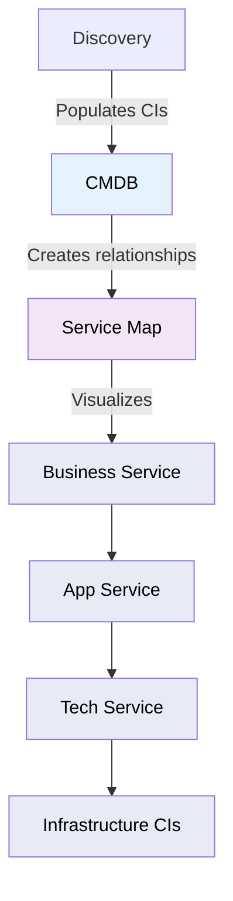
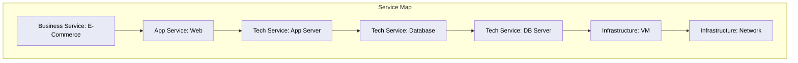

# ITOM Service Mapping — Application Service Topology and Dependency Mapping

**Agent:** Kilo
**Date:** 2026-11-19
**Module:** Service Mapping
**Confidence:** high

---

## Contents

- [Purpose](#purpose)
- [Where to Find It](#where-to-find-it)
- [Official Exam Alignment — CIS-Service Mapping (KB0011546)](#official-exam-alignment--cis-service-mapping-kb0011546)
- [Service Mapping Flow Diagram](#service-mapping-flow-diagram)
- [Core Concepts](#core-concepts)
- [Re-usable Metadata Inventory](#re-usable-metadata-inventory)
- [Out-of-Box Features](#out-of-box-features)
- [Key Tables](#key-tables)
- [Common Mistakes](#common-mistakes)
- [Deep Dive: Service Map Configuration](#deep-dive-service-map-configuration)
- [Lab: Map a Service to CIs](#lab-map-a-service-to-cis)
- [Goals, Benefits & Key Metrics](#goals-benefits--key-metrics)
- [Core Concept Diagrams](#core-concept-diagrams)
- [Quiz](#quiz)
- [Related Guides](#related-guides)
- [Official Learning Resources](#official-learning-resources)

---

## Purpose

**Service Mapping** discovers and visualizes relationships between business services and the underlying IT infrastructure (CIs) that supports them.

Service Mapping extends Discovery by creating visual representations of service dependency maps. It answers: "What services does this infrastructure support?"

Key capabilities:
- **Service graph** — Business services as top-level nodes, supporting CIs below
- **Application services** — Maps applications to the CIs they use
- **Technical services** — Maps technical services to infrastructure
- **Pattern-based mapping** — Uses patterns to understand application dependencies

---

## Where to Find It

| Breadcrumb | Path |
|------------|------|
| Module entry | All > Service Mapping |
| Service Map Designer | All > Service Mapping > Service Maps |
| Application Services | All > Service Mapping > Application Services |
| Technical Services | All > Service Mapping > Technical Services |
| Patterns | All > Service Mapping > Patterns |
| Discovery | All > Service Mapping > Discovery |

---

## Official Exam Alignment — CIS-Service Mapping (KB0011546)

| Guide Section | CIS-SM Domain | Exam Weight | What's Covered |
|---------------|-----------------|-------------|----------------|
| **Service Map Design** | Domain 1: Service Mapping Architecture | 30% | Service graph, patterns, application services |
| **Topology** | Domain 2: Pattern Design | 25% | Patterns, discovery integration |
| **Configuration** | Domain 3: Configuration Management | 20% | Service mapping configuration |

**Official preparation courses:**
- ServiceNow Administration Fundamentals
- Service Mapping Fundamentals
- ITOM Overview

---

## Service Mapping Flow Diagram

---

## Core Concepts

### Service Map
A hierarchical representation of a business service down through the supporting technical infrastructure.

### Patterns
Reusable rules that describe how applications and their dependencies should be discovered and mapped.

### Application Services
Business-facing services that users experience (e.g., E-commerce Platform, CRM).

### Technical Services
Supporting technical services that implement the application services (e.g., Database Server, Web Server).

### Service Graph
The top-level representation showing business services and their dependency relationships.

---

## Re-usable Metadata Inventory

| Re-usable piece | What it is | Where it lives (breadcrumb) |
|-----------------|------------|------------------------------|
| **Service Map Patterns** | Reusable mapping patterns | All > Service Mapping > Patterns |
| **Application Services** | Business services that need mapping | All > Service Mapping > Application Services |
| **Service Graph Editor** | Visual design tool for service maps | All > Service Mapping > Service Maps |
| **Impact Analysis** | Derived from service maps | All > Service Mapping > Impact Analysis |

---

## Out-of-Box Features

| Feature | Description | Where |
|---------|-------------|-------|
| Service Map Designer | Visual drag-and-drop service maps | All > Service Mapping > Service Maps |
| Application Services | Manage business service definitions | All > Service Mapping > Application Services |
| Technical Services | Manage supporting technical services | All > Service Mapping > Technical Services |
| Patterns | Reusable discovery/mapping patterns | All > Service Mapping > Patterns |
| Service Graph | Top-level service dependency view | All > Service Mapping > Service Graph |

---

## Key Tables

| Table | Purpose | Key Fields |
|-------|---------|------------|
| `cmdb_ci` | Configuration items | `name`, `sys_class_name`, `serial_number` |
| `cmdb_rel_ci` | Relationships | `parent`, `child`, `type` |
| `alm_service` | Business services | `name`, `description` |
| `alm_application_service` | Application services | `name`, `application_scope` |
| `service_map` | Service map definitions | `service`, `pattern` |

---

## Common Mistakes

| Mistake | Symptom | Fix |
|---------|---------|-----|
| Not creating application services | Services not in service maps | Create app service records first |
| Pattern design not aligned with discovery | Incomplete maps | Design patterns against discovered data |
| Not updating service maps after changes | Stale topology | Refresh service maps periodically |
| Missing technical services | Gaps in topology | Add supporting technical services |

---

## Deep Dive: Service Map Configuration

### Building a Service Map

1. **Create/Select Application Service** — All > Service Mapping > Application Services
2. **Create Service Map** — All > Service Mapping > Service Maps, select the app service
3. **Design** — Use the service graph editor to drag/drop CIs
4. **Add Patterns** — Attach discovery patterns to map new CIs
5. **Validate** — Run discovery and check that the service map updates

---

## Lab: Map a Service to CIs

1. **Navigate** to All > Service Mapping > Service Maps
2. **Click New** and select an application service (or create one)
3. **Design the service map** — add CIs for the app server, database, and network
4. **Save** and run a Discovery plan
5. **Verify** the service map reflects discovered CIs

---

## Goals, Benefits & Key Metrics

| Goal | Benefit | Key Metric | Example Target |
|------|---------|------------|----------------|
| Full infrastructure visibility | Know all dependencies | Service map coverage % | > 90% |
| Faster impact analysis | Know which services are affected | Impact analysis time | < 30 minutes |
| Proactive remediation | Know which services to fix | MTTR | < 30 minutes |
| Cost allocation | Know what services cost what | Cost per service | < 5% variance |

---

## Core Concept Diagrams

---

## Quiz

1. What is the difference between a Business Service and an Application Service?
   

Answer
A Business Service is the user-facing service; an Application Service is the technical implementation of that service

2. What does Service Mapping use to map dependencies?
   

Answer
Discovery patterns combined with service map design

3. What percentage of the CIS-Service Mapping exam covers Service Map Design?
   

Answer
30%

---

## Related Guides

- [ITOM Overview](../itom/itom-guide.md)
- [Discovery Guide](../discovery/discovery-guide.md)
- [CMDB Guide](../cmdb/cmdb-guide.md)
- [Event Management Guide](../eventmanagement/eventmanagement-guide.md)

---

## Official Learning Resources

### Now Learning (Structured Training)
- [Service Mapping Fundamentals](https://nowlearning.servicenow.com/) — Search "Service Mapping Fundamentals"

### Product Documentation (Technical Reference)
- [ServiceNow Product Documentation — Service Mapping](https://docs.servicenow.com/) → Search "Service Mapping"

### Official Videos & Playlists
- [ServiceNow YouTube Channel](https://www.youtube.com/c/ServiceNow) — Search "ServiceNow Service Mapping"

### Certification Blueprint
- [CIS-Service Mapping Blueprint (KB0011546)](https://www.servicenow.com/training-certification/certifications/cis-service-mapping.html)

---