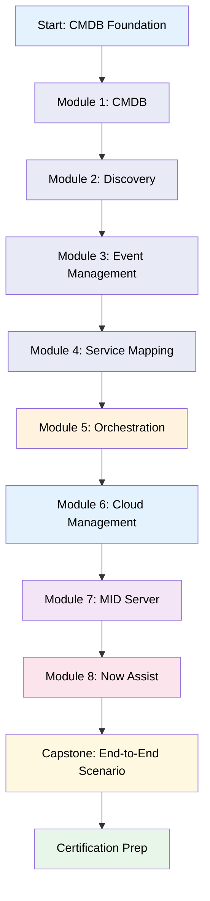

# Getting Started with ITOM — End-to-End Learning Path

**Agent:** Kilo  
**Date:** 2026-11-19  
**Module:** Getting Started — ITOM  
**Audience:** New ITOM practitioners, admins, architects  
**Confidence:** high  

---

## Contents

- [Learning Objectives](#learning-objectives)
- [Prerequisites](#prerequisites)
- [Recommended Learning Sequence](#recommended-learning-sequence)
- [Environment Setup](#environment-setup)
- [Module 1: CMDB Foundation](#module-1-cmdb-foundation)
- [Module 2: Discovery](#module-2-discovery)
- [Module 3: Event Management](#module-3-event-management)
- [Module 4: Service Mapping](#module-4-service-mapping)
- [Module 5: Orchestration](#module-5-orchestration)
- [Module 6: Cloud Management](#module-6-cloud-management)
- [Module 7: MID Server](#module-7-mid-server)
- [Module 8: Now Assist for ITOM](#module-8-now-assist-for-itom)
- [Capstone Exercise](#capstone-exercise)
- [Certification Path](#certification-path)
- [Resources](#resources)

---

## Learning Objectives

By completing this path, you will be able to:

1. **Explain** the ITOM architecture and how modules integrate
2. **Configure** CMDB with proper CI classes, relationships, and IRE
3. **Deploy** Discovery to populate CMDB with infrastructure CIs
4. **Implement** Event Management for alert correlation and CI binding
5. **Build** Service Maps for business service visibility
6. **Automate** remediation with Orchestration and Flow Designer
7. **Extend** visibility to cloud resources with Cloud Management
8. **Operate** MID Servers for secure, scalable discovery
9. **Leverage** Gen AI with Now Assist for faster resolution
10. **Pass** official CIS certifications (Discovery, EM, Service Mapping, Cloud)

---

## Prerequisites

| Requirement | Details |
|-------------|---------|
| **ServiceNow Instance** | PDI (Personal Developer Instance) or sub-prod |
| **ITOM License** | Discovery, Event Mgmt, Service Mapping, Orchestration, Cloud Mgmt |
| **Now Assist License** | For Gen AI modules (optional but recommended) |
| **Base Knowledge** | ServiceNow fundamentals (tables, forms, lists, business rules, flows) |
| **Technical Skills** | Linux/Windows admin basics, networking (IP, DNS, SNMP, SSH), cloud concepts |

### Recommended Pre-Work

- [ServiceNow Fundamentals](https://nowlearning.servicenow.com/) (if new to platform)
- [CMDB Fundamentals](https://nowlearning.servicenow.com/)
- [Scripting in ServiceNow](https://nowlearning.servicenow.com/) (for advanced labs)

---

## Recommended Learning Sequence



### Time Estimates

| Module | Reading | Labs | Total |
|--------|---------|------|-------|
| CMDB Foundation | 2 hrs | 3 hrs | 5 hrs |
| Discovery | 3 hrs | 4 hrs | 7 hrs |
| Event Management | 3 hrs | 4 hrs | 7 hrs |
| Service Mapping | 3 hrs | 4 hrs | 7 hrs |
| Orchestration | 2 hrs | 3 hrs | 5 hrs |
| Cloud Management | 2 hrs | 3 hrs | 5 hrs |
| MID Server | 2 hrs | 2 hrs | 4 hrs |
| Now Assist | 1 hr | 2 hrs | 3 hrs |
| Capstone | 1 hr | 4 hrs | 5 hrs |
| **Total** | **19 hrs** | **29 hrs** | **~48 hrs** |

---

## Environment Setup

### 1. Get a Personal Developer Instance (PDI)

1. Go to [developer.servicenow.com](https://developer.servicenow.com)
2. Sign in / Create account
3. Request **ITOM-enabled PDI** (includes Discovery, EM, SM, Orchestration, Cloud)
4. Wait for provisioning (~10-15 min)
5. Note instance URL: `https://devXXXXX.service-now.com`

### 2. Activate Required Plugins

**All > System Definition > Plugins** — Activate (if not already):

| Plugin | Required For |
|--------|--------------|
| `com.snc.cmdb` | All ITOM |
| `com.snc.identification_reconciliation` | CMDB, Discovery |
| `com.snc.cmdb.health` | CMDB Health |
| `com.snc.cmdb.csdm` | CSDM Alignment |
| `com.snc.discovery` | Discovery |
| `com.snc.event_management` | Event Management |
| `com.snc.service_mapping` | Service Mapping |
| `com.snc.orchestration` | Orchestration |
| `com.snc.cloud_management` | Cloud Management |
| `com.snc.mid_server` | MID Server |
| `com.snc.now_assist_itom` | Now Assist for ITOM |
| `com.snc.now_assist_em` | Now Assist for EM |
| `com.snc.now_assist_sm` | Now Assist for SM |

### 3. Create Learning Users

| User | Role | Purpose |
|------|------|---------|
| `itom_admin` | `admin`, `discovery_admin`, `evt_mgmt_admin`, `sm_admin`, `orchestration_admin`, `cloud_admin`, `mid_server_admin` | Full config |
| `itom_operator` | `evt_mgmt_operator`, `sm_user`, `discovery_user` | Daily operations |
| `itom_readonly` | `cmdb_read`, `evt_mgmt_read`, `sm_read` | Auditing |

### 4. Configure MID Server (Required for Discovery)

**Option A: Use PDI's Built-in MID Server**
- PDI includes a pre-configured MID Server
- Check **All > MID Server > Servers** — should show `active`

**Option B: Install Local MID Server (for real discovery)**
1. Download from **All > MID Server > Downloads**
2. Install on Linux/Windows VM with network access to targets
3. Configure `config.xml` with instance URL and MID user credentials
4. Start service → Verify **Status: Up**

---

## Module 1: CMDB Foundation

### Learning Goals
- Understand CMDB hierarchy and CSDM
- Configure Identification & Reconciliation
- Set Data Source Precedence
- Validate CMDB Health

### Reading
- [CMDB Guide](../docs/modules/cmdb/cmdb-guide.md) — Sections: Purpose, CI Class Hierarchy, IRE, Data Source Precedence, CMDB Health

### Hands-On Labs

| Lab | Description | Duration |
|-----|-------------|----------|
| **Lab 1.1** | Explore CI Class Manager — navigate hierarchy, note key classes | 30 min |
| **Lab 1.2** | Review Identification Rules for `cmdb_ci_linux_server` — verify criteria | 30 min |
| **Lab 1.3** | Check Reconciliation Definition — confirm Discovery precedence = 100 | 30 min |
| **Lab 1.4** | Run CMDB Health Dashboard — note Completeness, Compliance, Duplication | 30 min |
| **Lab 1.5** | Create manual CI (`cmdb_ci_linux_server`) — verify IRE creates new | 30 min |
| **Lab 1.6** | Simulate duplicate — import same serial_number — observe merge | 30 min |

### Verification Checklist
- [ ] Can explain CSDM 4 layers
- [ ] Can identify primary/fallback criteria for Linux/Windows/Network CIs
- [ ] Can explain why Discovery precedence = 100
- [ ] CMDB Health: Duplication < 1%, Staleness < 30 days

---

## Module 2: Discovery

### Learning Goals
- Configure Discovery schedules and behaviors
- Understand PCIE phases (Port, Classification, Identification, Exploration)
- Create and test Discovery Patterns
- Troubleshoot ECC Queue

### Reading
- [Discovery Guide](../docs/modules/discovery/discovery-guide.md) — Sections: PCIE, Patterns, MID Server, Credentials, ECC Queue, IRE

### Hands-On Labs

| Lab | Description | Duration |
|-----|-------------|----------|
| **Lab 2.1** | Create Discovery Schedule for test subnet (192.168.x.x/24) | 45 min |
| **Lab 2.2** | Run Discovery — monitor ECC Queue (Input/Output, Processing) | 60 min |
| **Lab 2.3** | Verify created CIs: Linux, Windows, Network, Applications | 45 min |
| **Lab 2.4** | Check Relationships: Runs on, Contains, Virtualized on | 30 min |
| **Lab 2.5** | Troubleshoot: Failed SSH credential — fix in Credentials module | 30 min |
| **Lab 2.6** | Create Custom Pattern: Discover custom app on port 8080 | 60 min |
| **Lab 2.7** | Horizontal Discovery: Verify Apache, MySQL, Tomcat CIs created | 45 min |

### Verification Checklist
- [ ] Can explain PCIE phases in order
- [ ] Can read ECC Queue payload (XML/JSON)
- [ ] Discovery creates correct CI classes with relationships
- [ ] Custom pattern discovers target application

---

## Module 3: Event Management

### Learning Goals
- Configure Event Rules (Transform, Bind, Correlate, Alert)
- Set up CI Binding (node, component, CI identifier)
- Create Correlation Rules (time, topology, field)
- Implement Alert Management workflows

### Reading
- [Event Management Guide](../docs/modules/eventmanagement/eventmanagement-guide.md) — Sections: Event Flow, Rules, Correlation, CI Binding, Alert Management, Now Assist

### Hands-On Labs

| Lab | Description | Duration |
|-----|-------------|----------|
| **Lab 3.1** | Send test event via REST API — verify Event [em_event] created | 30 min |
| **Lab 3.2** | Create Transform Rule — map source fields to ServiceNow fields | 45 min |
| **Lab 3.3** | Configure CI Binding — map `node` to `cmdb_ci.name` | 30 min |
| **Lab 3.4** | Create Alert Rule — severity mapping, auto-close | 30 min |
| **Lab 3.5** | Build Correlation Rule: Time-based (5 min window, same CI) | 45 min |
| **Lab 3.6** | Build Correlation Rule: Topology-based (parent/child) | 45 min |
| **Lab 3.7** | Test Now Assist: Alert Summarization, RCA, Incident Generation | 60 min |

### Verification Checklist
- [ ] Events flow: Event → Transform → Bind → Correlate → Alert
- [ ] CI Binding resolves `node` to correct CMDB CI
- [ ] Correlation reduces alert noise (group related alerts)
- [ ] Now Assist summarizes alert group and suggests root cause

---

## Module 4: Service Mapping

### Learning Goals
- Create Business Services (`sa_service`)
- Run Service Mapping Discovery (pattern-based, traffic-based)
- Build Service Topology with tiers
- Use Service Maps for Change Impact Analysis

### Reading
- [Service Mapping Guide](../docs/modules/servicemapping/servicemapping-guide.md) — Sections: Horizontal/Vertical Discovery, Traffic-based, Patterns, Change Impact, RCA

### Hands-On Labs

| Lab | Description | Duration |
|-----|-------------|----------|
| **Lab 4.1** | Create Business Service: `Customer Portal` (Tier 1, Criticality 1) | 30 min |
| **Lab 4.2** | Run Service Mapping Discovery (Pattern-based) for web tier | 60 min |
| **Lab 4.3** | Verify Topology: LB → Web → App → DB with correct tiers | 45 min |
| **Lab 4.4** | Create Traffic-based Discovery (NetFlow/Stream) — optional | 60 min |
| **Lab 4.5** | Test Change Impact: Create CR affecting App server — view impact | 45 min |
| **Lab 4.6** | Test Now Assist: Explain Service, Summarize Change Impact | 45 min |

### Verification Checklist
- [ ] Service map shows correct tiers (1=Entry, 2=Web/App, 3=Data)
- [ ] `sa_ci_relationship` links CIs to service with `direct`/`entry_point`
- [ ] Change Impact shows affected services and risk score
- [ ] Now Assist explains topology in natural language

---

## Module 5: Orchestration

### Learning Goals
- Build Flow Designer flows for remediation
- Use Activity Packs (SSH, PowerShell, REST, Script)
- Integrate with Event Management (auto-remediation)
- Implement Runbook Automation

### Reading
- [Orchestration Guide](../docs/modules/orchestration/orchestration-guide.md) — Sections: Flow Designer, Activities, Runbook Automation, EM Integration, MID Server, Credentials

### Hands-On Labs

| Lab | Description | Duration |
|-----|-------------|----------|
| **Lab 5.1** | Create Flow: Restart Service on Linux (SSH Activity) | 45 min |
| **Lab 5.2** | Create Flow: Restart IIS App Pool (PowerShell Activity) | 45 min |
| **Lab 5.3** | Create Flow: API Call to Cloud Provider (REST Activity) | 30 min |
| **Lab 5.4** | Test Now Assist: Generate Runbook from description | 30 min |
| **Lab 5.5** | Connect Flow to Alert: Auto-remediate "High CPU" alert | 60 min |
| **Lab 5.6** | Implement Approval Gate for Production flows | 30 min |

### Verification Checklist
- [ ] Flow executes SSH/PowerShell/REST activities successfully
- [ ] Flow handles errors with try/catch branches
- [ ] Auto-remediation triggers from Alert rule
- [ ] Now Assist generates usable runbook skeleton

---

## Module 6: Cloud Management

### Learning Goals
- Onboard AWS/Azure/GCP accounts
- Discover Cloud Resources (EC2, RDS, VMs, SQL, Compute)
- Map Cloud Resources to CMDB
- Implement Governance and Cost Optimization

### Reading
- [Cloud Management Guide](../docs/modules/cloudmanagement/cloudmanagement-guide.md) — Sections: Account Onboarding, Discovery, Governance, Cost, Actions, Multi-cloud

### Hands-On Labs

| Lab | Description | Duration |
|-----|-------------|----------|
| **Lab 6.1** | Onboard AWS Account (MID Server or Cloud MID) | 45 min |
| **Lab 6.2** | Run Cloud Discovery — verify EC2, RDS, S3 CIs created | 60 min |
| **Lab 6.3** | Verify Identification: `instance_id` for EC2, `resource_id` for Azure | 30 min |
| **Lab 6.4** | Create Governance Policy: Unencrypted S3 → Alert | 45 min |
| **Lab 6.5** | Test Now Assist: Explain Cost Spike, Remediate Unencrypted Bucket | 45 min |
| **Lab 6.6** | Multi-cloud: Onboard Azure + GCP — unified view | 60 min |

### Verification Checklist
- [ ] Cloud CIs appear in CMDB with provider-specific classes
- [ ] Identification uses cloud-native IDs (ARN, Resource ID, Self Link)
- [ ] Governance policies detect drift
- [ ] Now Assist explains cloud insights

---

## Module 7: MID Server

### Learning Goals
- Install and configure MID Server
- Set up HA/Clustering
- Configure Capabilities and IP Ranges
- Monitor and Upgrade MID Servers

### Reading
- [MID Server Guide](../docs/modules/midserver/midserver-guide.md) — Sections: Architecture, Installation, HA, Security, Monitoring, Upgrades

### Hands-On Labs

| Lab | Description | Duration |
|-----|-------------|----------|
| **Lab 7.1** | Install MID Server on Linux VM (manual install) | 45 min |
| **Lab 7.2** | Configure Capabilities: `ssh`, `snmp`, `powershell`, `aws` | 30 min |
| **Lab 7.3** | Assign IP Ranges — test Discovery through specific MID | 30 min |
| **Lab 7.4** | Set up MID Server Cluster (2 nodes) — test failover | 45 min |
| **Lab 7.5** | Monitor: Dashboard, Logs, Metrics, Alerting | 30 min |
| **Lab 7.6** | Upgrade MID Server — verify zero-downtime | 30 min |

### Verification Checklist
- [ ] MID Server shows **Up** status, correct capabilities
- [ ] Discovery routes to correct MID via IP Range/Capability
- [ ] Cluster fails over gracefully
- [ ] Upgrade completes without Discovery interruption

---

## Module 8: Now Assist for ITOM

### Learning Goals
- Enable and configure Now Assist Skills
- Set up Guardrails (PII, Confidence, Approval)
- Use Alert Summarization, RCA, Incident Generation
- Use Topology Explanation, Runbook Generation
- Monitor Audit Log for Quality

### Reading
- [Now Assist Guide](../docs/modules/nowassist-itom/nowassist-guide.md) — Sections: Skills, Guardrails, Prompt Engineering, Audit

### Hands-On Labs

| Lab | Description | Duration |
|-----|-------------|----------|
| **Lab 8.1** | Verify Skills Active: Alert Summary, RCA, Incident Gen, Topology, Runbook | 15 min |
| **Lab 8.2** | Configure Guardrails: Confidence 0.75, PII Redaction, Approval for Prod | 30 min |
| **Lab 8.3** | Test Alert Summarization on 20+ alert group | 30 min |
| **Lab 8.4** | Test RCA — verify hypotheses with evidence | 30 min |
| **Lab 8.5** | Test Incident Generation — verify auto-populated fields | 30 min |
| **Lab 8.6** | Test Topology Explanation on mapped service | 20 min |
| **Lab 8.7** | Test Runbook Generation — "Restart Tomcat on Linux" | 30 min |
| **Lab 8.8** | Review Audit Log — check confidence, acceptance rate | 20 min |

### Verification Checklist
- [ ] All 5 ITOM skills active and functional
- [ ] Guardrails block low-confidence/hallucinated output
- [ ] Now Assist reduces operator time for summary/RCA/incident creation
- [ ] Audit log shows > 80% acceptance rate

---

## Capstone Exercise: End-to-End ITOM Scenario

### Scenario: "E-Commerce Platform Outage"

**Background:** Your company runs an e-commerce platform. Overnight, customers report checkout failures. You need to detect, diagnose, and remediate using ITOM.

### Steps

| Step | Module | Action | Expected Outcome |
|------|--------|--------|------------------|
| 1 | Discovery | Run Discovery on `10.0.1.0/24` (prod subnet) | CMDB populated: LB, Web x3, App x2, DB x2, Redis |
| 2 | Service Mapping | Create `E-Commerce Platform` service, run mapping | Topology: LB → Web → App → DB/Redis, Tiers 1-3 |
| 3 | Event Mgmt | Simulate events: DB CPU 95%, App thread pool exhausted, Web 500s | Events → Alerts → Correlated group (3 services impacted) |
| 4 | Now Assist | Alert Summarization → RCA → Incident Generation | Summary: "DB root cause", RCA: DB01 98% CPU, Incident auto-created |
| 5 | Orchestration | Auto-remediation Flow: Restart App pools, scale DB read replica | Flow executes, metrics normalize |
| 6 | Change Mgmt | Emergency Change: Increase DB connection pool | Change Impact shows `E-Commerce Platform` Tier 1 affected |
| 7 | Cloud Mgmt | If DB on AWS: Now Assist suggests RDS instance resize | Cost-optimized remediation |
| 8 | MID Server | Verify all Discovery/Orchestration ran via correct MID | Logs show MID Server activity |

### Success Criteria
- [ ] Detection to Incident: < 5 minutes (Now Assist accelerated)
- [ ] Root Cause Identified: DB01 connection pool exhaustion
- [ ] Remediation Executed: Auto + Manual steps
- [ ] Service Restored: < 30 minutes total
- [ ] Post-Incident: Change Request for permanent fix

---

## Certification Path

### Official ServiceNow Certifications (ITOM)

| Certification | Exam ID | Focus Areas | Prereq |
|---------------|---------|-------------|--------|
| **CIS-Discovery** | KB0011545 | PCIE, Patterns, MID Server, Credentials, IRE, ECC Queue | CSA |
| **CIS-Event Management** | KB0011604 | Event Rules, Correlation, CI Binding, Alert Management, Integrations | CSA |
| **CIS-Service Mapping** | KB0011546 | Horizontal/Vertical Discovery, Traffic-based, Patterns, Change Impact, RCA | CSA |
| **CIS-Cloud Management** | KB0011547 | Account Onboarding, Discovery, Governance, Cost, Actions, Multi-cloud | CSA |

### Study Resources

| Resource | Link |
|----------|------|
| **Exam Blueprints** | [ServiceNow Certification](https://www.servicenow.com/training-certification.html) |
| **Official Study Guides** | Search exam ID on [Now Learning](https://nowlearning.servicenow.com/) |
| **Practice Exams** | Available on Now Learning (requires voucher) |
| **Community Groups** | [ServiceNow Community - ITOM](https://www.servicenow.com/community) |

### Recommended Study Order
1. **CSA** (Certified System Administrator) — Foundation
2. **CIS-Discovery** — Core data population
3. **CIS-Event Management** — Operational visibility
4. **CIS-Service Mapping** — Service context
5. **CIS-Cloud Management** — Modern infrastructure

---

## Resources

### This Repository
| Guide | Path |
|-------|------|
| ITOM Overview | `docs/modules/itom-guide.md` |
| Discovery | `docs/modules/discovery/discovery-guide.md` |
| Event Management | `docs/modules/eventmanagement/eventmanagement-guide.md` |
| Service Mapping | `docs/modules/servicemapping/servicemapping-guide.md` |
| Orchestration | `docs/modules/orchestration/orchestration-guide.md` |
| Cloud Management | `docs/modules/cloudmanagement/cloudmanagement-guide.md` |
| MID Server | `docs/modules/midserver/midserver-guide.md` |
| CMDB (ITOM) | `docs/modules/cmdb/cmdb-guide.md` |
| Now Assist | `docs/modules/nowassist-itom/nowassist-guide.md` |

### Official Documentation
- [ServiceNow Product Documentation](https://docs.servicenow.com/) — Search any topic
- [Now Learning](https://nowlearning.servicenow.com/) — Structured courses
- [ServiceNow Community](https://www.servicenow.com/community) — Forums, blogs, Q&A
- [ServiceNow YouTube](https://www.youtube.com/c/ServiceNow) — Video tutorials

### Reference Architectures
- [ITOM Reference Architecture](https://www.servicenow.com/resources/reference-architectures.html)
- [CMDB/CSDM Reference](https://docs.servicenow.com/bundle/csdm/page/administer/csdm/concept/c_csdm.html)
- [Discovery Best Practices](https://docs.servicenow.com/bundle/discovery/page/administer/discovery/concept/c_DiscoveryBestPractices.html)

---

## Quick Reference: Module Dependencies

```
CMDB (Foundation)
    │
    ├── Discovery ──────────────────┐
    │                                │
    ├── Cloud Management ───────────┤
    │                                ▼
    └── Manual Entry ──────► CMDB ◄──┘
                                 │
                                 ▼
                    ┌────────────┼────────────┐
                    ▼            ▼            ▼
            Event Mgmt    Service      Orchestration
            (Alerts)      Mapping      (Actions)
                    │            │            │
                    └────────────┼────────────┘
                                 ▼
                        Now Assist (Gen AI)
                                 │
                                 ▼
                    Faster Detection → Diagnosis → Resolution
```

---

*Start with Module 1 (CMDB) and progress sequentially. Each module builds on the previous. Complete labs in your PDI. Track progress in the verification checklists. Good luck!*