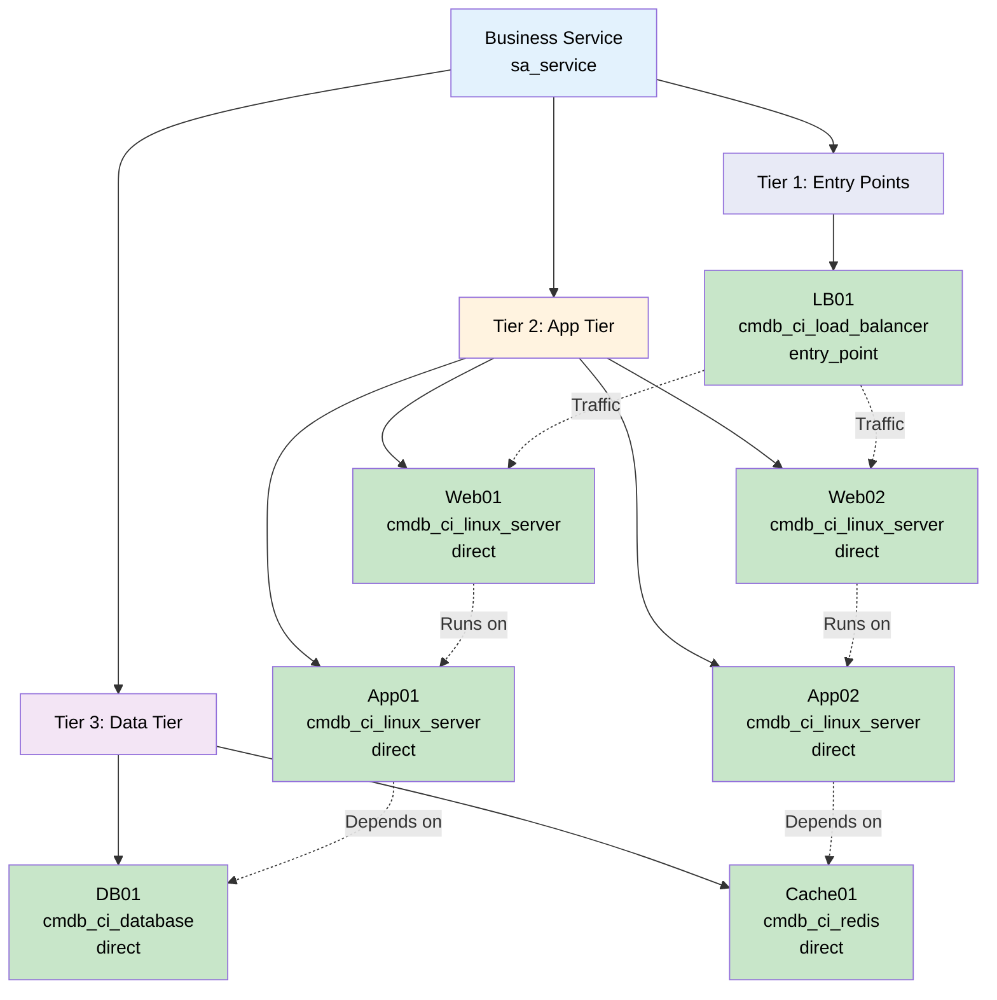

# Getting Started with Service Mapping

**Agent:** Kilo  
**Date:** 2026-11-19  
**Module:** Service Mapping  
**Prerequisites:** CMDB Foundation, Discovery (populated CIs), Event Management (for context)  
**Confidence:** high  

---

## Contents

- [Learning Objectives](#learning-objectives)
- [Prerequisites](#prerequisites)
- [Core Concepts](#core-concepts)
- [Service Mapping Architecture](#service-mapping-architecture)
- [Step-by-Step Setup](#step-by-step-setup)
- [Hands-On Labs](#hands-on-labs)
- [Troubleshooting Guide](#troubleshooting-guide)
- [Verification Checklist](#verification-checklist)
- [Next Steps](#next-steps)

---

## Learning Objectives

By completing this guide, you will be able to:

1. **Create** Business Services (`sa_service`) with tiers and criticality
2. **Run** Pattern-Based Service Mapping Discovery
3. **Understand** Traffic-Based Discovery (NetFlow/Stream)
4. **Build** Service Topology with entry points and dependencies
5. **Use** Change Impact Analysis for risk assessment
6. **Leverage** Now Assist for topology explanation and impact summary

---

## Prerequisites

| Requirement | Status |
|-------------|--------|
| CMDB Foundation completed | ✅ |
| Discovery populated infrastructure CIs | ✅ |
| `sm_admin` role | ✅ |
| MID Server with `service_mapping` capability | ✅ |
| Network access to application ports | 🔄 Prepare |

---

## Core Concepts

### Service Mapping Discovery Types

| Type | Description | Use Case |
|------|-------------|----------|
| **Pattern-Based** | Uses Discovery Patterns to traverse from entry point | Standard applications, known protocols |
| **Traffic-Based** | Analyzes network flows (NetFlow, Stream) | Unknown apps, microservices, cloud-native |
| **Horizontal** | Discovers applications on servers (Apache, Tomcat, DB) | Part of pattern-based, runs during exploration |
| **Vertical** | Traverses dependencies (App → DB, Web → App) | Builds service topology |

### Key Tables

| Table | Purpose |
|-------|---------|
| `sa_service` | Business Services (top-level) |
| `sa_ci_relationship` | Service ↔ CI links (with tier, relationship_type) |
| `cmdb_ci_service` | Technical Services (legacy, being replaced by sa_service) |
| `discovery_pattern` | Service Mapping patterns (type: `Service Mapping`) |

### Service Tiers

| Tier | Name | Description | Example |
|------|------|-------------|---------|
| **1** | Entry Point | User-facing access | Load Balancer, API Gateway |
| **2** | Business Logic | Application tier | Web Servers, App Servers |
| **3** | Data | Storage tier | Databases, Cache, Queues |
| **4+** | Infrastructure | Network, Storage, Compute | Switches, SAN, Hypervisors |

---

## Service Mapping Architecture



---

## Step-by-Step Setup

### 1. Verify Prerequisites

1. **Discovery Data:** Confirm CIs exist for your target application (Linux servers, databases, load balancers)
2. **MID Server:** **All > MID Server > Servers** → Verify capability `service_mapping` is listed
3. **Patterns:** **All > Discovery > Patterns** → Filter `Type = Service Mapping` → Verify OOTB patterns exist (Apache, Tomcat, MySQL, PostgreSQL, IIS, etc.)

### 2. Create Business Service

**All > Service Mapping > Application Services > New**

| Field | Example |
|-------|---------|
| **Name** | `Customer Portal` |
| **Criticality** | `1 - Mission Critical` |
| **Tier** | `1` (auto-set for top-level) |
| **Status** | `Active` |
| **Description** | `Customer-facing e-commerce portal` |

### 3. Define Entry Point(s)

**On Business Service form → Entry Points related list > New**

| Field | Example |
|-------|---------|
| **Type** | `TCP` (or `HTTP`, `HTTPS`) |
| **IP Address** | `10.0.1.10` (Load Balancer VIP) |
| **Port** | `443` |
| **Protocol** | `HTTPS` |
| **Credential** | Select MID Server credential for LB |

### 4. Run Service Mapping Discovery

**On Business Service form → Click `Discover`**

Options:
- **Pattern-Based:** Uses entry point + patterns (default)
- **Traffic-Based:** Requires NetFlow/Stream configuration

**Monitor:** **All > Discovery > ECC Queue** → Filter `Topic = Service Mapping`

### 5. Review Topology

**On Business Service form → Click `View Map`**

- **Map View:** Visual topology with tiers
- **List View:** `sa_ci_relationship` records
- **Verify:** Tiers assigned correctly, `relationship_type` = `direct`/`entry_point`

---

## Hands-On Labs

### Lab 1: Create Business Service (15 min)

1. **Create Service:** `Customer Portal`, Criticality 1
2. **Add Entry Point:** LB VIP `10.0.1.10:443`, HTTPS
3. **Verify:** Service appears in `All > Service Mapping > Application Services`

### Lab 2: Pattern-Based Discovery (45 min)

**Prerequisite:** Discovery has created CIs for LB, Web, App, DB tiers

1. **Run Discovery** on `Customer Portal` service
2. **Monitor ECC Queue:** Service Mapping probes → Pattern execution
3. **Wait for Completion** (5-15 min depending on size)
4. **View Map:** Verify topology:
   - Tier 1: LB (entry_point)
   - Tier 2: Web servers, App servers (direct)
   - Tier 3: Databases, Cache (direct)
5. **Check `sa_ci_relationship`:** Each CI linked with correct `tier` and `relationship_type`

### Lab 3: Traffic-Based Discovery (Optional, 60 min)

**Prerequisite:** NetFlow/Stream configured, MID Server with `netflow` capability

1. **Configure NetFlow:** **All > Service Mapping > Traffic-Based Discovery > NetFlow Config**
2. **Create Traffic-Based Service:** Same `Customer Portal`, select `Traffic-Based`
3. **Run Discovery:** Analyzes flows for 30+ minutes
4. **Compare:** Pattern-based vs Traffic-based topology (traffic finds unknown dependencies)

### Lab 4: Horizontal Discovery Verification (20 min)

1. **Open Web Server CI:** `cmdb_ci_linux_server` (Web01)
2. **Check Related CIs:** Should have `cmdb_ci_apache` child (Runs on::Runs)
3. **Open App Server CI:** Should have `cmdb_ci_tomcat` or similar
4. **Verify:** Horizontal patterns ran during Service Mapping discovery

### Lab 5: Change Impact Analysis (30 min)

1. **Create Change Request:** `All > Change > Create New`
2. **Configuration Item:** Select `App01` (app server CI)
3. **Submit** → **View Impact Analysis** (related list or button)
4. **Verify:** Shows `Customer Portal` impacted, Risk Score calculated
5. **Test Tier 1 Impact:** Change on LB → Higher risk score

### Lab 6: Root Cause Analysis Context (20 min)

1. **Simulate Alert:** Event Management alert on `DB01` (CPU critical)
2. **Open Alert:** Click **Service Impact** or **View Map**
3. **Verify:** Shows `Customer Portal` impacted, path: DB01 → App01/App02 → Web01/Web02 → LB → Customer Portal

### Lab 7: Now Assist Integration (30 min)

1. **Open Service Map** for `Customer Portal`
2. **Click Now Assist Panel** → **Explain Service**
3. **Verify Output:** Natural language tier breakdown, entry points, health
4. **Create Change Request** affecting `App01`
5. **Click Now Assist** → **Summarize Impact**
6. **Verify Output:** Affected services, risk narrative, mitigation suggestions

---

## Troubleshooting Guide

| Symptom | Likely Cause | Fix |
|---------|--------------|-----|
| Discovery never starts | Entry point not defined / MID Server down | Add entry point, verify MID Server Up |
| Discovery fails immediately | Credential failure / Port blocked | Test connectivity from MID Server |
| No CIs discovered | Patterns not triggered / Wrong entry point type | Verify entry point matches pattern trigger |
| Topology incomplete | Horizontal patterns missing / Exploration failed | Check pattern activation, MID capabilities |
| Wrong tier assignment | Pattern doesn't set tier / Manual override needed | Edit `sa_ci_relationship` tier manually |
| Change Impact shows nothing | CI not in service / Service Mapping not run | Re-run discovery, verify `sa_ci_relationship` |
| Traffic-based no results | NetFlow not configured / Wrong collector | Verify NetFlow config, MID Server netflow capability |

### Debug Commands (MID Server)

```bash
# Test connectivity to entry point
curl -k https://10.0.1.10:443

# Check Service Mapping pattern logs
grep "ServiceMapping" /opt/servicenow/mid-server/logs/agent0.log

# Verify pattern trigger
# In Pattern Designer: Check "Trigger" section matches entry point
```

---

## Verification Checklist

- [ ] Business Service created with Criticality and Tier
- [ ] Entry Point defined (IP, Port, Protocol, Credential)
- [ ] Pattern-Based Discovery runs successfully
- [ ] Topology shows 3+ tiers (Entry, App, Data)
- [ ] `sa_ci_relationship` records: correct `tier`, `relationship_type`
- [ ] Entry Point CI marked `is_entry_point = true`
- [ ] Change Impact Analysis shows affected services with risk score
- [ ] Root Cause Analysis shows service impact path
- [ ] Now Assist explains topology and summarizes change impact

---

## Next Steps

1. **Complete** [Orchestration Getting Started](../orchestration.md) — automate remediation
2. **Complete** [Cloud Management Getting Started](../cloudmanagement.md) — extend to cloud
3. **Review** [Service Mapping Deep Dive Guide](../../docs/modules/servicemapping/servicemapping-guide.md)
4. **Practice** CIS-Service Mapping exam questions (KB0011546)

---

## Quick Reference Card

```
SERVICE MAPPING QUICK REFERENCE

Discovery Types:
  Pattern-Based  → Entry point + patterns (standard apps)
  Traffic-Based  → NetFlow/Stream analysis (unknown/microservices)
  Horizontal     → App discovery on servers (part of pattern)
  Vertical       → Dependency traversal (builds topology)

Key Tables:
  sa_service              → Business Services
  sa_ci_relationship      → Service ↔ CI (tier, relationship_type)
  discovery_pattern       → Patterns (type: Service Mapping)

Service Tiers:
  1  → Entry Point (LB, API Gateway)
  2  → App Tier (Web, App servers)
  3  → Data Tier (DB, Cache, Queue)
  4+ → Infrastructure (Network, Storage)

Relationship Types:
  entry_point  → User-facing access (Tier 1 only)
  direct       → Direct dependency (Tier 2+)
  indirect     → Inferred/transitive

Entry Point Types:
  TCP          → Generic TCP port
  HTTP/HTTPS   → Web applications
  JDBC         → Database connections
  Custom       → Pattern-specific

Discovery Flow:
  1. Entry Point Probe → Identify entry CI
  2. Horizontal Patterns → Discover apps on entry CI
  3. Vertical Patterns → Traverse dependencies (App→DB)
  4. Build sa_ci_relationship → Assign tiers
  5. Complete → View Map

Change Impact:
  CI Change → sa_ci_relationship → sa_service → Risk Score
  Risk Factors: Tier, Criticality, Redundancy, Change Type

Now Assist:
  Explain Service      → Natural language topology
  Summarize Impact     → Change risk narrative
```

---

*Complete the labs in order. Use your PDI. Refer to the deep-dive guide for advanced topics.*