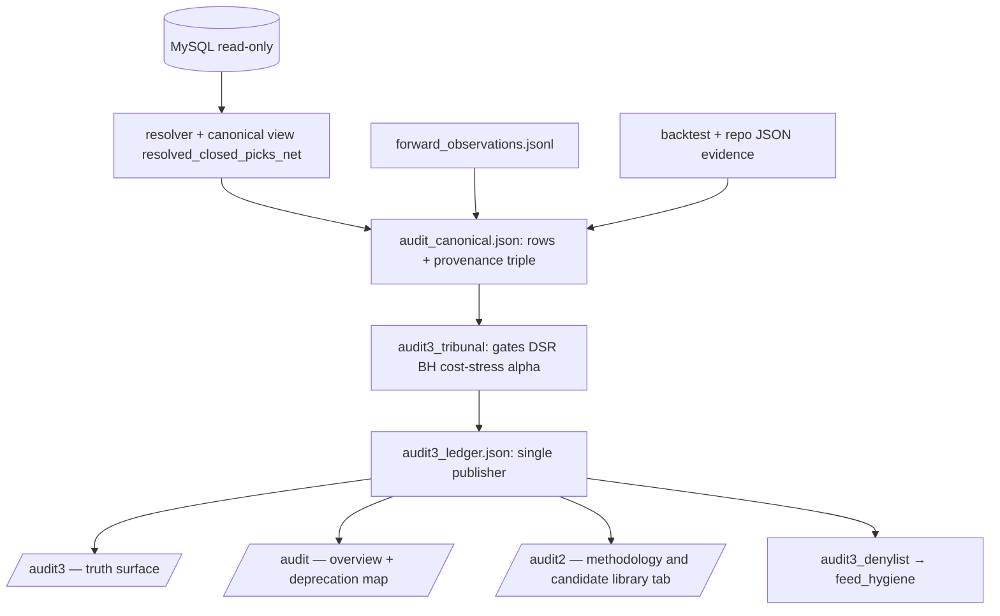

# Audit surface consolidation — fixes + test plan

**Date:** 2026-11-20 · **Author:** Zoo (architect) · **Status:** proposal, nothing implemented
**Scope:** `/audit`, `/audit2`, `/audit3`, their ledgers, their workflows, and the DB views feeding them.
**Governing rule:** no new strategy work until the measurement layer can be audited.

---

## 0. What the evidence says today

| Fact | Value | Where |
|---|---|---|
| Money-ready classes | 0 (`/audit` 0/11, `/audit3` 0/9, `/audit2` echoes) | three denominators, one product |
| PROVEN / CANDIDATE cells | 0 / 0 of ~359 | audit3 ledger |
| Selection alpha (decisive) | **−0.2763%/trade, CI [−0.506, −0.043], n=3,192** | `selection_alpha.overall` |
| Coverage | canonical 8,613/14,637 (58.84%) **vs** payload slice 3,500/16,330 (21.43%) | two ledgers, same name |
| Forward rows | 430, all H-119; POD-EQUITY-BREAKOUT 0 | `forward_gate` |
| Publishers of `audit3_ledger.json` | **two** (`audit3-ledger.yml` 6-hourly → `/audit3`; `audit-dashboard.yml` hourly → `/audit/data`) | measured lag 223 min |
| Sleeve layer | 0/10 sleeves verified against audit3 cells; CRYPTO sleeve PF 155.85 inside a class PF 0.8383 | `tools/sleeve_reconciliation.py` |

Cross-surface contradictions that a reader sees right now: COMMODITY `WATCH` vs `KILL`;
ETF win rate 1.9% vs 43.2%; kill counts 42 vs 11 vs 8; two forward-clock renderers on one
data source; three vintages of the same page presented as one current view.

None of this says the prediction work is worthless. It says the pages cannot currently tell
you which of their numbers to believe — and that is the cheapest thing to fix.

---

## 1. Target architecture — one source, three views



Rules that make it hold:

1. **One artifact, one writer.** `audit3-ledger.yml` is the only workflow allowed to produce
   `audit3_ledger.json`, and it uploads the same bytes to `/audit3/` and `/audit/data/`
   in one deploy step.
2. **One population.** Every tile on every page reads the canonical view. A page may show a
   slice, but it must label it as a slice and print the denominator.
3. **One provenance triple.** Each number carries `(population, cost_model, win_definition)`
   plus `provenance_id`. A tile without the triple fails the build.
4. **One trial counter.** The same `n_trials` feeds DSR, BH and Bonferroni in
   `audit3_tribunal.py`, `money_ready_verdict.py` and the emitter.
5. **One kill vocabulary, two labelled pipelines.** Keep the cell-gate verdicts and the
   legacy strategy-register verdicts separate, publish the union with provenance
   (`tools/kill_list_reconcile.py`), never merge them silently.

---

## 2. Fix backlog

### P0 — correctness and trust (do first, in this order)

| # | Fix | Why | Done when |
|---|---|---|---|
| P0-1 | Delete the `audit3_ledger.json` upload from `audit-dashboard.yml` | two publishers, one generation of lag, invisible to grep because the workflow globs `audit_dashboard/data/*.json` | one workflow writes the path; parity job green |
| P0-2 | Make `tools/assert_surface_parity.py` a hard CI gate (fail the build, not warn) | parity was RED at session end and nothing stopped it | a deliberately stale copy fails CI within one run |
| P0-3 | Coverage honesty: withhold any headline where `scored_rows > valid_closed_picks` (105.26%), keep `_raw`, reconcile the 430 H-119 rows | a ratio above 100% is not a rounding error | headline withheld or reconciled; denominator invariant tested |
| P0-4 | One money-ready count with one denominator, everywhere | 0/10 vs 0/9 vs echo is three answers to one question | every page shows the same `0/N` and the same N's definition |
| P0-5 | Derive `asset_class` from `symbol` in every aggregate; add a CI check that rejects FX symbols tagged CRYPTO | all 285 `bt_backtest_runs` are tagged CRYPTO, 4 BOND strategies too — every per-class number built on the column is wrong | zero FX under CRYPTO; `cross_db_consistency` green |
| P0-6 | Selection alpha becomes the per-class headline; raw PF and WR demoted to descriptors | it is the only metric that separates skill from beta, and it is negative | no page leads with WR |
| P0-7 | Rotate the leaked DB credential (human action) and scan `discord_*` columns for tokens before any distribution | a secret in git history is a secret | rotated; scan report committed with redactions |

### P1 — measurement quality

| # | Fix | Notes |
|---|---|---|
| P1-1 | Measured per-strategy slippage in audit3; correct FUTURES/COMMODITY constants | flat constants are above measured for CRYPTO/ETF (kills conservative) but below measured for FUTURES/COMMODITY |
| P1-2 | `required_n` from MDE/power, not the observed cell mean | current ETF value 1,745,345 is circular |
| P1-3 | Emit or intrabar-resolve the four EQUITY breakout strategies | 15 of 23 registered pod strategies are not emitted; the forward ingest rejects every row |
| P1-4 | Per-hypothesis forward-growth watchdog | silent non-accrual is the failure mode already found |
| P1-5 | Pin `/audit2` to one ledger path and add it to the parity assertions | it renders whichever entry of its fallback chain resolves first |
| P1-6 | `dsr_n_trials` on every bucket, floored for PROVEN | a DSR without a trial count is not a multiplicity correction |
| P1-7 | Sleeve cross-mark: a sleeve unreconciled against audit3 cells renders UNVERIFIED, never a PF |
| P1-8 | Retire the dead `tier2_proven_strategies` panel; one smart-picks definition; stamp vintage per tile | a proven panel with dead cards teaches readers to ignore labels |

### P2 — consolidation and hygiene

- Page consolidation per `docs/plans/2026-11-19-audit3-v2-evidence-and-success-metric-plan.md` P5:
  `/audit3` is the truth surface, `/audit` is an overview with a deprecation map, `/audit2`
  becomes a methodology/candidate tab (or redirects) — every old section maps to a cell or is
  documented as retired.
- Weekly `audit3-evidence.yml` (separate concurrency group, separate cron minute) ingesting
  `bt_backtest_runs`, `at_large`, `at_incubator` and the 77 repo JSONs with provenance.
- Canonicalise PBO (one CSCV implementation, threshold 0.5, `0.0` renders as *not computed*).
- Workflow hygiene: prune dormant/always-failing GHA jobs (`CI Tests` on dead branches,
  `QA Market Validation`), one cron owner per artifact, keep every new pipeline file in the
  AGENTS.md path registry in the same PR.

---

## 3. Test plan

### 3.1 Deterministic unit tests (fast, no DB, run in the normal CI job)

| Area | Test | Asserts |
|---|---|---|
| Parity | `test_surface_parity_fails_on_stale_copy` | injected 1-generation-old ledger → non-zero exit |
| Provenance | `test_every_tile_has_triple` | walk rendered tiles; each has population/cost_model/win_definition/provenance_id |
| Denominator | `test_scored_rows_le_valid_closed_picks` | `coverage.scored_rows == summary.n_rows` and ≤ valid closed picks |
| Publisher | `test_single_writer_per_artifact` | parse `.github/workflows/*.yml`; each deployed artifact path has exactly one producing workflow |
| Class labels | `test_asset_class_from_symbol` | `NZDUSD=X`, `AUDJPY=X`, `BTC-USD`/`BTCUSDT` → correct class, one instrument |
| Denylist | `test_denylist_direction_aware` | KILL LONG blocks LONG, not SHORT |
| Trial counter | `test_dsr_n_trials_matches_bucket_width` | DSR never published without `n_trials`; PROVEN requires the global floor |
| required_n | `test_required_n_is_mde_based` | a cell with a tiny mean cannot claim a million-row requirement |
| Kill lists | `test_kill_union_has_provenance` | union contains both pipelines with labels, no silent merge |
| Golden ledger | `test_ledger_rebuild_is_stable` | fixed payload → same ledger modulo timestamps and git sha |

### 3.2 Integration / end-to-end

- `tests/test_audit3_ledger_e2e.py` (exists) — CLI → ledger → schema, plus the persistence sidecar.
- `tests/test_audit3_cli_smoke.py` (exists) — every flag the workflows pass still parses.
  Note: `--help` exits inside argparse, so it can never be the sole evidence that `main()` works;
  keep the crash smoke test (`build_report(...)` on a one-row payload) alongside it.
- Focused suite at handoff:
  `python3 -m pytest tests/test_audit3_*.py tests/test_forward_observations*.py tests/test_resolved_closed_view.py tests/test_per_class_cost_gate.py -q`
  (expect 93+ passed once the open merge repairs land).

### 3.3 Live smoke (post-deploy, manual or scripted with `tools/wakeup_watch_20min.py`)

```bash
for u in /audit/ /audit2/ /audit3/; do curl -s -o /dev/null -w "$u %{http_code}\n" https://findtorontoevents.ca$u; done
curl -s https://findtorontoevents.ca/audit3/audit3_ledger.json | python3 -c \
 "import json,sys;d=json.load(sys.stdin);print(d['provenance']['id'],d['coverage']['scored_rows'],d['summary']['n_proven'])"
curl -s https://findtorontoevents.ca/audit/data/audit3_ledger.json | sha256sum   # must equal the /audit3 copy
```

Acceptance: three pages 200; `/audit/data/audit3_ledger.json` and `/audit3/audit3_ledger.json`
have identical sha256 and `generated_at`; provenance carries `generator_version`, `input_sha256`,
`git_sha`.

### 3.4 Fail-injection (proves the guards are load-bearing)

| Inject | Expect |
|---|---|
| Re-add the second publisher | P0-1 test red |
| Ship a tile without the triple | build fails |
| Tag `AUDJPY=X` as CRYPTO | class-label CI red |
| Freeze the forward ledger for 7 days while eligible rows exist | watchdog red |
| Publish DSR at `n_trials=1` for a class | DSR floor test red |

### 3.5 Manual review checklist (a human, each page)

- Name the provenance triple of any tile you point at.
- Every headline stat: can you tell which population it is?
- No two tiles on one page contradict each other; if they do, is the divergence labelled?
- Kill list: is each entry labelled with its pipeline?
- Vintage: is each stale number dated where it is shown?

---

## 4. Sequence

1. **Stop the bleeding** — P0-1, P0-2 (a day's work, immediately removes the lag and the silent staleness).
2. **Make the denominator honest** — P0-3, P0-4, P0-5 with their tests.
3. **Change the headline** — P0-6, P1-6, P1-7 (alpha, trial counts, sleeve honesty).
4. **Consolidate the pages** — P2, after the numbers agree, so we are not merging three ledgers into one confusing page.
5. **Feed the forward clock** — P1-3, P1-4, then re-evaluate whether any class deserves a pod.

## 5. Explicit non-goals

- No new strategy hunting until steps 1–3 are green.
- No promotion to real money; the audit3 forward gate decides that (n≥100 forward rows,
  net CI > 0 at 2× measured slippage, DSR ≥ 0.95), and nothing is close.
- No deletion of strategy evidence to make the numbers look better.
