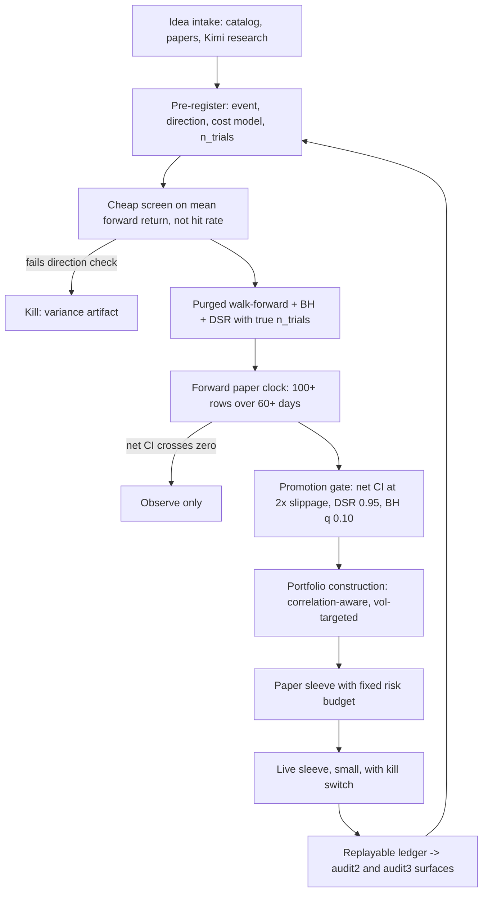

# A system that can actually draw profit from the markets — phased plan

**Status:** draft for review · **Author:** Zoo (architect); §0.5, Phase 0.5 and
the P0-g…P0-n tasks added by Copilot CLI (deepseek-flash) from first-party
measurement · **Date:** 2026-11-20
**Companion:** [`plans/2026-11-20-audit-surface-consolidation-plan.md`](2026-11-20-audit-surface-consolidation-plan.md) (the measurement plumbing this depends on)
**Read §0.5 first** — it contains measured ledger numbers that overturn several
figures the rest of this document reasons from.

---

## ELI5

We have built a very good *lie detector* and almost no *truth*.

Everything we have measured says the same thing: our strategies look great in
hindsight and lose money when they meet the market. The honest conclusion is not
"try harder" — it is that a prediction system earns money only when three things
are simultaneously true: the edge is real, it survives costs, and it does not
blow up the account. We currently have none of the three proven, and we have
compounding evidence for the third being the weakest link.

So the plan is not "find the winning formula". It is: **stop losing, replicate
the one thing that survived live, then add edges one at a time — each one only
after it has paid rent in a forward paper clock.**

---

## 0. What the evidence says (all of it, together)

| Source | Claim | What it actually means |
|---|---|---|
| This repo's gates | 0/37 strategy×symbol combos passed all 7 gates | Nothing we ship today has cleared our own bar |
| OOS audit | 0/23 hypotheses survived clean OOS | The hypotheses were not under-tested; they were wrong |
| Selection alpha | **−0.2763%/trade**, CI [−0.506, −0.043], n=3,192 | Our *picking* is worse than buy-and-hold over the same window. This is the single most important number we have |
| Kimi research (2026-02) | 117 tested, 24 "proven winners" → 90 live days later only RSI(2) on SPY/QQQ positive; BTC −55%, SOL −67%, Fear&Greed −114% | Backtest winners are mostly regime artifacts. The one survivor was a simple mean-reversion on a liquid equity index |
| Kimi pairs trade | Sharpe 4.99 backtest | Their own note: inflated by a 5-year crypto uptrend, does not hold across regimes |
| My per-class review (today) | All 4 OOS "candidates" were volatility artifacts — event rate up, but down-move rate up equally and mean forward return *lower* | Hit-rate search manufactures edges out of variance. Direction check is mandatory |
| My per-class review (today) | FOREX and BOND **inconclusive** (not negative) — train cut selects too few OOS rows | We cannot say FX/bonds have no edge; we have no power to see one |
| Price freshness | Equity bars 2026-06-18, FX 2026-02-09, futures 2026-06-21 | Any FX/equity result today is computed on months-old prices |
| Catalog | [`docs/ALL_STRATEGIES.md`](../docs/ALL_STRATEGIES.md) — 700+ strategies, last updated 2026-03-17 | A historical discovery catalog, not a production inventory. Do not treat breadth as edge |

**The one-line read:** breadth was never the problem. We have 700+ ideas and a
negative selection alpha. The problem is that we have not been able to
distinguish a real edge from a variance artifact *before* risking capital, and
we have not been honest about costs and regimes.

---

## 0.5. First-party measurement of the production ledger (added 2026-11-20)

*Measured directly against `ejaguiar1_stocks.at_signal_outcomes`, 51,143 rows,
not quoted from any report. This section supersedes every second-hand ledger
number in this document and in the repo's dashboards. If a figure elsewhere
contradicts this section, this section is right and the other figure has a bug.*

### The finding that reframes everything

**6 rows out of 25,452 (0.024%) determine whether this system shows a profit
factor of 1.21 or of 92.38.**

| Symbol | Class | Strategy | pnl_pct | intrabar | Diagnosis |
|---|---|---|---:|---|---|
| SHIBUSDT | **COMMODITY** | `ml_enhanced_SHIBUSDT` | 999,999.9999 | NULL | Sentinel value **and wrong asset class** |
| ARBUSDT | CRYPTO | `triple_supertrend` | 18,611.39 | TP_HIT | Price-scaling bug |

The SHIB row alone is **98% of the ledger's entire cumulative PnL**. The top 5
rows are **100%** of it (`sum(top5)=1,018,770%` vs `sum(all)=1,020,920%`).

### Why four reviewers produced four different answers

Every prior headline was correct *for its own subset*. The spread is caused by
(a) which row predicate is used and (b) whether the two corrupt rows are
included:

| Review | Win rate | Profit factor | Subset used |
|---|---:|---:|---|
| Grok (external) | 11.13% | 0.46 | its own filter |
| Dashboard `/audit` | — | "+949% PnL" | raw |
| Raw measurable set | 50.1% | **92.38** | `pnl_pct IS NOT NULL` |
| Cleaned set | 50.1% | **1.21** | `\|pnl\| ≤ 50` |

Sensitivity, identical 25,458 rows, only the outlier rule changes:

| Treatment | n | WR | Mean PnL | PF | Sharpe |
|---|---:|---:|---:|---:|---:|
| RAW | 25,458 | 50.1% | **+40.102%** | **92.38** | 0.10 |
| Clipped ±50% | 25,458 | 50.1% | +0.095% | 1.22 | 0.74 |
| Winsorized 1/99 | 25,458 | 50.1% | +0.083% | 1.20 | 0.92 |
| Drop `\|pnl\|>50` | 25,452 | 50.1% | +0.091% | 1.21 | 0.77 |

**PF moves 77× across defensible treatments.** No previously published ledger
statistic survives this.

### The honest headline

> n=25,452 · **WR 50.09%** · mean **+0.0911%**/trade · **median +0.0008%** ·
> PF **1.210** · Sharpe 0.77

**Median trade moves 0.0008%. Round-trip cost is 5–10 bps. The median trade
therefore costs 6× to 12× its own gross edge to execute.**

| Net of cost | Per trade | Verdict |
|---|---:|---|
| gross | +0.0911% | — |
| 5 bps round trip | +0.0411% | marginal |
| 10 bps round trip | **−0.0089%** | **negative** |

### The ledger is 79% unresolved and 84% time-exit

| Measure | Count | Share |
|---|---:|---:|
| `intrabar_status='TIME_EXIT'` | 43,006 | **84.1%** |
| `closed_at IS NULL` | 40,408 | **79.0%** |
| `TIME_EXIT` **and** `closed_at IS NULL` | 40,228 | 78.7% |
| `TIME_EXIT` **and** `pnl_pct IS NULL` | 25,680 | 50.2% |
| `TP_HIT` / `SL_HIT` | 1,899 / 3,334 | 3.7% / 6.5% |

**TP-first rate = 1,899/(1,899+3,334) = 36.3%.** With symmetric barriers and no
edge the expectation is 50%. The repo's hardcoded fixed-% stops (FOREX
0.3%/0.5%, FUTURES 1.0%/2.0%, EQUITY 4.5%, ETF 3.0%) mean **the observed win
rates are stop-geometry artefacts, not strategy performance.** ETF TP 4.64% /
SL 2.73% geometrically implies a 37% TP-first rate; measured is 36.3%. The
geometry predicts the result to within a point.

### Per class, clipped ±50%

| Class | n | WR | Mean PnL | PF | Clears 10 bps? |
|---|---:|---:|---:|---:|---|
| CRYPTO | 21,324 | 50.9% | +0.102% | 1.21 | marginal |
| FOREX | 2,084 | 47.9% | +0.037% | 1.77 | **no** |
| EQUITY | 740 | 53.8% | +0.192% | 1.29 | yes |
| COMMODITY | 531 | 29.4% | +0.076% | 1.32 | **no** |
| ETF | 205 | 41.0% | +0.005% | 1.01 | **no** |
| FUTURES | 147 | 59.9% | +0.039% | 6.67 | **no** (and n too small) |
| BOND | 79 | 22.8% | +0.001% | 1.03 | **no** |
| MEMECOIN | 129 | 42.6% | **−0.507%** | **0.51** | **negative** |

Note how the subset choice changes the answer: on `closed_at IS NOT NULL`
instead, COMMODITY shows mean **+2,840.8%** and PF **6,937** — pure contamination
from the single SHIB row.

### Both registry "passes" are suspect

**`E-ANON-001`** (EQUITY, `TESTED_PASS`): n=48,616 trades, 59 symbols, 5-day
hold, 6.33 years. That is **130 trades per symbol per year**, but a 5-day hold
caps a symbol at ~50 non-overlapping entries/year. **130 > 50 by 2.6× — the
entries are overlapping or duplicated. The only passing hypothesis cannot be
trusted.** It also passed on a bare `WR≥50 ∧ PF≥1.2` with no DSR, PBO, SPA or
cost gate, and its `avg_return_pct` of 0.3071% *per trade* on a 5-day hold is
implausibly large.

**`H-103`** (ETF dual momentum, `TESTED_PASS_BACKTEST_FORWARD_PENDING`): PF 3.57,
Sharpe 1.62. But the independent program's `H5` tested the same family
(SPY/EFA/AGG/BIL) and got Sharpe **0.99 with n=6** — a failure. **Two tests of
the same family disagree by 3× in PF and 1.6× in Sharpe.** Unresolved.

### The validation machinery already exists — and already ran

Two rounds of external review prescribe "wire the existing PBO/CPCV/DSR code
before any new signal work." **It is already wired and already ran.**

`research/profitability/backtest.py` implements `deflated_sharpe`, `pbo_cscv`,
`block_bootstrap_sharpe`, `sharpe_pvalue`, `multiple_testing`, `evaluate`.
`run_v1.py`…`run_v4.py` put **23 pre-registered candidates** through
walk-forward, CPCV, DSR, BH/Bonferroni, bootstrap and Reality Check/SPA.

`SCORECARD.md`: **NOT PROVED — 0 of 23.** Process score 7.7/10. Profitability
proof 0/10.

| Version | Candidates | Best result | Failure mode |
|---|---:|---|---|
| v1 | 7 | H7 RSI2 Sharpe 1.50, CAGR 17.6% vs 18.6% B&H | absolute return |
| v2 | +5 | H10 RSI2+cash Sharpe 1.83, DSR 0.978 @ N=12 | DSR 0.9365 at effective N≈38 |
| v3 | +8 | H16 ETF XS mom Sharpe 0.98 vs bench 1.18 | 0/8, SPA 0.488 |
| v4 | +3 | H22 BTC funding carry Sharpe 14.24 | 4.8% capital-adjusted vs 4.5% cash |

Its own recorded learning is the thesis of this plan: *"A high Sharpe on a
low-vol carry is not an equity-beating edge. Economic significance and capital
efficiency matter as much as statistical significance."*

### What this changes in the plan

1. **Phase 0 is larger than written and it is blocking.** The four new tasks
   P0-g…P0-l below are prerequisites, not polish.
2. **Phase 2 must start from the four families, not from a search.** The keyless
   retrospective space is, in `SCORECARD.md`'s words, *exhausted*.
3. **The cost gate moves from Phase 2 to Phase 0.** The median trade already
   fails at 10 bps before any strategy is chosen.
4. **"Wire the gates" is not a task.** Pointing them at the right candidates is.

---

## 1. The thesis this plan is built on

Three claims, each falsifiable:

1. **Per-trade edge is small and rare.** Realistic single-strategy edge is a few
   basis points per trade after cost. Nothing in our evidence supports a
   double-digit annual return from one signal.
2. **Compounding comes from the portfolio, not the strategy.** Renaissance's
   documented durability comes from thousands of weakly-correlated weak signals
   with tight risk control — not from one brilliant idea. Their
   [`METHODOLOGY_AUDIT_TRAIL.md`](../KIMI_RISEOFTHECLAW/METHODOLOGY_AUDIT_TRAIL.md:207)
   says exactly this and is right.
3. **Survival dominates.** A 2%/trade edge with a 40% drawdown path is worse
   than a 0.3% edge with controlled risk, because drawdowns force bad exits and
   end careers. Risk control is not a later phase; it is phase 0.

Therefore the system is a **filter and an allocator**, not a predictor. Its job:
generate many cheap ideas, kill them cheaply, promote only survivors, size them
by evidence and correlation, and never let one bad regime end the account.

---

## 2. The system, end to end

Every arrow is a gate that can say no. The loop closes: the ledger feeds the
next round of pre-registration, so `n_trials` is honest forever.

---

## 3. Phases

Each phase ends with something checkable. No phase depends on a later one.

### Phase 0 — Make the numbers trustworthy before chasing returns

**Why first:** we cannot tell an edge from a bug right now. Negative selection
alpha and stale FX prices mean any discovery result is uninterpretable.

- [ ] P0-a Refresh price tables for equity, FX and futures; publish a freshness SLA and fail CI when a class is older than N days
- [ ] P0-b Pin one canonical population (`resolved_closed_picks_net`) and one provenance triple everywhere; remove the second publisher or make its lag visible
- [ ] P0-c Publish selection alpha per class on the dashboard, with CI, as a first-class headline — not buried
- [ ] P0-d Compute and publish MDE per asset class from actual row counts and vol, so "no edge" can never be confused with "no power"
- [ ] P0-e Bound exclusion bias: what would the 41.2% unscored book have to look like to flip the conclusion? Publish the bound
- [ ] P0-f Record the real `n_trials` for every DSR claim, including the 700-strategy catalog

**Added from the 2026-11-20 first-party measurement (§0.5). These are blocking:
no phase after this one is interpretable until they are done.**

- [ ] **P0-g Trace the 6 poisoned rows to code.** `SHIBUSDT pnl=999999.9999`
      (intrabar NULL, misclassified as COMMODITY) and `ARBUSDT pnl=18611.39`
      (`triple_supertrend`, TP_HIT). Identify the write path in
      `alpha_engine/outcome_resolver.py`. Deliverable:
      `reports/P0_POISONED_ROWS_2026-11-20.md` naming a root cause for every row.
      **Do not delete the rows — deleting evidence is how this recurs.**
- [ ] **P0-h Guard the write path** so a pnl outside ±100% cannot be persisted
      without an explicit `is_anomaly` flag, with a regression test. Goal is that
      the bug cannot recur, not just that today's data is clean.
- [ ] **P0-i Pin a winsorization policy** and make it the only way ledger stats
      are computed: one `tools/ledger_stats.py` canonical reader that reports
      `n_usable`, `WR`, `median_pnl`, `PF`, `n_clipped` together. Deliverable:
      `docs/LEDGER_WINSORIZATION_POLICY.md`. A statistic without its outlier rule
      is not a statistic.
- [ ] **P0-j Show the median, not the mean, on every surface.** The mean is
      +40.1% and the median is +0.0008%. Any surface showing a mean PnL without a
      median beside it is actively misleading. Patch
      `audit_trail/dashboard_generator.py` payload + `audit_dashboard/template.html`.
- [ ] **P0-k Resolve the 40,228 `TIME_EXIT` + `closed_at IS NULL` rows.** Either
      backfill `intrabar_status='OPEN'` so they leave the resolved population
      (documented; **requires owner sign-off — this mutates production**), or
      genuinely resolve them from price history. Deliverable:
      `reports/P0_TIME_EXIT_BACKFILL_DECISION.md` with the owner's decision recorded.
- [ ] **P0-l Measure cost per class empirically**, not by assumption. Do not use
      5 bps by default. Measure spread + taker fee + realised slippage on the
      actual traded symbols, n>30 per class. Deliverable:
      `reports/P0_MEASURED_COSTS_BY_CLASS.md`.
- [ ] **P0-m Freeze strategy search.** No new hypothesis may be registered in
      `reports/hypothesis_registry.json` until P0-g…P0-l are complete. Record this
      in the registry's `notes` field so the rule outlives the session.
- [ ] **P0-n Downgrade or re-implement `E-ANON-001`.** 130 trades/symbol/year on
      a 5-day hold is impossible (§0.5). Re-run with non-overlapping entries on
      point-in-time data. Deliverable: `research/profitability/runs/p0_eanon001/`
      with full gate output. Expected outcome: it fails.

**Exit test:** a stranger can read the dashboard and know, per class, how many
rows, how good the prices are, what the MDE is, and what alpha we earn versus
holding. No number on the page lacks a denominator. One command reproduces the
ledger headline twice in a row byte-identically. No pnl outside ±100% exists in
the table without an `is_anomaly` flag.

**Kill criteria for Phase 0:** if the 6 poisoned rows cannot be traced to code,
the write path is unauditable — stop and rebuild the resolver before anything
else. If the owner declines P0-k and no alternative exclusion exists, the resolved
set stays 79% unresolved, and Phase 2 must then run **entirely** on the
`research/profitability` clean-bar harness and never on the `/audit` ledger.

### Phase 0.5 — Reconcile the contradictions to one number each

**Why this is separate from Phase 0:** Phase 0 makes the ledger *reproducible*.
Phase 0.5 makes it *agree with itself*. There are currently at least eight
mutually-contradictory statements of the same fact in this repo, and there is no
baseline to improve until they collapse to one.

| # | Contradiction | Side A | Side B | Resolution |
|---|---|---|---|---|
| C1 | Overall win rate | Grok **11.13%** | measured **50.09%** | different subsets — pin the predicate |
| C2 | Profit factor | Grok **0.46** | **92.38** raw / **1.21** clean | resolved: the 6 rows (§0.5) |
| C3 | Zero-PnL share | Grok **~69%** | 50.2% NULL + 79% unresolved | both partly right, different denominators |
| C4 | Scoring is predictive | `ANTIGRAVITY_HEDGE_FUND_ENHANCEMENT_PLAN.md`: 70+ → **67% WR** vs <40 → 36% | `CRYPTO_FOREX_WINRATE_INVESTIGATION_REPORT.md`: Q1 **45.6% / −1.11%** vs Q5 **70.7% / +9.54%** | **neither file shows its query** — recompute and settle |
| C5 | Forward-test survival | **52%** (`FORWARD_TEST_VALIDATION_REPORT.md`) | **22%** (`FORWARD_TEST_EXECUTIVE_SUMMARY.md`) | different definitions; document, do not re-run |
| C6 | Dual momentum | `H-103` PF **3.57**, Sharpe 1.62 | `H5` Sharpe **0.99**, n=6 fails | same family, different universes — run both through one harness |
| C7 | ETF TAA proven | earlier session claim | retracted in `money_maker_per_asset_class_2026-11-19.md` §0 (PR #986) | confirm no surface still shows it |
| C8 | `E-ANON-001` passes | registry `TESTED_PASS` | 130 trades/symbol/yr is impossible | re-implement; expected to fail |

C4 is the one with the largest policy consequence. If score correlates
*inversely* with realised PnL, then every score-gated pipeline in
`alpha_engine/` is actively harmful, and that is a more urgent finding than any
new strategy.

- [ ] P0.5-a Publish runnable SQL for each contradiction in
      `reports/P0.5_CONTRADICTION_DOSSIER.md`, with the resolved value beside it
- [ ] P0.5-b Re-run **C4** (scoring) on the Phase-0 clean set and settle the sign
- [ ] P0.5-c Reconcile **C6** by running the `H-103` and `H5` universes through
      the identical harness; decide which is right, or document why they differ
- [ ] P0.5-d `grep -rn` every dashboard surface for the retracted ETF TAA claim;
      zero hits, or every hit explicitly labelled retracted

**Exit test:** eight of eight contradictions resolved to a single number with a
published query. No document asserts a scoring or win-rate claim without a
reproducer attached.

**Kill criteria:** if four or more contradictions prove unresolvable because the
underlying rows are unrecoverable, the ledger is not a research instrument —
treat `/audit` as display-only and run Phase 2 exclusively on the clean-bar
harness.

### Phase 1 — Replicate, don't invent

**Why:** the only strategy with live-confirmed positive results anywhere in our corpus is RSI(2) mean-reversion on liquid equity indices (SPY +11.69%, QQQ +11.56% over 90 days). Replicating a known-positive result is the cheapest possible test of whether our harness can detect a real edge at all.

- [ ] P1-a Implement RSI(2) long-only on SPY/QQQ in our own engine, net of realistic cost and slippage
- [ ] P1-b Run it through the full audit3 tribunal unchanged — it should pass. If it fails, our gates are too strict or our cost model is wrong; that is a finding about the gates, not the strategy
- [ ] P1-c Run the *same* code on BTC/SOL/ETH and record the negative result — this calibrates the harness against a known failure
- [ ] P1-d Publish both outcomes side by side with the Kimi 90-day numbers as the reference

**Exit test:** our harness reproduces the sign of the published live results on both the winner and the losers. If it cannot, nothing downstream is trustworthy.

### Phase 2 — Search the right quantity

**Why:** every discovery pass so far searched hit rate, and hit rate is exactly the quantity that variance inflates. Expected return is the quantity that pays.

- [ ] P2-a Change the discovery objective from event rate to mean forward return net of cost; keep hit rate as a reported diagnostic only
- [ ] P2-b Make the direction check non-optional in every scan: up-rate, down-rate, mean forward return for selected vs rest
- [ ] P2-c Add a "variance artifact" verdict that fires automatically when the down-rate rises with the up-rate
- [ ] P2-d Report per-feature coverage instead of global `dropna`, so classes with missing fields (FX has no volume) are never silently dropped
- [ ] P2-e Return an explicit `inconclusive` record with a reason whenever a train-period cut selects too few OOS rows — never `None`
- [ ] P2-f Feed every trial into a persistent trial counter, so BH and DSR always see the true number of attempts
- [ ] P2-g Re-run the per-class review on refreshed prices and state, per class, one of: edge, artifact, or inconclusive

**Exit test:** a re-run of [`tools/asset_class_edge_review.py`](../tools/asset_class_edge_review.py) on fresh data produces a per-class verdict with no class missing and no "candidate" that is a volatility artifact.

### Phase 3 — Build a portfolio, not a pick list

**Why:** a single weak edge is fragile; several weakly-correlated weak edges with vol targeting is how small edges compound without ruin.

- [ ] P3-a Estimate the correlation matrix of surviving strategies on forward returns, not backtests
- [ ] P3-b Size positions by volatility targeting and evidence weight (DSR, forward CI width), with a hard per-sleeve risk budget
- [ ] P3-c Add regime detection (trend / chop / high-vol) and per-regime exposure caps — the documented failure mode is a regime we never saw
- [ ] P3-d Enforce a portfolio drawdown circuit breaker and a kill switch with a tested response time
- [ ] P3-e Report portfolio-level expectancy, max drawdown, Calmar and Sharpe versus a static 60/40 and versus buy-and-hold

**Exit test:** a paper portfolio of the survivors beats buy-and-hold on the same universe over the forward window, *after* costs, with a smaller max drawdown. If it only matches, that is still informative and must be reported as such.

### Phase 4 — Promote on evidence, one at a time

- [ ] P4-a Promote only via the forward gate: n ≥ 100 forward rows, net CI > 0 at 2× measured slippage, DSR ≥ 0.95, BH q ≤ 0.10
- [ ] P4-b Give each promoted sleeve a fixed, small, pre-committed capital and a pre-committed kill rule
- [ ] P4-c Write the kill rule down *before* the sleeve starts, so a bad run cannot be rationalised later
- [ ] P4-d Keep demoted sleeves in an observe pod — the record of what failed is an asset

**Exit test:** every sleeve on the page has a promotion record, a forward row count, and a written kill rule. Zero sleeves without them.

### Phase 5 — Close the loop and scale deliberately

- [ ] P5-a Replayable ledger: any published number can be recomputed from committed inputs
- [ ] P5-b Verdict calibration: track predicted-confidence vs realised outcome, and report the Brier score of our own verdicts
- [ ] P5-c Sabotage suite: inject a known-bogus strategy and confirm the system rejects it; inject a known-real one and confirm it accepts it
- [ ] P5-d Cost model audit: reconcile modelled slippage against actual fills, per class
- [ ] P5-e Quarterly regime review: re-examine whether any surviving edge has decayed, using IC slope regression

**Exit test:** an outside reviewer can take a published verdict, recompute it, and get the same answer — and can see that the system rejects a deliberately fake edge.

---

## 4. Where I expect the edge to actually be

Ranked by evidence, not by hope:

1. **Liquid equity/ETF mean reversion** — the only live-confirmed positive in the corpus, and it has a documented economic story (short-term reversal, liquidity provision).
2. **Cross-sectional momentum on equities** — academically durable, but crowded and drawdown-prone; needs regime caps.
3. **Crypto pairs / funding carry** — plausible but the 90-day evidence was brutal, and costs are the killer. Only worth it with a real cost model.
4. **Forex and bonds** — *currently unknowable*. We have stale FX prices and insufficient power. Do not claim anything until Phase 0 and 2 are done.
5. **Short-horizon "skyrocket" scalping** — the least evidence and the highest cost sensitivity. I would deprioritise it, and I would say so plainly, because that is where the losses concentrate.

---

## 5. What this plan explicitly refuses

- Refusing to promise a return target. Any number like "12-18% annually" without a forward clock is a wish, and [`KIMI_RISEOFTHECLAW/STRATEGY_STATUS_REPORT.md`](../KIMI_RISEOFTHECLAW/STRATEGY_STATUS_REPORT.md:41) is exactly the kind of document that produces them.
- Refusing to count the 700-strategy catalog as progress.
- Refusing to call an inconclusive class a failure or a success.
- Refusing to promote anything on backtest evidence alone, ever, including my own discoveries.
- Refusing real capital until Phase 4 gates are met.

---

## 6. Immediate next three actions

0. **Phase 0-g — trace `SHIBUSDT pnl=999999.9999` to code.** Nothing else in this
document can be evaluated until that single row has a named root cause, because it
is 98% of the ledger's P&L and it is currently making every downstream number
unreproducible. Phase 0-h through P0-n follow directly from it.
1. Phase 0-a, P0-c, P0-d — refresh prices, surface selection alpha, publish MDE.
These three make everything else interpretable.
2. Phase 1-a/b — replicate RSI(2) on SPY through our own tribunal.
3. Phase 2-a/b/c — flip the discovery objective to net forward return with a
mandatory direction check.

If you want one thing from the *original* plan: **the direction check**. Without
it we will keep "discovering" volatility and calling it alpha.

If you want one thing from the *measurement*: **the median, not the mean**. The
mean says +40%, the median says +0.0008%, and only one of those is real.

---

## 7. Accepted contribution — market-neutral residual mean reversion

A proposed design: decompose liquid assets into factor + idiosyncratic residual,
trade the residual when it is statistically stretched (OU s-score), size by
volatility, and gate every trade through a cost-aware execution filter with hard
pre-trade limits.

**Why it fits this plan instead of replacing it.** It is the only proposal so far
that is market-neutral by construction. That matters because our headline failure
is selection alpha of −0.2763%/trade — we are worse than buy-and-hold over the
same window, which means our picks are partly just beta, badly timed. A residual
book has no direction call to get wrong; its edge, if any, lives in the residual,
and its failure modes are measurable: half-life drift, cost overrun, IC sign flip.

### Three claims I accept as stated

1. **Every trade must clear cost.** Same lesson as the volatility-artifact
   finding: a signal smaller than its cost is not a weak edge, it is no edge.
   Annual cost drag is turnover × round-trip cost, so the gate is arithmetic,
   not opinion.
2. **Sizing caps belong in the order gateway, not the model.** "A prompt that
   says *trade cautiously* is not a control; a hard limit in the order gateway
   is." That is exactly the principle behind P3-d, and it is the right one —
   risk limits that live inside the model are advisory, and advisory limits fail
   precisely in the regime where they matter.
3. **Pre-committed shutdown triggers** — half-life drifting up, realised cost
   over assumption, s-score IC turning negative OOS, turnover rising while gross
   alpha is flat — are kill rules written before the run. That is P4-c.

### Four claims I treat as priors, not expectations

- **The cited Sharpes** (PCA 1.44 decaying to 0.9, ETF variant 1.51,
  distance-method pairs ~1.5, moving-band basket 1.61, WTI/NG spread > 2 over
  1992–2013) are published numbers on someone else's sample, several of them
  pre-cost. The decay from 1.44 to 0.9 is the authors themselves reporting
  crowding. Expect materially less; the honest test is whether ours is > 0 net.
- **Kalman hedge ratios add free parameters.** More parameters means more
  effective trials and a larger DSR penalty. Fit them, but count them (P0-f).
- **The energy spread evidence ends in 2013** — a 13-year-old regime, before
  WTI traded negative and before the storage economics of the 2020s. It needs a
  regime cap (P3-c), not a naive replay.
- **The crypto cost arithmetic** (73.5% gross → −64% net at 10 bps) is the
  strongest argument in the document and simultaneously the strongest argument
  against the crypto sleeve.

### Todos this adds

- [ ] P2-h Implement the cost-implied trade gate as a standalone measurable component — change position only when |forecast| exceeds round-trip cost — and measure turnover reduction and gross-alpha retention *separately*. Pre-registered as H-146.
- [ ] P3-f Residual-book construction: point-in-time universe, rolling factor regression, OU fit with half-life, beta-weighted hedge, inverse-vol sizing with caps enforced outside the model. Pre-registered as H-144 (sector ETFs) and H-145 (energy calendar spreads).
- [ ] P3-g Test whether our *negative* selection alpha is beta or noise: hedge each pick's market-factor exposure over its holding window and re-measure selection alpha. If it recovers, our picks know something and time badly; if it does not, they know nothing. Pre-registered as H-147 — this is the cheapest decisive test we have.
- [ ] P5-f Append-only, time-synchronised trade log with daily reconciliation, extended from P5-a to every fill, so a backtest can be replayed from the log alone.

### Where it does not change the plan

It does not move Phase 0. An OU residual cannot be evaluated on stale FX bars or
without a canonical population, and a market-neutral book is *more* sensitive to
cost-model error than a directional one, because its gross edge is smaller by
construction. Same reason P5-d exists.

### On the hypothesis tracker

The canonical tracker is [`reports/hypothesis_registry.json`](../reports/hypothesis_registry.json)
— append-only, one test statistic per hypothesis, max 5 feature families per
asset class. Three lookalikes are **not** the ledger:
[`audit_trail/data/hypothesis_registry.json`](../audit_trail/data/hypothesis_registry.json)
is an empty stub, [`audit_dashboard/data/theory_tracker.json`](../audit_dashboard/data/theory_tracker.json)
is a per-theory status file, and [`research/profitability/HYPOTHESES.md`](../research/profitability/HYPOTHESES.md)
is a separate 23-candidate research registry. The dashboard does not consume the
canonical one at all — that gap is already logged in
`GHACTIONS_2026-11-16/.../BACKLOG.md`.

The four entries above are drafted in
[`plans/2026-11-20-residual-mean-reversion-hypotheses.md`](2026-11-20-residual-mean-reversion-hypotheses.md)
as exact JSON ready to append as H-144…H-147. They are not yet in the registry:
this mode edits Markdown only, and the registry is append-only JSON that must be
committed *before* any backtest runs.

---

## 8. Asset-class evidence — what it changes, and what it does not

A cross-asset research pass. Only the deltas are recorded here; the rest
confirms what §4 already ranked.

### Changes something

**Reverse-engineering winners: retarget from identity to exposure.** Ranking by
past return finds momentum or long-horizon reversal depending entirely on the
formation window, and a strategy tuned until it matches the observed winner list
is the textbook case for a deflated Sharpe. The testable version is: decompose
the winners into factor exposures, ask which exposures were rewarded, then ask
whether that reward persists forward. Identity-based patterns can only be tested
backward; exposure-based claims can be tested forward. This amends §4 item 5 —
skyrocket research is not worthless, it is aimed at the wrong quantity.

**Survivorship is the same failure we already have.** A universe drawn from
today's winners is missing the names that went to −100%. That is structurally
identical to our 41.2% unscored closed book (P0-e): the population is defined
after the outcome. Fix the universe before measuring, never after.

**Carry the decay number, not the headline number.** PCA residual stat-arb
earned Sharpe 1.44 net over 1997–2007 and 0.9 over 2003–2007 — same signal, more
capital chasing it. That is why H-144's bar is 0.5 rather than 1.4, and why its
shutdown triggers include residual half-life drift.

**Fixed income: reframe the reason, keep the conclusion.** The edge in bonds is
liquidity discovery and execution — finding where liquidity actually is before
sending an RFQ — not price prediction. We still cannot claim a bond edge, but the
reason changes from "insufficient power" to "we lack the execution layer", and
that tells us what we would have to build rather than what we would have to
measure.

**Crypto: execution quality dominates signal quality.** A $1M BTC market order
pays 4–13 bps extra on a single venue; $5M pays ~134 bps. Directional accuracy
for tree models sits at 53–56%, which is not a strategy by itself. This promotes
H-146 to the highest-value crypto work and argues against running the BTC
breakout sleeve before a real cost model exists (P5-d).

**News counts as a signal need a placebo.** Point-in-time discipline is
necessary but not sufficient: a count feature is indistinguishable from
attention that is already priced unless the same count fails to predict
unrelated tickers and stops predicting once the sector move is controlled for.
Build the placebo into the feature, not into the review.

### Confirms, without changing action

- **FX** stays unknowable *for us*. Triangular arbitrage is real but clears in
  milliseconds; that is a latency statement, not a statistical one, and no
  amount of data refreshes will put us in that business.
- **ETF NAV arbitrage** is access-gated — creation/redemption authority,
  creation units of 50k shares, competing against firms with dedicated
  infrastructure. The accessible version is the intraday ETF-vs-constituent
  spread traded as a mean-reverting pair, now filed as H-148.
- **Prediction markets**: no sourced evidence for mechanism, liquidity, or
  regulation. Note also that our registry has no `PREDICTION_MARKET` asset
  class, so any attempt needs a new class added first. Binary contracts are a
  natural fit for the same relative-value logic — that is reasoning, not a
  result.

### Discounted

- **Cross-sectional momentum** is genuinely durable *and* the most crowded and
  drawdown-prone family listed. It stays ranked #2 in §4, behind residual mean
  reversion, precisely because its drawdowns are the ones that end accounts.
- **Market making** is a business with infrastructure requirements, not a
  strategy we can run from a scanner. Listing it next to stat-arb flatters it.
