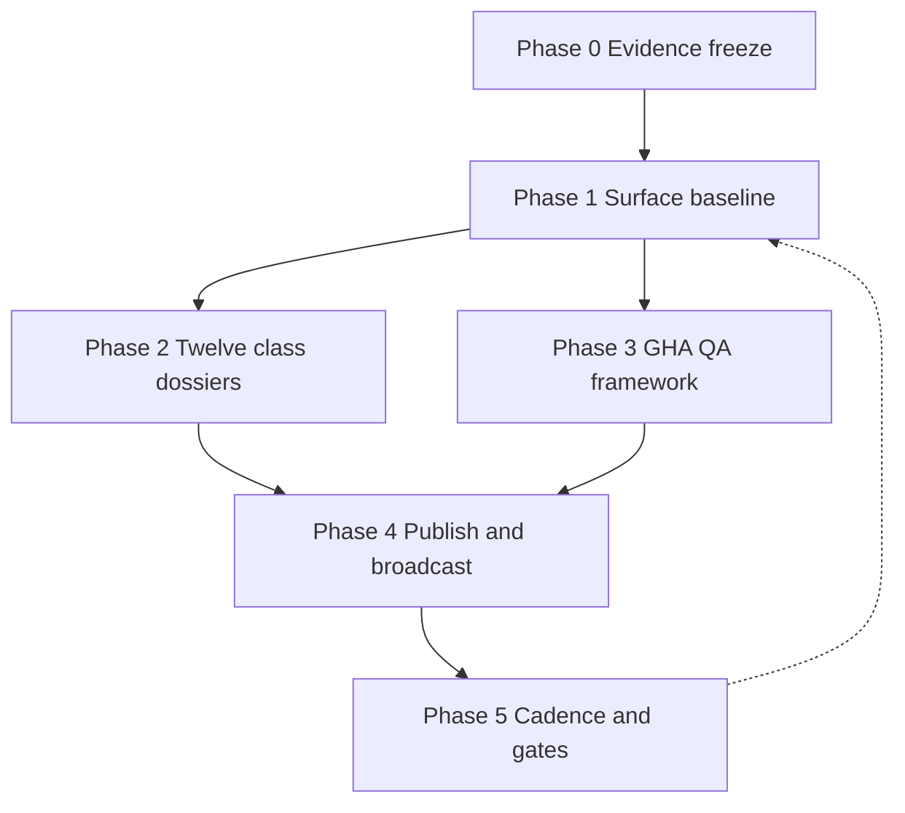

# Program plan — audit-surface review, per-asset-class dossiers, and a GHA quality framework

**Date:** 2026-11-22 · **Author:** Zoo (architect) · **Status:** proposal, nothing implemented
**Surfaces:** `findtorontoevents.ca/audit`, `/audit2`, `/audit3`
**Source of record:** `eltonaguiar/findtorontoevents_antigravity.ca`
**Artifact store:** `eltonaguiar/antigravity_review_Nov192026` (already cloned at `.worktrees/review-repo/`)
**Governing rule:** a number that cannot name its population, cost model, win definition and provenance id is a rumour, not a finding.

---

## 0. Why this program and not another audit memo

Three scoreboards are fed by the same games and they disagree — three money-ready
denominators (`/audit` 0/11, `/audit3` 0/9, `/audit2` echoes the ledger), CRYPTO
published three ways (PF 0.26 / 0.83 / 0.92), COMMODITY `WATCH` vs `KILL`, two kill
lists sharing one name. Every prior review re-derived the same contradictions, then
re-stated them. The marginal value now is **not another summary**. It is:

1. a **per-asset-class dossier** that states, for each class, what is measured, what
   the number means, where it is contradicted, and what single experiment would settle
   it — written so a reader never needs the ledger;
2. a **quality framework for the 373 workflows** that checks the actions themselves
   (schedule, permissions, secrets, duplication, output consumers), not only whether
   the last run was red.

Both go into the review repo so they are durable and cross-reviewable, and both are
summarised on the COMS bus so the fleet can act without re-reading anything.

---

## 1. Scope decisions (all requested variants folded in)

| Decision | Resolution |
|---|---|
| Taxonomy | **12 dossiers.** The 8 canonical classes in [`CANONICAL_ASSET_CLASSES`](../../alpha_engine/money_ready_verdict.py:255) — CRYPTO, EQUITY, ETF, FOREX, COMMODITY, BOND, FUTURES, MUTUAL_FUND — plus 4 classes the repo emits and the ledger scores: PENNY_STOCK, MEMECOIN, INDEX, SPORTS. |
| Where the docs live | **Both.** Written under `docs/audit_review_2026-11-22/` in this repo (reviewable in-tree), then mirrored into `.worktrees/review-repo/` on a dated branch (`review/2026-11-22-zoo-asset-class-dossiers`) and opened as a PR. |
| Delivery to review repo | Branch + PR, **new files only**. No touching of another agent's folders (`01_`–`25_`). Every changed file is ours. |
| GHA QA deliverable | **Design doc + working scaffold**: a design spec, a new `tools/gha_quality_framework.py`, a new `.github/workflows/gha-quality-framework.yml`, and rule definitions that extend — not replace — the existing R1–R12 in [`gha_health_audit.py`](../../tools/gha_health_audit.py:649). |
| COMS | One retained `mentions/all` broadcast (durable) + one inbox note; content is the cross-class verdict table plus pointers, not a re-derivation. |
| Execution model | **Delegated + adversarially reviewed.** Drafts are produced by a fan-out of LLM peers through [`tools/consult_multi.py`](../../tools/consult_multi.py:1); every draft is then reviewed by *different* models than the one that wrote it. We never accept an AI claim as measured — see §2a. |

---

## 2a. Delegation architecture (writer ≠ reviewer)

The box has dozens of provider keys in `~/dbpasses.txt` (gitignored, never echoed) and
[`tools/consult_multi.py`](../../tools/consult_multi.py:1) already fans one prompt out to a
panel and writes each peer's answer to `--out-dir`. We use that, not a fresh framework.

**Three-role split — a document is only trusted when the roles are distinct:**

| Role | Who | Owns | Must NOT do |
|---|---|---|---|
| **Measurer** | us, deterministic | Phases 0–1: curl, sha256, manifest, baseline | infer; recall; use an AI summary as a source |
| **Drafter** | one AI per dossier (assigned) | one `NN_CLASS.md`, following the fixed 8-section template | invent a number; cite a source it did not read; write to another's file |
| **Adversary** | 2 AIs that did **not** draft that file | a `NN_CLASS.review.md` attacking each sourced number | rubber-stamp; agree with the drafter's framing |

**Why this matters here specifically:** every prior review in this repo re-derived the same
contradictions and then asserted them. The failure mode is not "too few opinions" — it is
"opinions treated as measurements". So the adversarial pass has one mandatory question per
dossier: *name the single number in this document that is least likely to survive a
re-measurement, and say why.* A dossier cannot be published until it answers that.

**Fan-out presets already available:** `diverse5` (nvidia/kimi, cloudflare/llama, groq/llama,
gemini/pro, cerebras/llama), `fast4`, `reasoning4`. Use `diverse5` for drafting a batch of
dossiers and `reasoning4` for the adversarial pass — different model families on each side,
which is the whole point.

**Output contract for every delegated file** (enforced by the doc lint in Phase 2):
1. every number carries `[SRC: <path>:<line> | manifest:<key>]` or the literal token `UNMEASURED`;
2. a `## Provenance` footer naming the model, the prompt file, and the snapshot id;
3. no key material, no DB host/user, no `~/dbpasses.txt` content (the repo is public);
4. the 8 section headings verbatim, so documents are diffable against each other.

**Cost/authority guardrails:** only the operator-authorized key file is read at runtime; keys
never enter a prompt, a log, or a committed file. Delegation is additive — a peer produces a
`.md` in `reports/delegated/2026-11-22/`, we curate it into `docs/…`, and nothing an AI writes
is committed without passing the lint and the adversarial pass.

---

## 2. Phase map

Phases 2 and 3 are independent after Phase 1 and can run in parallel.

### Phase 0 — Evidence freeze (no claim without a measurement)

- Capture live snapshots with timestamps and sha256: `/audit3/audit3_ledger.json`,
  `/audit/data/audit3_ledger.json`, `/audit2/audit2_forward.json`,
  `/audit/data/audit2_forward.json`, `audit_dashboard/data/money_ready_verdict.json`,
  `audit_dashboard/data/dashboard_data.json`.
- Record HTTP status for `/audit/`, `/audit2/`, `/audit3/`, `/audit/audit3.html`.
- Write `_MANIFEST.json` describing every captured file (path, generated_at, sha256, rows, producer).
- **Exit criterion:** every later number cites a manifest entry or a repo path with a line number. Anything unverifiable is labelled `UNVERIFIED — not measured this pass`.

### Phase 1 — Shared surface baseline

One document, `00_SURFACE_BASELINE.md`, that every dossier links to instead of repeating:
- what each of the three pages actually fetches (verified, not recalled);
- the contradiction register (PF three ways, three denominators, two kill lists, stale sidecars);
- the canonical metric glossary: net expectancy, PF (gross vs net), selection alpha, DSR + `dsr_n_trials`, BH q, 2×-cost stress, forward gate thresholds;
- the "do not trust" list (hardcoded PASS at zero observation, `/tmp` provenance, static pod snapshots).

### Phase 2 — Twelve per-asset-class dossiers

Work is **split across delegated drafters**, one AI per dossier, assigned so no single model
writes more than four documents and every document is adversarially reviewed by at least two
models that did not draft it (see §2a). The operator sequences the batches; the drafter never
sees another class's draft, so the classes are reviewed as independent claims.

Each dossier uses one fixed template so they are comparable:

1. **Identity** — symbols that map to the class, how class is derived (symbol, not the stored column), include/exclude rules.
2. **What the class is** — instrument behaviour and the structural edge candidates that theoretically belong to it (risk premia, carry, momentum, mean-reversion), each with a citation or an `UNVERIFIED`.
3. **Measured state** — per the frozen snapshot: n, WR, PF (both definitions, labelled), net expectancy + CI, selection alpha, 2×-cost result, DSR with trial count, verdict from each of the three surfaces.
4. **Contradictions** — every place the surfaces disagree for this class, with both numbers and the population behind each.
5. **Data integrity** — coverage share, exclusion cohorts, stale/wrong-labelled rows (e.g. FX pairs tagged CRYPTO in `bt_backtest_runs`), resolver behaviour relevant to the class.
6. **Cost reality** — measured slippage vs the flat constant used; whether the constant is conservative or optimistic for this class.
7. **What would change the verdict** — one pre-registerable experiment, its n, its gate, and the falsifier. No strategy proposals beyond what measurement supports.
8. **Blunt answer** — is there a defensible edge here today: NO / NOT PROVEN / UNMEASURED, in one line.

Class-specific focus (what distinguishes each dossier):

| Class | Central question |
|---|---|
| CRYPTO | Why is PF published three ways, and does selection alpha stay negative after intrabar-honest resolution? |
| EQUITY | Is a 59–60% WR at PF 0.94 exit geometry rather than skill, and is the breakout family the only positive-OOS cell? |
| ETF | Does measured slippage consume more than 100% of per-trade PnL, leaving only monthly cadence viable? |
| FOREX | Is the class unmeasurable because `fx_prices` ends 2026-02-09 and symbols do not join? |
| COMMODITY | Is `n≈51, PF≈0.1` a real kill or a sample artifact, and why is a flat slippage constant below measured here? |
| BOND | Is there any measurement at all beyond `INSUFFICIENT_DATA`? |
| FUTURES | Same cost-constant question as COMMODITY, plus whether class labels are contaminated. |
| MUTUAL_FUND | Is this a tracked class or a placeholder (`intrabar_truth: null`) that should be retired from the headline? |
| PENNY_STOCK | Are the tiny-n catastrophic cells (PF 0.18, n=4) evidence or noise, and does the literature bound it? |
| MEMECOIN | Is `n=10, WR 10%, PF 0.02` or the ghost-row inflation the real story? |
| INDEX | Is INDEX a class at all, or a futures alias that double-counts? |
| SPORTS | Is this in scope for a financial audit, and if so what is its settlement/resolution contract? |

### Phase 3 — GHA quality framework (extensive)

Also delegated, but **differently** — this phase has a hard deterministic core that must not
be delegated: the YAML parser, the rule implementations, the tests, and the workflow file are
written and verified in-repo. AI peers are used only for (a) red-teaming the rule catalog
(*"what class of workflow failure does Q7 miss?"*) and (b) drafting the prose spec from the
implemented rules — never the other way round. A rule exists when its test passes, not when a
model describes it.

A layered framework. Existing R1–R12 answers "what is broken now". The gap is
*structural* quality of the actions themselves.

**Layer A — Inventory & metadata** (deterministic, offline): parse every workflow YAML; record triggers, cron minutes, concurrency group, `permissions`, `timeout-minutes`, secrets referenced, actions used with version pins, `continue-on-error` count, `|| true` count, commit-and-push steps, and which artifacts a job consumes/produces.

**Layer B — Static rules** (new, offline, fail-closed): candidate rules
- `Q1 cron-stampede` — two workflows at the same minute with overlapping resource contention;
- `Q2 unpinned action` — third-party action without a version or SHA;
- `Q3 write-all default` — no `permissions:` block on a workflow that pushes;
- `Q4 self-push without skip-ci` — a commit step lacking `[skip ci]`;
- `Q5 duplicate producer` — two workflows writing the same artifact path (the class of bug that made `/audit` lag `/audit3` by 223 min);
- `Q6 orphan artifact` — a produced JSON that no workflow consumes (extends R12);
- `Q7 silent failure` — `continue-on-error` or `|| true` on a gate-shaped step;
- `Q8 missing timeout` — no `timeout-minutes`, the phantom-queue generator;
- `Q9 secret sprawl` — same secret referenced by more workflows than a declared fan-in bound;
- `Q10 dead schedule` — a cron that has produced no run in > 2× its interval (extends R9 but from the trigger side).

**Layer C — Runtime signals** (reuse R1–R12 JSON): broken-now, flapping, queue hogs, cancel churn.

**Layer D — Scoring & budget**: a per-workflow quality score (0–100) from A+B+C with weights stated; an aggregate "repo actions health" number; a cost budget (API calls, runner-minutes estimate) so the framework cannot itself become the queue hog.

**Layer E — Gate & report**: `tools/gha_quality_framework.py --check` exits non-zero on any new P0 rule violation; the workflow writes `GHACTIONS_LIVE/gha_quality.json` + `.md` and commits with `[skip ci]`, serialized under its own concurrency group on a staggered cron minute. Design must state explicitly which rules are advisory vs blocking and why.

Deliverables: the design spec, the tool, the workflow, a rule catalog, and a test fixture (`--dry-run` with canned YAML so it runs with no network/token).

### Phase 4 — Publish & broadcast

- Curate `reports/delegated/2026-11-22/` → `docs/audit_review_2026-11-22/`: keep only drafts that pass the lint and answered the adversarial question; record rejected drafts and *why* in `REJECTED.md` so the discard is auditable.
- Mirror `docs/audit_review_2026-11-22/` into `.worktrees/review-repo/` as `26_ASSET_CLASS_DOSSIERS/` (new folder, ours).
- Create branch `review/2026-11-22-zoo-asset-class-dossiers` **from `origin/main`**, commit only the new folder + a `README.md` index, push, open PR.
- Verify the PR contains only our files (`git show --stat`).
- COMS: register seat, then `send --retain mentions/all` with the cross-class verdict table + PR link + the three P0s; `check` to confirm receipt.

### Phase 5 — Cadence & follow-through

- Propose (not build) a weekly refresh: regenerate dossiers from the frozen payload, diff, and fail CI on any *new* contradiction.
- Wire the dossier generator so a class verdict change is a reviewable diff, not a silent page update.
- Register the new pipeline paths in the AGENTS.md path registry in the same PR that adds them.

---

## 3. File inventory this program will create

| Path | Purpose |
|---|---|
| `docs/audit_review_2026-11-22/README.md` | Index + cross-class verdict table |
| `docs/audit_review_2026-11-22/00_SURFACE_BASELINE.md` | Shared surface + metric glossary + contradictions |
| `docs/audit_review_2026-11-22/_MANIFEST.json` | Frozen evidence with sha256 |
| `docs/audit_review_2026-11-22/01_CRYPTO.md` … `12_SPORTS.md` | Twelve dossiers |
| `docs/audit_review_2026-11-22/GHA_QA_FRAMEWORK.md` | Phase 3 design spec |
| `tools/gha_quality_framework.py` | Phase 3 tool (Layers A–D, `--check`, `--dry-run`) |
| `.github/workflows/gha-quality-framework.yml` | Phase 3 runner |
| `docs/audit_review_2026-11-22/GHA_QA_RULE_CATALOG.md` | Q1–Q10 definition + severity |
| `.worktrees/review-repo/26_ASSET_CLASS_DOSSIERS/**` | Mirrored copy + index for the PR |
| `docs/audit_review_2026-11-22/REJECTED.md` | Delegated drafts that failed lint/adversarial pass, and why |
| `reports/delegated/2026-11-22/` | Raw peer output (one dir per dossier; `.md` in, `.review.md` back). Curation input, not published. |
| `tools/doc_source_lint.py` | Enforces the `[SRC: …]` / `UNMEASURED` contract and the 8-heading shape; fails CI on a bare number |
| `.github/workflows/audit-review-doc-lint.yml` | Optional read-only CI gate running the lint over `docs/audit_review_*` |

> Delegation note: the `.review.md` files stay under `reports/delegated/` and are **not** published
> to the review repo — the public artifact is the curated dossier plus its provenance footer.
> This keeps "an AI said so" out of the record while keeping the audit trail of who checked whom.

---

## 4. Test plan

- **Docs:** every number traceable to a manifest entry or a `file:line`; a lint that greps dossiers for bare numbers without a source marker.
- **Tool:** `python3 -m py_compile`, then `--dry-run` against fixtures; a unit test asserting each Q-rule fires on a crafted bad workflow and stays silent on a crafted good one.
- **Workflow:** first dispatch `workflow_dispatch` only, verify green and that it commits `[skip ci]`, then (separately) enable the schedule.
- **Live smoke:** `curl` the three surfaces; assert `/audit3` ledger and `/audit/data` copy sha256 match and `generated_at` within tolerance.

## 5. Guardrails

- No strategy proposals presented as findings; a hypothesis is labelled a hypothesis.
- No editing another agent's review-repo folder; new folder only.
- No production code changed in this program except the new additive tool/workflow.
- No destructive git; no force-push; push only our own branch.
- Any claim we cannot measure is written as `UNMEASURED`, never softened into an assertion.

## 6. Success criteria

1. Twelve dossiers exist, each answering its central question with a sourced number or an explicit `UNMEASURED`.
2. Every dossier names the drafter model and carries at least two adversarial reviews by different models; each responds to the "least survivable number" question.
3. `tools/doc_source_lint.py` passes on all twelve — zero bare numbers without a source marker.
4. The cross-class table shows, per class, all three surfaces' verdicts side by side — so the disagreement is visible rather than argued about.
5. `gha_quality_framework.py --dry-run` runs offline and produces a scored inventory of all 373 workflows.
6. The new workflow is green on dispatch and cannot duplicate another producer.
7. A COMS broadcast carries the table + the three P0s and is acknowledged.

*Not investment advice.*
