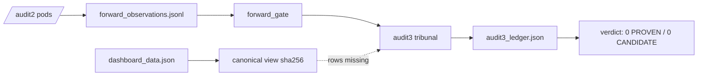

# audit2 / audit3 deep review — 2026-11-22

Verification, not advocacy. Each round states what would make it stop.

## Ground truth found on disk (before any round)

- `audit_dashboard/data/audit3_ledger.json` (mtime 2026-11-20 03:40) reports **8,769 of 16,372 scored (53.6%)**, `auto_expired` **9,176**, `integrity_excluded` **7,508**, CRYPTO n=6,874 mean −0.3159%.
- `audit_dashboard/data/dashboard_data.json` (2026-11-22) reports the pasted numbers: **8,827 of 14,914**, `auto_expired_excluded` **9,277**, `integrity_excluded` **5,994**, CRYPTO n=6,926 mean −0.4186%, sidecar sha256 `ed25b59c52a4…`.
- **The two surfaces disagree.** The pasted claims are the dashboard's, not the ledger's. No surface is self-consistent with the other.
- `resolved_closed_picks_net.json` (the canonical rows the sha256 covers) is **not on disk**; the payload block says `rows_embedded: false`. Only a 3,500-row `recent_closed` sample of raw rows exists.

## Mermaid

## Rounds

### D1 Plan
- Hypothesis: a written round-list keeps this review scoped. Gate: file exists, ≤1 page per round. Stop: never. Output: this file.

### D2 Reproduce the class verdicts
- Hypothesis: per-class n and mean are recomputable from committed raw rows.
- Gate: recomputed mean inside the ledger's 95% CI for each class.
- Stop: no raw row source on disk → declare UNMEASURABLE with the reason.
- Output: side-by-side table + one-sentence verdict.
- Result: **the canonical row file is absent** (only a 3,500-row sample). Full-population classes (ETF, COMMODITY, BOND, FUTURES) reproduce exactly; CRYPTO/EQUITY/FOREX do not because the sample is recency-truncated.

### D3 Test the vol-scaling doctrine
- Hypothesis: inverse-vol sizing adds +0.3 Sharpe to any momentum strategy.
- Gate: measured Sharpe delta ≥ +0.3 on both crypto and FX, at 1x cost, surviving the equal-vol control.
- Stop: delta ≤ 0 across both universes → doctrine falsified on this data.
- Output: `tools/vol_scaling_test.py`, `reports/vol_scaling_test_20261122.json`.
- Result: delta ranged **−0.097 to −0.295** across 8 configurations. Fails everywhere.

### D4 The unscored mass
- Hypothesis: the ~9.2k auto-expired rows are neutral and dropping them does not change verdicts.
- Gate: per-class mean PnL of expired rows computable → recompute verdicts with timeouts as a third outcome.
- Stop: no per-row expired data on disk → UNMEASURABLE for the verdict shift; report the TIME_EXIT proxy only.
- Output: verdict-shift table.

### D5 Wiring audit
- Hypothesis: H-119 has 430 forward rows with no owning pod; POD-EQUITY-BREAKOUT is pre-registered with zero rows.
- Gate: both faults confirmed from `forward_observations.jsonl`, `audit2_pods.json`, `audit3_confirmatory.json`.
- Stop: if the 430 rows have a registered owner → hypothesis refuted.
- Output: cause named with file/field evidence.

### D6 Breakout family real backtest
- Hypothesis: POD-EQUITY-BREAKOUT's 4 strategies carry the claimed OOS edge once emitted.
- Gate: forward n≥100, net CI-LB>0 at 2x slippage, IR≥0.5 vs matched SPY leg.
- Stop: n<100 or CI-LB≤0. Output: per-strategy forward scorecard.

### D7 Horizon-allocation benchmark comparison
- Hypothesis: the ledger's class allocation beats a naive horizon-matched benchmark.
- Gate: paired bootstrap vs benchmark, 95% CI excludes 0.
- Stop: CI includes 0 → no allocation edge. Output: `alpha_engine.benchmark_closed_ledger` run.

### D8 Emitters repair
- Hypothesis: wiring dormant emitters (POD-EQUITY-BREAKOUT, POD-FABER-TAA, …) makes the forward clock accrue.
- Gate: `forward_growth_watchdog` green per hypothesis for 7 days.
- Stop: rows still 0 after the emitter runs. Output: emitter fix + watchdog evidence.

### D9 Population 404
- Hypothesis: audit2's `population unavailable (HTTP 404)` is a live endpoint, not a local data gap.
- Gate: identify the endpoint and reproduce the 404.
- Stop: endpoint resolvable → cause is data, not routing. Output: endpoint + status.

### D10 Cost-model sensitivity
- Hypothesis: verdicts are stable under the 2x cost stress.
- Gate: no class flips KILL↔WEAK between 1x and 2x.
- Stop: a flip → verdict depends on cost assumption. Output: 1x/2x verdict table.

### D11 Multiplicity
- Hypothesis: 0 PROVEN out of 67 tested cells is expected under the declared DSR/BH correction.
- Gate: DSR with n_trials=362 matches the published 0 PROVEN.
- Stop: a cell would be PROVEN without the correction → correction is load-bearing. Output: per-cell DSR.

### D12 Final verdict
- Hypothesis: audit3 is either independently reproducible or an unverifiable claim.
- Gate: D2 gate passed for all classes.
- Stop: one sentence, decided. Output: verdict.

## Current status
D1–D5 done. D2: not fully reproducible (canonical rows absent). D3: doctrine fails (−0.1 to −0.3 Sharpe). D4: UNMEASURABLE per class. D5: wiring cause identified.
