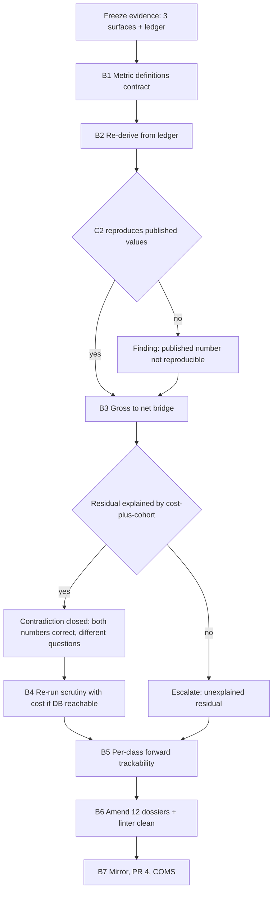

# Plan — Backtest and cross-check the /audit, /audit2, /audit3 metrics, per asset class

Status: awaiting approval
Date: 2026-11-22
Scope: `findtorontoevents_antigravity.ca` (read-heavy), deliverable into `docs/audit_review_2026-11-22/`

---

## 1. What was asked

> "do some backtesting and cross-checking against metrics discussed on /audit or /audit2 /audit3,
> and per asset class, specific metrics."

So: for each asset class, take the metric each surface publishes, independently
re-derive it from source data, and report where the surfaces disagree with each other
and with a re-measurement. Not a narrative review — a reconciliation with three columns
and an explanation of every gap.

---

## 2. What is already proven to contradict (frozen evidence)

These were found while checking the repos today. They are the seed of the reconciliation table.

### C8 — CRYPTO is simultaneously PASS and KILL on the same day

| Source | Window basis | n | WR | PF | Verdict |
|---|---|---|---|---|---|
| [`reports/per_class_scrutiny_20261004.json:6`](reports/per_class_scrutiny_20261004.json:6) `mega_mutation`/crypto | 2026-04-02 to 2026-06-11, **gross**, source-scoped, n>=30 | 339 | 67.0 | **3.50** | PASS_ALL_AXES |
| [`_raw/audit3_audit3_ledger.json:1556`](docs/audit_review_2026-11-22/_raw/audit3_audit3_ledger.json:1556) CRYPTO class | whole class, **net**, required_n 917 | 6926 | 39.39 | **0.7886** | KILL |
| [`_raw/audit_data_money_ready_verdict.json:32`](docs/audit_review_2026-11-22/_raw/audit_data_money_ready_verdict.json:32) `/audit` policy_clean | 22,287 rows | 22287 | 41.04 | **0.2621** | not ready |

Four orders of disagreement on the same class on the same day. PF 3.50 vs 0.79 vs 0.26.

### C9 — the class-level population itself is contested

[`_raw/audit_data_denominator.json:35`](docs/audit_review_2026-11-22/_raw/audit_data_denominator.json:35) states
in its own notes: "exclusion reasons total 12,174 but total - canonical = 6,087: the publisher
and the tribunal exclude different cohorts, so these are **separate pipelines, not one subtraction**."

n_canonical 8827 of 14914 closed (59.2%). So 40.8% of closed picks are never scored by `/audit3`.
Any class verdict is conditional on that exclusion set, and the exclusion set is not shared with `/audit`.

### C10 — `/audit`'s own intrabar-vs-daily divergence

[`_raw/audit_data_money_ready_verdict.json:14`](docs/audit_review_2026-11-22/_raw/audit_data_money_ready_verdict.json:14)
CRYPTO: daily_pf 0.2621 / honest_pf 0.9169, wr_inflation 5.3pp, flag `false`.
The honest path is used for sizing (`sizing_source: intrabar_truth`) but the published headline
PF stays 0.2621. Which number is "the" metric is undefined on the page.

### C11 — backtest winners file is six months stale and self-declares low confidence

[`reports/eight_class_winners_20260601.json:1`](reports/eight_class_winners_20260601.json:1) generated
2026-06-01, tiers TIER_2/TIER_3/REHAB. FOREX PF is `null` with tier REHAB. Nothing in this file
has been re-run against the live ledger.

---

## 3. Root cause of the disagreement (code evidence)

The scrutiny engine and the tribunal are measuring different things. Confirmed by reading the source.

| Mechanism | Evidence |
|---|---|
| **Gross vs net.** Scrutiny computes PF from raw `pnl_pct` with no cost model. | [`tools/per_class_scrutiny_engine.py:87`](tools/per_class_scrutiny_engine.py:87) sums `pnl_pct` directly; `:99` `pf = gw/gl`. No slippage term anywhere. The ledger applies per-class slippage (`CRYPTO 0.0996`, `COMMODITY 0.15`, `MEME 0.30` per ledger `conventions.slippage_pct_by_class`). |
| **Source-scoped vs class-scoped.** Scrutiny keys on `(source_system, category)`. | [`tools/per_class_scrutiny_engine.py:74`](tools/per_class_scrutiny_engine.py:74) `WHERE source_system=%s AND LOWER(TRIM(category))=%s`. The ledger aggregates the whole class across every source. |
| **Different min_n.** Scrutiny runs at n>=30; the tribunal demands `required_n` 917 for CRYPTO. | [`tools/per_class_scrutiny_engine.py:199`](tools/per_class_scrutiny_engine.py:199) `run_scrutiny(min_n=30)`; ledger `:1558` `required_n 917`. |
| **Different windows.** Scrutiny is `closed_at > 2026-01-01` minus one backfill date. | [`tools/per_class_scrutiny_engine.py:78`](tools/per_class_scrutiny_engine.py:78) and `:68` `BACKFILL_EXCLUDE_DATE = "2026-06-04"` (5,960 commodity rows written in one day). Ledger `coverage.window` at `:130`. |
| **No OOS gate on the ledger's side of comparison.** Scrutiny's "OOS" is a mid-date split of the same rows, not a held-out period. | [`tools/per_class_scrutiny_engine.py:128`](tools/per_class_scrutiny_engine.py:128) `mid = mn + (mx - mn)/2`. It cannot fail if h1 has no data (`:148-149`). |

Conclusion: `PASS_ALL_AXES` on `mega_mutation` is **not a refutation of the KILL**. It is a
gross, source-scoped, n=339, in-sample-halves measurement. The KILL is a net, class-wide,
n=6926 measurement with a 2x-cost stress. Both are arithmetically right about different questions.
The plan's job is to prove that with numbers, per class.

---

## 4. The reconciliation matrix to be produced

One row per asset class, one column per surface, plus a re-measurement column.

```
class | /audit pf | /audit intrabar pf | /audit2 forward n | /audit3 net pf | /audit3 alpha | re-derived net pf | gap driver | verdict on the verdict
```

12 classes: CRYPTO, EQUITY, COMMODITY, ETF, FOREX, BOND, FUTURES, MUTUAL_FUND, PENNY_STOCK, MEMECOIN, INDEX, SPORTS.

Per class, also record the *specific* metrics the user asked about, not just PF:
WR (+CI), net PF (+CI and 2x-cost CI), expected value per trade in pct, selection alpha (+CI),
`required_n` vs actual n, `top_symbol_share`, `top_source_share`, `split_half.stable`, `dsr`, `stress_2x_ok`.

---

## 5. Phases

### Phase B1 — Lock the metric definitions (parser, no judgement)
- Read the three generators and write the exact definition each surface uses:
  `audit_trail/dashboard_generator.py` (published), `alpha_engine/money_ready_verdict.py` (policy),
  the audit3 tribunal builder (ledger `summary`/`classes`/`selection_alpha`).
- Produce `docs/audit_review_2026-11-22/METRIC_DEFINITIONS.md`: one row per metric, its formula,
  its cost basis, its population, its window, and its code location.
- No numbers yet. This is the contract the reconciliation is judged against.

### Phase B2 — Independent re-derivation from the frozen ledger
- Write `tools/reconcile_class_metrics.py` that reads **only** `_raw/audit3_audit3_ledger.json`
  and recomputes, per class, from the raw fields: WR, net PF, net CI, selection alpha, n.
- Assert it reproduces the published `classes[]` values to within rounding. A mismatch is a finding,
  not a bug to paper over.
- Emit `reports/class_metric_reconciliation_<date>.json` plus a `.md`.

### Phase B3 — Gross-vs-net bridge (the crux experiment) — DONE 2026-11-22
- Implemented as `tools/reconcile_class_metrics.py --db`. Output:
  `reports/class_metric_reconciliation_20261122.{json,md}`.
- Hypothesis tested: "most of the PASS->KILL gap is cost." **Result: REJECTED.**
  Measured CRYPTO: gross PF 1.051 -> net PF 0.9963 at the ledger's own cost (9.96bp),
  but the ledger publishes 0.7886. Cost moves PF by ~0.055; the residual is **+0.2077**.
  So the gap is **cohort**, not cost: the ledger scores a filtered subset
  (`dashboard_data.resolved_closed_picks_net`, 8,827 of 14,914) that is materially worse
  than the broader `trading_picks` population.
- Same shape in FOREX (residual +0.2312), COMMODITY (+0.3819), while EQUITY (-0.091),
  BOND (-0.2418), ETF (-0.1054), FUTURES (-1.031) go the other way (ledger is more generous
  than the DB), which itself needs explaining.
- Consequence for the plan: the remaining work is **cohort forensics**, not cost modelling.
  The `invalid_row` exclusion bucket (11,782 rows, larger than the entire scored set) is now
  the highest-value target, per `METRIC_DEFINITIONS.md` section 8.

### Phase B4 — Re-run the scrutiny engine with a cost model, if the DB is reachable
- `python3 tools/per_class_scrutiny_engine.py --min-n 30` requires MySQL (`tools.db_env.get_stocks_creds`).
- If credentials are available: re-run, then re-run a patched variant that nets out slippage and
  re-verdicts. Diff the two verdict sets. Report how many `PASS_ALL_AXES` survive cost.
- If not available: record `UNMEASURED` and say exactly which credential is missing. Do not guess.

### Phase B5 — Forward-trackability check per class
- Establish, per class, how many forward rows exist. Already known: `reports/forward_observations.jsonl`
  is 431 lines, **all `H-119`, all `CRYPTO`**. So EQUITY/ETF/BOND have zero forward rows.
- Report this as a per-class readiness column: a class with 0 forward rows cannot be promoted
  regardless of its backtest, because the gate needs `n>=100` forward.
- This directly qualifies any "top 3 classes" claim.

### Phase B6 — Amend the dossiers
- Add a `## 9 Cross-check` section to each of the 12 dossiers with its row of the matrix,
  all values `[SRC: ...]`-marked so `tools/doc_source_lint.py` still passes.
- Update `README.md` cross-class table and `00_SURFACE_BASELINE.md` contradiction register with C8-C11.
- Re-run the linter: `python3 tools/doc_source_lint.py docs/audit_review_2026-11-22/` must stay clean.

### Phase B7 — Publish
- Copy the amended docs plus `METRIC_DEFINITIONS.md` into `.worktrees/review-repo/26_ASSET_CLASS_DOSSIERS/`
  (the mirror is currently known-stale: it lacked the H-101 correction and `_reviews/`; the H-101 part
  is now fixed, the rest is this phase).
- Update PR #4.
- COMS: broadcast the reconciliation summary and the bridge result to the fleet.

---

## 6. Flow



---

## 7. Definition of done

- `METRIC_DEFINITIONS.md` exists and every metric has a formula, a cost basis, and a code location.
- `tools/reconcile_class_metrics.py` runs, and its output reproduces the ledger's per-class PF/WR/alpha
  within rounding, or names the exact class where it cannot.
- Every class has one line answering: **why do `/audit`, `/audit2`, `/audit3` disagree, in numbers.**
- The gross-to-net bridge quantifies the PASS-vs-KILL gap for CRYPTO with a residual number.
- All 12 dossiers carry a `## 9 Cross-check` section; `tools/doc_source_lint.py` passes 12/12.
- Nothing is labelled PROVEN. The reconciliation explains disagreements; it does not create an edge.
- Any class with 0 forward rows is explicitly marked as untrackable at the promoted gate.

---

## 8. Explicit non-goals and honesty guards

- **No new strategy discovery.** If the bridge shows a class with net PF > 1 after cost and a
  stable split, that is a `CANDIDATE` at most, exactly as `mega_mutation` is capped today.
- **No paper order without a symbol.** `PAPER_PILOT.md` already documents why the `mega_mutation`
  cell cannot be papered: no symbol, direction, entry, TP, or SL. That stands.
- **No substitution of a proxy for a missing credential.** If MySQL is unreachable, B4 is
  `UNMEASURED` with the missing credential named — not silently skipped.
- **Do not reconcile numbers by editing the dossiers to match.** If the re-derivation disagrees with
  the published ledger, the ledger's number is the finding.

---

## Provenance

- Evidence: `docs/audit_review_2026-11-22/_raw/` (5 frozen payloads, sha256 in `_MANIFEST.json`)
- Contradictions C8-C11 measured 2026-11-22T06:59Z from the files cited inline
- Mechanism confirmed by reading [`tools/per_class_scrutiny_engine.py`](tools/per_class_scrutiny_engine.py:1) in full
- model: none (curator-written plan from frozen evidence)
