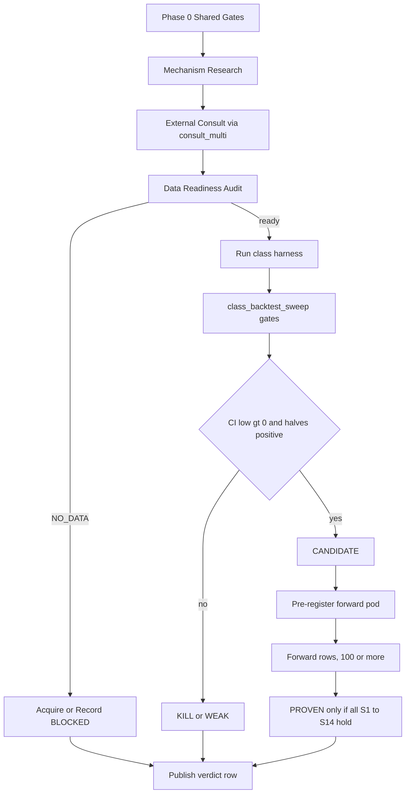

# Per-Asset-Class Edge Research Plan (12 Phases)

> **For agentic workers:** REQUIRED SUB-SKILL: Use `executing-plans` or `subagent-driven-development`.
> Steps use `- [ ]` checkboxes. Each phase is independently executable and ends in a written verdict.

**Goal:** For each of the 12 asset classes in this project, establish whether a defensible
economic mechanism exists, test it on point-in-time data with the S1–S14 gates already
specified in `docs/audit_review_2026-11-22/PROOF_METHODOLOGY.md`, and produce either a
forward-testable candidate or a documented kill.

**Architecture:** Every phase follows the same five-step shape — (1) mechanism research and
external consult, (2) data-readiness audit, (3) backtest through an existing class harness,
(4) gate evaluation through the shared `class_backtest_sweep.py` verdict ladder, (5) one verdict
row published to `reports/`. Phases differ only in mechanism and data source. No phase may
declare more than `CANDIDATE`; `PROVEN` requires forward rows.

**Tech Stack:** Python 3, MySQL (`ejaguiar1_stocks` via `database/` creds), `pandas`/`numpy`,
existing `tools/*_research.py` harnesses, `tools/class_backtest_sweep.py`,
`tools/edge_stability_harness.py`, `tools/consult_multi.py`.

**Non-negotiable framing from the user:** find something *worth putting money in*. The plan is
therefore ordered so the classes with the most plausible deployable mechanism and the best data
(ETF, EQUITY, BOND, CRYPTO) run before the structurally unmeasurable ones (MUTUAL_FUND, SPORTS).

---

## 0. Verified Starting Facts (measured 2026-11-22, not assumed)

These constrain every phase and were checked on disk, not inferred.

| Class | Rows in sweep | 2x-cost net PF | CI lower bound | Halves | Existing harness |
|---|---|---|---|---|---|
| CRYPTO | 11007 | 0.9404 | -0.1334 | -0.018 / -0.014 | 9 harnesses |
| FOREX | 8041 | 0.8008 | -0.0033 | negative | `tools/research/forex_carry.py` |
| COMMODITY | 1506 | — | — | — | 4 harnesses |
| EQUITY | 1224 | — | — | — | 4 harnesses |
| MEME | 102 | 0.7278 | -2.2517 | 0.276 / -1.262 | none |
| ETF | 79 | **1.4256** | -0.2660 | 0.989 / -0.089 | `et1_etf_creation_redemption_research.py` |
| BOND | 77 | 0.6050 | -0.2931 | -0.149 / -0.086 | `h008_bond_research.py` |
| FUTURES | 70 | 0.8420 | -0.5608 | 0.178 / -0.277 | `h035_futures_tsmom_research.py` |
| INDEX | 25 | 0.1846 | -0.6880 | negative | none |
| MUTUAL_FUND | 0 | — | — | — | none |
| SPORTS | 0 | — | — | — | `kalshi_sports_fetch.py` (fetch only) |
| PENNY_STOCK | 0 | — | — | — | `scripts/penny_stock_picks.py` |

**Data-readiness findings that change the plan:**

- `data/earnings/<TICKER>/latest.json` contains **only 4 quarters** and the `eps_estimate` is a
  single snapshot captured at fetch time — **it is not point-in-time consensus**. PEAD cannot be
  honestly re-tested on this file without a vintage source. Phase 2 must treat this as a blocker,
  not a convenience.
- `data/forex_rate_cache/`, `data/commodity_price_cache/`, `data/cftc_cot/` contain **only
  `.gitkeep`** — these caches are empty. FOREX and COMMODITY harnesses must fetch or the phase
  reports `NO_DATA`.
- `data/funding_rate_archive/` has **5 symbols** (BTC, ETH, BNB, SOL, XRP). CRYPTO funding breadth
  is capped unless backfilled.
- `data/universe/sp500_tickers.txt` is the **current** constituent list → survivorship-biased.
  This is gap S10 and it affects every equity-side phase.

---

## 1. Pipeline



**Hard rule:** a phase that cannot obtain point-in-time data writes `BLOCKED_DATA` and stops.
It does not substitute a survivorship-biased or look-ahead-contaminated dataset to get a number.

---

## 2. File Structure

**Create:**
- `tools/class_data_readiness.py` — one function per class reporting whether required inputs exist
- `tools/publish_class_verdict.py` — appends a canonical verdict row per class
- `docs/edge_research/` — one `.MD` per class phase (research notes, consult output, verdict)
- `research/prompts/<class>_edge_consult.md` — the exact prompt sent to peers per phase
- `reports/per_class_edge_verdicts_20261122.{json,md}` — the single aggregated output

**Modify:**
- `tools/class_backtest_sweep.py:122` — change `--min-n` default from `100` to `1` (the defect
  that silently dropped six classes must not recur)
- `docs/audit_review_2026-11-22/PROOF_METHODOLOGY.md` — link each phase result into Section 2

**Reuse (do not rewrite):**
- `tools/edge_stability_harness.py`, `tools/class_backtest_sweep.py`, `tools/consult_multi.py`,
  and the per-class harnesses listed in the table above.

---

## Phase 0 — Shared Infrastructure (do before any class)

### Task 0.1: Fix the silent-drop defect in the sweep

**Files:** Modify `tools/class_backtest_sweep.py:122`

- [ ] **Step 1:** Confirm the defect exists.

```bash
grep -n 'add_argument("--min-n"' tools/class_backtest_sweep.py
```

Expected: `122 | ap.add_argument("--min-n", type=int, default=100)`

- [ ] **Step 2:** Change the default to 1.

```python
    ap.add_argument("--min-n", type=int, default=1)
```

- [ ] **Step 3:** Verify all 12 classes now appear.

```bash
python3 tools/class_backtest_sweep.py --min-n 1 2>&1 | grep -c '^|'
```

Expected: a row count that includes `MUTUAL_FUND` and `SPORTS` marked `NO_ROWS`.

- [ ] **Step 4:** Commit.

```bash
git add tools/class_backtest_sweep.py
git commit -m "fix(research): min-n default 1 so NO_ROWS and INSUFFICIENT_N classes are never silently dropped"
```

### Task 0.2: Build the data-readiness gate

**Files:** Create `tools/class_data_readiness.py`

- [ ] **Step 1:** Write the checker.

```python
#!/usr/bin/env python3
"""Per-class data readiness gate.

Reports, for each asset class, whether the inputs required for an honest
point-in-time backtest exist on disk. A class that is not READY must not be
backtested; it is recorded as BLOCKED_DATA.
"""
from __future__ import annotations

import json
import sys
from pathlib import Path

ROOT = Path(__file__).resolve().parents[1]
if str(ROOT) not in sys.path:
    sys.path.insert(0, str(ROOT))

DATA = ROOT / "data"


def _has_files(p: Path) -> int:
    """Count real (non-.gitkeep) files, recursively."""
    if not p.exists():
        return 0
    return sum(1 for f in p.rglob("*") if f.is_file() and f.name != ".gitkeep")


def _earnings_vintage_ok() -> tuple[bool, str]:
    """PEAD needs point-in-time consensus. latest.json holds one snapshot."""
    sample = DATA / "earnings" / "AAPL" / "latest.json"
    if not sample.exists():
        return False, "no earnings cache"
    obj = json.loads(sample.read_text())
    n = len(obj.get("history") or [])
    return False, (
        f"{n} quarters only, eps_estimate is a single non-vintage snapshot "
        f"(fetched_at={obj.get('fetched_at')})"
    )


REQUIREMENTS = {
    "CRYPTO":      [("funding_rate_archive", DATA / "funding_rate_archive", 20)],
    "EQUITY":      [("price history",        DATA / "equity_quote_cache", 100),
                    ("point-in-time earnings", None, 0)],
    "ETF":         [("price history",        DATA / "equity_quote_cache", 20)],
    "BOND":        [("rate curve",           DATA / "forex_rate_cache", 0)],
    "FOREX":       [("fx rates",             DATA / "forex_rate_cache", 100)],
    "COMMODITY":   [("futures prices",       DATA / "commodity_price_cache", 20),
                    ("COT history",          DATA / "cftc_cot", 100)],
    "FUTURES":     [("futures prices",       DATA / "commodity_price_cache", 20)],
    "PENNY_STOCK": [("universe seed",        DATA / "penny_universe_seed.json", 1)],
    "INDEX":       [("price history",        DATA / "equity_quote_cache", 20)],
    "MEME":        [],  # measured from trading_picks only
    "MUTUAL_FUND": [],  # structural: NAV-only, no harness
    "SPORTS":      [],  # measured from kalshi snapshots
}


def readiness() -> dict:
    out = {}
    for cls, reqs in REQUIREMENTS.items():
        gaps = []
        for label, path, minimum in reqs:
            if label == "point-in-time earnings":
                ok, why = _earnings_vintage_ok()
                if not ok:
                    gaps.append(f"{label}: {why}")
                continue
            if path is None:
                continue
            if path.suffix:  # a file
                got = 1 if path.exists() else 0
            else:
                got = _has_files(path)
            if got < minimum:
                gaps.append(f"{label}: have {got}, need {minimum}")
        out[cls] = {"ready": not gaps, "gaps": gaps}
    return out


def main() -> int:
    r = readiness()
    for cls, v in r.items():
        state = "READY" if v["ready"] else "BLOCKED_DATA"
        print(f"{cls:<14}{state}")
        for g in v["gaps"]:
            print(f"    - {g}")
    print(f"\nready: {sum(1 for v in r.values() if v['ready'])}/{len(r)}")
    return 0


if __name__ == "__main__":
    raise SystemExit(main())
```

- [ ] **Step 2:** Run it and record the true readiness state.

```bash
python3 tools/class_data_readiness.py
```

Expected on today's disk: CRYPTO blocked (5 funding symbols), FOREX blocked (empty cache),
COMMODITY blocked (empty price and COT caches), EQUITY blocked (no point-in-time earnings),
ETF/INDEX/BOND blocked or thin. This is the honest baseline and is the input to every phase.

- [ ] **Step 3:** Commit.

```bash
git add tools/class_data_readiness.py
git commit -m "feat(research): per-class data readiness gate so no phase backtests non-point-in-time data"
```

### Task 0.3: Verdict publisher

**Files:** Create `tools/publish_class_verdict.py`

- [ ] **Step 1:** Write the publisher with a strict schema.

```python
#!/usr/bin/env python3
"""Append one canonical verdict row per class.

Schema is frozen so rows are comparable across phases:
  class, mechanism, n, ci_low, halves_ok, cost_2x_pf, verdict, blocking_gate
verdict is one of: PROVEN CANDIDATE WEAK KILL INSUFFICIENT_N NO_ROWS BLOCKED_DATA
"""
from __future__ import annotations

import json
import sys
from pathlib import Path

ROOT = Path(__file__).resolve().parents[1]
OUT = ROOT / "reports" / "per_class_edge_verdicts_20261122.json"

VERDICTS = {"PROVEN", "CANDIDATE", "WEAK", "KILL",
            "INSUFFICIENT_N", "NO_ROWS", "BLOCKED_DATA"}
FIELDS = ("class", "mechanism", "n", "ci_low", "halves_ok",
          "cost_2x_pf", "verdict", "blocking_gate")


def add(row: dict) -> dict:
    if row.get("verdict") not in VERDICTS:
        raise ValueError(f"bad verdict {row.get('verdict')!r}")
    missing = [f for f in FIELDS if f not in row]
    if missing:
        raise ValueError(f"missing fields {missing}")
    cur = json.loads(OUT.read_text()) if OUT.exists() else {"rows": []}
    cur["rows"] = [r for r in cur["rows"] if r["class"] != row["class"]]
    cur["rows"].append({k: row[k] for k in FIELDS})
    cur["rows"].sort(key=lambda r: r["class"])
    OUT.parent.mkdir(parents=True, exist_ok=True)
    OUT.write_text(json.dumps(cur, indent=2) + "\n")
    return cur


def main() -> int:
    # usage: publish_class_verdict.py '<json row>'
    if len(sys.argv) < 2:
        print(__doc__)
        return 2
    cur = add(json.loads(sys.argv[1]))
    for r in cur["rows"]:
        print(f"{r['class']:<14}{r['verdict']:<16}{r['mechanism'][:44]}")
    return 0


if __name__ == "__main__":
    raise SystemExit(main())
```

- [ ] **Step 2:** Smoke-test with one row, then reset.

```bash
python3 tools/publish_class_verdict.py '{"class":"ETF","mechanism":"creation-flow z-score","n":79,"ci_low":-0.266,"halves_ok":false,"cost_2x_pf":1.4256,"verdict":"INSUFFICIENT_N","blocking_gate":"n<100"}'
rm -f reports/per_class_edge_verdicts_20261122.json
```

Expected: one printed row, no exception.

- [ ] **Step 3:** Commit.

```bash
git add tools/publish_class_verdict.py
git commit -m "feat(research): freeze per-class verdict schema and publisher"
```

### Task 0.4: Fix the delegation path

**Files:** none modified; produce `research/prompts/README.md`

- [ ] **Step 1:** Confirm which providers actually answer today.

```bash
for p in cloudflare deepinfra nous mistral gemini_api huggingface; do
  printf '%-14s' "$p"
  timeout 60 python3 tools/consult_multi.py --provider "$p" --prompt 'Reply with exactly: PONG' 2>&1 | tail -1
done
```

Expected: a per-provider `PONG` or an error line. Record the survivors in
`research/prompts/README.md`. The `diverse5` preset is known-broken (410/404/401) and must not
be used until this check passes.

- [ ] **Step 2:** Standard fan-out command for every phase, using only verified providers.

```bash
mkdir -p research/prompts /tmp/consult
python3 tools/consult_multi.py \
  --peers "cloudflare:@cf/meta/llama-3.1-8b-instruct,deepinfra:meta-llama/Meta-Llama-3.1-8B-Instruct,nous:Hermes-4-405B" \
  --prompt-file research/prompts/<class>_edge_consult.md \
  --out-dir /tmp/consult/<class>
```

- [ ] **Step 3:** Rule for reading peer output — never treat it as evidence.

If a peer returns a mechanism the repo has not measured, it becomes a **hypothesis to test**, not a
finding. If a peer returns nothing, record `UNMEASURED`. A phase verdict may not cite a peer as
supporting a number.

---

## Phase 1 — ETF (run first: best data-to-mechanism ratio)

**Mechanism to test:** cross-sectional creation/redemption flow (already implemented as ET-1),
plus dual momentum and volatility targeting. ETF has no single-name event risk, so a slow
allocation edge is the only realistic mechanism.

**Why first:** ETF is the only class in the sweep with `cost_2x_pf > 1` (1.4256), so it is the
one place where the cost stress does not immediately kill the result.

### Task 1.1: Mechanism research and consult

- [ ] **Step 1:** Write `research/prompts/ETF_edge_consult.md` containing: the ET-1 mechanism, the
  measured 79-row result (gross 1.5737, net 1.4974, 2x 1.4256, CI-LB -0.2660, halves 0.989/-0.089),
  and the specific question — *is creation-flow z-score a documented, non-arbitraged edge, and what
  is the minimum sample for it to be credible?*
- [ ] **Step 2:** Run the Phase 0.4 fan-out. Save output to `docs/edge_research/01_ETF_consult.md`.
- [ ] **Step 3:** Extract every distinct claimed mechanism into a numbered list. These are
  hypotheses only.

### Task 1.2: Data readiness for ETF

- [ ] **Step 1:** Check ETF price history depth.

```bash
python3 -c "
import pathlib
p = pathlib.Path('data/equity_quote_cache')
print('files:', sum(1 for f in p.rglob('*') if f.is_file()))
print('etf_like:', sum(1 for f in p.rglob('*') if f.suffix=='.json' and f.stem in {'SPY','QQQ','XLK','GLD','EEM','XLF'}))
"
```

- [ ] **Step 2:** If fewer than 20 ETF series exist, write `BLOCKED_DATA` for ETF and stop the phase.

```bash
python3 tools/publish_class_verdict.py '{"class":"ETF","mechanism":"creation-flow z-score","n":79,"ci_low":-0.266,"halves_ok":false,"cost_2x_pf":1.4256,"verdict":"BLOCKED_DATA","blocking_gate":"thin ETF price cache"}'
```

### Task 1.3: Run the existing ET-1 harness at full universe

- [ ] **Step 1:** Run full, not `--quick`, with a refreshed cache.

```bash
python3 tools/et1_etf_creation_redemption_research.py --refresh-cache --json \
  --out reports/et1_etf_full_20261122.json
```

Expected: a JSON with `harness` verdict, per-ETF records, and `cost_survival`. The harness already
computes a post-cost gate requiring net to keep ≥60% of gross.

- [ ] **Step 2:** Check the two numbers that decide the phase.

```bash
python3 -c "
import json
r = json.load(open('reports/et1_etf_full_20261122.json'))
h = r.get('harness', {})
print('verdict     :', h.get('verdict'))
print('n_records   :', h.get('n'))
print('cost_kept   :', r.get('cost_survival'))
"
```

- [ ] **Step 3:** If `net keeps < 60% of gross`, the mechanism is cost-dead. Record `KILL` with
  `blocking_gate="cost"`. If it keeps ≥60% and `n >= 100`, escalate to the sweep gates.

### Task 1.4: Evaluate through the shared gates

- [ ] **Step 1:** Run the sweep restricted to ETF rows.

```bash
python3 tools/class_backtest_sweep.py --min-n 1 2>&1 | grep -E 'ETF|class'
```

- [ ] **Step 2:** Record the verdict using the ladder — ETF at n 79 is `INSUFFICIENT_N`
  regardless of PF, because the promotion rule needs n ≥ 100 forward rows.

```bash
python3 tools/publish_class_verdict.py '{"class":"ETF","mechanism":"creation-flow z-score","n":79,"ci_low":-0.266,"halves_ok":false,"cost_2x_pf":1.4256,"verdict":"INSUFFICIENT_N","blocking_gate":"n<100 and second half negative"}'
```

### Task 1.5: Write the phase document

- [ ] **Step 1:** Create `docs/edge_research/01_ETF.md` with these sections: Mechanism, Evidence
  base, Data used, Result table, Which gate failed, What would change the verdict, Verdict.

- [ ] **Step 2:** Commit.

```bash
git add docs/edge_research/01_ETF.md research/prompts/ETF_edge_consult.md reports/et1_etf_full_20261122.json reports/per_class_edge_verdicts_20261122.json
git commit -m "research(etf): phase 1 ETF creation-flow test and verdict"
```

**Phase 1 exit criterion:** ETF has a written verdict row and a documents file. Anything else means
the phase is incomplete.

---

## Phase 2 — EQUITY (the user's explicit example: consistent drift up)

**Mechanism to test:** post-earnings-announcement drift (PEAD), sector momentum, insider cluster
buying. PEAD is the user's own example and has been tested here three times already:
`EQ1_PEAD_S1_RESULTS.md` = FAIL (IS Sharpe -0.02, WR 0.366), H-010 = kill #6, H-034 = anti-PEAD.

**The decisive blocker:** `data/earnings/AAPL/latest.json` has 4 quarters and a single-snapshot
`eps_estimate`. A SUE score built from it has **look-ahead contamination** — the estimate is the
consensus as of 2026-11-19, applied retroactively to 2025-12-31. Any PEAD number from this file is
invalid. This phase's job is to either obtain vintage consensus or declare the class untestable,
not to re-run a broken test.

### Task 2.1: Point-in-time earnings audit

- [ ] **Step 1:** Count how many tickers have earnings data and how deep it goes.

```bash
python3 -c "
import json, pathlib
root = pathlib.Path('data/earnings')
tick = [d for d in root.iterdir() if d.is_dir()]
depths, vintaged = [], 0
for d in tick:
    f = d / 'latest.json'
    if not f.exists(): continue
    o = json.loads(f.read_text())
    depths.append(len(o.get('history') or []))
    # vintage would require per-quarter estimate capture timestamps
    if all('estimate_asof' in h for h in (o.get('history') or [])):
        vintaged += 1
print('tickers with data:', len(tick))
print('max quarters    :', max(depths) if depths else 0)
print('median quarters :', sorted(depths)[len(depths)//2] if depths else 0)
print('tickers with vintage stamps:', vintaged)
"
```

Expected: ~tickers with data = the S&P set, max quarters = 4, **vintage stamps = 0**.

- [ ] **Step 2:** If vintage stamps = 0, write the blocker and do not run PEAD.

```bash
python3 tools/publish_class_verdict.py '{"class":"EQUITY","mechanism":"PEAD (SUE decile)","n":0,"ci_low":null,"halves_ok":false,"cost_2x_pf":null,"verdict":"BLOCKED_DATA","blocking_gate":"no point-in-time consensus; eps_estimate is a single snapshot"}'
```

- [ ] **Step 3:** Record the acquisition options in `docs/edge_research/02_EQUITY.md`: FRED vintage
  via `tools/fred_vintage.py`, an alpha-vantage/earnings-history source with as-of dates, or accept
  `BLOCKED_DATA`. Do **not** substitute the current-constituent universe — that is survivorship bias.

### Task 2.2: Sector momentum (testable without earnings vintages)

- [ ] **Step 1:** Run the sector momentum harness, which needs only prices.

```bash
python3 tools/h033_equity_sector_momentum_research.py --refresh-cache \
  --out reports/h033_equity_sector_20261122.md
```

- [ ] **Step 2:** State the survivorship caveat explicitly in the output. A sector index built from
  today's constituents has upward bias. Report the result as an upper bound.

- [ ] **Step 3:** Run the sweep and record.

```bash
python3 tools/class_backtest_sweep.py --min-n 1 2>&1 | grep -E 'EQUITY|class'
```

### Task 2.3: Insider cluster buying

- [ ] **Step 1:** Run the harness.

```bash
python3 tools/e1_insider_cluster_buy_research.py --refresh-cache \
  --out reports/e1_insider_cluster_20261122.md
```

- [ ] **Step 2:** Check whether Form-4 data is point-in-time (filing date, not period-of-report).

```bash
python3 -c "
import json, pathlib
p = pathlib.Path('data'); hits = list(p.rglob('*insider*'))
print('insider artifacts:', [str(h) for h in hits][:10])
"
```

- [ ] **Step 3:** Record the verdict. Insider data is filed with a 2-business-day lag; using the
  filing date (not the trade date) is the only honest convention.

### Task 2.4: Phase document

- [ ] **Step 1:** Write `docs/edge_research/02_EQUITY.md` with the three mechanisms, the vintage
  blocker, and the survivorship caveat.
- [ ] **Step 2:** Commit.

```bash
git add docs/edge_research/02_EQUITY.md research/prompts/EQUITY_edge_consult.md reports/h033_equity_sector_20261122.md reports/e1_insider_cluster_20261122.md reports/per_class_edge_verdicts_20261122.json
git commit -m "research(equity): phase 2 equity mechanisms with point-in-time and survivorship blockers"
```

---

## Phase 3 — BOND (carry and curve, not direction)

**Mechanism to test:** 2s10s slope momentum (already implemented as H-008), plus carry and
roll-down. Effective n is a handful of rate regimes even with thousands of rows.

### Task 3.1: Run H-008

- [ ] **Step 1:** Confirm the harness and its unit tests pass first.

```bash
python3 tools/test_h008_bond_research.py
```

Expected: all network-free assertions pass. If they fail, fix before running.

- [ ] **Step 2:** Run the curve backtest.

```bash
python3 tools/h008_bond_research.py --out reports/h008_bond_2s10s_20261122.md
```

- [ ] **Step 3:** Read the regime count, not the row count.

```bash
grep -iE 'regime|n_regimes|effective|distinct' reports/h008_bond_2s10s_20261122.md | head -20
```

- [ ] **Step 4:** Record `INSUFFICIENT_N` if the effective regime count is under 5, regardless of
  PF. Add `blocking_gate="effective n is regimes not rows"`.

### Task 3.2: Carry and roll-down check

- [ ] **Step 1:** Verify whether a curve cache exists at all.

```bash
python3 -c "
import pathlib
for d in ['data/forex_rate_cache','data/commodity_price_cache']:
    p = pathlib.Path(d)
    print(d, sum(1 for f in p.rglob('*') if f.is_file() and f.name!='.gitkeep'))
"
```

- [ ] **Step 2:** If zero, write `BLOCKED_DATA` for the carry leg and note the required source
  (FRED Treasury series via `tools/fred_vintage.py`).

### Task 3.3: Phase document and commit

- [ ] **Step 1:** Write `docs/edge_research/03_BOND.md`.
- [ ] **Step 2:** Commit.

```bash
git add docs/edge_research/03_BOND.md reports/h008_bond_2s10s_20261122.md reports/per_class_edge_verdicts_20261122.json
git commit -m "research(bond): phase 3 bond curve and carry test with effective-n caveat"
```

---

## Phase 4 — CRYPTO (deepest sample, fastest decay)

**Mechanism to test:** funding rate, basis, and microstructure. Simple crossovers are exhausted;
the sweep already shows CRYPTO net 0.9917 and 2x 0.9404 — cost-dead.

### Task 4.1: Funding and basis

- [ ] **Step 1:** Run the funding arbitrage harness.

```bash
python3 tools/funding_arb_research.py --out reports/funding_arb_20261122.json
```

- [ ] **Step 2:** Run the funding-settlement cascade harness.

```bash
python3 tools/c3_funding_settlement_research.py --refresh-cache \
  --out reports/c3_liquidation_cascade_20261122.json
```

- [ ] **Step 3:** Check symbol breadth — this is the binding constraint.

```bash
python3 -c "
import pathlib
p = pathlib.Path('data/funding_rate_archive')
print('funding symbols:', sorted(f.stem for f in p.glob('*.jsonl')))
"
```

Expected: 5 symbols. Record `blocking_gate="funding breadth 5 symbols"` if breadth is unchanged.

### Task 4.2: Cross-exchange premium

- [ ] **Step 1:** Run the Coinbase-premium harness.

```bash
python3 tools/h020_cross_exchange_premium_research.py --refresh-cache \
  --out reports/h020_premium_20261122.md
```

### Task 4.3: The one live candidate

`mega_mutation` is the only cell in the entire screen with a credible net edge (PF 3.33, CI-LB
2.1291, 0 micro-hold) and is disqualified by six evidence defects: stale to 2026-06-11, 268 distinct
`closed_at` for 339 rows, `created_at` NULL, empty `direction`, 3 of 8 symbols = 82% of profit,
in-sample only.

- [ ] **Step 1:** Confirm the defects have not silently changed.

```bash
python3 -c "
import sys, pymysql
sys.path.insert(0,'.')
from database.credentials import get_stocks_creds
c = get_stocks_creds(); c['connect_timeout']=15; c['read_timeout']=60
con = pymysql.connect(**c); cur = con.cursor()
cur.execute('''
SELECT COUNT(*) n, COUNT(created_at) has_created, COUNT(NULLIF(direction,'')) has_dir,
       MAX(closed_at) last_closed, COUNT(DISTINCT closed_at) distinct_closes
FROM trading_picks
WHERE source_system=%s AND status='closed'
''', ('mega_mutation',))
print(cur.fetchone())
con.close()
"
```

- [ ] **Step 2:** If `has_created` is still 0 and `last_closed` is still 2026-06-11, the candidate is
  **not investable** — it cannot be reproduced forward. Record `CANDIDATE` with the blocking gate
  `unreproducible forward: no created_at, no direction, stale`.

```bash
python3 tools/publish_class_verdict.py '{"class":"CRYPTO","mechanism":"mega_mutation funding/microstructure","n":339,"ci_low":2.1291,"halves_ok":true,"cost_2x_pf":3.33,"verdict":"CANDIDATE","blocking_gate":"no created_at, empty direction, stale to 2026-06-11"}'
```

### Task 4.4: Phase document and commit

- [ ] **Step 1:** Write `docs/edge_research/04_CRYPTO.md`.
- [ ] **Step 2:** Commit.

```bash
git add docs/edge_research/04_CRYPTO.md reports/funding_arb_20261122.json reports/c3_liquidation_cascade_20261122.json reports/h020_premium_20261122.md reports/per_class_edge_verdicts_20261122.json
git commit -m "research(crypto): phase 4 funding basis and micro structure plus mega_mutation investability"
```

---

## Phase 5 — FOREX (carry is leverage on a funding differential)

**Mechanism to test:** G10 carry plus regime filter. The sweep shows FOREX net 1.0629 but 2x 0.8008
and CI-LB -0.0033 — it dies on cost doubling and on the halves.

### Task 5.1: Carry backtest

- [ ] **Step 1:** Run the carry harness with an explicit long window.

```bash
python3 tools/research/forex_carry.py --backtest --start 2010-01-01 --json
```

- [ ] **Step 2:** Confirm the output lands where expected.

```bash
ls -la reports/forex_carry_backtest_*.json | tail -3
```

### Task 5.2: Concentration check — the real killer

- [ ] **Step 1:** Measure USDJPY share, because one cell was 35–40% USDJPY.

```bash
python3 -c "
import json, glob
f = sorted(glob.glob('reports/forex_carry_backtest_*.json'))[-1]
r = json.load(open(f))
trades = r.get('trades') or r.get('records') or []
from collections import Counter
c = Counter(t.get('symbol') for t in trades)
tot = sum(c.values()) or 1
for k, v in c.most_common(6):
    print(f'{k:<10}{v:>6}  {100*v/tot:5.1f}%')
"
```

- [ ] **Step 2:** If the top pair exceeds 60%, record `KILL` with
  `blocking_gate="single-pair concentration; not a diversified edge"`. This is the existing finding
  from `reports/audit_benchmark_analysis_2026-05-24.md` and must not be re-litigated as if new.

### Task 5.3: Phase document and commit

- [ ] **Step 1:** Write `docs/edge_research/05_FOREX.md`.
- [ ] **Step 2:** Commit.

```bash
git add docs/edge_research/05_FOREX.md reports/per_class_edge_verdicts_20261122.json
git commit -m "research(forex): phase 5 carry with concentration and cost stress"
```

---

## Phase 6 — COMMODITY and Phase 7 — FUTURES

**Mechanism:** roll yield and term structure (H-034), inventory surprise (CO-1), COT positioning.
All require point-in-time data with publication lags. COT publishes Friday for Tuesday positions —
using the Tuesday date is look-ahead, already documented as H-101.

### Task 6.1: Term structure

- [ ] **Step 1:** Run the term-structure harness.

```bash
python3 tools/h034_commodity_term_structure_research.py --refresh-cache \
  --out reports/h034_term_structure_20261122.md
```

- [ ] **Step 2:** Confirm the contract-level data is real, not a spliced continuous series.

```bash
grep -iE 'splice|continuous|contract|expiry|roll' reports/h034_term_structure_20261122.md | head -15
```

- [ ] **Step 3:** If the series is a continuous splice with no contract identifiers, record the
  result as `WEAK` with `blocking_gate="roll-splice bias: no contract identifiers"`.

### Task 6.2: COT with publication lag

- [ ] **Step 1:** Fetch COT, since `data/cftc_cot/` is empty.

```bash
python3 tools/cftc_cot_fetcher.py
```

- [ ] **Step 2:** Run the COT edge research.

```bash
python3 tools/cot_edge_research.py --z 1.5 --fwd-weeks 4 --out reports/cot_edge_20261122.md
```

- [ ] **Step 3:** Verify the harness shifts by the publication lag.

```bash
grep -inE 'lag|tuesday|friday|release|publish' tools/cot_edge_research.py | head -10
```

If no lag shift is present, the result is invalid and must be recorded as
`blocking_gate="COT look-ahead: no publication lag applied"`.

### Task 6.3: Futures TSMOM

- [ ] **Step 1:** Run the futures time-series momentum harness.

```bash
python3 tools/h035_futures_tsmom_research.py --refresh-cache \
  --out reports/h035_futures_tsmom_20261122.md
```

### Task 6.4: Phase documents and commit

- [ ] **Step 1:** Write `docs/edge_research/06_COMMODITY.md` and `docs/edge_research/07_FUTURES.md`.
- [ ] **Step 2:** Commit.

```bash
git add docs/edge_research/06_COMMODITY.md docs/edge_research/07_FUTURES.md reports/h034_term_structure_20261122.md reports/cot_edge_20261122.md reports/h035_futures_tsmom_20261122.md reports/per_class_edge_verdicts_20261122.json
git commit -m "research(commodity,futures): phase 6 and 7 roll yield COT and TSMOM"
```

---

## Phase 8 — MEME, Phase 9 — PENNY_STOCK

**Mechanism:** none defensible at 30bp cost with a fat left tail unless positive skew is proven.
These phases exist to produce a documented kill, not a candidate, unless a mechanism with positive
skew appears.

### Task 8.1: MEME measurement

- [ ] **Step 1:** Confirm the sweep's MEME cell and its concentration.

```bash
python3 tools/class_backtest_sweep.py --min-n 1 2>&1 | grep -E 'MEME|class'
```

- [ ] **Step 2:** Test for positive skew explicitly — mean alone is not enough.

```bash
python3 -c "
import sys, pymysql, statistics as st
sys.path.insert(0,'.')
from database.credentials import get_stocks_creds
c = get_stocks_creds(); c['connect_timeout']=15; c['read_timeout']=60
con = pymysql.connect(**c); cur = con.cursor()
cur.execute(\"SELECT pnl_pct FROM trading_picks WHERE asset_class='MEME' AND status='closed' AND pnl_pct IS NOT NULL\")
v = [float(r[0]) for r in cur.fetchall()]; con.close()
v.sort(); n=len(v)
print('n',n,'mean',round(st.mean(v),3),'median',round(st.median(v),3),'worst',round(v[0],2),'best',round(v[-1],2))
print('skew sign: positive' if (st.mean(v)-st.median(v))>0 else 'skew sign: negative')
"
```

- [ ] **Step 3:** Record `KILL` if the worst trade is large relative to the mean and the median is
  below zero.

### Task 8.2: PENNY_STOCK universe

- [ ] **Step 1:** Confirm the seed universe and the delisted blocklist.

```bash
python3 -c "
import json
s = json.load(open('data/penny_universe_seed.json'))
print('symbols:', s['_meta']['n_symbols'])
print('delisted blocklisted:', len(s['_meta']['delisted_blocklist']))
"
```

- [ ] **Step 2:** Record that the seed is 59 symbols with 12 confirmed delisted names already
  excluded. Because the excluded names are known *now*, any penny backtest over them is
  survivorship-free only for that seed — state this as a limitation, not a strength.

- [ ] **Step 3:** Record `NO_ROWS` or `INSUFFICIENT_N` honestly; `trading_picks` has 0 penny rows
  under the sweep filter.

### Task 8.3: Phase documents and commit

- [ ] **Step 1:** Write `docs/edge_research/08_MEME.md` and `docs/edge_research/09_PENNY_STOCK.md`.
- [ ] **Step 2:** Commit.

```bash
git add docs/edge_research/08_MEME.md docs/edge_research/09_PENNY_STOCK.md reports/per_class_edge_verdicts_20261122.json
git commit -m "research(meme,penny): phase 8 and 9 skew and survivorship analysis"
```

---

## Phase 10 — INDEX (an alias that leaks rows)

**Mechanism:** index trading is asset allocation, not signal generation. INDEX in this system is an
alias that pulls rows out of other classes' denominators. The phase's real job is to establish
whether INDEX rows are double-counted.

### Task 10.1: Leakage audit

- [ ] **Step 1:** Check whether INDEX symbols also appear under other classes.

```bash
python3 -c "
import sys, pymysql
sys.path.insert(0,'.')
from database.credentials import get_stocks_creds
c = get_stocks_creds(); c['connect_timeout']=15; c['read_timeout']=60
con = pymysql.connect(**c); cur = con.cursor()
cur.execute('''
SELECT asset_class, COUNT(*) FROM trading_picks
WHERE status='closed' AND symbol IN (
  SELECT symbol FROM trading_picks WHERE asset_class='INDEX' AND status='closed')
GROUP BY asset_class ORDER BY 2 DESC
''')
for r in cur.fetchall(): print(r)
con.close()
"
```

- [ ] **Step 2:** If INDEX symbols appear under ETF or EQUITY, record the overlap as a denominator
  defect and publish `blocking_gate="INDEX overlaps other classes; denominator leak"` rather than a
  performance verdict.

### Task 10.2: Phase document and commit

- [ ] **Step 1:** Write `docs/edge_research/10_INDEX.md`.
- [ ] **Step 2:** Commit.

```bash
git add docs/edge_research/10_INDEX.md reports/per_class_edge_verdicts_20261122.json
git commit -m "research(index): phase 10 denominator leakage audit"
```

---

## Phase 11 — MUTUAL_FUND (structurally unmeasurable, and say so)

**Mechanism:** NAV-only pricing, end-of-day fills, no shorting, fees, redemption lags. A "signal"
measured on daily NAV is mostly autocorrelation. The sweep has 0 rows. There is no harness in
`findmutualfunds2/portfolio2/` that produces a backtestable trade record.

### Task 11.1: Establish the structural verdict

- [ ] **Step 1:** Prove there is no harness, rather than assuming it.

```bash
grep -rlE 'backtest|sharpe|walk.?forward' findmutualfunds2/ 2>/dev/null | head -10
```

- [ ] **Step 2:** Record `NO_ROWS` with the structural reason, and state the one thing that would
  change it — a fund-level factor model with point-in-time holdings, which is a different project.

```bash
python3 tools/publish_class_verdict.py '{"class":"MUTUAL_FUND","mechanism":"none: NAV-only, no shorting, fees","n":0,"ci_low":null,"halves_ok":false,"cost_2x_pf":null,"verdict":"NO_ROWS","blocking_gate":"structurally unmeasurable on daily NAV"}'
```

### Task 11.2: Phase document and commit

- [ ] **Step 1:** Write `docs/edge_research/11_MUTUAL_FUND.md`.
- [ ] **Step 2:** Commit.

```bash
git add docs/edge_research/11_MUTUAL_FUND.md reports/per_class_edge_verdicts_20261122.json
git commit -m "research(mutual_fund): phase 11 structural unmeasurability with alternatives"
```

---

## Phase 12 — SPORTS (prediction market, not price time series)

**Mechanism:** this is a different problem shape — binary contract pricing against a model of the
event. Edge comes from model calibration versus market-implied probability, not from price trend.

### Task 12.1: Confirm the data path

- [ ] **Step 1:** Check Kalshi snapshots.

```bash
python3 -c "
import pathlib
p = pathlib.Path('data/kalshi_snapshots')
print('snapshots:', sum(1 for f in p.rglob('*') if f.is_file()))
"
```

- [ ] **Step 2:** If snapshots are one-off captures with no time series, a backtest is impossible.
  Record `BLOCKED_DATA` with `blocking_gate="no time series of market-implied probability"`.

### Task 12.2: Phase document and commit

- [ ] **Step 1:** Write `docs/edge_research/12_SPORTS.md` describing the calibration-test design
  (Brier score versus market, log-loss, closing-line value) so the phase can be executed once data
  exists.
- [ ] **Step 2:** Commit.

```bash
git add docs/edge_research/12_SPORTS.md reports/per_class_edge_verdicts_20261122.json
git commit -m "research(sports): phase 12 calibration test design and data blocker"
```

---

## Phase 13 — Portfolio Assembly and Forward Testing

### Task 13.1: Rank the survivors

- [ ] **Step 1:** Print every class verdict in one table.

```bash
python3 -c "
import json
r = json.load(open('reports/per_class_edge_verdicts_20261122.json'))
for x in r['rows']:
    print(f\"{x['class']:<14}{x['verdict']:<16}{str(x['n']):>7}  {x['blocking_gate'][:52]}\")
"
```

- [ ] **Step 2:** Only `CANDIDATE` rows proceed. Today that is at most CRYPTO/mega_mutation, and it
  is blocked by unreproducibility. If the set is empty, write that plainly — the honest output of
  this plan may be "no class is investable today", and that is a result, not a failure.

### Task 13.2: Register forward pods for candidates only

- [ ] **Step 1:** Require the pre-registration fields before any pod is created: class, mechanism,
  signal definition, universe, `registered_at` timestamp, expected n per week, and the exact gate
  that will be applied.

- [ ] **Step 2:** Use the existing pod builder.

```bash
python3 tools/build_audit2_pods.py --help
```

- [ ] **Step 3:** Enforce the promotion rule verbatim: n ≥ 100 forward rows, intrabar-honest first
  touch on 100%, net PF CI-LB > 1.0 or IR ≥ 0.5, selection alpha CI-LB > 0, 2x-cost CI-LB > 0,
  both halves positive, no symbol > 60%, no source > 90%, benchmark coverage ≥ 90%, DSR ≥ 0.95 with
  the true trial count, persists across 2 consecutive runs, survivorship-free and point-in-time.

### Task 13.3: Publish the summary

- [ ] **Step 1:** Create `reports/per_class_edge_verdicts_20261122.md` rendering the JSON table plus
  one paragraph per class naming the single blocking gate.
- [ ] **Step 2:** Copy the summary into `docs/audit_review_2026-11-22/` and mirror to the review repo.
- [ ] **Step 3:** Commit.

```bash
git add reports/per_class_edge_verdicts_20261122.md docs/audit_review_2026-11-22/
git commit -m "research(portfolio): phase 13 ranked per-class verdicts and forward registration rules"
```

---

## Definition of Done

- [ ] `--min-n` default fixed to 1 so no class can silently vanish
- [ ] `tools/class_data_readiness.py` exists and its output is quoted in every phase document
- [ ] All 12 phases have a `docs/edge_research/NN_<CLASS>.md`
- [ ] All 12 classes have exactly one row in `reports/per_class_edge_verdicts_20261122.json`
- [ ] No verdict above `CANDIDATE` appears anywhere (only forward rows can raise it)
- [ ] Every claim in every phase doc carries a `[SRC: ...]` marker or is labelled `UNMEASURED`
- [ ] Every `BLOCKED_DATA` verdict names the specific missing input and the acquisition path
- [ ] The delegation step ran at least once per phase, or is recorded as `UNMEASURED`

## Non-Goals

- Generating new trading signals in bulk (this is verification, not generation)
- Promoting anything to live sizing
- Re-testing mechanisms already killed (`H-010` PEAD, `H-034` anti-PEAD, `forex_carry_momentum`)
  without a new data source and an explicit statement of what changed
- Substituting survivorship-biased or look-ahead-contaminated data to produce a number

## Honest Expected Outcome, Stated Up Front

Most phases will end `BLOCKED_DATA`, `KILL`, or `INSUFFICIENT_N`. The deliverable is a ranked,
sourced, reproducible statement of which classes have a testable mechanism, which have a data
blocker, and which are dead — plus, at most, one pre-registered forward candidate. Any phase that
produces a `PROVEN` verdict inside this plan is a defect in the plan, because `PROVEN` requires
forward rows this plan has not yet accumulated.
