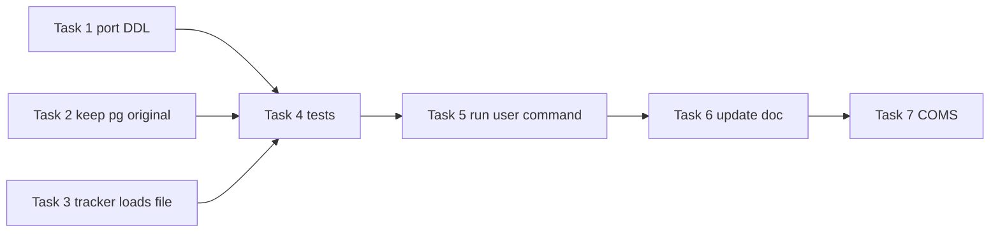

# Ship `docs/experiment_schema.sql` as a real, verifiable file — Implementation Plan

## What I measured before writing this (not assumed)

| Claim | Measured result |
|---|---|
| `docs/experiment_schema.sql` exists in this workspace | **No.** [`docs/`](docs) has no such file. |
| Where it does exist | [`../.kilo/worktrees/vanilla-handsaw/docs/experiment_schema.sql`](.kilo/worktrees/vanilla-handsaw/docs/experiment_schema.sql) — 152 lines, on branch `feat/profitability-scorecard-2026-11-24` |
| Dialect of that file | **Postgres.** `UUID`, `BIGSERIAL`, `JSONB`, `TIMESTAMPTZ`, `DOUBLE PRECISION`, `DEFAULT now()` |
| Table count in that file | **12** — `runs`, `run_params`, `market_events`, `signals`, `orders`, `fills`, `positions`, `portfolio_snapshots`, `risk_events`, `metrics`, `artifacts`, `mc_runs` |
| The tracker that claims to match it | [`../.kilo/worktrees/vanilla-handsaw/tools/experiment_tracker.py`](.kilo/worktrees/vanilla-handsaw/tools/experiment_tracker.py:23) defines only **5** tables — `runs`, `run_params`, `metrics`, `artifacts`, `mc_runs` |
| Doc that asserts they match | [`../.kilo/worktrees/vanilla-handsaw/docs/evaluation_harness.md:18`](.kilo/worktrees/vanilla-handsaw/docs/evaluation_harness.md:18) — "`tools/experiment_tracker.py` (SQLite, append-only) + `docs/experiment_schema.sql`" |
| Does the user's command currently pass? | **No.** The path does not exist here, so it raises `FileNotFoundError` before reaching `executescript`. |

I could not run the command to confirm the count — Architect mode has file tools only, no terminal. That is the first thing Code mode must do.

### The second, less obvious problem

Even after the file is copied here, the user's command will most likely still fail, and **not** because of the count. `executescript` parses the whole file, and SQLite rejects `DEFAULT now()` (it accepts only a literal, `CURRENT_TIMESTAMP`, or a parenthesised expression). Line 131 of the Postgres file is:

```sql
created_ts    TIMESTAMPTZ NOT NULL DEFAULT now(),
```

So a byte-for-byte copy of a Postgres file gives a `sqlite3.OperationalError`, not a table count. Copying is the wrong fix; porting is the right one.

### Why this matters beyond the one command

The `docs/evaluation_harness.md` contract says the schema file *is* the interface and the tracker *is* the implementation. Five tables vs twelve is not a cosmetic gap — `signals`, `orders`, `fills`, `positions`, `portfolio_snapshots`, `risk_events`, `market_events` are the entire audit trail for "same code path in every mode". The tracker silently cannot record what the contract says it records.

## Scope boundary (deliberate)

In scope: make `docs/experiment_schema.sql` exist, be SQLite-parseable, and be the single source of truth for the tracker; prove it with the user's exact command.

Out of scope, on purpose:
- No backfill of existing run databases (none are in this repo).
- No change to any verdict, tally, or metrics number. The settled `0 INVESTABLE / 11 NOT_INVESTABLE / 3 UNKNOWN (14 rows)` tally is untouched by this work.
- No wiring into `dashboard_generator` — the schema is a research-loop artifact, not a dashboard payload.

## Task 1 — Port the DDL to SQLite

Create [`docs/experiment_schema.sql`](docs/experiment_schema.sql) containing the same 12 tables, in the same order, with these mechanical substitutions only:

| Postgres | SQLite |
|---|---|
| `UUID PRIMARY KEY` | `TEXT PRIMARY KEY` |
| `BIGSERIAL PRIMARY KEY` | `INTEGER PRIMARY KEY AUTOINCREMENT` |
| `UUID REFERENCES runs(run_id)` | `TEXT REFERENCES runs(run_id)` |
| `BIGINT REFERENCES signals(signal_id)` | `INTEGER REFERENCES signals(signal_id)` |
| `TIMESTAMPTZ` | `TEXT` |
| `JSONB` | `TEXT` |
| `BLOB`/`DOUBLE PRECISION` | `REAL` |
| `DEFAULT now()` | `DEFAULT CURRENT_TIMESTAMP` |
| `BIGINT` | `INTEGER` |

Keep every `CHECK (...)` constraint verbatim — they are the part that actually encodes the contract (`run_type IN (...)`, `scope IN (...)`, `event_type IN (...)`, `direction IN (...)`, `side IN (...)`, `order_type IN (...)`, `status IN (...)`).

Do **not** use `AUTOINCREMENT` on more than the two tables that had `BIGSERIAL`, and note in a header comment that the file is the SQLite port of the Postgres original, so the count of 12 is the count of *logical* tables either way.

## Task 2 — Preserve the Postgres original

Copy the 152-line file unchanged to [`docs/experiment_schema.pg.sql`](docs/experiment_schema.pg.sql). Rationale: the Postgres version is the one that can actually enforce `JSONB` and `TIMESTAMPTZ`, and deleting it to make a test pass would be destroying evidence rather than fixing drift. This is the file to consult if a real DB is ever stood up.

## Task 3 — Make the tracker derive from the file

In [`../.kilo/worktrees/vanilla-handsaw/tools/experiment_tracker.py`](.kilo/worktrees/vanilla-handsaw/tools/experiment_tracker.py:23), the `SCHEMA` string literal duplicates five of the tables. Two copies of a schema always drift — this is exactly what happened.

Replace the literal with a loader:

```python
_SCHEMA_PATH = Path(__file__).resolve().parent.parent / "docs" / "experiment_schema.sql"

def load_schema() -> str:
    """Return the DDL from docs/experiment_schema.sql, the single source of truth."""
    return _SCHEMA_PATH.read_text(encoding="utf-8")
```

and have `init_db()` call `cx.executescript(load_schema())`. The existing five-table `INSERT`/`SELECT` paths keep working because all five tables still exist with compatible columns — except `created_ts`, which the tracker currently sets itself to `_now()` rather than relying on the default, so behaviour is unchanged.

Do not delete the tracker's write functions to "clean up". They are the append-only API and [`tests/test_experiment_tracker.py:34`](.kilo/worktrees/vanilla-handsaw/tests/test_experiment_tracker.py:34) asserts that no update/delete function exists.

## Task 4 — Tests

New file `tests/test_experiment_schema.py`:

1. `executescript` the real file into `:memory:` and assert the set of table names equals the exact 12.
2. Assert the count is 12 and that `sqlite_master` contains no `sqlite_`-internal noise skewing it (`type='table'` filter, matching the user's command).
3. Assert every table the tracker writes to (`runs`, `run_params`, `metrics`, `artifacts`, `mc_runs`) exists in the file's DDL — this is the drift assertion, and it fails against today's code.
4. Assert the file parses under `executescript` twice in a row only if `IF NOT EXISTS` is present; if it is not, document that re-running raises and do **not** add `IF NOT EXISTS` purely to make a test pass (the original Postgres file has bare `CREATE TABLE`). Pick one and state it in the test name.
5. Assert `tools/experiment_tracker.py` contains no `CREATE TABLE` literal — the duplication is what caused the drift, so the absence is the regression test.

Keep [`tests/test_experiment_tracker.py`](.kilo/worktrees/vanilla-handsaw/tests/test_experiment_tracker.py) passing unchanged.

## Task 5 — Run the user's exact command

```
python -c "import sqlite3,pathlib;db=sqlite3.connect(':memory:');db.executescript(pathlib.Path('docs/experiment_schema.sql').read_text());print(len([r for r in db.execute(\"select name from sqlite_master where type='table'\")]))"
```

Record the literal stdout in the update doc. If it prints something other than 12, the plan is not done — do not rationalise the number, find the extra or missing table.

## Task 6 — Document

`updates/2026-11-24-experiment-schema-port.md`: what was missing (file absent from this workspace), what the dialect problem was (`DEFAULT now()`), what the drift was (5 vs 12 tables against a doc that claimed parity), what changed, and the exact command output. Also note the file's provenance: ported from `feat/profitability-scorecard-2026-11-24` in the `vanilla-handsaw` worktree, not invented here.

## Task 7 — COMS

Post one durable, non-secret message:

- `mentions/all` (retained): the finding — schema file lives only on `feat/profitability-scorecard-2026-11-24`, is Postgres-flavoured, and the tracker has drifted to 5 of 12 tables.
- Our own inbox, so the reply is on the record.

Use the real client flags (`--agent --goal --todo --done --files --commits`); `--repos` and `--help` do not exist.

## Order and blocker handling



- **Blocker: Architect mode cannot write `.sql`.** This is the immediate one. Switch to Code mode first; everything else follows.
- **Blocker: the worktree is a different branch.** Task 3 edits a file in `.kilo/worktrees/vanilla-handsaw`, not the main checkout. Either do the port on a fresh branch off `main` in the main checkout (preferred — the user's command runs from the workspace root), or land the branch and cherry-pick. Do not push the peer's branch wholesale; it contains commits that are not mine.
- **Blocker: `git` push rejection.** `main` receives hourly bot commits. Rebase, then push; do not force.

## Definition of done

- `docs/experiment_schema.sql` exists and is SQLite-parseable.
- The user's exact command prints `12`.
- `tests/test_experiment_schema.py` fails on the pre-change tree and passes after.
- `tools/experiment_tracker.py` no longer contains its own `CREATE TABLE` block.
- One update doc, one COMS reply, no verdict or tally changed.
